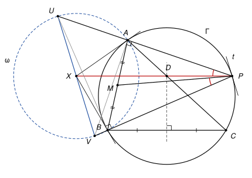

## Statement

Soit $ABC$ un triangle dont les trois angles sont aigus, avec $AB < AC$, et soit $\Gamma$ son cercle circonscrit.

La médiatrice du segment $[BC]$ coupe le segment $[AC]$ en un point $D$. La droite parallèle à $(BC)$ qui passe par $D$ coupe le cercle $\Gamma$ en un point $P$ situé sur le petit arc $AC$, celui qui ne contient pas $B$. Enfin, $M$ est le milieu du segment $[AB]$.

Montrer que $\widehat{APD} = \widehat{BPM}$.

![Le triangle ABC, son cercle circonscrit, la médiatrice de [BC] qui coupe [AC] en D, la parallèle à (BC) par D qui rencontre le cercle en P, et le milieu M de [AB]. Les deux angles à comparer sont marqués en P.](10281-figure-1.svg)

## Hints

1. Notez $X$ le point où se coupent les tangentes à $\Gamma$ en $A$ et en $B$. Calculez $\widehat{ADB}$ et $\widehat{AXB}$ en fonction de l'angle $\widehat{ACB}$. Que peut-on dire des points $A$, $D$, $B$, $X$ ?
2. Déduisez-en que $(DX)$ est parallèle à $(BC)$. Le point $X$ est donc sur la droite $(PD)$, et il reste à montrer que $\widehat{APX} = \widehat{BPM}$.
3. Tracez la parallèle à la tangente en $P$ qui passe par $X$. Elle coupe $(PA)$ en $U$ et $(PB)$ en $V$. Montrez que $XU = XA$ et $XV = XB$ : le point $X$ est le milieu de $[UV]$.
4. Montrez que les triangles $PUV$ et $PBA$ sont semblables, puis comparez leurs médianes issues de $P$.

## Solution

*Rappels.*

- *Angle inscrit.* Deux angles inscrits qui interceptent la même corde, avec leurs sommets du même côté de cette corde, sont égaux. Si deux points $D$ et $X$ sont de part et d'autre d'une droite $(AB)$ et si $\widehat{ADB} + \widehat{AXB} = 180°$, alors $A$, $D$, $B$, $X$ sont sur un même cercle.
- *Angle entre une tangente et une corde.* L'angle entre la tangente en $A$ et la corde $[AP]$ est égal à l'angle inscrit $\widehat{ABP}$, pour $B$ sur l'arc situé de l'autre côté de la corde. De l'autre côté de la tangente, on trouve le supplément $180° - \widehat{ABP}$.
- *Angle entre deux droites.* Deux droites sécantes font entre elles un angle aigu ou droit $\varphi$ et son supplément $180° - \varphi$. Nous appellerons $\varphi$ « l'angle des deux droites ». Le rappel précédent dit alors simplement : l'angle des droites (tangente en $A$) et $(AP)$ est égal à l'angle des droites $(BA)$ et $(BP)$, sans se soucier des côtés.

On note $\gamma = \widehat{ACB}$, qui est un angle aigu.

**Étape 1 : le point $X$.** Comme $\gamma < 90°$, le petit arc $AB$ est celui qui ne contient pas $C$, et les tangentes en $A$ et en $B$ se coupent en un point $X$ situé de l'autre côté de $(AB)$ que $C$. Les deux segments de tangente sont égaux : $XA = XB$. D'après le rappel sur la tangente, $\widehat{XAB} = \widehat{XBA} = \gamma$, donc

$$\widehat{AXB} = 180° - 2\gamma.$$

**Étape 2 : $A$, $D$, $B$, $X$ sont cocycliques.** Le point $D$ est sur la médiatrice de $[BC]$, donc $DB = DC$ et le triangle $DBC$ est isocèle : $\widehat{DBC} = \widehat{DCB} = \gamma$. Comme $D$ est sur le segment $[AC]$, l'angle $\widehat{ADB}$ est l'angle extérieur en $D$ du triangle $DBC$ :

$$\widehat{ADB} = \widehat{DBC} + \widehat{DCB} = 2\gamma.$$

Le point $D$ est du côté de $C$ par rapport à $(AB)$, et $X$ de l'autre côté. Comme $\widehat{ADB} + \widehat{AXB} = 2\gamma + (180° - 2\gamma) = 180°$, les points $A$, $D$, $B$, $X$ sont sur un même cercle, où ils se suivent dans cet ordre : le quadrilatère $ADBX$ est convexe.

**Étape 3 : $X$ est sur la droite $(PD)$.** Dans ce cercle, les angles inscrits $\widehat{BDX}$ et $\widehat{BAX}$ interceptent la corde $[BX]$, avec $D$ et $A$ du même côté. Donc

$$\widehat{BDX} = \widehat{BAX} = \gamma = \widehat{DBC}.$$

La droite $(BD)$ porte un côté du quadrilatère convexe $ADBX$, donc $X$ est du même côté de $(BD)$ que $A$, c'est-à-dire de l'autre côté que $C$. Les angles égaux $\widehat{BDX}$ et $\widehat{DBC}$ sont donc alternes-internes, et $(DX) \parallel (BC)$. Comme $(DP)$ est elle aussi parallèle à $(BC)$ et passe par $D$, les points $P$, $D$, $X$ sont alignés.

Plaçons ces points sur la droite. Les diagonales $[AB]$ et $[DX]$ du quadrilatère convexe se coupent en un point $N$, qui est sur le segment $[AB]$, donc à l'intérieur du disque, tout comme $D$. Le segment $[ND]$ est donc tout entier à l'intérieur du disque, et le point $P$, qui est sur le cercle, ne s'y trouve pas. Enfin $P$ et $D$ sont du même côté de $(AB)$ alors que $X$ est de l'autre. Sur la droite, l'ordre est donc $X$, $N$, $D$, $P$, et vus depuis $P$, les points $D$ et $X$ sont dans la même direction :

$$\widehat{APD} = \widehat{APX}.$$

Il reste à montrer que $\widehat{APX} = \widehat{BPM}$.

**Étape 4 : $X$ est le milieu d'un segment $[UV]$.** Soit $t$ la tangente à $\Gamma$ en $P$, et $d$ la parallèle à $t$ qui passe par $X$. Elle coupe $(PA)$ en $U$ et $(PB)$ en $V$.

Dans le triangle $XAU$, comparons les angles des droites en $U$ et en $A$.

- En $U$ : les droites $d$ et $t$ sont parallèles, donc l'angle des droites $d$ et $(PA)$ est celui des droites $t$ et $(PA)$, c'est-à-dire, par le rappel appliqué à la tangente en $P$, l'angle des droites $(BP)$ et $(BA)$.
- En $A$ : la droite $(XA)$ est la tangente en $A$, donc l'angle des droites $(XA)$ et $(AP)$ est aussi l'angle des droites $(BA)$ et $(BP)$.

Appelons $\varphi$ cet angle commun. L'angle du triangle en $U$ vaut $\varphi$ ou $180° - \varphi$, et de même en $A$. Deux angles d'un triangle ont une somme inférieure à $180°$, ce qui exclut $\varphi$ et $180° - \varphi$ ensemble, et aussi deux fois $180° - \varphi$. Les deux angles valent donc $\varphi$ : le triangle $XAU$ est isocèle en $X$ et $XU = XA$.

(Ce triangle n'est pas aplati : si $U$ était égal à $A$, la tangente en $A$ serait la droite $d$, parallèle à $t$. Deux tangentes parallèles touchent le cercle aux deux bouts d'un diamètre, donc $[AP]$ serait un diamètre et $\widehat{ABP}$ vaudrait $90°$. Or $\widehat{ABP} < \widehat{ABC} < 90°$, puisque $P$ est sur l'arc $AC$ qui ne contient pas $B$.)

Le même raisonnement dans le triangle $XBV$, avec cette fois l'angle des droites $(AB)$ et $(AP)$, donne $XV = XB$. (Si $V = B$, il n'y a rien à démontrer.)

Ainsi $XU = XV = XA = XB$. Les points $U$ et $V$ sont distincts : un point commun à $(PA)$ et $(PB)$ ne peut être que $P$, et si $d$ passait par $P$ ce serait la tangente $t$, ce qui donnerait une troisième tangente au cercle issue de $X$. Le point $X$ est donc le milieu de $[UV]$, et les quatre points $A$, $B$, $U$, $V$ sont sur le cercle $\omega$ de centre $X$ et de diamètre $[UV]$.

**Étape 5 : deux angles droits.** Le point $A$ est sur le cercle de diamètre $[UV]$, donc $\widehat{UAV} = 90°$ : la droite $(AV)$ est perpendiculaire à $(PA)$. De même $(BU)$ est perpendiculaire à $(PB)$. (Dans le cas particulier $V = B$, la droite $(BU)$ est $d$, parallèle à $t$, et $t$ est perpendiculaire au diamètre $[PB]$.)

L'angle $\widehat{APB}$ est un angle inscrit qui intercepte la corde $[AB]$, du même côté que $C$, donc $\widehat{APB} = \gamma < 90°$. Dans le triangle $PAV$, rectangle en $A$, l'angle en $P$ est aigu. Il vaut donc $\gamma$ et non $180° - \gamma$, ce qui veut dire que $V$ est sur la demi-droite $[PB)$. De même $U$ est sur la demi-droite $[PA)$.

Les triangles $PAV$ et $PBU$ sont rectangles, en $A$ et en $B$, et ont le même angle $\gamma$ en $P$. Ils sont semblables, donc

$$\frac{PA}{PV} = \frac{PB}{PU}, \qquad \text{c'est-à-dire} \qquad \frac{PU}{PB} = \frac{PV}{PA}.$$

**Étape 6 : deux triangles semblables.** Les triangles $PUV$ et $PBA$ ont le même angle en $P$, puisque $U$ est sur $[PA)$ et $V$ sur $[PB)$, et les côtés qui l'encadrent sont proportionnels d'après l'étape 5. Ils sont donc semblables, $U$ correspondant à $B$ et $V$ à $A$. En particulier

$$\widehat{PUV} = \widehat{PBA} \qquad \text{et} \qquad \frac{UV}{BA} = \frac{PU}{PB}.$$

**Étape 7 : les médianes.** Comparons les triangles $PUX$ et $PBM$. Comme $X$ est sur $[UV]$ et $M$ sur $[BA]$, on a $\widehat{PUX} = \widehat{PUV} = \widehat{PBA} = \widehat{PBM}$. Comme $X$ et $M$ sont des milieux,

$$\frac{UX}{BM} = \frac{UV/2}{BA/2} = \frac{UV}{BA} = \frac{PU}{PB}.$$

Les deux triangles ont un angle égal compris entre des côtés proportionnels : ils sont semblables, et $\widehat{UPX} = \widehat{BPM}$. Comme $U$ est sur la demi-droite $[PA)$, $\widehat{UPX} = \widehat{APX}$.

**Conclusion.** Avec l'étape 3,

$$\widehat{APD} = \widehat{APX} = \widehat{BPM}.$$

*Remarques.*

- Les étapes 4 à 7 démontrent un résultat classique : dans un triangle $PAB$ inscrit dans un cercle, la droite qui joint $P$ au point de rencontre des tangentes en $A$ et en $B$ fait avec $(PA)$ le même angle que la médiane $(PM)$ avec $(PB)$. Cette droite s'appelle la *symédiane* issue de $P$.
- Dans la configuration de l'énoncé, $U$ tombe toujours au-delà de $A$, mais $V$ tombe tantôt entre $P$ et $B$, tantôt au-delà de $B$. C'est pour cela que la preuve de l'étape 4 compare des angles de droites et non des angles de triangles précis : elle marche dans les deux cas sans les séparer.

## Going further

1. Le corrigé officiel propose une autre voie pour la deuxième moitié. Soit $P'$ le symétrique de $P$ par rapport à $M$, de sorte que $APBP'$ est un parallélogramme. Montrer que $\widehat{BPM} = \widehat{PP'A}$, puis chercher à démontrer l'égalité voulue par une chasse aux angles.
2. Soit $Q$ le second point d'intersection de $(PX)$ avec $\Gamma$. En comparant les triangles $XAQ$ et $XPA$, montrer que $\frac{AQ}{AP} = \frac{XA}{XP}$, puis que $AQ \times PB = BQ \times PA$.
