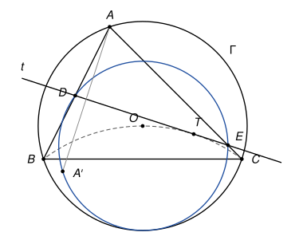
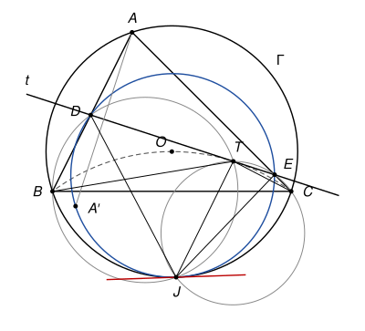

## Statement

Soit $ABC$ un triangle, $\Gamma$ son cercle circonscrit et $O$ le centre de $\Gamma$. Soit $t$ une droite tangente au cercle circonscrit au triangle $BCO$. La droite $t$ coupe les droites $(AB)$ et $(AC)$ en $D$ et $E$, et on note $A'$ le symétrique de $A$ par rapport à $t$.

Montrer que le cercle circonscrit au triangle $DEA'$ est tangent au cercle $\Gamma$.

## Hints

1. Notez $T$ le point de contact de $t$. Les cercles circonscrits aux triangles $BDT$ et $CET$ se recoupent en un point $J$. Montrez que $J$ est sur $\Gamma$, en calculant $\widehat{BJC}$.
2. Montrez que $\widehat{DJE} = \widehat{BAC}$. Pour cela, servez-vous de $\widehat{BTC} = \widehat{BOC} = 2\,\widehat{BAC}$. En déduire que $J$ est sur le cercle $DEA'$.
3. Il reste à voir que les cercles $\Gamma$ et $DEJ$ ont la même tangente en $J$. Utilisez cette fois que $t$ est tangente au cercle $BCT$ : $\widehat{BTD} = \widehat{BCT}$.

## Solution

*Rappels.*

- *Angle inscrit.* Deux angles inscrits qui interceptent la même corde sont égaux si leurs sommets sont du même côté de la corde, et supplémentaires s'ils sont de part et d'autre. Réciproquement, si $\widehat{XMY} = \widehat{XNY}$ avec $M$, $N$ du même côté de $(XY)$, ou $\widehat{XMY} + \widehat{XNY} = 180°$ avec $M$, $N$ de part et d'autre, les points $X$, $Y$, $M$, $N$ sont cocycliques.
- *Angle au centre.* Si l'angle inscrit $\widehat{BAC}$ est aigu, l'angle au centre vaut $\widehat{BOC} = 2\,\widehat{BAC}$.
- *Angle entre une tangente et une corde, et sa réciproque.* Une droite qui passe par un point $X$ d'un cercle est tangente en $X$ si et seulement si elle fait avec une corde $[XY]$ un angle égal à l'angle inscrit $\widehat{XZY}$, où $Z$ est un point du cercle situé de l'autre côté de la corde.

*La disposition.* Nous traitons la disposition de la figure, qui est aussi celle du corrigé officiel : le triangle $ABC$ a ses trois angles aigus, et le point de contact $T$ de la droite $t$ est à l'intérieur du triangle. Les points $B$ et $C$ sont sur le cercle $BCO$, donc du même côté de sa tangente $t$. La droite $t$ ne coupe donc pas $[BC]$, et elle sort du triangle par les côtés $[AB]$ et $[AC]$ : $D$ est sur $[AB]$, $E$ sur $[AC]$, et $T$ est entre $D$ et $E$. Les autres positions de $t$ se traitent par le même calcul, où certains angles sont remplacés par leurs suppléments.

On note $\alpha = \widehat{BAC}$, $\beta = \widehat{ABC}$, $\gamma = \widehat{ACB}$.

**Étape 1 : le point $J$ est sur $\Gamma$.** Les cercles circonscrits aux triangles $BDT$ et $CET$ passent tous deux par $T$. Soit $J$ leur second point commun. Sur la figure, $J$ est sous la droite $(BC)$.

Dans le cercle $BDTJ$, les points $D$ et $J$ sont de part et d'autre de la corde $[BT]$, donc $\widehat{BJT} = 180° - \widehat{BDT}$. Comme $D$ est entre $A$ et $B$, et $T$ sur $[DE]$, on a $\widehat{BDT} = 180° - \widehat{ADE}$. Ainsi $\widehat{BJT} = \widehat{ADE}$. De même, dans le cercle $CETJ$, $\widehat{TJC} = \widehat{AED}$. Le point $T$ est à l'intérieur de l'angle $\widehat{BJC}$, donc

$$\widehat{BJC} = \widehat{BJT} + \widehat{TJC} = \widehat{ADE} + \widehat{AED} = 180° - \alpha.$$

Les points $J$ et $A$ sont de part et d'autre de $(BC)$, et $\widehat{BJC} + \widehat{BAC} = 180°$ : le point $J$ est sur $\Gamma$. (C'est le théorème de Miquel pour le triangle $ADE$ et les points $B$, $C$, $T$ pris sur ses côtés.)

**Étape 2 : le point $J$ est sur le cercle $DEA'$.** Dans le cercle $BDTJ$, les points $B$ et $J$ sont du même côté de la corde $[DT]$, donc $\widehat{DJT} = \widehat{DBT}$. De même $\widehat{TJE} = \widehat{TCE}$. Comme $T$ est à l'intérieur du triangle, la demi-droite $[BT)$ est à l'intérieur de l'angle $\widehat{ABC}$, et $[CT)$ à l'intérieur de l'angle $\widehat{ACB}$ :

$$\widehat{DBT} = \beta - \widehat{TBC}, \qquad \widehat{TCE} = \gamma - \widehat{TCB}.$$

Dans le triangle $TBC$, $\widehat{TBC} + \widehat{TCB} = 180° - \widehat{BTC}$. Les points $T$ et $O$ sont sur le cercle $BCO$, du même côté de $(BC)$, donc $\widehat{BTC} = \widehat{BOC} = 2\alpha$ par le rappel sur l'angle au centre. Le point $T$ est à l'intérieur de l'angle $\widehat{DJE}$, donc

$$\widehat{DJE} = \widehat{DJT} + \widehat{TJE} = (\beta + \gamma) - (180° - 2\alpha) = (180° - \alpha) - 180° + 2\alpha = \alpha.$$

D'autre part, la symétrie d'axe $t = (DE)$ échange $A$ et $A'$ et fixe $D$ et $E$, donc $\widehat{DA'E} = \widehat{DAE} = \alpha$. Les points $J$ et $A'$ sont du même côté de $(DE)$, et $\widehat{DJE} = \widehat{DA'E}$ : les quatre points $D$, $E$, $A'$, $J$ sont cocycliques. Le cercle circonscrit au triangle $DEA'$ est donc le cercle $\omega$ qui passe par $D$, $E$ et $J$.

Remarquons que la tangence de $t$ n'a pas encore servi : jusqu'ici, il suffisait que $T$ soit sur le cercle $BCO$.

**Étape 3 : la tangence.** Les cercles $\Gamma$ et $\omega$ passent tous deux par $J$. Ils sont tangents en $J$ s'ils ont la même tangente en ce point.

Soit $\ell$ la tangente à $\Gamma$ en $J$, et $L$ un point de $\ell$ situé de l'autre côté de $(JB)$ que $C$. D'après le rappel sur la tangente, appliqué à la corde $[JB]$ de $\Gamma$,

$$\widehat{LJB} = \widehat{JCB}.$$

Calculons maintenant $\widehat{JED}$, angle inscrit de $\omega$.

- Comme $T$ est entre $D$ et $E$, $\widehat{JED} = \widehat{JET}$. Dans le cercle $CETJ$, les points $E$ et $C$ sont du même côté de la corde $[JT]$, donc $\widehat{JET} = \widehat{JCT}$.
- La demi-droite $[CB)$ est à l'intérieur de l'angle $\widehat{JCT}$, donc $\widehat{JCT} = \widehat{JCB} + \widehat{BCT}$.
- C'est ici que sert la tangence : $t$ est tangente en $T$ au cercle $BCT$, et $C$ est de l'autre côté de la corde $[TB]$ que $D$, donc $\widehat{BCT} = \widehat{BTD}$.
- Enfin, dans le cercle $BDTJ$, les points $T$ et $J$ sont du même côté de la corde $[BD]$, donc $\widehat{BTD} = \widehat{BJD}$.

Ainsi $\widehat{JED} = \widehat{JCB} + \widehat{BJD} = \widehat{LJB} + \widehat{BJD}$. La demi-droite $[JB)$ est à l'intérieur de l'angle $\widehat{LJD}$, donc

$$\widehat{LJD} = \widehat{LJB} + \widehat{BJD} = \widehat{JED}.$$

**Conclusion.** La droite $\ell$ passe par le point $J$ de $\omega$ et fait avec la corde $[JD]$ un angle égal à l'angle inscrit $\widehat{JED}$, le point $E$ étant de l'autre côté de $(JD)$ que $L$. D'après la réciproque du rappel, $\ell$ est aussi tangente à $\omega$ en $J$. Les cercles $\Gamma$ et $\omega$ ont la même tangente en leur point commun $J$ : **le cercle circonscrit au triangle $DEA'$ est tangent à $\Gamma$ en $J$**.

*Remarques.*

- Toutes les positions relatives utilisées (l'ordre des points sur chaque cercle, les côtés des cordes, les demi-droites à l'intérieur des angles) se lisent sur la figure, et elles restent vraies tant que le triangle a ses angles aigus et que $T$ est à l'intérieur du triangle. Une vérification numérique sur plusieurs milliers de triangles et de tangentes le confirme. Dans cette disposition, le cercle $DEA'$ est à l'intérieur de $\Gamma$.
- Le corrigé officiel trouve le même point $J$, puis conclut par une inversion de centre $J$ : après inversion, les deux cercles deviennent deux droites parallèles.

## Going further

1. Montrer que le résultat de l'étape 2 reste vrai pour n'importe quel point $T$ du cercle $BCO$ et n'importe quelle droite passant par $T$ : le cercle $DEA'$ passe toujours par le point $J$ de $\Gamma$.
2. On suppose que $t$ est parallèle à $(BC)$ et coupe les côtés $[AB]$ et $[AC]$. Montrer que le point de contact $T$ est alors le point $O$, puis que $J$ est le second point d'intersection de $\Gamma$ avec la hauteur issue de $A$. (Montrer d'abord que $\widehat{BJO} = \widehat{ABC}$.)
