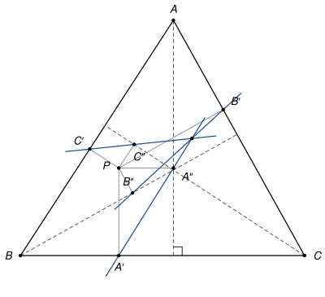

## Statement

Soit $ABC$ un triangle et $P$ un point du plan, distinct des pieds des trois hauteurs.

On note $A'$ et $A''$ les projetés orthogonaux de $P$ sur la droite $(BC)$ et sur la hauteur issue de $A$. On définit de même $B'$ et $B''$, projetés de $P$ sur $(CA)$ et sur la hauteur issue de $B$, puis $C'$ et $C''$, projetés de $P$ sur $(AB)$ et sur la hauteur issue de $C$.

Montrer que les droites $(A'A'')$, $(B'B'')$ et $(C'C'')$ sont concourantes ou parallèles.

## Hints

1. Notez $D$ le pied de la hauteur issue de $A$. Le quadrilatère $PA'DA''$ est un rectangle. Où est le milieu de $[A'A'']$ ? Que devient la droite $(A'A'')$ par l'homothétie de centre $P$ et de rapport $2$ ?
2. Notez $P_a$ le symétrique de $P$ par rapport à la hauteur $(AD)$. Montrez que l'image de $(A'A'')$ dans l'indication 1 est la droite $(DP_a)$.
3. Soient $E$ et $F$ les pieds des deux autres hauteurs. La hauteur $(AD)$ est la bissectrice de l'angle $\widehat{EDF}$. Notez $Y$ et $Z$ les symétriques de $P$ par rapport à $(FD)$ et à $(DE)$, et montrez que $(DP_a)$ est la médiatrice de $[YZ]$.

## Solution

*Rappels.*

- *Symétrie axiale.* Une symétrie axiale conserve les distances, les milieux et l'orthogonalité. Par conséquent, si $N$ est le symétrique de $M$ par rapport à une droite $\delta$, et si $s$ est une symétrie axiale quelconque, alors $s(N)$ est le symétrique de $s(M)$ par rapport à la droite $s(\delta)$.
- *Médiatrice.* Un point à égale distance de deux points distincts $Y$ et $Z$ est sur la médiatrice de $[YZ]$. Les trois médiatrices d'un triangle se coupent au centre de son cercle circonscrit.
- *Homothétie.* L'homothétie $h$ de centre $P$ et de rapport $\frac{1}{2}$ envoie chaque point $M$ sur le milieu de $[PM]$. Elle envoie une droite sur une droite parallèle.
- *Cercle de diamètre $[XY]$.* Un point $M$ tel que $\widehat{XMY} = 90°$ est sur le cercle de diamètre $[XY]$.

On note $D$, $E$, $F$ les pieds des hauteurs issues de $A$, $B$, $C$, et $\alpha = \widehat{BAC}$.

*Le cas d'un triangle rectangle.* Si le triangle est rectangle en $A$, alors $E = F = A$. La hauteur issue de $B$ est la droite $(BA)$ et celle issue de $C$ est la droite $(CA)$. Donc $B' = C''$ (le projeté de $P$ sur $(CA)$) et $B'' = C'$ (le projeté de $P$ sur $(AB)$) : les droites $(B'B'')$ et $(C'C'')$ sont la même droite, et le résultat est évident.

*La disposition.* Nous traitons maintenant le cas d'un triangle dont les trois angles sont aigus. Le cas d'un angle obtus est expliqué dans les remarques. Le point $P$, lui, est quelconque. Les pieds $D$, $E$, $F$ sont alors à l'intérieur des côtés $[BC]$, $[CA]$, $[AB]$, et l'orthocentre $H$ est à l'intérieur du triangle. Les points $D$, $E$, $F$ ne sont pas alignés, car une droite ne peut pas couper les trois côtés d'un triangle en des points intérieurs.

**Étape 1 : la hauteur $(AD)$ est la bissectrice de l'angle $\widehat{EDF}$.** Les angles $\widehat{BFH}$ et $\widehat{BDH}$ sont droits, donc $F$ et $D$ sont sur le cercle de diamètre $[BH]$. Dans ce cercle, $D$ et $B$ sont du même côté de la corde $[FH]$, qui est portée par la hauteur $(CF)$, donc

$$\widehat{FDH} = \widehat{FBH} = \widehat{ABE} = 90° - \alpha,$$

la dernière égalité venant du triangle $ABE$, rectangle en $E$. De même, $E$ et $D$ sont sur le cercle de diamètre $[CH]$, et $\widehat{EDH} = \widehat{ECH} = \widehat{ACF} = 90° - \alpha$. Comme $H$ est sur $[AD]$, on obtient $\widehat{FDA} = \widehat{EDA}$. Enfin $F$ et $E$ sont de part et d'autre de $(AD)$ (du côté de $B$ et du côté de $C$). La symétrie $\sigma_a$ d'axe $(AD)$ échange donc les demi-droites $[DF)$ et $[DE)$, et elle échange les droites $(DF)$ et $(DE)$.

De même, la symétrie d'axe $(BE)$ échange les droites $(ED)$ et $(EF)$, et la symétrie d'axe $(CF)$ échange les droites $(FE)$ et $(FD)$.

**Étape 2 : trois médiatrices.** Notons $X$, $Y$, $Z$ les symétriques de $P$ par rapport aux droites $(EF)$, $(FD)$, $(DE)$, et $P_a = \sigma_a(P)$ le symétrique de $P$ par rapport à $(AD)$. Montrons que **la droite $(DP_a)$ est la médiatrice de $[YZ]$**.

- Le point $D$ est sur les deux droites $(FD)$ et $(DE)$, donc $DY = DP = DZ$.
- La symétrie $\sigma_a$ envoie la droite $(FD)$ sur $(DE)$. D'après le premier rappel, $\sigma_a(Y)$ est le symétrique de $\sigma_a(P) = P_a$ par rapport à $(DE)$. Notons-le $Y_1$. Comme $\sigma_a$ conserve les distances, $P_aY = \sigma_a(P_a)\,\sigma_a(Y) = P\,Y_1$. La symétrie d'axe $(DE)$ conserve aussi les distances, et elle échange $P$ et $Z$, ainsi que $P_a$ et $Y_1$. Donc $P\,Y_1 = Z\,P_a$. Finalement $P_aY = P_aZ$.
- Les points $Y$ et $Z$ sont distincts. Sinon, comme $P \neq D$, le point $P$ n'est pas sur les deux droites à la fois, donc $P \neq Y$, et le segment $[PY]$ serait perpendiculaire à $(FD)$ et à $(DE)$, avec son milieu sur ces deux droites, c'est-à-dire en $D$. Les droites $(FD)$ et $(DE)$ seraient alors toutes deux la perpendiculaire à $(PY)$ passant par $D$, ce qui est faux.
- Enfin $P_a \neq D$ puisque $P \neq D$.

Les deux points distincts $D$ et $P_a$ sont à égale distance de $Y$ et de $Z$ : la droite $(DP_a)$ est la médiatrice de $[YZ]$.

De la même façon, avec $P_b$ et $P_c$ les symétriques de $P$ par rapport aux hauteurs $(BE)$ et $(CF)$, la droite $(EP_b)$ est la médiatrice de $[ZX]$ et la droite $(FP_c)$ est la médiatrice de $[XY]$. En particulier, $X$, $Y$, $Z$ sont trois points distincts.

**Étape 3 : retour aux droites de l'énoncé.** Les droites $(BC)$ et $(AD)$ sont perpendiculaires en $D$, et $A'$, $A''$ sont les projetés de $P$ sur ces deux droites. Donc $\overrightarrow{DA'} + \overrightarrow{DA''} = \overrightarrow{DP}$ : le quadrilatère $PA'DA''$ est un rectangle, éventuellement aplati si $P$ est sur l'une des deux droites, et ses diagonales $[PD]$ et $[A'A'']$ ont le même milieu $K$.

Appliquons l'homothétie $h$ de centre $P$ et de rapport $\frac{1}{2}$ :

- $h(D)$ est le milieu de $[PD]$, c'est-à-dire $K$ ;
- $h(P_a)$ est le milieu de $[PP_a]$. Comme $P_a$ est le symétrique de $P$ par rapport à $(AD)$, ce milieu est le projeté de $P$ sur $(AD)$, c'est-à-dire $A''$.

Donc $h$ envoie la droite $(DP_a)$ sur la droite $(KA'')$, qui est la droite $(A'A'')$ puisque $K$ est le milieu de $[A'A'']$. (Les points $K$ et $A''$ sont distincts, sinon $A' = A''$, ce qui forcerait $P = D$.) De même, $h$ envoie $(EP_b)$ sur $(B'B'')$ et $(FP_c)$ sur $(C'C'')$.

![Le triangle DEF des pieds des hauteurs, les symétriques X, Y, Z de P par rapport à ses côtés, le cercle de centre Q qui passe par X, Y et Z, et en rouge les droites (DQ), (EQ), (FQ). Le point N est le milieu de [PQ].](10286-figure-2.svg)

**Conclusion.** Deux cas se présentent.

- Si $X$, $Y$, $Z$ ne sont pas alignés, les trois médiatrices du triangle $XYZ$ se coupent au centre $Q$ de son cercle circonscrit. Les droites $(DP_a)$, $(EP_b)$, $(FP_c)$ passent donc toutes par $Q$, et leurs images $(A'A'')$, $(B'B'')$, $(C'C'')$ passent toutes par $h(Q)$, le milieu $N$ de $[PQ]$. **Les trois droites sont concourantes en $N$.**
- Si $X$, $Y$, $Z$ sont alignés sur une droite $d$, les trois médiatrices sont perpendiculaires à $d$, donc parallèles entre elles, et leurs images par $h$ aussi. **Les trois droites sont parallèles.**

*Remarques.*

- Si le triangle a un angle obtus, une chasse aux angles du même genre montre que chaque hauteur est encore une bissectrice, intérieure ou extérieure, de l'angle correspondant du triangle $DEF$. Dans les deux cas, la symétrie par rapport à cette hauteur échange les deux côtés de l'angle, et c'est la seule chose qu'utilisent les étapes 2 et 3. La preuve reste donc valable. Une vérification numérique sur plusieurs milliers de triangles, aigus et obtus, le confirme.
- Le second cas arrive vraiment : les points $X$, $Y$, $Z$ sont alignés exactement quand $P$ est sur le cercle qui passe par $D$, $E$ et $F$ (voir « Pour aller plus loin »). L'énoncé officiel l'oublie et affirme que les droites sont toujours concourantes.
- Le point $Q$ s'appelle le *conjugué isogonal* de $P$ dans le triangle $DEF$ : les droites $(DQ)$ et $(DP)$ sont symétriques par rapport à la bissectrice $(AD)$, et de même aux deux autres sommets. Le corrigé officiel utilise directement cette notion.

## Going further

1. On note $U$, $V$, $W$ les projetés de $P$ sur les droites $(EF)$, $(FD)$, $(DE)$. Montrer que $X$, $Y$, $Z$ sont alignés si et seulement si $U$, $V$, $W$ le sont. Un théorème classique, celui de la droite de Simson, dit que $U$, $V$, $W$ sont alignés exactement quand $P$ est sur le cercle circonscrit au triangle $DEF$. Essayer de le démontrer avec des angles inscrits, en utilisant les cercles de diamètres $[PD]$, $[PE]$, $[PF]$.
2. Le cercle circonscrit au triangle $DEF$ passe aussi par les milieux des côtés de $ABC$ : c'est le cercle d'Euler. En déduire que les trois droites de l'énoncé sont parallèles quand $P$ est le milieu de $[BC]$, et le vérifier sur une figure.
