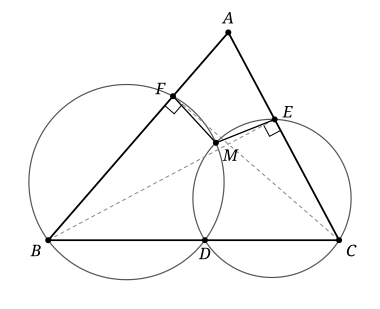

## Statement

Soit $ABC$ un triangle dont les trois angles sont aigus, avec $AB \neq AC$. On note $D$ le pied de la bissectrice issue de $A$ : c'est le point où la bissectrice de l'angle $\widehat{BAC}$ coupe le segment $[BC]$. On note $E$ le pied de la hauteur issue de $B$, et $F$ le pied de la hauteur issue de $C$.

Le cercle qui passe par $D$, $B$ et $F$ et le cercle qui passe par $D$, $C$ et $E$ se coupent en $D$ et en un second point $M$.

Montrer que $ME = MF$.

## Hints

1. Ajoutez la bissectrice $[AD]$ à la figure. Que remarquez-vous ?
2. Montrez que $AF \times AB = AE \times AC$.
3. Si une droite passant par un point $P$ coupe un cercle en $U$ et $V$, le produit $PU \times PV$ ne dépend que de $P$ et du cercle, pas de la droite choisie. Démontrez-le avec le théorème de Pythagore, puis utilisez-le pour montrer que $M$ est sur $[AD]$.
4. Comparez le triangle $AMF$ au triangle $ABD$, et le triangle $AME$ au triangle $ACD$. Pour finir, montrez que $BD/AB = CD/AC$ en calculant de deux façons les aires des triangles $ABD$ et $ACD$.

## Solution

On note $\alpha = \widehat{BAC}$. On appelle $\Gamma_1$ le cercle qui passe par $D$, $B$, $F$, de centre $O_1$ et de rayon $R_1$, et $\Gamma_2$ le cercle qui passe par $D$, $C$, $E$, de centre $O_2$ et de rayon $R_2$. L'idée est de montrer que $M$ est sur la bissectrice $[AD]$, puis de comparer des triangles.

**Un outil : la puissance d'un point.** Soit un cercle de centre $O$ et de rayon $R$, et $P$ un point. Une droite passant par $P$ coupe le cercle en deux points $U$ et $V$, éventuellement confondus si la droite est tangente au cercle. Soit $H$ le pied de la perpendiculaire à cette droite passant par $O$. D'après le théorème de Pythagore,

$$OP^2 = OH^2 + HP^2 , \qquad R^2 = OU^2 = OH^2 + HU^2 = OV^2 = OH^2 + HV^2 .$$

Donc $HU = HV$ : le point $H$ est le milieu de $[UV]$. En soustrayant, on obtient $OP^2 - R^2 = HP^2 - HU^2$. On en tire deux conséquences.

- Si $P$ n'est pas sur le segment $[UV]$, alors $HP \geqslant HU$, et les distances de $P$ à $U$ et à $V$ valent $HP + HU$ et $HP - HU$. Donc $PU \times PV = HP^2 - HU^2 = OP^2 - R^2$.
- Si $OP > R$, alors $HP > HU$ : le point $P$ n'est pas sur le segment $[UV]$, et $U$ et $V$ sont du même côté de $P$ sur la droite.

**Étape 1 : $AF \times AB = AE \times AC$.** Les angles du triangle sont aigus, donc $E$ est sur le segment $[AC]$ et $F$ sur le segment $[AB]$, distincts des sommets. Le triangle $ABE$ est rectangle en $E$, donc $AE = AB \cos \alpha$. Le triangle $ACF$ est rectangle en $F$, donc $AF = AC \cos \alpha$. Ainsi

$$AF \times AB = AE \times AC = AB \times AC \cos \alpha .$$

Notons $k$ ce nombre ; il est strictement positif.

**Étape 2 : la droite $(AD)$ recoupe les deux cercles au même point.** La droite $(AB)$ coupe $\Gamma_1$ en $F$ et en $B$, et $A$ n'est pas sur le segment $[FB]$, puisque $F$ est entre $A$ et $B$. D'après l'outil, $O_1A^2 - R_1^2 = AF \times AB = k > 0$. De même, avec la droite $(AC)$, qui coupe $\Gamma_2$ en $E$ et $C$, on a $O_2A^2 - R_2^2 = AE \times AC = k$.

La droite $(AD)$ passe par le point $D$ de $\Gamma_1$. Elle recoupe $\Gamma_1$ en un point $N_1$ (avec $N_1 = D$ si elle est tangente) : c'est le symétrique de $D$ par rapport au pied $H_1$ de la perpendiculaire à $(AD)$ passant par $O_1$. Comme $O_1A > R_1$, l'outil montre que $N_1$ est du même côté de $A$ que $D$, et que $AN_1 \times AD = k$.

De même, $(AD)$ recoupe $\Gamma_2$ en un point $N_2$, du même côté de $A$ que $D$, avec $AN_2 \times AD = k$.

Les points $N_1$ et $N_2$ sont sur la demi-droite $[AD)$, à la même distance $k/AD$ de $A$ : ils sont confondus. Notons $N$ ce point. Il est à la fois sur $\Gamma_1$ et sur $\Gamma_2$, et

$$AN \times AD = k = AF \times AB = AE \times AC .$$

**Étape 3 : $N \neq D$.** Notons $K$ le pied de la hauteur issue de $A$, et $H$ l'orthocentre du triangle, c'est-à-dire le point commun des trois hauteurs. Comme les trois angles sont aigus, $H$ est à l'intérieur du triangle, donc strictement entre $A$ et $K$.

Les triangles $AFH$ et $AKB$ sont rectangles en $F$ et en $K$, et ils ont le même angle en $A$, puisque $F$ est sur $[AB]$ et $H$ sur $[AK]$. Ils sont donc semblables, et $AF/AK = AH/AB$, c'est-à-dire $k = AF \times AB = AH \times AK$.

Or $AH < AK$, et $AK \leqslant AD$, car $AK$ est la distance de $A$ à la droite $(BC)$, sur laquelle se trouve $D$. Donc $k = AH \times AK < AK^2 \leqslant AD^2$, puis $AN = k/AD < AD$. Ainsi $N \neq D$.

**Étape 4 : $N = M$.** Les cercles $\Gamma_1$ et $\Gamma_2$ sont différents. Sinon, ce cercle contiendrait les trois points $B$, $D$, $C$, qui sont alignés et distincts, alors qu'une droite coupe un cercle en au plus deux points. Or deux cercles différents ont au plus deux points communs. Les points $D$, $M$ et $N$ sont communs à $\Gamma_1$ et $\Gamma_2$, avec $M \neq D$ et $N \neq D$, donc $N = M$.

Ainsi $M$ est sur le segment $[AD]$, et $AM \times AD = AF \times AB = AE \times AC$.

**Étape 5 : deux paires de triangles semblables.** De $AM \times AD = AF \times AB$, on tire

$$\frac{AM}{AB} = \frac{AF}{AD} .$$

Notons $\lambda$ ce rapport. Les triangles $AMF$ et $ABD$ ont le même angle en $A$, égal à $\alpha/2$, car $M$ est sur $[AD)$ et $F$ sur $[AB)$. Montrons que $MF = \lambda \times BD$.

La symétrie d'axe la bissectrice de l'angle $\widehat{DAB}$ échange les demi-droites $[AD)$ et $[AB)$. Elle envoie $M$ sur le point $M'$ de $[AB)$ tel que $AM' = AM$, et $F$ sur le point $F'$ de $[AD)$ tel que $AF' = AF$. Comme $AM'/AB = AF'/AD = \lambda$, la réciproque du théorème de Thalès montre que $(M'F')$ est parallèle à $(BD)$, puis le théorème de Thalès donne $M'F' = \lambda \times BD$. Une symétrie conserve les longueurs, donc

$$MF = M'F' = \lambda \times BD = \frac{AM \times BD}{AB} .$$

Le même raisonnement, à partir de $AM \times AD = AE \times AC$, appliqué aux triangles $AME$ et $ACD$, donne

$$ME = \frac{AM \times CD}{AC} .$$

**Étape 6 : le théorème de la bissectrice.** Montrons que $BD/AB = CD/AC$. Calculons de deux façons les aires $\mathcal{A}_1$ et $\mathcal{A}_2$ des triangles $ABD$ et $ACD$.

- Avec la hauteur issue de $A$, commune aux deux triangles : $\mathcal{A}_1 = BD \times AK/2$ et $\mathcal{A}_2 = CD \times AK/2$. Donc $\mathcal{A}_1/\mathcal{A}_2 = BD/CD$.
- Le point $D$ est sur la bissectrice de $\widehat{BAC}$. La symétrie d'axe $(AD)$ échange les droites $(AB)$ et $(AC)$ et laisse $D$ fixe, donc $D$ est à la même distance $\delta$ de ces deux droites. Avec les hauteurs issues de $D$ : $\mathcal{A}_1 = AB \times \delta/2$ et $\mathcal{A}_2 = AC \times \delta/2$. Donc $\mathcal{A}_1/\mathcal{A}_2 = AB/AC$.

Ainsi $BD/CD = AB/AC$, c'est-à-dire $BD/AB = CD/AC$.

**Conclusion.** D'après les étapes 5 et 6,

$$MF = AM \times \frac{BD}{AB} = AM \times \frac{CD}{AC} = ME .$$

Donc $ME = MF$.

On remarque que l'hypothèse $AB \neq AC$ n'a servi nulle part.

## Going further

1. Montrer que les points $A$, $E$, $F$ et $M$ sont sur un même cercle.
2. La droite $(AD)$ recoupe le cercle circonscrit à $ABC$ en un point $S$. Montrer que $AD \times AS = AB \times AC$, puis que $AM = AS \cos \alpha$.
