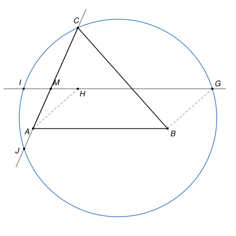

## Statement

Soit $ABC$ un triangle dont les trois angles sont aigus, et soit $H$ son orthocentre, c'est-à-dire le point où se coupent ses trois hauteurs.

- Soit $G$ le point tel que $ABGH$ soit un parallélogramme.
- Soit $I$ le point de la droite $(GH)$ tel que la droite $(AC)$ passe par le milieu $M$ du segment $[HI]$.
- La droite $(AC)$ recoupe le cercle passant par $G$, $C$ et $I$ en un second point, que l'on note $J$.

Montrer que $IJ = AH$.

## Hints

1. Montre que l'angle $\widehat{CHG}$ est droit. Sur quel cercle se trouve le point $H$ ?
2. Soit $D$ le pied de la perpendiculaire à $(AC)$ passant par $G$. Montre que $D$ est sur le même cercle que $H$, puis que $HD = HA$. Pense au milieu des diagonales du parallélogramme $ABGH$ et à la hauteur issue de $B$.
3. On veut montrer que $J$ est le symétrique de $D$ par rapport à $M$. Pour cela, montre d'abord ce résultat : si une droite passant par un point $P$ coupe un cercle de centre $O$ et de rayon $R$ en $X$ et $Y$, alors $PX \times PY = |PO^2 - R^2|$. Utilise le pied de la perpendiculaire à la droite passant par $O$, et le théorème de Pythagore.
4. Applique ce résultat au point $M$, une fois avec chacun des deux cercles.

## Solution

**Étape 1. Le point $H$ est sur le cercle de diamètre $[CG]$.**

La droite $(CH)$ est la hauteur issue de $C$, donc elle est perpendiculaire à $(AB)$. Comme $ABGH$ est un parallélogramme, la droite $(HG)$ est parallèle à $(AB)$. Donc $(CH)$ est perpendiculaire à $(HG)$ : l'angle $\widehat{CHG}$ est droit.

Un point qui voit un segment sous un angle droit est sur le cercle qui a ce segment pour diamètre. Le point $H$ est donc sur le cercle $\omega$ de diamètre $[CG]$.

**Étape 2. Un point $D$ sur $\omega$ tel que $HD = HA$.**

Soit $D$ le pied de la perpendiculaire à $(AC)$ passant par $G$. L'angle $\widehat{CDG}$ est droit, donc $D$ est aussi sur le cercle $\omega$.

Soit $E$ le pied de la hauteur issue de $B$, sur la droite $(AC)$. L'orthocentre $H$ est sur cette hauteur $(BE)$.

Les diagonales $[AG]$ et $[BH]$ du parallélogramme $ABGH$ se coupent en leur milieu $N$. Ce point $N$ est sur $(BH)$, c'est-à-dire sur la hauteur $(BE)$. Dans le triangle $AGD$, la droite $(NE)$ et la droite $(GD)$ sont toutes les deux perpendiculaires à $(AC)$, donc parallèles. Comme $N$ est le milieu de $[AG]$, le théorème de Thalès (ou celui de la droite des milieux) montre que $E$ est le milieu de $[AD]$.

Ainsi la droite $(BE)$ est perpendiculaire à $[AD]$ en son milieu : c'est la médiatrice de $[AD]$. Le point $H$ est sur cette médiatrice, donc
$$HD = HA.$$

Il reste donc à montrer que $IJ = HD$.

**Étape 3. La position du point $M$.**

Les points $H$ et $I$ sont sur la droite $(GH)$, donc le milieu $M$ de $[HI]$ aussi : $M$ est le point où la droite $(GH)$ coupe la droite $(AC)$.

Le point $H$ est à l'intérieur du triangle, car ses angles sont aigus. La droite $(GH)$ est la parallèle à $(AB)$ passant par $H$ : elle traverse le triangle en coupant le côté $[CA]$, en $M$, et le côté $[CB]$. Comme $\overrightarrow{HG} = \overrightarrow{AB}$, on va de $H$ vers $G$ dans la direction qui mène de $A$ vers $B$, donc du côté de $[CB]$, alors que $M$ est du côté de $[CA]$. Ainsi, sur la droite $(GH)$, **le point $H$ est entre $M$ et $G$**.

Comme $I$ est le symétrique de $H$ par rapport à $M$, les quatre points sont dans l'ordre $I$, $M$, $H$, $G$ sur la droite $(GH)$. On en tire deux conséquences.

- La droite $(GH)$ coupe le cercle $\omega$ en $H$ et en $G$. Les points de cette droite situés hors du segment $[HG]$ sont à l'extérieur de $\omega$. Donc **$M$ est à l'extérieur du cercle $\omega$**.
- Soit $\Gamma$ le cercle passant par $G$, $C$ et $I$. Le point $M$ est sur le segment $[IG]$, qui est une corde de $\Gamma$. Donc **$M$ est à l'intérieur du cercle $\Gamma$**.

**Étape 4. Un lemme sur les cercles.**

*Soit un cercle de centre $O$ et de rayon $R$, et soit $P$ un point qui n'est pas sur ce cercle. Si une droite passant par $P$ coupe le cercle en $X$ et $Y$, alors $PX \times PY = |PO^2 - R^2|$. Ce nombre ne dépend donc pas de la droite choisie.*

Soit $K$ le pied de la perpendiculaire à la droite passant par $O$. D'après le théorème de Pythagore, $KX^2 = OX^2 - OK^2 = R^2 - OK^2$, et de même $KY^2 = R^2 - OK^2$. Donc $K$ est le milieu de $[XY]$. On note $t = KX = KY$. Toujours avec Pythagore,
$$PO^2 - R^2 = (PK^2 + OK^2) - (t^2 + OK^2) = PK^2 - t^2 = (PK - t)(PK + t).$$

- Si $P$ est à l'extérieur du cercle, alors $PO > R$, donc $PK > t$. Les points $X$ et $Y$ sont du même côté de $P$, à des distances $PK - t$ et $PK + t$.
- Si $P$ est à l'intérieur du cercle, alors $PK < t$. Le point $P$ est entre $X$ et $Y$, à des distances $t - PK$ et $t + PK$.

Dans les deux cas, $PX \times PY = |PK^2 - t^2| = |PO^2 - R^2|$. (Le lemme reste vrai si la droite est tangente, avec $X = Y = K$ et $t = 0$.)

**Étape 5. On applique le lemme au cercle $\omega$.**

Le point $M$ est à l'extérieur de $\omega$. La droite $(GH)$ coupe $\omega$ en $H$ et $G$, et la droite $(AC)$ le coupe en $C$ et $D$. Le lemme donne
$$MC \times MD = MH \times MG,$$
et, comme $M$ est extérieur, les points $C$ et $D$ sont du même côté de $M$.

Soit $J'$ le symétrique de $D$ par rapport à $M$. Il est sur la droite $(AC)$, **du côté opposé à $C$** par rapport à $M$. De plus $MJ' = MD$ et $MI = MH$, donc
$$MC \times MJ' = MI \times MG.$$

**Étape 6. On applique le lemme au cercle $\Gamma$, et l'on trouve $J = J'$.**

Le point $M$ est à l'intérieur de $\Gamma$. La droite $(GH)$ coupe $\Gamma$ en $I$ et $G$, et la droite $(AC)$ le coupe en $C$ et $J$. Le lemme donne
$$MC \times MJ = MI \times MG,$$
et, comme $M$ est intérieur, il est entre $C$ et $J$ : le point $J$ est **du côté opposé à $C$** par rapport à $M$.

En comparant avec l'étape 5, on obtient $MC \times MJ = MC \times MJ'$, donc $MJ = MJ'$. Les points $J$ et $J'$ sont sur la même droite, du même côté de $M$, à la même distance de $M$ : ils sont confondus. Ainsi **$J$ est le symétrique de $D$ par rapport à $M$**.

**Étape 7. On conclut.**

La symétrie de centre $M$ envoie $H$ sur $I$ et $D$ sur $J$. Une symétrie centrale conserve les longueurs, donc $IJ = HD$. Avec l'étape 2, on obtient
$$IJ = HD = HA.$$

## Going further

1. Le quadrilatère $HDIJ$ est un parallélogramme. Pourquoi ?
2. Le nombre $|PO^2 - R^2|$ de l'étape 4 s'appelle la *puissance* du point $P$ par rapport au cercle. Montre avec le lemme que, si deux droites $(XY)$ et $(ZT)$ se coupent en un point $P$ et si $PX \times PY = PZ \times PT$, avec $P$ entre $X$ et $Y$ et entre $Z$ et $T$, alors les points $X$, $Y$, $Z$, $T$ sont sur un même cercle.
