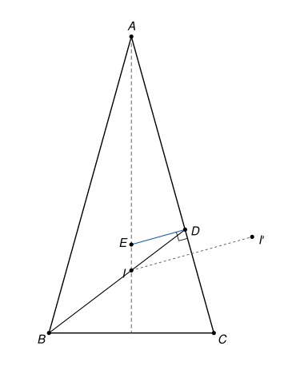

## Statement

Soit $ABC$ un triangle tel que $AB = AC$ et $AB \neq BC$, et soit $I$ le centre de son cercle inscrit. La droite $(BI)$ coupe la droite $(AC)$ en $D$. La droite qui passe par $D$ et qui est perpendiculaire à $(AC)$ coupe la droite $(AI)$ en $E$.

Montrer que le symétrique de $I$ par rapport à la droite $(AC)$ est sur le cercle circonscrit au triangle $BDE$.

## Hints

1. Le triangle est isocèle en $A$. Que représente la droite $(AI)$ pour le segment $[BC]$ ? Compare $EB$ et $EC$.
2. Cherche deux triangles semblables pour montrer que $DC^2 = DI \times DB$.
3. Place-toi dans le repère orthonormé d'origine $D$ dont les axes sont les droites $(AC)$ et $(DE)$. Note $I(p\,;\,q)$, $E(0\,;\,e)$ et $B(kp\,;\,kq)$ avec $k = \frac{DB}{DI}$. Traduis les deux propriétés des indications précédentes.
4. Le centre $\Omega$ du cercle circonscrit à $BDE$ est sur la médiatrice de $[DE]$, donc $\Omega\left(s\,;\,\frac{e}{2}\right)$ pour un certain réel $s$. Traduis $\Omega B = \Omega D$, puis calcule $\Omega I'^2 - \Omega D^2$, où $I'$ est le symétrique de $I$.

## Solution

On note $I'$ le symétrique de $I$ par rapport à la droite $(AC)$.

**Étape 1. On a $EB = EC$.**

Le triangle $ABC$ est isocèle en $A$. Sa droite de symétrie est la bissectrice de l'angle $\widehat{BAC}$, qui est aussi la médiatrice du segment $[BC]$. Le point $I$ est sur cette bissectrice, donc la droite $(AI)$ est la médiatrice de $[BC]$. Comme $E$ est sur $(AI)$, on a $EB = EC$.

**Étape 2. On a $DC^2 = DI \times DB$.**

La bissectrice issue de $B$ coupe le côté $[AC]$ en $D$, et le point $I$, qui est à l'intérieur du triangle, est sur le segment $[BD]$. On compare les triangles $DCI$ et $DBC$.

- Ils ont le même angle en $D$, car $I$ est sur le segment $[DB]$.
- La droite $(CI)$ est la bissectrice de l'angle $\widehat{ACB}$, et $D$ est sur $[CA]$, donc $\widehat{DCI} = \frac{1}{2}\,\widehat{ACB}$. De même, $\widehat{DBC} = \widehat{IBC} = \frac{1}{2}\,\widehat{ABC}$. Comme $\widehat{ABC} = \widehat{ACB}$, on obtient $\widehat{DCI} = \widehat{DBC}$.

Les deux triangles ont deux angles égaux, ils sont donc semblables, le sommet $D$ correspondant à $D$, le sommet $C$ à $B$ et le sommet $I$ à $C$. Les côtés sont donc proportionnels :
$$\frac{DC}{DB} = \frac{DI}{DC}, \qquad \text{c'est-à-dire} \qquad DC^2 = DI \times DB.$$

**Étape 3. Les points $B$, $D$, $E$ ne sont pas alignés.**

Sinon, $E$ serait sur la droite $(BD)$, qui est la droite $(BI)$. Comme $E$ est aussi sur $(AI)$, et que ces deux droites ne se coupent qu'en $I$, on aurait $E = I$. La droite $(DI)$, c'est-à-dire $(BD)$, serait alors perpendiculaire à $(AC)$. La bissectrice issue de $B$ serait aussi une hauteur, donc le triangle serait isocèle en $B$, avec $BA = BC$. Avec $AB = AC$, le triangle serait équilatéral, ce qui est exclu par $AB \neq BC$.

Le triangle $BDE$ a donc bien un cercle circonscrit. On note $\Omega$ son centre.

**Étape 4. Un repère.**

On se place dans le repère orthonormé d'origine $D$ dont l'axe des abscisses est la droite $(AC)$, orientée de $D$ vers $C$, et dont l'axe des ordonnées est la perpendiculaire à $(AC)$ passant par $D$, orientée du côté de $B$. Le point $E$ est sur cette perpendiculaire. Dans ce repère :

- $C(c\,;\,0)$, avec $c = DC > 0$ ;
- $I(p\,;\,q)$, avec $q > 0$, car $I$ est du même côté de $(AC)$ que $B$ ;
- $B(kp\,;\,kq)$, avec $k = \frac{DB}{DI} > 1$, car $I$ est sur le segment $[DB]$, donc $\overrightarrow{DB} = k\,\overrightarrow{DI}$ ;
- $E(0\,;\,e)$ ;
- $I'(p\,;\,-q)$, car la symétrie par rapport à $(AC)$ est la symétrie par rapport à l'axe des abscisses.

On a $DI^2 = p^2 + q^2$ et $DB = k \times DI$, donc $DI \times DB = k\,DI^2 = k\,(p^2 + q^2)$. L'étape 2 s'écrit donc
$$c^2 = k\,(p^2 + q^2). \qquad (1)$$

**Étape 5. On traduit $EB = EC$.**

On a
$$EB^2 = (kp)^2 + (kq - e)^2 = k^2(p^2 + q^2) - 2kqe + e^2 \qquad \text{et} \qquad EC^2 = c^2 + e^2.$$
L'égalité $EB^2 = EC^2$ donne, avec $(1)$, $k^2(p^2 + q^2) - 2kqe = k\,(p^2 + q^2)$. On divise par $k > 0$ :
$$2qe = (k - 1)(p^2 + q^2). \qquad (2)$$
Le membre de droite est strictement positif, donc $e > 0$. En particulier $E \neq D$.

**Étape 6. Le centre du cercle.**

On a $\Omega D = \Omega E$, donc $\Omega$ est sur la médiatrice de $[DE]$. Comme $D(0\,;\,0)$ et $E(0\,;\,e)$, cette médiatrice est la droite horizontale d'ordonnée $\frac{e}{2}$. On peut donc écrire $\Omega\left(s\,;\,\frac{e}{2}\right)$, où $s$ est un réel. Alors
$$\Omega D^2 = s^2 + \frac{e^2}{4}, \qquad \Omega B^2 = (kp - s)^2 + \left(kq - \frac{e}{2}\right)^2 = k^2(p^2 + q^2) - 2kps - kqe + s^2 + \frac{e^2}{4}.$$
L'égalité $\Omega B^2 = \Omega D^2$ donne $k^2(p^2 + q^2) - 2kps - kqe = 0$. On divise par $k$ :
$$2ps = k\,(p^2 + q^2) - qe. \qquad (3)$$

**Étape 7. Le point $I'$ est sur le cercle.**

On calcule
$$\Omega I'^2 = (p - s)^2 + \left(-q - \frac{e}{2}\right)^2 = p^2 + q^2 - 2ps + qe + s^2 + \frac{e^2}{4}.$$
Donc, avec $(3)$ puis $(2)$,
$$\Omega I'^2 - \Omega D^2 = p^2 + q^2 - 2ps + qe = p^2 + q^2 - k\,(p^2 + q^2) + 2qe = 2qe - (k - 1)(p^2 + q^2) = 0.$$
Ainsi $\Omega I' = \Omega D$ : le point $I'$ est à la même distance de $\Omega$ que $D$.

**Conclusion.** Le symétrique $I'$ de $I$ par rapport à $(AC)$ est sur le cercle circonscrit au triangle $BDE$.

## Going further

1. Montre que $EB = EC = EI'$ : le point $E$ est le centre du cercle qui passe par $B$, $C$ et $I'$.
2. Que se passe-t-il si le triangle $ABC$ est équilatéral ? Où se trouve alors le point $E$ ?
