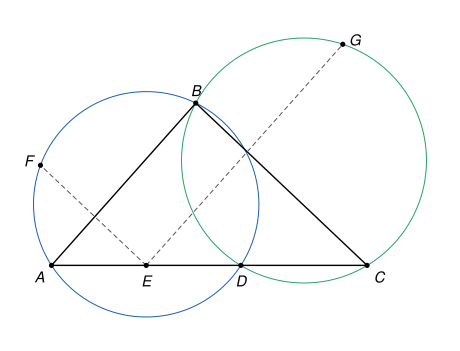

## Statement

Soit $ABC$ un triangle. Soient $D$ et $E$ deux points du segment $[AC]$, distincts de $A$ et de $C$, tels que $D$ soit situé entre $C$ et $E$.

- Soit $F$ le point d'intersection du cercle circonscrit au triangle $ABD$ avec la parallèle à $(BC)$ passant par $E$, choisi de sorte que $E$ et $F$ soient de part et d'autre de la droite $(AB)$.
- Soit $G$ le point d'intersection du cercle circonscrit au triangle $BCD$ avec la parallèle à $(AB)$ passant par $E$, choisi de sorte que $E$ et $G$ soient de part et d'autre de la droite $(BC)$.

Montrer que les points $D$, $E$, $F$, $G$ sont sur un même cercle.

## Hints

1. Trace une figure soignée. Que remarques-tu pour les points $F$, $B$ et $G$ ?
2. Le point $G$ est difficile à atteindre directement. Note $G'$ le point où la droite $(FB)$ coupe la parallèle à $(AB)$ passant par $E$. Montre que $D$, $E$, $F$, $G'$ sont sur un même cercle, en comparant les angles $\widehat{EDF}$ et $\widehat{EG'F}$ avec l'angle $\widehat{ABF}$.
3. Dans ce nouveau cercle, l'angle $\widehat{FDG'}$ est égal à $\widehat{FEG'}$. Calcule-le à l'aide des angles du triangle $ABC$, puis calcule l'angle $\widehat{DG'F}$ dans le triangle $DFG'$.
4. Tu dois trouver $\widehat{DG'F} = \widehat{ACB}$. Déduis-en que $G'$ est sur le cercle circonscrit à $BCD$, puis que $G' = G$.

## Solution

On note $\alpha = \widehat{BAC}$, $\beta = \widehat{ABC}$ et $\gamma = \widehat{BCA}$ les angles du triangle $ABC$. Sur le segment $[AC]$, les points sont dans l'ordre $A$, $E$, $D$, $C$.

On utilise le **théorème de l'angle inscrit** et sa réciproque, sous la forme suivante. Soient $Y$ et $Z$ deux points distincts, et $W$ et $X$ deux points situés du même côté de la droite $(YZ)$.

- Si $W$, $X$, $Y$, $Z$ sont sur un même cercle, alors $\widehat{YWZ} = \widehat{YXZ}$.
- Réciproquement, si $\widehat{YWZ} = \widehat{YXZ}$, alors $W$, $X$, $Y$, $Z$ sont sur un même cercle.

Le premier point vient de ce qu'un angle inscrit vaut la moitié de l'angle au centre qui intercepte le même arc.

L'idée est la suivante : sur la figure, $F$, $B$ et $G$ semblent alignés. On construit donc un point $G'$ sur la droite $(FB)$, on montre que $D$, $E$, $F$, $G'$ sont sur un même cercle, puis que $G'$ n'est autre que $G$. Les positions des points jouent un rôle à chaque étape, et l'on prend le temps de les justifier.

### Étape 1. Les points $Q$ et $P$, et les points $F$ et $G$

La parallèle à $(BC)$ passant par $E$ coupe la droite $(AB)$ en un point $Q$. D'après le théorème de Thalès, $\frac{AQ}{AB} = \frac{AE}{AC}$, qui est compris strictement entre $0$ et $1$ : le point $Q$ est à l'intérieur du segment $[AB]$. De même, la parallèle à $(AB)$ passant par $E$ coupe le segment $[BC]$ en un point $P$ situé à l'intérieur de ce segment.

Les côtés $(EQ)$ et $(PB)$ sont parallèles, ainsi que $(EP)$ et $(QB)$ : le quadrilatère $EQBP$ est un parallélogramme.

Le point $Q$ est à l'intérieur de la corde $[AB]$ du cercle circonscrit à $ABD$, donc à l'intérieur du disque. La droite $(EQ)$ coupe donc ce cercle en exactement deux points, situés de part et d'autre de $Q$ sur la droite, donc de part et d'autre de la droite $(AB)$. Le point $F$ est celui qui n'est pas du côté de $E$. Ainsi $F$ est bien défini, et **$Q$ est entre $E$ et $F$**.

De même, $P$ est à l'intérieur de la corde $[BC]$ du cercle circonscrit à $BCD$. **Le point $G$ est le seul point de ce cercle qui soit sur la droite $(EP)$ et de l'autre côté de $(BC)$ par rapport à $E$.**

### Étape 2. Le point $G'$ et sa position

La droite $(FB)$ n'est pas parallèle à $(EP)$ : sinon elle serait parallèle à $(AB)$, donc égale à $(AB)$ puisqu'elle passe par $B$, et $F$ serait sur $(AB)$. On note $G'$ le point d'intersection des droites $(FB)$ et $(EP)$.

- *Le point $B$ est entre $F$ et $G'$.* La droite $(EP)$ est parallèle à $(AB)$, donc tous ses points sont du même côté de $(AB)$ que $E$, c'est-à-dire du côté de $C$. Le point $F$ est de l'autre côté. La droite $(FB)$ ne traverse $(AB)$ qu'en $B$, donc $B$ est entre $F$ et $G'$.
- *Le point $G'$ est de l'autre côté de $(BC)$ par rapport à $A$ et à $E$, et $P$ est entre $E$ et $G'$.* La droite $(EF)$ est parallèle à $(BC)$, donc $F$ est du même côté de $(BC)$ que $E$, c'est-à-dire que $A$. Comme $B$ est entre $F$ et $G'$, le point $G'$ est de l'autre côté. Sur la droite $(EP)$, les points $E$ et $G'$ sont donc de part et d'autre de $P$.
- *La droite $(FB)$ ne rencontre pas le segment $[AC]$.* Les points de la demi-droite $[BF)$, sauf $B$, sont de l'autre côté de $(AB)$ par rapport à $C$, alors que ceux de $[AC]$, sauf $A$, sont du côté de $C$. Les points de la demi-droite $[BG')$, sauf $B$, sont de l'autre côté de $(BC)$ par rapport à $A$, alors que ceux de $[AC]$, sauf $C$, sont du côté de $A$. Enfin, ni $A$ ni $C$ ne sont sur la droite $(FB)$. **En particulier, $D$ et $E$ sont du même côté de la droite $(FG')$.**
- *Les points $D$ et $G'$ sont du même côté de la droite $(EF)$.* Le point $D$ est entre $E$ et $C$, donc du côté de $C$. Comme $(EF)$ est parallèle à $(BC)$ et que $G'$ est de l'autre côté de $(BC)$ par rapport à $E$, le point $G'$ est lui aussi du côté de $(EF)$ où se trouve $C$.
- *Les points $G'$ et $C$ sont du même côté de la droite $(BD)$.* Cette droite sépare $A$ et $C$, puisque $D$ est entre eux. Le point $E$ est du côté de $A$, et le point $P$, qui est sur $[BC]$ et différent de $B$, est du côté de $C$. La droite $(BD)$ coupe donc la droite $(EP)$ entre $E$ et $P$. Comme $P$ est entre $E$ et $G'$, le point $G'$ est du côté de $C$.

### Étape 3. L'ordre des points sur le cercle circonscrit à $ABD$

Les points $D$ et $F$ sont de part et d'autre de $(AB)$ : sur ce cercle, ils sont sur les deux arcs différents d'extrémités $A$ et $B$. En faisant le tour du cercle, on rencontre donc les points dans l'ordre $A$, $D$, $B$, $F$, et $ADBF$ est un quadrilatère convexe dont les diagonales sont $[AB]$ et $[DF]$. Par conséquent :

- $A$ et $F$ sont du même côté de la droite $(BD)$ ;
- $D$ et $B$ sont du même côté de la droite $(AF)$.

### Étape 4. Les points $D$, $E$, $F$, $G'$ sont sur un même cercle

- Les droites $(G'E)$ et $(BA)$ sont parallèles, et la droite $(FG')$ les coupe en $G'$ et en $B$. Les points $E$ et $A$ sont du même côté de $(FG')$ d'après l'étape 2, et $B$ est entre $G'$ et $F$. Les angles $\widehat{EG'F}$ et $\widehat{ABF}$ sont donc des angles correspondants, et $\widehat{EG'F} = \widehat{ABF}$.
- Dans le cercle circonscrit à $ABD$, les points $B$ et $D$ sont du même côté de $(AF)$ d'après l'étape 3, donc $\widehat{ABF} = \widehat{ADF}$.
- Le point $E$ est sur la demi-droite $[DA)$, donc $\widehat{ADF} = \widehat{EDF}$.

On obtient $\widehat{EDF} = \widehat{EG'F}$. Les points $D$ et $G'$ sont du même côté de $(EF)$ d'après l'étape 2. D'après la réciproque du théorème de l'angle inscrit, **les points $D$, $E$, $F$, $G'$ sont sur un même cercle**, que l'on note $\omega$.

### Étape 5. Les angles du triangle $DFG'$

- Dans le cercle $\omega$, les points $D$ et $E$ sont du même côté de $(FG')$, donc $\widehat{FDG'} = \widehat{FEG'}$. Or $Q$ est sur la demi-droite $[EF)$ et $P$ sur la demi-droite $[EG')$, donc $\widehat{FEG'} = \widehat{QEP}$. Dans le parallélogramme $EQBP$, les angles opposés sont égaux, donc $\widehat{QEP} = \widehat{QBP} = \widehat{ABC} = \beta$. Ainsi $\widehat{FDG'} = \beta$.
- Dans le cercle circonscrit à $ABD$, les points $F$ et $A$ sont du même côté de $(BD)$ d'après l'étape 3, donc $\widehat{DFB} = \widehat{DAB}$. Comme $D$ est sur $[AC]$, on a $\widehat{DAB} = \widehat{CAB} = \alpha$. Enfin $B$ est sur la demi-droite $[FG')$, donc $\widehat{DFG'} = \widehat{DFB} = \alpha$.

La somme des angles du triangle $DFG'$ vaut $180°$, donc
$$\widehat{DG'F} = 180° - \alpha - \beta = \gamma.$$

### Étape 6. Le point $G'$ est sur le cercle circonscrit à $BCD$

Le point $B$ est sur la demi-droite $[G'F)$, donc $\widehat{DG'B} = \widehat{DG'F} = \gamma$. D'autre part, $D$ est sur la demi-droite $[CA)$, donc $\widehat{DCB} = \widehat{ACB} = \gamma$.

Ainsi $\widehat{BG'D} = \widehat{BCD}$, et $G'$ et $C$ sont du même côté de $(BD)$ d'après l'étape 2. D'après la réciproque du théorème de l'angle inscrit, **le point $G'$ est sur le cercle circonscrit au triangle $BCD$.**

### Étape 7. Conclusion

Le point $G'$ est sur le cercle circonscrit à $BCD$, sur la droite $(EP)$, et de l'autre côté de $(BC)$ par rapport à $E$. D'après l'étape 1, un seul point a ces trois propriétés : le point $G$. Donc $G' = G$.

D'après l'étape 4, **les points $D$, $E$, $F$, $G$ sont sur un même cercle.** On a montré au passage que $F$, $B$, $G$ sont alignés.

## Going further

1. Montre que les triangles $DFG$ et $BAC$ ont les mêmes angles : l'angle en $F$ vaut $\alpha$, l'angle en $D$ vaut $\beta$ et l'angle en $G$ vaut $\gamma$.
2. Toutes les positions utilisées ici ont dû être justifiées une par une. Avec les **angles orientés de droites**, qui se mesurent à $180°$ près, le théorème de l'angle inscrit et sa réciproque s'écrivent sans condition « du même côté », et le même calcul marche dans tous les cas de figure. Si tu les connais, refais la démonstration avec eux.
