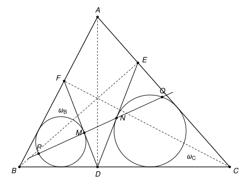

## Statement

Soit $ABC$ un triangle dont les trois angles sont aigus. On note $D$, $E$ et $F$ les pieds des
hauteurs issues respectivement de $A$, $B$ et $C$.

Soit $\omega_B$ le cercle inscrit dans le triangle $BDF$, et $M$ le point où $\omega_B$ touche le
côté $[DF]$. De même, soit $\omega_C$ le cercle inscrit dans le triangle $CDE$, et $N$ le point où
$\omega_C$ touche le côté $[DE]$.

La droite $(MN)$ recoupe $\omega_B$ en un point $P$ autre que $M$, et recoupe $\omega_C$ en un
point $Q$ autre que $N$.

Démontrer que $MP = NQ$.

## Hints

1. Commence par les angles en $D$. Calcule $BD$ et $BF$ à l'aide de $\cos \widehat{ABC}$, et
   déduis-en que les triangles $BDF$ et $BAC$ sont semblables. Que peux-tu dire des angles
   $\widehat{BDF}$ et $\widehat{CDE}$ ?
2. Pour calculer la longueur de la corde $[MP]$, abaisse la perpendiculaire depuis le centre de
   $\omega_B$ sur $(MN)$ : elle tombe au milieu de la corde.
3. Note $\theta$ l'angle entre les droites $(DF)$ et $(MN)$, et $r_B$ le rayon de $\omega_B$. Montre
   que $MP = 2 r_B \sin\theta$.
4. Appelle $K$ le pied de la perpendiculaire à $(MN)$ issue de $D$. Exprime $\sin\theta$ à l'aide de
   $DK$ et de $DM$. Fais de même pour $NQ$, avec $DK$ et $DN$. Il reste à comparer
   $\dfrac{r_B}{DM}$ et $\dfrac{r_C}{DN}$.

## Solution

Notons $O_B$ et $r_B$ le centre et le rayon de $\omega_B$, et $O_C$ et $r_C$ le centre et le rayon
de $\omega_C$. Comme le triangle $ABC$ a ses trois angles aigus, les pieds des hauteurs sont sur les
côtés : $D$ est sur $[BC]$, $E$ sur $[CA]$ et $F$ sur $[AB]$. On note $\alpha = \widehat{BAC}$.

### Étape 1 : $\widehat{BDF} = \widehat{CDE} = \alpha$

Le triangle $ABD$ est rectangle en $D$, donc $BD = AB \cos\widehat{ABC}$. Le triangle $CBF$ est
rectangle en $F$, donc $BF = BC \cos\widehat{ABC}$. Ainsi
$$\frac{BD}{BA} = \frac{BF}{BC} = \cos\widehat{ABC}.$$
Les triangles $BDF$ et $BAC$ ont le même angle en $B$, puisque $D$ est sur $[BC]$ et $F$ sur
$[BA]$, et cet angle est compris entre des côtés proportionnels. Ils sont donc semblables, $D$
correspondant à $A$. Par conséquent $\widehat{BDF} = \widehat{BAC} = \alpha$.

De même, $CD = CA \cos\widehat{ACB}$ et $CE = CB \cos\widehat{ACB}$, donc les triangles $CDE$ et
$CAB$ sont semblables, $D$ correspondant à $A$, et $\widehat{CDE} = \alpha$.

### Étape 2 : $\dfrac{r_B}{DM} = \dfrac{r_C}{DN}$

Le centre $O_B$ du cercle inscrit dans $BDF$ est sur la bissectrice de l'angle $\widehat{BDF}$, et
le rayon $[O_B M]$ est perpendiculaire au côté $[DF]$. Dans le triangle $O_B M D$, rectangle en
$M$, l'angle en $D$ vaut $\frac{\alpha}{2}$, donc
$$\tan\frac{\alpha}{2} = \frac{O_B M}{DM} = \frac{r_B}{DM}.$$
De même, dans le triangle $O_C N D$, rectangle en $N$, l'angle en $D$ vaut
$\frac{1}{2}\widehat{CDE} = \frac{\alpha}{2}$, donc $\tan\frac{\alpha}{2} = \dfrac{r_C}{DN}$.

### Étape 3 : la longueur des deux cordes

Les points $M$ et $N$ sont différents de $D$, sur les droites $(DF)$ et $(DE)$ qui ne se coupent
qu'en $D$. Donc $D$ n'est pas sur la droite $(MN)$, et $(MN)$ n'est ni $(DF)$ ni $(DE)$. Soit $K$ le
pied de la perpendiculaire à $(MN)$ issue de $D$.

Notons $\theta$ l'angle entre les droites $(DF)$ et $(MN)$, avec $0^\circ < \theta \leqslant 90^\circ$.

**La distance $DK$.** Si $K = M$, alors $(DM)$ est perpendiculaire à $(MN)$, $\theta = 90^\circ$ et
$DK = DM = DM\sin\theta$. Sinon, le triangle $DKM$ est rectangle en $K$, son angle en $M$ est aigu et
vaut $\theta$, donc $DK = DM \sin\theta$.

**La corde $[MP]$.** Soit $H$ le pied de la perpendiculaire à $(MN)$ issue de $O_B$. Comme
$O_B M = O_B P$, le triangle $O_B M P$ est isocèle et $H$ est le milieu de $[MP]$, donc $MP = 2\,MH$.

- Si $H = O_B$, la droite $(MN)$ passe par $O_B$. Elle est alors perpendiculaire à $(DF)$, car le
  rayon $[O_B M]$ l'est. Donc $\theta = 90^\circ$ et $MH = r_B = r_B \sin\theta$.
- Sinon, le triangle $O_B H M$ est rectangle en $H$. Son angle en $M$ est l'angle entre les droites
  $(MO_B)$ et $(MN)$. Comme $(MO_B)$ est perpendiculaire à $(DF)$, cet angle vaut $90^\circ - \theta$.
  Donc $MH = r_B \cos(90^\circ - \theta) = r_B \sin\theta$.

Dans les deux cas $MP = 2 r_B \sin\theta$. Avec $\sin\theta = \dfrac{DK}{DM}$, on obtient
$$MP = 2\,DK \times \frac{r_B}{DM}.$$

**La corde $[NQ]$.** On recommence avec l'angle $\theta'$ entre $(DE)$ et $(MN)$. Le point $K$ est le
même, car c'est aussi le pied de la perpendiculaire issue de $D$ sur la droite $(NQ) = (MN)$. On
obtient $DK = DN\sin\theta'$ et $NQ = 2 r_C \sin\theta'$, donc
$$NQ = 2\,DK \times \frac{r_C}{DN}.$$

### Conclusion

D'après l'étape 2, $\dfrac{r_B}{DM} = \dfrac{r_C}{DN}$, donc
$$MP = 2\,DK \times \frac{r_B}{DM} = 2\,DK \times \frac{r_C}{DN} = NQ.$$

**On a bien $MP = NQ$.**

## Going further

La preuve n'a utilisé qu'une seule chose sur les deux triangles : ils ont le même sommet $D$, et le
même angle en $D$. Soit $DUV$ et $DU'V'$ deux triangles tels que $\widehat{UDV} = \widehat{U'DV'}$,
et soit $M$ et $N$ les points où leurs cercles inscrits touchent les côtés $[DV]$ et $[DV']$. Montrer
que la droite $(MN)$ découpe dans les deux cercles inscrits deux cordes de même longueur. Faire une
figure où les deux triangles ne sont pas placés comme dans l'exercice.
