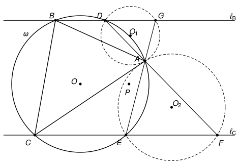

## Statement

Soit $ABC$ un triangle et $\omega$ son cercle circonscrit. Soit $\ell_B$ et $\ell_C$ deux droites
parallèles distinctes, passant respectivement par $B$ et par $C$. La droite $\ell_B$ recoupe
$\omega$ en un point $D$, autre que $B$, et la droite $\ell_C$ recoupe $\omega$ en un point $E$,
autre que $C$.

On suppose que les droites $\ell_C$ et $(AD)$ se coupent en un point $F$, et que les droites
$\ell_B$ et $(AE)$ se coupent en un point $G$. On note $O$, $O_1$ et $O_2$ les centres des cercles
circonscrits aux triangles $ABC$, $ADG$ et $AEF$. Enfin, on note $P$ le centre du cercle
circonscrit au triangle $OO_1O_2$. On suppose que tous ces triangles sont non aplatis.

Démontrer que la droite $(OP)$ est parallèle aux droites $\ell_B$ et $\ell_C$.

## Hints

1. Prends un repère orthonormé d'origine $A$ dont l'axe des abscisses est parallèle aux deux
   droites. Écris $\ell_B : y = b$ et $\ell_C : y = c$, et la droite $(AD)$ sous la forme $x = sy$.
2. Un point $(x\,;y)$ est à égale distance de $A$ et du point $(m\,;n)$ si et seulement si
   $2(mx + ny) = m^2 + n^2$. Utilise-le pour calculer les coordonnées de $O_1$ et de $O_2$, et
   l'ordonnée de $O$.
3. Les points $O$ et $O_1$ sont tous les deux sur la médiatrice de $[AD]$. Trace la parallèle à
   $(AD)$ passant par $O_1$ : quel angle fait-elle avec $(OO_1)$ ? Fais de même avec $O_2$ et
   $(AE)$.
4. Ces deux parallèles se coupent en un point $X$. Montre que $X$ a la même ordonnée que $O$, puis
   pense au cercle de diamètre $[OX]$.

## Solution

### Étape 1 : un repère adapté

On se place dans un repère orthonormé d'origine $A$, dont l'axe des abscisses est parallèle à
$\ell_B$ et à $\ell_C$. Ces deux droites ont alors des équations $\ell_B : y = b$ et
$\ell_C : y = c$, avec $b \neq c$ puisqu'elles sont distinctes.

Le point $A$ n'est pas sur $\ell_B$. En effet, $\ell_B$ ne coupe le cercle $\omega$ qu'en $B$ et
en $D$, et $A$ n'est ni $B$ (c'est un sommet du triangle) ni $D$ (sinon la droite $(AD)$ n'aurait
pas de sens). Donc $b \neq 0$, et de même $c \neq 0$.

La droite $(AD)$ passe par l'origine et par $D$, dont l'ordonnée est $b \neq 0$. Posons
$s = \dfrac{x_D}{b}$ : alors $D = (sb\,; b)$, et la droite $(AD)$ a pour équation $x = sy$. De
même, en posant $t = \dfrac{x_E}{c}$, on a $E = (tc\,; c)$, et la droite $(AE)$ a pour équation
$x = ty$.

On a $s \neq t$ : sinon les droites $(AD)$ et $(AE)$ seraient confondues, et les trois points
distincts $A$, $D$, $E$ du cercle $\omega$ seraient alignés, ce qui est impossible.

Le point $G$ est sur $(AE)$ et a pour ordonnée $b$, donc $G = (tb\,; b)$. De même, $F = (sc\,; c)$.

### Étape 2 : un outil pour les centres

Soit $M = (m\,; n)$ un point. Un point $Z = (x\,; y)$ est à égale distance de $A$ et de $M$ si et
seulement si $x^2 + y^2 = (x - m)^2 + (y - n)^2$. En développant et en simplifiant, cela s'écrit
$$2(mx + ny) = m^2 + n^2.$$

### Étape 3 : les coordonnées des centres

**Le point $O_1 = (x_1\,; y_1)$** est à égale distance de $A$, de $D = (sb\,; b)$ et de
$G = (tb\,; b)$. D'après l'étape 2, en divisant par $b \neq 0$ :
$$2(s\,x_1 + y_1) = (1 + s^2)\,b \qquad \text{et} \qquad 2(t\,x_1 + y_1) = (1 + t^2)\,b.$$
En soustrayant, $2(s - t)\,x_1 = (s^2 - t^2)\,b = (s - t)(s + t)\,b$, et comme $s \neq t$,
$x_1 = \dfrac{(s + t)\,b}{2}$. Puis $2y_1 = (1 + s^2)\,b - s(s + t)\,b = (1 - st)\,b$. Ainsi
$$O_1 = \left( \frac{(s + t)\,b}{2}\,;\ \frac{(1 - st)\,b}{2} \right).$$

**Le point $O_2$** est à égale distance de $A$, de $F = (sc\,; c)$ et de $E = (tc\,; c)$. C'est le
même calcul, avec $c$ à la place de $b$ :
$$O_2 = \left( \frac{(s + t)\,c}{2}\,;\ \frac{(1 - st)\,c}{2} \right).$$

**Le point $O = (u\,; v)$** est à égale distance de $A$, de $D = (sb\,; b)$ et de
$E = (tc\,; c)$. D'après l'étape 2, en divisant par $b$ et par $c$ :
$$2(s\,u + v) = (1 + s^2)\,b \qquad \text{et} \qquad 2(t\,u + v) = (1 + t^2)\,c.$$
On multiplie la première égalité par $t$, la seconde par $s$, et on soustrait :
$2(t - s)\,v = t(1 + s^2)\,b - s(1 + t^2)\,c$. Ainsi
$$v = \frac{s(1 + t^2)\,c - t(1 + s^2)\,b}{2(s - t)}.$$

### Étape 4 : un point $X$ à la même hauteur que $O$

Soit $d_1$ la parallèle à $(AD)$ passant par $O_1$, et $d_2$ la parallèle à $(AE)$ passant par
$O_2$. Une droite parallèle à $(AD)$, dont l'équation est $x - sy = 0$, a une équation de la forme
$x - sy = k$. Pour $d_1$, la constante $k$ se calcule avec $O_1$ :
$$d_1 : \ x - sy = x_1 - s\,y_1 = \frac{(s + t)\,b - s(1 - st)\,b}{2} = \frac{t(1 + s^2)\,b}{2}.$$
De même,
$$d_2 : \ x - ty = \frac{(s + t)\,c - t(1 - st)\,c}{2} = \frac{s(1 + t^2)\,c}{2}.$$
Comme $s \neq t$, ces deux droites ne sont pas parallèles : elles se coupent en un point
$X = (x_X\,; y_X)$. En soustrayant les deux équations,
$$(t - s)\,y_X = \frac{t(1 + s^2)\,b - s(1 + t^2)\,c}{2}, \qquad \text{donc} \qquad y_X = \frac{s(1 + t^2)\,c - t(1 + s^2)\,b}{2(s - t)} = v.$$
**Le point $X$ a la même ordonnée que $O$.**

### Étape 5 : le cercle de diamètre $[OX]$

Les points $O$ et $O_1$ sont tous les deux à égale distance de $A$ et de $D$ : ils sont sur la
médiatrice de $[AD]$. Comme ils sont distincts (le triangle $OO_1O_2$ n'est pas aplati), la droite
$(OO_1)$ est cette médiatrice, et elle est perpendiculaire à $(AD)$, donc à $d_1$.

- **$X \neq O$.** Sinon $O$ serait sur $d_1$, et la droite $(OO_1)$ serait $d_1$, qui est parallèle
  à $(AD)$. Or elle lui est perpendiculaire.
- **$O_1$ est sur le cercle de diamètre $[OX]$.** C'est clair si $O_1 = X$. Sinon, la droite
  $(O_1X)$ est $d_1$, perpendiculaire à $(OO_1)$ : le triangle $OO_1X$ est rectangle en $O_1$, et
  $O_1$ est sur le cercle de diamètre $[OX]$.

De la même façon, $O$ et $O_2$ sont sur la médiatrice de $[AE]$, donc $(OO_2)$ est perpendiculaire
à $(AE)$, donc à $d_2$, et $O_2$ est aussi sur le cercle de diamètre $[OX]$.

Ce cercle passe donc par $O$, $O_1$ et $O_2$. Par trois points non alignés passe un seul cercle :
c'est le cercle circonscrit au triangle $OO_1O_2$, et son centre $P$ est le milieu de $[OX]$.

### Étape 6 : conclusion

Les points $O$ et $X$ sont distincts et ont la même ordonnée, donc la droite $(OX)$ est parallèle à
l'axe des abscisses. Comme $P$ est le milieu de $[OX]$, la droite $(OP)$ est la droite $(OX)$.

**La droite $(OP)$ est parallèle aux droites $\ell_B$ et $\ell_C$.**

## Going further

1. Montrer, à l'aide des coordonnées trouvées, que les points $A$, $O_1$ et $O_2$ sont alignés.
   Le voir aussi sans calcul : par quelle transformation de centre $A$ passe-t-on du triangle
   $ADG$ au triangle $AFE$ ?
2. Le point $X$ de la solution est le point du cercle circonscrit à $OO_1O_2$ diamétralement
   opposé à $O$. Expliquer pourquoi la droite perpendiculaire à $\ell_B$ passant par $O$ est
   tangente à ce cercle.
