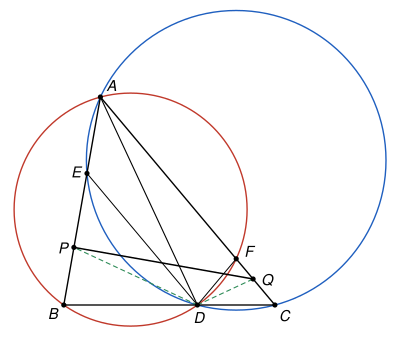

## Statement

Soit $ABC$ un triangle tel que $90^\circ > \widehat{ABC} > \widehat{BCA}$. Soit $D$ le point du segment $[BC]$ tel que
$$2\,\widehat{DAC} = \widehat{ABC} - \widehat{BCA}.$$

- Le cercle circonscrit au triangle $ACD$ recoupe la droite $(AB)$ en un point $E$ autre que $A$. La bissectrice de l'angle $\widehat{BDE}$ coupe $(AB)$ en $P$.
- De même, le cercle circonscrit au triangle $ABD$ recoupe la droite $(AC)$ en un point $F$ autre que $A$. La bissectrice de l'angle $\widehat{CDF}$ coupe $(AC)$ en $Q$.

Démontrer que les droites $(AB)$ et $(PQ)$ sont perpendiculaires.

## Hints

1. Fais une figure exacte. Commence par chercher les angles $\widehat{BDE}$ et $\widehat{CDF}$ à l'aide des deux cercles.
2. Ces deux angles sont égaux à $\widehat{BAC}$. Calcule ensuite $\widehat{ADC}$ en fonction des angles du triangle $ABC$, en utilisant l'hypothèse sur $D$. Que vaut alors $\widehat{ADQ}$ ?
3. L'angle $\widehat{ADQ}$ est droit, donc $D$ est sur le cercle de diamètre $[AQ]$. Il reste à montrer que $P$ est aussi sur ce cercle.
4. Appelle $K$ le pied de la perpendiculaire à $(AB)$ passant par $Q$. Il est sur le cercle de diamètre $[AQ]$. Compare les angles $\widehat{ADK}$ et $\widehat{ADP}$.

## Solution

On note $\alpha = \widehat{BAC}$, $\beta = \widehat{ABC}$ et $\gamma = \widehat{BCA}$, de sorte que $\alpha + \beta + \gamma = 180^\circ$. L'hypothèse dit que $\widehat{DAC} = \frac{\beta - \gamma}{2}$. Cet angle n'est pas nul, car $\beta > \gamma$, donc $D \neq C$. Il est plus petit que $\alpha$, car $\beta < 90^\circ$ et $\gamma < \beta$ donnent $3\beta + \gamma < 360^\circ$, c'est-à-dire $\frac{\beta - \gamma}{2} < 180^\circ - \beta - \gamma$. Donc $D \neq B$.

**Rappel : le théorème de l'angle inscrit.** Soit $U$, $V$, $M$, $N$ quatre points distincts d'un même cercle. Si $M$ et $N$ sont du même côté de la droite $(UV)$, alors $\widehat{UMV} = \widehat{UNV}$. S'ils sont de part et d'autre, alors $\widehat{UMV} + \widehat{UNV} = 180^\circ$. On utilise aussi le cas particulier du cercle de diamètre $[UV]$ : un point $M$ autre que $U$ et $V$ est sur ce cercle si et seulement si l'angle $\widehat{UMV}$ est droit.

**Étape 1 : les angles en $D$ formés avec $(DA)$.** Dans le triangle $ADC$,
$$\widehat{ADC} = 180^\circ - \gamma - \frac{\beta - \gamma}{2} = 180^\circ - \frac{\beta + \gamma}{2} = 180^\circ - \frac{180^\circ - \alpha}{2} = 90^\circ + \frac{\alpha}{2},$$
et donc $\widehat{ADB} = 180^\circ - \widehat{ADC} = 90^\circ - \dfrac{\alpha}{2}$.

**Étape 2 : $\widehat{BDE} = \alpha$ et $\widehat{CDF} = \alpha$.** La droite $(BC)$ coupe le disque limité par le cercle $ACD$ selon le segment $[DC]$, qui ne contient pas $B$ : le point $B$ est à l'extérieur de ce cercle. La droite $(BA)$ coupe le disque selon le segment $[AE]$, qui ne contient donc pas $B$ non plus. Ainsi $E$ est sur la demi-droite $[BA)$, et il y a deux cas.

- Si $E$ est entre $B$ et $A$, alors $B$ et $A$ sont de part et d'autre de la droite $(EC)$. Le point $D$, qui est sur le segment $[BC]$, est du côté de $B$. Donc $A$ et $D$ sont de part et d'autre de $(EC)$, et $\widehat{EDC} = 180^\circ - \widehat{EAC} = 180^\circ - \alpha$.
- Si $A$ est entre $B$ et $E$, alors $A$, $B$ et $D$ sont du même côté de $(EC)$. Donc $\widehat{EDC} = \widehat{EAC} = 180^\circ - \alpha$, car $\widehat{EAC}$ et $\widehat{BAC}$ sont supplémentaires.

Dans les deux cas $\widehat{BDE} = 180^\circ - \widehat{EDC} = \alpha$. Le même raisonnement avec le cercle $ABD$ donne $\widehat{CDF} = \alpha$.

Par conséquent, les bissectrices issues de $D$ font avec $(BC)$ des angles $\widehat{BDP} = \widehat{CDQ} = \dfrac{\alpha}{2}$, du côté de $A$. Comme $\frac{\alpha}{2} + \beta < 180^\circ$, la bissectrice de $\widehat{BDE}$ coupe bien la demi-droite $[BA)$ : le point $P$ est sur $[BA)$.

**Étape 3 : l'angle $\widehat{ADQ}$ est droit.** Les demi-droites $[DC)$, $[DQ)$ et $[DA)$ sont du même côté de $(BC)$, et $\widehat{CDQ} = \frac{\alpha}{2}$ est plus petit que $\widehat{CDA} = 90^\circ + \frac{\alpha}{2}$. Donc $[DQ)$ est entre $[DC)$ et $[DA)$ : le point $Q$ est sur le segment $[CA]$, strictement entre $C$ et $A$, et
$$\widehat{ADQ} = \widehat{ADC} - \widehat{QDC} = 90^\circ + \frac{\alpha}{2} - \frac{\alpha}{2} = 90^\circ.$$
Le point $D$ est donc sur le cercle $\omega$ de diamètre $[AQ]$.

**Étape 4 : la position de $P$.** On compare $\widehat{BDP} = \frac{\alpha}{2}$ et $\widehat{BDA} = 90^\circ - \frac{\alpha}{2}$.

- Si $\alpha = 90^\circ$, les deux angles sont égaux, donc $P = A$. Alors $(PQ) = (AC)$, qui est perpendiculaire à $(AB)$ puisque l'angle en $A$ est droit. C'est fini.
- Si $\alpha < 90^\circ$, alors $\frac{\alpha}{2} < 90^\circ - \frac{\alpha}{2}$. La demi-droite $[DP)$ est entre $[DB)$ et $[DA)$, donc $P$ est entre $B$ et $A$, du côté de $B$ par rapport à $(AD)$, et $\widehat{ADP} = 90^\circ - \alpha$.
- Si $\alpha > 90^\circ$, alors $[DP)$ est au-delà de $[DA)$ : le point $P$ est sur $(AB)$ au-delà de $A$, du côté opposé à $B$ par rapport à $(AD)$, et $\widehat{ADP} = \alpha - 90^\circ$.

**Étape 5 : $P$ est le pied de la perpendiculaire issue de $Q$.** On suppose $\alpha \neq 90^\circ$. Soit $K$ le pied de la perpendiculaire à $(AB)$ passant par $Q$. L'angle $\widehat{AKQ}$ est droit, donc $K$ est sur le cercle $\omega$ de diamètre $[AQ]$, tout comme $D$. Les points $D$ et $Q$ sont du même côté de $(AB)$, celui de $C$. Le théorème de l'angle inscrit, pour la corde $[AK]$, donne donc
$$\widehat{ADK} = \widehat{AQK}.$$

- Si $\alpha < 90^\circ$, l'angle $\widehat{QAB} = \alpha$ est aigu, donc $K$ est sur la demi-droite $[AB)$, du côté de $B$ par rapport à $(AD)$. Dans le triangle $AKQ$ rectangle en $K$, $\widehat{AQK} = 90^\circ - \alpha$. Donc $\widehat{ADK} = 90^\circ - \alpha = \widehat{ADP}$.
- Si $\alpha > 90^\circ$, l'angle $\widehat{QAB}$ est obtus, donc $K$ est sur $(AB)$ au-delà de $A$, du côté opposé à $B$ par rapport à $(AD)$. Dans le triangle $AKQ$, l'angle en $A$ vaut $180^\circ - \alpha$, donc $\widehat{AQK} = \alpha - 90^\circ$. Donc $\widehat{ADK} = \alpha - 90^\circ = \widehat{ADP}$.

Dans les deux cas, les demi-droites $[DK)$ et $[DP)$ font le même angle avec $[DA)$, du même côté de $(AD)$ : c'est la même demi-droite. Elle coupe la droite $(AB)$ en un seul point, donc $K = P$.

**Conclusion.** Le point $P$ est le pied de la perpendiculaire à $(AB)$ passant par $Q$. Donc **les droites $(AB)$ et $(PQ)$ sont perpendiculaires.**

## Going further

- Sans l'hypothèse sur $D$, les étapes 2 et 4 restent vraies, et dans le cas de la figure on trouve $\widehat{PDQ} = 180^\circ - \frac{\alpha}{2} - \frac{\alpha}{2} = 180^\circ - \alpha$. Les points $A$, $P$, $D$, $Q$ sont donc toujours sur un même cercle. L'hypothèse sur $D$ sert seulement à rendre droit l'angle $\widehat{ADQ}$, c'est-à-dire à faire de $[AQ]$ un diamètre de ce cercle.
- La figure de l'énoncé n'est pas la seule possible. Selon les angles du triangle, $E$ peut se trouver au-delà de $A$, et $P$ aussi quand l'angle en $A$ est obtus. C'est pour cela que la solution vérifie à chaque étape de quel côté se trouvent les points : un raisonnement qui suit seulement la figure ne prouve le résultat que pour cette figure.
