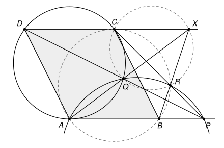

## Statement

Soit $ABCD$ un parallélogramme tel que $AC = BC$. Soit $P$ un point situé sur le prolongement du segment $[AB]$ au-delà de $B$.

Soit $Q$ le point d'intersection, autre que $D$, entre le segment $[PD]$ et le cercle circonscrit au triangle $ACD$. Soit ensuite $R$ le point d'intersection, autre que $P$, entre le segment $[PC]$ et le cercle circonscrit au triangle $APQ$.

Démontrer que les droites $(AQ)$, $(BR)$ et $(CD)$ sont concourantes.

![Le parallélogramme ABCD, le point P sur le prolongement de [AB], le cercle passant par A, C, D, le cercle passant par A, P, Q, et les points Q et R](12661-figure-1.svg)

## Hints

1. Trace une grande figure soignée. Cherche des angles égaux : la droite $(AB)$ est parallèle à $(CD)$, le triangle $ABC$ est isocèle, et $ABCD$ est un parallélogramme. Combien d'angles égaux à $\widehat{CAB}$ trouves-tu ?
2. Montre que le point $R$ est sur le cercle qui passe par $A$, $B$ et $C$. Pour cela, compare les angles $\widehat{ARC}$ et $\widehat{ABC}$, en passant par le point $Q$.
3. Note $X$ le point où la droite $(AQ)$ coupe la droite $(CD)$. Il suffit de montrer que $B$, $R$ et $X$ sont alignés. Montre d'abord que $C$, $Q$, $R$ et $X$ sont sur un même cercle, en comparant les angles $\widehat{QRC}$ et $\widehat{QXC}$.
4. Pour conclure, calcule $\widehat{CRX}$ grâce à ce dernier cercle, puis $\widehat{BRC}$ grâce au cercle passant par $A$, $B$, $C$, $R$. Que vaut leur somme ?

## Solution

On note $\omega_1$ le cercle circonscrit au triangle $ACD$, qui passe par $Q$, et $\omega_2$ le cercle circonscrit au triangle $APQ$, qui passe par $R$. On note $X$ le point d'intersection des droites $(AQ)$ et $(CD)$ (on verra à l'étape 1 qu'il existe). Il suffit de montrer que **les points $B$, $R$ et $X$ sont alignés** : la droite $(BR)$ passera alors par $X$, qui est sur $(AQ)$ et sur $(CD)$.

**L'outil : le théorème de l'angle inscrit.** Soient $U$ et $V$ deux points d'un cercle, et $M$, $N$ deux autres points de ce cercle.

- Si $M$ et $N$ sont du même côté de la droite $(UV)$, alors $\widehat{UMV} = \widehat{UNV}$.
- Si $M$ et $N$ sont de part et d'autre de $(UV)$, alors $\widehat{UMV} + \widehat{UNV} = 180^\circ$.

En effet, la corde $[UV]$ coupe le cercle en deux arcs, et un angle inscrit qui intercepte $[UV]$ vaut la moitié de l'arc qu'il intercepte : il vaut donc une certaine valeur $\varphi$ sur l'un des arcs et $180^\circ - \varphi$ sur l'autre. On utilisera aussi la **réciproque** : si $M$ et $N$ sont du même côté de $(UV)$ et si $\widehat{UMV} = \widehat{UNV}$, alors $U$, $V$, $M$ et $N$ sont sur un même cercle.

Tout repose donc sur la position des points par rapport aux droites. L'étape 1 rassemble ces vérifications. On peut la lire en dernier.

**Étape 1 : la position des points.** Le parallélogramme est compris entre les deux droites parallèles $(AB)$ et $(CD)$, qu'on appelle les deux bords de la **bande**. On utilise souvent ce fait évident : si un point $U$ est sur une droite $d$, tous les points d'un segment $[UV]$, ou d'une demi-droite $[UV)$, autres que $U$, sont du même côté de $d$ que $V$.

- *(a)* Les diagonales du parallélogramme se coupent, donc $B$ et $D$ sont de part et d'autre de $(AC)$. Le point $P$ est sur la demi-droite $[AB)$, donc du côté de $B$. De même, $(BC)$ est parallèle à $(AD)$, donc $C$ et $B$ sont du même côté de $(AD)$, et $P$ aussi.
- *(b)* D'après (a), le segment $[PD]$ coupe la droite $(AC)$ en un point $Y$. Comme $P$ et $D$ sont sur les deux bords de la bande, le segment $[PD]$ reste dans la bande, et la partie de la droite $(AC)$ située dans la bande est le segment $[AC]$. De plus $Y \neq A$ et $Y \neq C$, car la droite $(PD)$ ne coupe $(AB)$ qu'en $P$ et $(CD)$ qu'en $D$. Donc **$Y$ est strictement entre $A$ et $C$**.
- *(c)* Le point $Y$, situé sur la corde $[AC]$ sans en être une extrémité, est à l'intérieur du cercle $\omega_1$. Or la droite $(PD)$ coupe $\omega_1$ en $D$ et $Q$, et ses points situés à l'intérieur du cercle sont ceux du segment $[DQ]$. Donc $Y$ est entre $D$ et $Q$. On a aussi $Q \neq P$, sans quoi le triangle $APQ$ n'existerait pas. Sur le segment $[PD]$, les points sont donc dans l'ordre $D$, $Y$, $Q$, $P$. Ainsi **$Q$ est à l'intérieur du triangle $ACP$**, sur le segment qui joint le point $Y$ du côté $[AC]$ au sommet $P$. On en déduit :
  - $Q$ et $D$ sont de part et d'autre de $(AC)$, puisque $Y$ est entre eux ;
  - $Q$ et $C$ sont du même côté de $(AD)$, car tout le triangle $ACP$ est du côté de $C$ et de $P$, d'après (a) ;
  - $Q$ et $A$ sont du même côté de $(PC)$, et donc $D$ aussi, car $Q$ est sur $[PD]$ ;
  - la droite $(CQ)$, qui part du sommet $C$ et passe par le point intérieur $Q$, ressort du triangle par le côté $[AP]$ : **$A$ et $P$ sont de part et d'autre de $(CQ)$**.
- *(d)* Le point $R$ est sur le segment $[PC]$, et $R \neq C$. En effet, si $R$ était égal à $C$, le cercle $\omega_2$ passerait par $A$, $C$ et $Q$, et serait donc le cercle $\omega_1$. La droite $(PD)$ couperait alors $\omega_1$ en trois points $P$, $Q$ et $D$, ce qui est impossible. On en déduit :
  - $Q$ et $R$ sont tous les deux strictement à l'intérieur de la bande, donc du même côté de $(AB)$, et du même côté de $(CD)$ ;
  - $R$ est du même côté de $(AC)$ que $P$, donc que $B$ ;
  - $R$ est du même côté de $(PD)$ que $C$. Or $A$ et $C$ sont de part et d'autre de $(PD)$, puisque $Y$ est entre eux. Donc **$R$ et $A$ sont de part et d'autre de $(PD)$** ;
  - $B$ est entre $A$ et $P$, donc $A$ et $P$ sont de part et d'autre de $(BC)$, et **$R$ et $A$ sont de part et d'autre de $(BC)$**.
- *(e)* Le point $Q$ est strictement à l'intérieur de la bande, donc la droite $(AQ)$ n'est pas parallèle à $(CD)$, et le point $X$ existe. En allant de $A$, sur un bord, vers $X$, sur l'autre bord, on traverse la bande, et l'on passe par $Q$ : **$Q$ est strictement entre $A$ et $X$**. On en déduit :
  - $X$ est sur la demi-droite $[AQ)$, donc du même côté de $(AC)$ que $Q$, c'est-à-dire du côté opposé à $D$. Sur la droite $(CD)$, ce sont les points situés au-delà de $C$ : **$C$ est strictement entre $D$ et $X$** ;
  - $X$ et $A$ sont de part et d'autre de $(CQ)$, et $R$ est du côté de $P$. Comme $A$ et $P$ sont de part et d'autre de $(CQ)$, **$R$ et $X$ sont du même côté de $(CQ)$** ;
  - $D$ et $X$ sont de part et d'autre de $(PC)$, puisque $C$ est entre eux. Or $D$ est du côté de $A$, donc du côté de $B$. Ainsi **$B$ et $X$ sont de part et d'autre de $(PC)$**.

**Étape 2 : quatre angles égaux.** On pose $\alpha = \widehat{CAB}$.

- Le triangle $ABC$ est isocèle en $C$, puisque $CA = CB$. Donc $\widehat{CBA} = \alpha$.
- Les droites $(AB)$ et $(CD)$ sont parallèles, et $B$ et $D$ sont de part et d'autre de la sécante $(AC)$. Les angles alternes-internes sont égaux : $\widehat{ACD} = \widehat{CAB} = \alpha$.
- Les angles opposés d'un parallélogramme sont égaux : $\widehat{ADC} = \widehat{ABC} = \alpha$.

Ainsi $\widehat{CAB} = \widehat{CBA} = \widehat{ACD} = \widehat{ADC} = \alpha$.

**Étape 3 : $R$ est sur le cercle qui passe par $A$, $B$ et $C$.**

- Les points $R$ et $Q$ sont sur $\omega_2$, du même côté de $(AP)$. D'après le théorème de l'angle inscrit, $\widehat{ARP} = \widehat{AQP}$.
- Le point $R$ est entre $P$ et $C$, donc $\widehat{ARC} = 180^\circ - \widehat{ARP}$. De même, $Q$ est entre $P$ et $D$, donc $\widehat{AQD} = 180^\circ - \widehat{AQP}$. On en déduit $\widehat{ARC} = \widehat{AQD}$.
- Les points $Q$ et $C$ sont sur $\omega_1$, du même côté de $(AD)$. Donc $\widehat{AQD} = \widehat{ACD} = \alpha$.

Ainsi $\widehat{ARC} = \alpha = \widehat{ABC}$. Les points $R$ et $B$ sont du même côté de $(AC)$ : d'après la réciproque du théorème de l'angle inscrit, **$A$, $B$, $C$ et $R$ sont sur un même cercle**, qu'on note $\omega_3$.

**Étape 4 : $C$, $Q$, $R$ et $X$ sont sur un même cercle.**

- Les points $R$ et $A$ sont sur $\omega_2$, de part et d'autre de la droite $(PQ)$, qui est la droite $(PD)$. Donc $\widehat{QRP} + \widehat{QAP} = 180^\circ$.
- Le point $R$ est entre $P$ et $C$, donc $\widehat{QRC} = 180^\circ - \widehat{QRP} = \widehat{QAP}$.
- Le point $Q$ est sur la demi-droite $[AX)$ et le point $P$ sur la demi-droite $[AB)$, donc $\widehat{QAP} = \widehat{XAB}$.
- Comme $\overrightarrow{DC} = \overrightarrow{AB}$ et que $C$ est entre $D$ et $X$, la demi-droite $[XD)$ est parallèle à $[AB)$ mais va dans le sens contraire. Les angles $\widehat{XAB}$ et $\widehat{AXD}$ sont alternes-internes, donc égaux.
- Enfin $Q$ est sur la demi-droite $[XA)$ et $C$ sur la demi-droite $[XD)$, donc $\widehat{AXD} = \widehat{QXC}$.

En enchaînant, $\widehat{QRC} = \widehat{QXC}$. Les points $R$ et $X$ sont du même côté de $(CQ)$ : d'après la réciproque du théorème de l'angle inscrit, **$C$, $Q$, $R$ et $X$ sont sur un même cercle**, qu'on note $\omega_4$.

**Étape 5 : $B$, $R$ et $X$ sont alignés.**

- Les points $R$ et $Q$ sont sur $\omega_4$, du même côté de $(CX)$, qui est la droite $(CD)$. Donc $\widehat{CRX} = \widehat{CQX}$.
- Le point $Q$ est entre $A$ et $X$, donc $\widehat{CQX} = 180^\circ - \widehat{CQA}$.
- Les points $Q$ et $D$ sont sur $\omega_1$, de part et d'autre de $(AC)$. Donc $\widehat{CQA} + \widehat{CDA} = 180^\circ$, c'est-à-dire $\widehat{CQA} = 180^\circ - \alpha$.

On obtient $\widehat{CRX} = \widehat{CQX} = \alpha$.

- Les points $R$ et $A$ sont sur $\omega_3$, de part et d'autre de $(BC)$. Donc $\widehat{BRC} + \widehat{BAC} = 180^\circ$, c'est-à-dire $\widehat{BRC} = 180^\circ - \alpha$.

Ainsi $\widehat{BRC} + \widehat{CRX} = 180^\circ$. Ces deux angles ont le côté $[RC)$ en commun, et $B$ et $X$ sont de part et d'autre de la droite $(RC)$. Leur somme valant $180^\circ$, les demi-droites $[RB)$ et $[RX)$ sont dans le prolongement l'une de l'autre : **$B$, $R$ et $X$ sont alignés.**

**Conclusion.** La droite $(BR)$ passe par le point $X$, qui est sur $(AQ)$ et sur $(CD)$. **Les droites $(AQ)$, $(BR)$ et $(CD)$ sont concourantes en $X$.**

## Going further

- Le corrigé officiel suit les mêmes trois étapes, $ABCR$ cocyclique, puis $CQRX$ cocyclique, puis l'alignement, mais avec des **angles orientés de droites**, qui se voient après le bac. Avec eux, chaque égalité reste vraie quelle que soit la position des points, et l'on n'a pas besoin de l'étape 1. C'est pourquoi le corrigé tient en six lignes.
- La condition $AC = BC$ cache deux tangentes. Comme $AD = BC = AC$, le triangle $ACD$ est isocèle en $A$, et la droite $(AB)$, parallèle à sa base $[CD]$, est tangente en $A$ au cercle $\omega_1$. De même, $(CD)$ est tangente en $C$ au cercle $\omega_3$. Les triangles $ACD$ et $CAB$ sont d'ailleurs superposables, donc $\omega_1$ et $\omega_3$ ont le même rayon.
- Le commentaire des correcteurs signale un piège classique dans les problèmes de concours : utiliser, sans s'en rendre compte, un fait visible sur la figure mais pas encore démontré, comme la concourance elle-même. Certains élèves ont tracé exprès une seconde figure un peu fausse, où les trois droites ne concourent pas, pour être sûrs de ne pas s'en servir.
