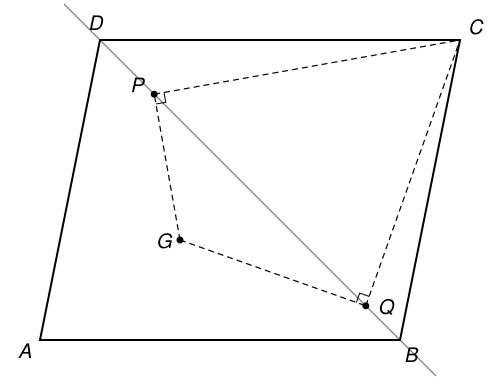

## Statement

Soit $ABCD$ un parallélogramme et $G$ le centre de gravité du triangle $ABD$. On note $P$ et $Q$ les deux points de la droite $(BD)$ tels que

- les droites $(GP)$ et $(PC)$ sont perpendiculaires,
- les droites $(GQ)$ et $(QC)$ sont perpendiculaires.

Démontrer que la droite $(AG)$ est la bissectrice de l'angle $\widehat{PAQ}$.

## Hints

1. Où sont les points d'où l'on voit le segment $[GC]$ sous un angle droit ? Tracez cette courbe sur la figure, et appelez $M$ son centre.
2. Soit $N$ le centre du parallélogramme. Montrez que $A$, $G$, $N$, $M$, $C$ sont alignés dans cet ordre, et exprimez $NA$, $NM$ et $NC$ en fonction de $NG$.
3. Calculez le produit $NP \times NQ$ en fonction de $NG$. Pour cela, appelez $H$ le pied de la perpendiculaire à $(BD)$ passant par $M$, et utilisez le théorème de Pythagore dans les triangles $MHP$ et $MHN$.
4. Comparez $NP \times NQ$ et $NA \times NM$. Une égalité de produits est une égalité de rapports : cherchez deux paires de triangles semblables qui ont $N$ pour sommet.
5. Terminez avec le triangle $MPQ$, qui est isocèle.

## Solution

### Étape 1 : placer les points sur la droite (AC)

Notons $N$ le centre du parallélogramme : c'est le milieu de $[BD]$ et aussi le milieu de $[AC]$. La droite $(AN)$ est donc la médiane issue de $A$ dans le triangle $ABD$, et le centre de gravité $G$ est sur $[AN]$, aux deux tiers à partir de $A$ :

$$AG = \frac{2}{3}\,AN, \qquad \text{donc} \qquad NG = \frac{1}{3}\,NA.$$

Posons $g = NG$. Alors $NA = 3g$, et comme $N$ est le milieu de $[AC]$, $NC = 3g$, avec $C$ de l'autre côté de $N$. Sur la droite $(AC)$, les points sont donc dans l'ordre $A$, $G$, $N$, $C$, avec $GC = g + 3g = 4g$.

Appelons $M$ le milieu de $[GC]$. Alors $GM = MC = 2g$, donc $M$ est entre $N$ et $C$, avec $NM = 2g - g = g$. En résumé, les cinq points sont alignés dans l'ordre

$$A,\ G,\ N,\ M,\ C, \qquad \text{avec} \qquad NA = 3g, \quad NG = NM = g, \quad NC = 3g.$$

### Étape 2 : P et Q sont sur un cercle de centre M

Un angle $\widehat{GPC}$ est droit exactement quand $P$ est sur le cercle de diamètre $[GC]$. Appelons $\Gamma$ ce cercle : son centre est $M$ et son rayon est $r = 2g$. Les points $P$ et $Q$ sont donc les points communs à $\Gamma$ et à la droite $(BD)$. Il y en a bien deux, car la distance de $M$ à la droite $(BD)$ est au plus $MN = g$, qui est plus petit que le rayon $2g$.

En particulier $MP = MQ = 2g$.

### Étape 3 : le produit NP × NQ

Soit $H$ le pied de la perpendiculaire à $(BD)$ passant par $M$. Le triangle $MPQ$ est isocèle en $M$, donc $H$ est le milieu de $[PQ]$. Le théorème de Pythagore donne

$$HP^2 = MP^2 - MH^2 = 4g^2 - MH^2, \qquad HN^2 = MN^2 - MH^2 = g^2 - MH^2.$$

(Si $H = N$, la seconde égalité dit simplement $0 = 0$.) En particulier $HN < HP$ : le point $N$, situé à la distance $HN$ du milieu $H$ de $[PQ]$, est donc strictement entre $P$ et $Q$. Quitte à échanger les noms de $P$ et $Q$, on a $NP = HP - HN$ et $NQ = HP + HN$, d'où

$$NP \times NQ = (HP - HN)(HP + HN) = HP^2 - HN^2 = 4g^2 - g^2 = 3g^2.$$

Or $NA \times NM = 3g \times g = 3g^2$ aussi. On a donc

$$NA \times NM = NP \times NQ. \qquad (\star)$$

### Étape 4 : deux paires de triangles semblables

On utilise le critère suivant : deux triangles qui ont un angle égal, compris entre deux côtés proportionnels, sont semblables.

**Les triangles $NAP$ et $NQM$.** L'égalité $(\star)$ s'écrit $NA/NQ = NP/NM$. De plus, $N$ est entre $A$ et $M$, et aussi entre $P$ et $Q$, donc les angles $\widehat{ANP}$ et $\widehat{QNM}$ sont opposés par le sommet, donc égaux. Les deux triangles sont semblables, $A$ correspondant à $Q$ et $P$ à $M$. Par conséquent

$$\widehat{NAP} = \widehat{NQM}.$$

Comme $N$ est sur $[AM]$ et sur $[QP]$, cela s'écrit $\widehat{MAP} = \widehat{PQM}$.

**Les triangles $NAQ$ et $NPM$.** De la même façon, $(\star)$ s'écrit $NA/NP = NQ/NM$, et les angles $\widehat{ANQ}$ et $\widehat{PNM}$ sont opposés par le sommet. Les deux triangles sont semblables, donc

$$\widehat{NAQ} = \widehat{NPM}, \qquad \text{c'est-à-dire} \qquad \widehat{MAQ} = \widehat{QPM}.$$

### Étape 5 : conclusion

Le triangle $MPQ$ est isocèle en $M$, donc ses angles à la base sont égaux : $\widehat{QPM} = \widehat{PQM}$. Avec l'étape 4,

$$\widehat{MAP} = \widehat{PQM} = \widehat{QPM} = \widehat{MAQ}.$$

De plus la demi-droite $[AM)$ passe par le point $N$, situé entre $P$ et $Q$ : elle est à l'intérieur de l'angle $\widehat{PAQ}$, qu'elle partage en deux angles égaux. C'est donc la bissectrice de $\widehat{PAQ}$. Comme $A$, $G$ et $M$ sont alignés, la droite $(AM)$ est la droite $(AG)$.

**La droite $(AG)$ est bien la bissectrice de l'angle $\widehat{PAQ}$.**

*Remarque.* L'égalité $(\star)$ dit aussi que les quatre points $A$, $P$, $M$, $Q$ sont sur un même cercle, dont $M$ est alors le milieu de l'arc $PQ$. C'est ainsi que le corrigé officiel présente la fin, avec le vocabulaire de la « puissance d'un point ».

## Going further

1. Le résultat reste-t-il vrai si l'on remplace le centre de gravité $G$ par un autre point $G'$ du segment $[AN]$ ? Refaites le calcul de l'étape 3 avec $NG' = x \cdot NA$ et cherchez pour quelles valeurs de $x$ l'égalité $(\star)$ tient encore.
