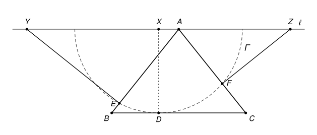

## Statement

Soit $ABC$ un triangle isocèle en $A$ dont les trois angles sont aigus, et soit $D$ un point du segment $[BC]$. On note $\ell$ la droite parallèle à $(BC)$ passant par $A$, puis $X$ le point de $\ell$ tel que $(XD)$ soit perpendiculaire à $(BC)$, et $\Gamma$ le cercle de centre $X$ passant par $D$.

Le cercle $\Gamma$ coupe le segment $[AB]$ en un point $E$, et on note $Y$ le point de $\ell$ tel que $(EY)$ soit perpendiculaire à $(AB)$. De même, $\Gamma$ coupe le segment $[AC]$ en un point $F$, et on note $Z$ le point de $\ell$ tel que $(FZ)$ soit perpendiculaire à $(AC)$.

Démontrer que les bissectrices des angles $\widehat{EYA}$ et $\widehat{FZA}$ se coupent en un point de la droite $(XD)$.

## Hints

1. Prolongez les droites $(EY)$ et $(FZ)$ : elles se coupent en un point $U$. Où semble-t-il se trouver ?
2. Les triangles $AEU$ et $AFU$ sont rectangles en $E$ et en $F$. Sur quel cercle se trouvent $E$ et $F$ ?
3. Montrez que $X$ est sur ce cercle lui aussi. Pour cela, comparez les angles $\widehat{AEX}$ et $\widehat{AFX}$. La symétrie par rapport à $\ell$ envoie la droite $(AB)$ sur la droite $(AC)$, et $XE = XF$.
4. Calculez l'angle $\widehat{AYE}$ en fonction de l'angle $\widehat{ABC}$, puis l'angle $\widehat{AZF}$. Que dire alors des triangles $UXY$ et $UXZ$ ?

## Solution

**Rappel.** Voici deux propriétés du cercle que l'on va utiliser.

- *Cercle et angle droit.* Un triangle $PQM$ est rectangle en $M$ si et seulement si $M$ est sur le cercle de diamètre $[PQ]$.
- *Angles inscrits.* Soit $P$, $Q$ deux points, et $M$, $N$ deux points situés du même côté de la droite $(PQ)$. Si $\widehat{PMQ} = \widehat{PNQ}$, alors les quatre points $P$, $Q$, $M$, $N$ sont sur un même cercle.

Notons $H$ le milieu de $[BC]$. La droite $(AH)$ est l'axe de symétrie du triangle : elle est perpendiculaire à $(BC)$, donc aussi à $\ell$. Notons $\beta = \widehat{ABC} = \widehat{ACB}$. Comme l'angle $\widehat{BAC} = 180° - 2\beta$ est aigu, on a $\beta > 45°$.

### Étape 0 : où sont les points

*Le point $A$ est à l'intérieur de $\Gamma$.* Le quadrilatère $XAHD$ est un rectangle (ses côtés $(XD)$ et $(AH)$ sont perpendiculaires à $\ell$ et à $(BC)$), donc $XA = HD$ et $XD = AH$. Comme $D$ est sur $[BC]$, $HD \leq HB$. Dans le triangle $AHB$ rectangle en $H$, on a $\tan \beta = \frac{AH}{HB} > \tan 45° = 1$, donc $HB < AH$. Finalement $XA = HD \leq HB < AH = XD$ : le point $A$ est strictement à l'intérieur du cercle $\Gamma$. En particulier $E \neq A$ et $F \neq A$.

*Le point $Y$ est du côté de $B$.* Les droites $\ell$ et $(BC)$ sont parallèles, donc la demi-droite de $\ell$ issue de $A$ du côté de $B$ fait avec $[AB)$ un angle égal à $\beta$ (angles alternes-internes) : il est aigu. L'autre demi-droite fait avec $[AB)$ un angle $180° - \beta$, obtus. Or le triangle $AEY$ est rectangle en $E$, donc son angle en $A$ est aigu : $Y$ est sur la demi-droite de $\ell$ issue de $A$ du côté de $B$, et

$$\widehat{AYE} = 90° - \widehat{YAE} = 90° - \beta.$$

De même, $Z$ est sur la demi-droite de $\ell$ issue de $A$ du côté de $C$, et $\widehat{AZF} = 90° - \beta$. En particulier, **$A$ est strictement entre $Y$ et $Z$**.

### Étape 1 : le point U et le cercle de diamètre [AU]

Les droites $(EY)$ et $(FZ)$ sont perpendiculaires à $(AB)$ et à $(AC)$, qui ne sont pas parallèles : elles se coupent donc en un point $U$. Le triangle $AEU$ est rectangle en $E$, donc $E$ est sur le cercle $\mathcal{C}$ de diamètre $[AU]$. De même, $F$ est sur $\mathcal{C}$. Comme $A$, $E$, $F$ ne sont pas alignés, $\mathcal{C}$ est le seul cercle qui passe par $A$, $E$ et $F$.

### Étape 2 : le point X est sur le cercle C

Si $D = H$, alors $X = A$, et toute la figure est symétrique par rapport à $(AH) = (XD)$ : cette symétrie échange $B$ et $C$, conserve $\Gamma$, échange $E$ et $F$, puis $Y$ et $Z$. On peut alors passer directement à l'étape 5. On suppose désormais $D \neq H$, c'est-à-dire $X \neq A$.

Notons $C'$ un point de la droite $(AC)$ tel que $A$ soit entre $C$ et $C'$. La demi-droite $[AC')$ fait avec $[AY)$ le même angle $\beta$ que $[AC)$ avec $[AZ)$ (angles opposés par le sommet). Les demi-droites $[AB)$ et $[AC')$ font donc le même angle $\beta$ avec $[AY)$, de part et d'autre de $\ell$ : elles sont symétriques par rapport à $\ell$.

Soit $E'$ le symétrique de $E$ par rapport à $\ell$. Il est sur $[AC')$, donc sur la droite $(AC)$, et $A$ est strictement entre $E'$ et $F$. Comme $X$ est sur l'axe $\ell$, et comme $XE$ et $XF$ sont deux rayons de $\Gamma$,

$$XE' = XE = XF.$$

Le triangle $XE'F$ est donc isocèle en $X$, et ses angles à la base sont égaux : $\widehat{XE'F} = \widehat{XFE'}$. Comme $A$ est sur le segment $[E'F]$, cela s'écrit $\widehat{XE'A} = \widehat{XFA}$. Enfin, la symétrie conserve les angles, donc $\widehat{XE'A} = \widehat{XEA}$. On obtient

$$\widehat{AEX} = \widehat{AFX}.$$

Les points $E$ et $F$ sont du même côté de la droite $(AX) = \ell$, celui de $(BC)$. D'après le rappel, $A$, $X$, $E$, $F$ sont sur un même cercle, et ce cercle est $\mathcal{C}$.

### Étape 3 : le point U est sur la droite (XD)

Le point $U$ n'est pas sur $\ell$ : sinon il serait égal à $Y$ (la droite $(EY)$ ne coupe $\ell$ qu'en $Y$) et à $Z$, alors que $Y \neq Z$. Donc $X \neq U$, et $X \neq A$.

Le point $X$ est sur le cercle $\mathcal{C}$ de diamètre $[AU]$, donc le triangle $AXU$ est rectangle en $X$ : la droite $(XU)$ est perpendiculaire à $\ell$ en $X$. Or $(XD)$ est aussi perpendiculaire à $\ell$ en $X$, puisqu'elle est perpendiculaire à $(BC)$. Donc **$U$ est sur la droite $(XD)$**.

### Étape 4 : X est le milieu de [YZ]

Le point $Y$ est différent de $X$. Sinon la droite $(EY)$ passerait par $X$ et par $U$, et serait égale à $(XD)$ ; elle serait perpendiculaire à la fois à $(AB)$ et à $(BC)$, ce qui est impossible. De même, $Z \neq X$.

Le triangle $UXY$ est rectangle en $X$, donc son angle $\widehat{XYU}$ est aigu. C'est l'un des angles formés par les droites $(YU) = (YE)$ et $\ell$. Or deux droites sécantes forment deux angles, $\theta$ et $180° - \theta$, dont un seul est aigu. L'angle $\widehat{AYE} = 90° - \beta$ est lui aussi formé par ces deux droites, et il est aigu. Donc

$$\widehat{XYU} = 90° - \beta, \qquad \text{et de même} \qquad \widehat{XZU} = 90° - \beta.$$

Les triangles $UXY$ et $UXZ$ sont rectangles en $X$, ont le côté $[UX]$ en commun et le même angle en $Y$ et en $Z$. Donc

$$XY = \frac{UX}{\tan(90° - \beta)} = XZ.$$

Les points $Y$, $X$, $Z$ sont sur $\ell$, avec $XY = XZ$ et $Y \neq Z$ : $X$ est le milieu de $[YZ]$. Ainsi **la symétrie $\sigma$ d'axe $(XD)$ échange $Y$ et $Z$**.

### Étape 5 : les deux bissectrices sont symétriques

La symétrie $\sigma$ conserve la droite $\ell$, qui est perpendiculaire à son axe, et elle conserve chacun des deux côtés de $\ell$. Elle fixe $U$, qui est sur l'axe (dans le cas $D = H$, c'est vrai aussi : $U$ est le point commun de deux droites symétriques l'une de l'autre).

- La demi-droite $[YA)$ est égale à $[YZ)$, car $A$ est entre $Y$ et $Z$. Son image par $\sigma$ est $[ZY) = [ZA)$.
- La demi-droite $[YE)$ est la moitié de la droite $(YU)$ partant de $Y$ du côté de $(BC)$. Son image est la moitié de la droite $(ZU)$ partant de $Z$ du même côté, c'est-à-dire $[ZF)$.

La symétrie $\sigma$ transforme donc l'angle $\widehat{EYA}$ en l'angle $\widehat{FZA}$, et la bissectrice $\delta_Y$ du premier en la bissectrice $\delta_Z$ du second.

La droite $\delta_Y$ fait avec $\ell$ un angle $\frac{90° - \beta}{2}$, qui n'est pas droit : elle n'est pas parallèle à $(XD)$ et la coupe en un point $T$. Comme $T$ est sur l'axe, $\sigma(T) = T$, et $T$ est sur $\sigma(\delta_Y) = \delta_Z$. Les deux bissectrices sont deux droites différentes (seule $\delta_Y$ passe par $Y$, sinon $\delta_Z$ serait la droite $(YZ) = \ell$), et elles passent toutes deux par $T$.

**Les bissectrices des angles $\widehat{EYA}$ et $\widehat{FZA}$ se coupent donc au point $T$, qui est sur la droite $(XD)$.**

## Going further

1. Où a-t-on utilisé que les angles du triangle $ABC$ sont aigus ? Faites une figure avec un angle $\widehat{BAC}$ obtus : que devient le point $E$ ?
2. Montrez que le point $T$ est le centre du cercle inscrit dans le triangle $UYZ$.
