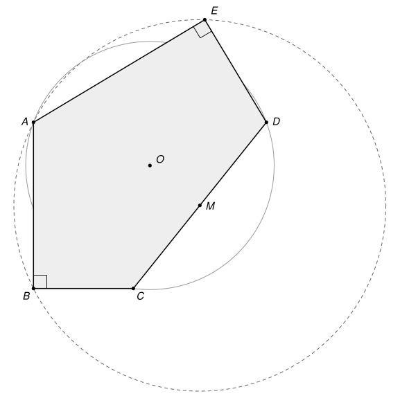

## Statement

Soit $ABCDE$ un pentagone convexe dont les angles en $B$ et en $E$ sont droits : $\widehat{ABC} = \widehat{DEA} = 90^\circ$. On suppose que le milieu $M$ du segment $[CD]$ est le centre du cercle circonscrit au triangle $ABE$. On note $O$ le centre du cercle circonscrit au triangle $ACD$.

Démontrer que le milieu du segment $[BE]$ appartient à la droite $(AO)$.

## Hints

1. Notez $X$ le point diamétralement opposé à $A$ sur le cercle circonscrit à $ABE$. Les angles droits en $B$ et en $E$ disent où se trouve $X$.
2. Le point $M$ est le milieu de $[AX]$ et de $[CD]$. Que pouvez-vous dire du quadrilatère $ACXD$ ? Quelles droites de la figure sont parallèles ?
3. Montrez que $(AB) \perp (AD)$ et $(AE) \perp (AC)$. La médiatrice de $[AD]$ passe par $O$ : à quelle droite est-elle parallèle ?
4. Notez $N$ le milieu de $[BE]$, de sorte que $\overrightarrow{AB} + \overrightarrow{AE} = 2\,\overrightarrow{AN}$. Il suffit de montrer que $\det\left(\overrightarrow{AB}, \overrightarrow{AO}\right) + \det\left(\overrightarrow{AE}, \overrightarrow{AO}\right) = 0$. Calculez chaque déterminant en passant par le milieu de $[AD]$, puis par celui de $[AC]$.

## Solution

On note $\Gamma$ le cercle circonscrit à $ABE$, de centre $M$, et $N$ le milieu de $[BE]$. On note aussi $P$ et $Q$ les milieux de $[AC]$ et de $[AD]$.

### Rappel : le déterminant de deux vecteurs

Dans un repère orthonormé, le déterminant des vecteurs $\vec{u}(x\,;y)$ et $\vec{v}(x'\,;y')$ est $\det(\vec{u}, \vec{v}) = xy' - yx'$. Directement à partir de cette formule, on vérifie que :

- $\det(\vec{u}, \vec{v}) = 0$ si et seulement si $\vec{u}$ et $\vec{v}$ sont colinéaires ;
- $\det(\vec{v}, \vec{u}) = -\det(\vec{u}, \vec{v})$ ;
- $\det(\vec{u} + \vec{w}, \vec{v}) = \det(\vec{u}, \vec{v}) + \det(\vec{w}, \vec{v})$ et $\det(k\vec{u}, \vec{v}) = k \det(\vec{u}, \vec{v})$ pour tout réel $k$, et de même pour le second vecteur.

Une conséquence sert sans cesse : **si $\vec{w}$ est colinéaire à $\vec{v}$, alors $\det(\vec{u} + \vec{w}, \vec{v}) = \det(\vec{u}, \vec{v})$**, puisque $\det(\vec{w}, \vec{v}) = 0$. De même, si $\vec{w}$ est colinéaire à $\vec{u}$, alors $\det(\vec{u}, \vec{v} + \vec{w}) = \det(\vec{u}, \vec{v})$.

### Étape 1 : le point diamétralement opposé à A

Soit $X$ le symétrique de $A$ par rapport à $M$. Comme $M$ est le centre de $\Gamma$, le segment $[AX]$ est un diamètre de $\Gamma$.

Le point $B$ est sur $\Gamma$. Si $B \neq X$, le triangle $ABX$ est inscrit dans un cercle dont $[AX]$ est un diamètre, donc il est rectangle en $B$ : $(BX) \perp (AB)$. Or $(BC) \perp (AB)$ aussi, et les deux droites passent par $B$, donc $(BX) = (BC)$. Dans tous les cas, **$X$ est sur la droite $(BC)$**.

De la même façon, avec l'angle droit en $E$, **$X$ est sur la droite $(DE)$**.

### Étape 2 : un parallélogramme

Le point $M$ est à la fois le milieu de $[AX]$ et celui de $[CD]$. Les diagonales du quadrilatère $ACXD$ ont le même milieu, donc c'est un parallélogramme :

$$\overrightarrow{CX} = \overrightarrow{AD} \qquad \text{et} \qquad \overrightarrow{DX} = \overrightarrow{AC}.$$

Le vecteur $\overrightarrow{CX}$ n'est pas nul, et les points $C$ et $X$ sont sur la droite $(BC)$. Donc **$(AD)$ est parallèle à $(BC)$**. De même, $D$ et $X$ sont sur $(DE)$, donc **$(AC)$ est parallèle à $(DE)$**.

On en déduit deux angles droits en $A$ :

- $(AB) \perp (BC)$ et $(BC) \parallel (AD)$, donc $(AB) \perp (AD)$ ;
- $(AE) \perp (DE)$ et $(DE) \parallel (AC)$, donc $(AE) \perp (AC)$.

### Étape 3 : le centre O

Le point $O$ est sur la médiatrice de $[AD]$, qui passe par $Q$ et est perpendiculaire à $(AD)$. La droite $(AB)$ est elle aussi perpendiculaire à $(AD)$. Donc le vecteur $\overrightarrow{QO}$ est colinéaire à $\overrightarrow{AB}$ (il est nul si $O = Q$).

De même, $O$ est sur la médiatrice de $[AC]$, perpendiculaire à $(AC)$ comme $(AE)$ : le vecteur $\overrightarrow{PO}$ est colinéaire à $\overrightarrow{AE}$.

### Étape 4 : le calcul

**Premier déterminant.** Comme $\overrightarrow{AO} = \overrightarrow{AQ} + \overrightarrow{QO}$ avec $\overrightarrow{QO}$ colinéaire à $\overrightarrow{AB}$, puis $\overrightarrow{AQ} = \tfrac{1}{2}\overrightarrow{AD}$,

$$\det\left(\overrightarrow{AB}, \overrightarrow{AO}\right) = \det\left(\overrightarrow{AB}, \overrightarrow{AQ}\right) = \frac{1}{2} \det\left(\overrightarrow{AB}, \overrightarrow{AD}\right).$$

Ensuite $\overrightarrow{AB} = \overrightarrow{AC} + \overrightarrow{CB}$, et $\overrightarrow{CB}$ est colinéaire à $\overrightarrow{AD}$ d'après l'étape 2. Donc

$$\det\left(\overrightarrow{AB}, \overrightarrow{AO}\right) = \frac{1}{2} \det\left(\overrightarrow{AC}, \overrightarrow{AD}\right).$$

**Second déterminant.** De même, $\overrightarrow{AO} = \overrightarrow{AP} + \overrightarrow{PO}$ avec $\overrightarrow{PO}$ colinéaire à $\overrightarrow{AE}$, et $\overrightarrow{AP} = \tfrac{1}{2}\overrightarrow{AC}$, donc

$$\det\left(\overrightarrow{AE}, \overrightarrow{AO}\right) = \frac{1}{2} \det\left(\overrightarrow{AE}, \overrightarrow{AC}\right).$$

Puis $\overrightarrow{AE} = \overrightarrow{AD} + \overrightarrow{DE}$, avec $\overrightarrow{DE}$ colinéaire à $\overrightarrow{AC}$, donc

$$\det\left(\overrightarrow{AE}, \overrightarrow{AO}\right) = \frac{1}{2} \det\left(\overrightarrow{AD}, \overrightarrow{AC}\right) = -\frac{1}{2} \det\left(\overrightarrow{AC}, \overrightarrow{AD}\right).$$

**La somme.** En ajoutant les deux résultats,

$$\det\left(\overrightarrow{AB} + \overrightarrow{AE}, \overrightarrow{AO}\right) = \det\left(\overrightarrow{AB}, \overrightarrow{AO}\right) + \det\left(\overrightarrow{AE}, \overrightarrow{AO}\right) = 0.$$

### Conclusion

Comme $N$ est le milieu de $[BE]$, on a $\overrightarrow{AB} + \overrightarrow{AE} = 2\,\overrightarrow{AN}$. L'étape 4 donne donc $\det\left(\overrightarrow{AN}, \overrightarrow{AO}\right) = 0$ : les vecteurs $\overrightarrow{AN}$ et $\overrightarrow{AO}$ sont colinéaires, et $\overrightarrow{AO}$ n'est pas nul.

**Le milieu $N$ de $[BE]$ est sur la droite $(AO)$.**

## Going further

1. La valeur absolue de $\det\left(\overrightarrow{AB}, \overrightarrow{AO}\right)$ est l'aire du parallélogramme construit sur $\overrightarrow{AB}$ et $\overrightarrow{AO}$, c'est-à-dire le double de l'aire du triangle $ABO$. Traduisez la solution en termes d'aires : quels triangles ont la même aire ? Pourquoi le calcul avec des aires seules ne suffit-il pas tout à fait à conclure, alors que le déterminant, qui garde un signe, suffit ?
2. Le corrigé officiel propose aussi une solution en coordonnées, avec $B$ à l'origine, $C$ sur l'axe des abscisses et $A$ sur l'axe des ordonnées. Essayez : quelle est l'équation qui traduit que $M$ est le centre du cercle $ABE$ ?
