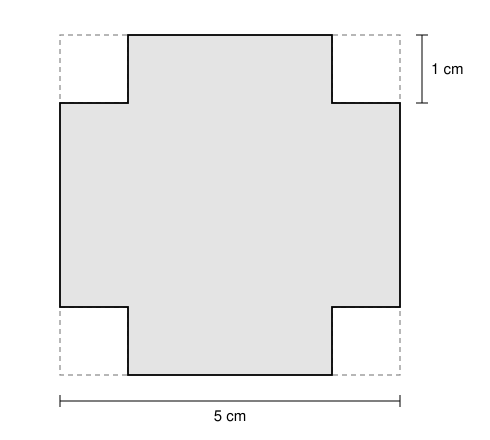
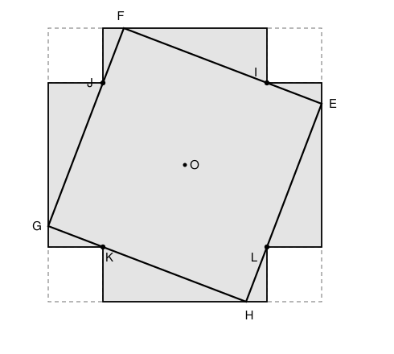

## Statement

On prend un carré de $5$ cm de côté, et on lui retire, à chacun de ses quatre coins, un carré
de $1$ cm de côté. Il reste une croix, en gris sur la figure.

Quelle est l'aire du plus grand carré que l'on peut placer à l'intérieur de cette croix ?

## Hints

1. Un carré dont les côtés sont parallèles à ceux de la figure ne peut pas avoir un côté de
   plus de $3$ cm. Pourquoi ? Il faut donc pencher le carré.
2. Prends le centre de la figure comme origine et le demi-centimètre comme unité : la croix
   va de $-5$ à $5$, et ses quatre coins rentrants sont les points $(\pm 3, \pm 3)$. Cherche un
   carré penché dont les quatre sommets $(5, t)$, $(-t, 5)$, $(-5, -t)$, $(t, -5)$ sont sur le
   bord extérieur, et dont chaque côté passe par un coin rentrant.
3. Pour montrer qu'on ne peut pas faire mieux : un coin rentrant ne peut jamais être
   strictement à l'intérieur du carré. Pourquoi ?
4. Si un côté du carré fait un angle $\theta$ avec l'horizontale, l'ombre du carré sur une
   droite horizontale mesure $s(\cos\theta + \sin\theta)$, où $s$ est son côté. Cette ombre ne
   peut pas dépasser la largeur de la croix.

## Solution

On prend pour origine le centre $O$ de la figure, des axes parallèles à ses côtés, et pour
unité le **demi-centimètre**, ce qui évite les nombres décimaux. Le grand carré est alors
formé des points dont les deux coordonnées sont comprises entre $-5$ et $5$, et les carrés
retirés ont un côté de $2$. On note $I(3, 3)$, $J(-3, 3)$, $K(-3, -3)$ et $L(3, -3)$ les quatre
coins rentrants de la croix. Une aire de $1$ cm² vaut $4$ unités d'aire, donc il s'agit de
montrer que **le plus grand carré a pour aire $60$**, soit $15$ cm².

**Un carré d'aire $60$ tient dans la croix.** Posons

$$E(5, \sqrt{5}), \qquad F(-\sqrt{5}, 5), \qquad G(-5, -\sqrt{5}), \qquad H(\sqrt{5}, -5).$$

- *C'est un carré d'aire $60$.* On a
  $EF^2 = (5 + \sqrt{5})^2 + (5 - \sqrt{5})^2 = 2 \times 25 + 2 \times 5 = 60$, et le même calcul
  donne $FG^2 = GH^2 = HE^2 = 60$. Les diagonales vérifient
  $EG^2 = 10^2 + (2\sqrt{5})^2 = 120$ et $FH^2 = (2\sqrt{5})^2 + 10^2 = 120$. Un losange dont les
  diagonales ont la même longueur est un carré. Son aire est $EF^2 = 60$.
- *Il est dans le grand carré*, car ses quatre sommets y sont.
- *Il évite les coins retirés.* Le point $I$ est sur le côté $[EF]$ : les pentes des droites
  $(EI)$ et $(IF)$ valent
  $$\frac{\sqrt{5} - 3}{5 - 3} = \frac{\sqrt{5} - 3}{2} \qquad \text{et} \qquad \frac{5 - 3}{-\sqrt{5} - 3} = \frac{-2}{\sqrt{5} + 3},$$
  et elles sont égales, car $(\sqrt{5} - 3)(\sqrt{5} + 3) = 5 - 9 = -4$. La droite $(EF)$
  descend vers la droite et passe par $I$ : pour $x \geqslant 3$, elle est à une hauteur au plus
  $3$. Le carré retiré en haut à droite, où $x \geqslant 3$ et $y \geqslant 3$, est donc au-dessus
  de $(EF)$, alors que le carré $EFGH$ est en dessous. Ils n'ont en commun que le point $I$, qui
  fait partie de la croix. Le quart de tour de centre $O$ envoie $E$ sur $F$, $F$ sur $G$, $G$ sur
  $H$, $H$ sur $E$, et $I$ sur $J$, $J$ sur $K$, $K$ sur $L$ : les trois autres coins sont évités de
  la même façon.

**On ne peut pas faire mieux.** Supposons qu'un carré $\mathcal{S}$ de côté $s$ tienne dans la
croix avec $s^2 > 60$, et cherchons une contradiction. On a $s > 7$, donc $\dfrac{s}{2} > \text{3,5}$.

*Étape 1 : aucun coin rentrant n'est strictement à l'intérieur de $\mathcal{S}$.* Si $I$
l'était, tout un petit disque autour de $I$ serait dans $\mathcal{S}$, et ce disque contient des
points du coin retiré, comme $(3 + \varepsilon, 3 + \varepsilon)$ pour $\varepsilon > 0$ petit.
C'est impossible. De même pour $J$, $K$ et $L$.

*Étape 2 : l'inclinaison.* Les côtés de $\mathcal{S}$ ont deux directions perpendiculaires.
Notons $\theta$ l'angle de l'une d'elles avec l'horizontale. Quitte à prendre l'autre
direction, ou à remplacer la figure par son symétrique par rapport à l'axe vertical, qui laisse
la croix en place, on peut supposer $0^\circ \leqslant \theta \leqslant 45^\circ$. Posons
$c = \cos\theta$ et $d = \sin\theta$. Alors $c \geqslant d \geqslant 0$, $c^2 + d^2 = 1$, et
$c + d \geqslant c^2 + d^2 = 1$ car $c$ et $d$ sont entre $0$ et $1$.

On utilise les deux vecteurs de longueur $1$ qui suivent les côtés,
$\vec{u}(c, d)$ et $\vec{v}(-d, c)$. Ils sont perpendiculaires, et on vérifie en développant
que

$$\vec{e} = c\,\vec{u} - d\,\vec{v} \qquad \text{et} \qquad \vec{f} = d\,\vec{u} + c\,\vec{v},$$

où $\vec{e}(1, 0)$ et $\vec{f}(0, 1)$ sont les vecteurs des axes.

*Étape 3 : le centre de $\mathcal{S}$ est près de $O$.* Soit $\Omega(m, n)$ le centre de
$\mathcal{S}$. Ses sommets sont les points $\Omega \pm \frac{s}{2}\vec{u} \pm \frac{s}{2}\vec{v}$.
Le plus à droite a pour abscisse $m + \frac{s}{2}(c + d)$, le plus à gauche
$m - \frac{s}{2}(c + d)$. Les deux sont entre $-5$ et $5$, donc

$$|m| \leqslant 5 - \frac{s}{2}(c + d) \qquad \text{et en particulier} \qquad c + d \leqslant \frac{10}{s}.$$

Le même raisonnement sur les ordonnées donne $|n| \leqslant 5 - \frac{s}{2}(c + d)$. Comme
$c + d \geqslant 1$, on obtient $|m| \leqslant 5 - \frac{s}{2} < \text{1,5}$ et de même
$|n| < \text{1,5}$, donc $\Omega O < \text{1,5} \times \sqrt{2} < \text{2,2}$.

*Étape 4 : les coins rentrants vus depuis le centre de $\mathcal{S}$.* Repérons chaque point
$P$ par ses coordonnées $(p_1, p_2)$ dans le repère $(\Omega ; \vec{u}, \vec{v})$, qui suit les
côtés de $\mathcal{S}$. Un point est strictement à l'intérieur de $\mathcal{S}$ exactement quand
$|p_1| < \frac{s}{2}$ et $|p_2| < \frac{s}{2}$.

Notons $(\omega_1, \omega_2)$ les coordonnées de $O$ dans ce repère. D'après le théorème de
Pythagore, $\omega_1^2 + \omega_2^2 = \Omega O^2$, donc $|\omega_1|$ et $|\omega_2|$ sont
inférieurs à $\text{2,2}$, et donc à $\frac{s}{2}$.

Avec l'étape 2, $\overrightarrow{OI} = 3\vec{e} + 3\vec{f} = a\,\vec{u} + b\,\vec{v}$,
où $a = 3(c + d)$ et $b = 3(c - d)$, avec $0 \leqslant b \leqslant a$. De même
$\overrightarrow{OJ} = -3\vec{e} + 3\vec{f} = -b\,\vec{u} + a\,\vec{v}$,
$\overrightarrow{OK} = -\overrightarrow{OI}$ et $\overrightarrow{OL} = -\overrightarrow{OJ}$.
Les coordonnées des coins rentrants sont donc

$$I(\omega_1 + a, \ \omega_2 + b), \quad J(\omega_1 - b, \ \omega_2 + a), \quad K(\omega_1 - a, \ \omega_2 - b), \quad L(\omega_1 + b, \ \omega_2 - a).$$

Enfin $a$ et $b$ sont inférieurs à $\frac{s}{2}$ : d'après l'étape 3,
$a = 3(c + d) \leqslant \dfrac{30}{s}$, et $\dfrac{30}{s} < \dfrac{s}{2}$ revient à $s^2 > 60$.

*Étape 5 : la contradiction.* Si deux nombres sont de signes contraires, la valeur absolue de
leur somme ne dépasse pas la plus grande de leurs deux valeurs absolues. On choisit le coin
selon les signes de $\omega_1$ et $\omega_2$ :

- si $\omega_1 \leqslant 0$ et $\omega_2 \leqslant 0$, on prend $I$ : on ajoute $a \geqslant 0$
  à $\omega_1$ et $b \geqslant 0$ à $\omega_2$ ;
- si $\omega_1 \geqslant 0$ et $\omega_2 \geqslant 0$, on prend $K$ ;
- si $\omega_1 \geqslant 0$ et $\omega_2 \leqslant 0$, on prend $J$ ;
- si $\omega_1 \leqslant 0$ et $\omega_2 \geqslant 0$, on prend $L$.

Dans chaque cas, les deux coordonnées du coin choisi sont des sommes de deux nombres de
signes contraires, chacun de valeur absolue inférieure à $\frac{s}{2}$. Elles sont donc
toutes les deux strictement entre $-\frac{s}{2}$ et $\frac{s}{2}$ : ce coin est strictement à
l'intérieur de $\mathcal{S}$, ce que l'étape 1 interdit.

Donc tout carré placé dans la croix a une aire au plus $60$ unités, et le carré $EFGH$ atteint
cette valeur.

**Le plus grand carré a pour aire $60$ unités d'aire, c'est-à-dire $15$ cm².** Son
côté vaut $\sqrt{15} \approx \text{3,87}$ cm.

## Going further

Dans le carré $EFGH$, tout est « juste » : les quatre sommets touchent le bord extérieur et les
quatre côtés touchent les coins rentrants. C'est typique d'un problème de plus grand objet :
l'objet optimal est bloqué de tous les côtés. Ici l'égalité $s^2 = 60$ correspond à
$c + d = \dfrac{10}{s}$, c'est-à-dire au carré penché de l'angle $\theta$ tel que
$\cos\theta + \sin\theta = \dfrac{10}{\sqrt{60}}$, environ $\text{20,9}^\circ$.
