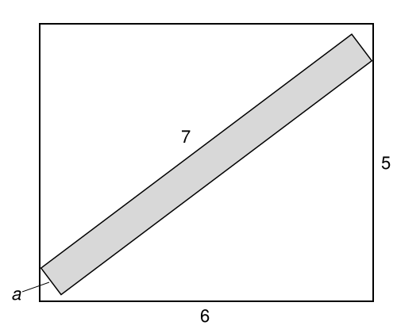

## Statement

Le fond d'une boîte est un rectangle de $6$ sur $5$. On veut poser à plat, au fond de cette
boîte, une plaque rectangulaire de longueur $7$ et de largeur $a$, avec $0 < a < 7$. La plaque
est plus longue que les deux côtés de la boîte : il faut donc la poser en biais, comme sur la
figure.

Quelles valeurs de $a$ conviennent ?

On donnera la plus grande valeur possible de $a$ à $10^{-3}$ près, à la calculatrice.

## Hints

1. Repérer la position de la plaque par l'angle $\theta$ entre son grand côté et le côté de
   longueur $6$ de la boîte. Pourquoi peut-on se limiter à $0^\circ \leq \theta \leq 90^\circ$ ?
2. Pour un angle $\theta$ donné, on peut faire glisser la plaque sans la tourner. Elle tient
   dans la boîte exactement quand sa largeur horizontale totale est au plus $6$ et sa hauteur
   totale au plus $5$. Calculer ces deux longueurs avec $\theta$ et $a$, en utilisant des
   triangles rectangles.
3. On obtient $7\cos\theta + a\sin\theta \leq 6$ et $7\sin\theta + a\cos\theta \leq 5$, ce
   qui s'écrit $a \leq f_1(\theta)$ et $a \leq f_2(\theta)$. La plus grande valeur de $a$ est
   la plus grande valeur que peut prendre le plus petit des deux nombres $f_1(\theta)$ et
   $f_2(\theta)$.
4. Pour voir que $f_1$ est croissante, poser $t = \frac{\sin\theta}{1 + \cos\theta}$ et
   vérifier que $\frac{1 - \cos\theta}{\sin\theta} = t$ et $\frac{1 + \cos\theta}{\sin\theta} = \frac{1}{t}$.
   Écrire ensuite $2(6 - 7\cos\theta)$ sous la forme $\alpha(1 - \cos\theta) - \beta(1 + \cos\theta)$.
5. Si $f_1$ est croissante et $f_2$ décroissante, le plus petit des deux est le plus grand à
   l'endroit où les deux courbes se croisent. Le trouver à la calculatrice par dichotomie.

## Solution

**Mise en équation.** Notons $\theta$ l'angle, en degrés, entre le grand côté de la plaque et
le côté de longueur $6$ de la boîte (le côté « horizontal »). Si on remplace $\theta$ par
$180^\circ - \theta$, on obtient l'image de la plaque dans un miroir vertical, et ce miroir
transforme la boîte en elle-même. On peut donc supposer $0^\circ \leq \theta \leq 90^\circ$.

Pour un angle $\theta$ fixé, entourons la plaque du plus petit rectangle à côtés horizontaux et
verticaux qui la contient. La plaque tient dans la boîte exactement quand ce rectangle a une
largeur au plus $6$ et une hauteur au plus $5$ : si c'est le cas, on fait glisser la plaque
pour que ce rectangle vienne dans le coin de la boîte ; sinon, la plaque déborde, quelle que
soit sa position.

Le grand côté, de longueur $7$, fait l'angle $\theta$ avec l'horizontale : dans un triangle
rectangle, sa largeur horizontale est $7\cos\theta$ et sa hauteur $7\sin\theta$. Le petit côté,
de longueur $a$, lui est perpendiculaire : il fait l'angle $\theta$ avec la verticale, donc sa
largeur horizontale est $a\sin\theta$ et sa hauteur $a\cos\theta$. Quand on fait le tour de la
plaque, ces deux côtés se mettent bout à bout dans les deux directions, donc la plaque tient
pour l'angle $\theta$ si et seulement si

$$7\cos\theta + a\sin\theta \leq 6 \qquad \text{et} \qquad 7\sin\theta + a\cos\theta \leq 5 .$$

Comme $a > 0$, la première condition exige $7\cos\theta < 6$, soit $\theta > \theta_1$, où
$\theta_1$ est l'angle tel que $\cos\theta_1 = \frac{6}{7}$ ($\theta_1 \approx 31^\circ$). La
seconde exige $7\sin\theta < 5$, soit $\theta < \theta_2$, où $\sin\theta_2 = \frac{5}{7}$
($\theta_2 \approx \text{45,6}^\circ$). Pour $\theta_1 \leq \theta \leq \theta_2$, on a
$\sin\theta > 0$ et $\cos\theta > 0$, et les deux conditions s'écrivent

$$a \leq f_1(\theta) = \frac{6 - 7\cos\theta}{\sin\theta} \qquad \text{et} \qquad a \leq f_2(\theta) = \frac{5 - 7\sin\theta}{\cos\theta} .$$

Ainsi, **une largeur $a$ convient si et seulement s'il existe un angle $\theta$ entre
$\theta_1$ et $\theta_2$ tel que $a$ soit au plus le plus petit des deux nombres $f_1(\theta)$
et $f_2(\theta)$.**

**$f_1$ est croissante.** Posons $t = \frac{\sin\theta}{1 + \cos\theta}$. Quand $\theta$ augmente
de $0^\circ$ à $90^\circ$, $\sin\theta$ augmente et $\cos\theta$ diminue : le numérateur augmente
et le dénominateur, positif, diminue, donc $t$ augmente. Comme
$(1 - \cos\theta)(1 + \cos\theta) = 1 - \cos^2\theta = \sin^2\theta$, on a

$$\frac{1 - \cos\theta}{\sin\theta} = \frac{\sin\theta}{1 + \cos\theta} = t \qquad \text{et} \qquad \frac{1 + \cos\theta}{\sin\theta} = \frac{1}{t} .$$

Or $2(6 - 7\cos\theta) = 12 - 14\cos\theta = 13(1 - \cos\theta) - (1 + \cos\theta)$. En divisant
par $2\sin\theta$ :

$$f_1(\theta) = \frac{1}{2}\left(13\,t - \frac{1}{t}\right) .$$

Quand $\theta$ augmente, $t$ augmente, donc $13t$ augmente et $-\frac{1}{t}$ augmente aussi :
$f_1$ est strictement croissante.

**$f_2$ est décroissante.** De même, avec $u = \frac{\cos\theta}{1 + \sin\theta}$, qui diminue
quand $\theta$ augmente, on a $\frac{1 - \sin\theta}{\cos\theta} = u$ et
$\frac{1 + \sin\theta}{\cos\theta} = \frac{1}{u}$. Comme
$2(5 - 7\sin\theta) = 12(1 - \sin\theta) - 2(1 + \sin\theta)$, on obtient

$$f_2(\theta) = 6u - \frac{1}{u} ,$$

qui est strictement décroissante.

**Le meilleur angle.** On a $f_1(\theta_1) = 0 < f_2(\theta_1)$ et $f_2(\theta_2) = 0 < f_1(\theta_2)$.
La différence $f_1 - f_2$ est strictement croissante, négative en $\theta_1$ et positive en
$\theta_2$ : comme ces courbes se tracent sans lever le crayon, elles se croisent, et en un
seul angle $\theta^*$. Posons
$a^* = f_1(\theta^*) = f_2(\theta^*)$.

- Pour $\theta \leq \theta^*$, le plus petit des deux nombres est au plus $f_1(\theta) \leq f_1(\theta^*) = a^*$.
- Pour $\theta \geq \theta^*$, il est au plus $f_2(\theta) \leq f_2(\theta^*) = a^*$.

Le plus petit des deux nombres ne dépasse donc jamais $a^*$, et il vaut $a^*$ pour
$\theta = \theta^*$. Une largeur $a$ convient si et seulement si $a \leq a^*$.

**Calcul.** À la calculatrice (en degrés) :

| $\theta$ | $36^\circ$ | $38^\circ$ | $\text{38,4}^\circ$ | $\text{38,5}^\circ$ | $39^\circ$ | $40^\circ$ |
|---|---|---|---|---|---|---|
| $f_1(\theta)$ | $\text{0,573}$ | $\text{0,786}$ | $\text{0,828}$ | $\text{0,838}$ | $\text{0,890}$ | $\text{0,992}$ |
| $f_2(\theta)$ | $\text{1,095}$ | $\text{0,876}$ | $\text{0,832}$ | $\text{0,821}$ | $\text{0,765}$ | $\text{0,653}$ |

Les courbes se croisent entre $\text{38,4}^\circ$ et $\text{38,5}^\circ$. En continuant la
dichotomie, on trouve $\theta^* \approx \text{38,42}^\circ$ et $a^* \approx \text{0,8298}$.

**Conclusion :** la plaque tient dans la boîte si et seulement si $0 < a \leq a^*$, avec
$a^* \approx \text{0,830}$. Pour $a = a^*$, la plaque est inclinée d'environ $\text{38,4}^\circ$
et touche les quatre côtés de la boîte.

**Bilan.** Une plaque de longueur $7$ entre dans une boîte de $6$ sur $5$, dont la diagonale
mesure $\sqrt{61} \approx \text{7,8}$, mais seulement si elle est très étroite : sa largeur ne
peut pas dépasser environ $\text{0,83}$. Le problème se ramène à deux inégalités sur l'angle
d'inclinaison ; l'une se relâche et l'autre se resserre quand l'angle augmente, et le meilleur
angle est celui où elles sont des égalités en même temps.

## Going further

- Dans la position optimale, la plaque touche les quatre côtés :
  $7\cos\theta + a\sin\theta = 6$ et $a\cos\theta + 7\sin\theta = 5$. Résoudre ce système en
  $\cos\theta$ et $\sin\theta$, puis utiliser $\cos^2\theta + \sin^2\theta = 1$ pour montrer
  que $a^*$ est une solution de l'équation $a^4 - 159a^2 + 840a - 588 = 0$. C'est sa plus petite
  solution positive ; cette équation n'a pas de solution « simple », d'où la calculatrice.
- Pour une boîte de $L$ sur $\ell$ et une plaque de longueur $c$, à quelle condition sur $L$,
  $\ell$ et $c$ une plaque très fine (de largeur presque nulle) peut-elle entrer ?
- Le sujet ne donnait que la figure et la question : aucune indication. Pour un groupe, on peut
  d'abord faire chercher pour quels angles d'inclinaison un simple segment de longueur $7$ (une
  plaque de largeur nulle) entre dans la boîte.
