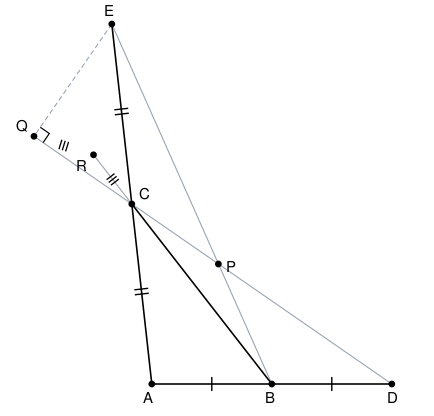

## Statement

Soit $ABC$ un triangle tel que $AB < BC$. On construit les points suivants.

- $D$ est le symétrique de $A$ par rapport à $B$.
- $E$ est le symétrique de $A$ par rapport à $C$.
- $P$ est le point d'intersection des droites $(DC)$ et $(BE)$.
- $Q$ est le pied de la perpendiculaire à $(DC)$ passant par $E$ : c'est donc le point où cette perpendiculaire coupe la droite $(DC)$.
- $R$ est le point de la droite $(BC)$ tel que le triangle $CQR$ soit isocèle en $R$, c'est-à-dire tel que $RC = RQ$.

Montrer que les trois droites $(AP)$, $(QR)$ et $(DE)$ passent toutes par un même point.

## Hints

1. Refaites la figure vous-même, en grand. Puis tracez les trois droites : elles se coupent quelque part. Où ? Regardez bien, ce point a l'air remarquable.
2. Oubliez un instant le triangle $ABC$ et regardez le triangle $ADE$. Où sont les points $B$ et $C$ dans ce triangle-là ?
3. Dans le triangle $ADE$, les droites $(DC)$ et $(BE)$ sont donc des médianes. Que représente alors leur point d'intersection $P$ ?
4. La droite $(BC)$ et la droite $(DE)$ sont parallèles. Pourquoi ? (Théorème des milieux.)
5. Pour la droite $(QR)$, appelez $M'$ son point d'intersection avec $(DE)$, et appliquez le théorème de Thalès dans la configuration de sommet $Q$ formée par $(CR)$ et $(DM')$.
6. L'angle $\widehat{DQE}$ est droit. Dans quel cercle le point $Q$ se trouve-t-il alors ?

## Solution

**L'idée générale.** On va montrer que les trois droites passent toutes par **$M$, le milieu du segment $[DE]$**. Comme $M$ est sur $(DE)$ par définition, il ne reste que deux choses à prouver : que $(AP)$ passe par $M$, et que $(QR)$ passe par $M$.

Le point de départ, c'est de changer de triangle : le bon triangle, ici, n'est pas $ABC$ mais $ADE$.

### Étape 1 : dans le triangle $ADE$, les points $B$ et $C$ sont des milieux

$D$ est le symétrique de $A$ par rapport à $B$, donc $B$ est le milieu de $[AD]$. De même, $C$ est le milieu de $[AE]$.

Deux conséquences immédiates.

**(a)** Dans le triangle $ADE$, la droite $(DC)$ joint le sommet $D$ au milieu $C$ du côté opposé $[AE]$ : c'est une médiane. De même $(EB)$ joint $E$ au milieu $B$ de $[AD]$ : c'est une médiane aussi.

**(b)** $(BC)$ joint les milieux de deux côtés du triangle $ADE$, donc, par le théorème des milieux, $(BC)$ et $(DE)$ sont **parallèles**.

### Étape 2 : la droite $(AP)$ passe par $M$

Les trois médianes d'un triangle sont concourantes. Comme $P$ est le point d'intersection des deux médianes $(DC)$ et $(BE)$ du triangle $ADE$, c'est le centre de gravité de ce triangle, et la troisième médiane passe aussi par $P$.

Cette troisième médiane part du sommet $A$ et rejoint le milieu $M$ de $[DE]$. Elle passe par $A$ et par $P$ : c'est donc la droite $(AP)$.

Donc $(AP)$ passe par $M$.

### Étape 3 : la droite $(QR)$ passe par $M$

C'est la partie la plus délicate. On introduit le point $M'$ : l'intersection de $(QR)$ avec $(DE)$. On veut montrer que $M' = M$.

**(a) Le point $M'$ est à égale distance de $D$ et de $Q$.**

Les points $Q$, $C$ et $D$ sont alignés (tous sur la droite $(DC)$), et les points $Q$, $R$ et $M'$ sont alignés (tous sur la droite $(QR)$). Enfin $(CR)$, qui est la droite $(BC)$, est parallèle à $(DM')$, qui est la droite $(DE)$, d'après l'étape 1(b).

On est donc dans une configuration de Thalès de sommet $Q$, avec les triangles $QCR$ et $QDM'$ :

$$\dfrac{QR}{QM'} = \dfrac{CR}{DM'}.$$

Or le triangle $CQR$ est isocèle en $R$, donc $CR = QR$. En remplaçant $CR$ par $QR$ dans l'égalité ci-dessus, on obtient

$$\dfrac{QR}{QM'} = \dfrac{QR}{DM'}, \qquad \text{donc} \qquad QM' = DM'.$$

Le point $M'$ est donc sur la médiatrice du segment $[DQ]$.

**(b) Le milieu $M$ de $[DE]$ est lui aussi à égale distance de $D$ et de $Q$.**

Par construction, $(EQ)$ est perpendiculaire à $(DC)$, et $D$ est sur $(DC)$. L'angle $\widehat{DQE}$ est donc droit.

Le triangle $DQE$ est ainsi rectangle en $Q$. Or, dans un triangle rectangle, le milieu de l'hypoténuse est le centre du cercle circonscrit. L'hypoténuse est ici $[DE]$, de milieu $M$, donc

$$MD = ME = MQ.$$

En particulier $MD = MQ$, donc $M$ est lui aussi sur la médiatrice de $[DQ]$.

**(c) Conclusion : $M = M'$.**

Les deux points $M$ et $M'$ appartiennent tous les deux à la droite $(DE)$ et à la médiatrice de $[DQ]$. Ces deux droites sont distinctes : la droite $(DE)$ passe par $D$, alors que la médiatrice de $[DQ]$ ne passe pas par $D$, puisque $Q \neq D$. Deux droites distinctes se coupent en au plus un point, donc

$$M = M'.$$

La droite $(QR)$ passe donc par $M$.

### Conclusion

Les trois droites $(AP)$, $(QR)$ et $(DE)$ passent toutes par le milieu $M$ du segment $[DE]$ : elles sont concourantes.

*Le piège à éviter.* Il ne faut surtout pas commencer par écrire « soit $X$ le point d'intersection des trois droites » : c'est précisément ce que l'on cherche à démontrer, et le supposer revient à admettre l'énoncé. La méthode correcte est celle employée ici : on devine le point de rendez-vous, on le définit indépendamment des trois droites (ici, comme milieu de $[DE]$), puis on montre que chaque droite passe par lui.

## Going further

1. L'hypothèse $AB < BC$ sert-elle vraiment ? Refaites la figure avec $AB > BC$ et regardez si la démonstration tient encore.
2. La construction de $D$ et $E$ comme symétriques de $A$ est en fait une façon déguisée de dire « $B$ et $C$ sont les milieux ». Montrez que le résultat reste vrai si l'on part directement d'un triangle $ADE$ quelconque en appelant $B$ et $C$ les milieux de $[AD]$ et $[AE]$.
