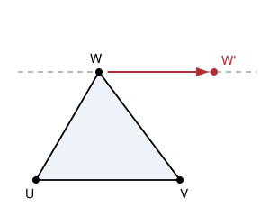

## Statement

Trois jetons sont posés sur un repère du plan, aux points de coordonnées

$$(0, 0), \qquad (0, 1), \qquad (1, 0).$$

Chaque minute, il se passe la chose suivante : deux des jetons ne bougent pas, et le troisième glisse le long d'une droite **parallèle à la droite qui joint les deux autres**. Il peut aussi choisir de ne pas bouger.

Peut-on, après un certain nombre de minutes, se retrouver avec les trois jetons aux points

$$(-1, 0), \qquad (0, 1), \qquad (1, 0) \ ?$$

## Hints

1. Quand on ne peut pas atteindre une position, c'est en général qu'une quantité ne change jamais. Cherchez une telle quantité.
2. Les trois jetons forment un triangle. Que se passe-t-il pour ce triangle lors d'un déplacement autorisé ?
3. L'aire d'un triangle vaut la moitié de la base multipliée par la hauteur correspondante. Prenez comme base le segment qui joint les deux jetons immobiles.
4. Le jeton qui bouge reste sur une parallèle à cette base. Sa distance à la base change-t-elle ?
5. Calculez l'aire au départ, puis l'aire de la position visée, et comparez.

## Solution

### L'aire ne change jamais

Regardons le triangle formé par les trois jetons. Lors d'un déplacement, deux jetons restent fixes : appelons $[UV]$ le segment qu'ils forment, et $W$ le jeton qui bouge.

L'aire du triangle $UVW$ vaut

$$\mathcal{A} = \dfrac{1}{2} \times UV \times h,$$

où $h$ est la distance de $W$ à la droite $(UV)$.

Pendant le déplacement :

- la longueur $UV$ ne change pas, puisque $U$ et $V$ ne bougent pas ;
- le point $W$ se déplace sur une droite parallèle à $(UV)$, et tous les points d'une même parallèle sont à la même distance de $(UV)$. Donc $h$ ne change pas non plus.

L'aire $\mathcal{A}$ est donc la même avant et après le déplacement. Comme c'est vrai à chaque minute, **l'aire du triangle formé par les trois jetons ne change jamais** : c'est un invariant.

### L'aire de départ

Les trois points de départ sont $(0,0)$, $(0,1)$ et $(1,0)$. Le triangle qu'ils forment est rectangle en $(0,0)$, avec deux côtés de l'angle droit de longueur $1$ (l'un le long de l'axe des abscisses, l'autre le long de l'axe des ordonnées). Son aire vaut donc

$$\mathcal{A}_{\text{départ}} = \dfrac{1 \times 1}{2} = \dfrac{1}{2}.$$

### L'aire visée

Les trois points visés sont $(-1,0)$, $(1,0)$ et $(0,1)$. Prenons comme base le segment qui joint $(-1,0)$ à $(1,0)$ : il est porté par l'axe des abscisses et mesure $2$. Le troisième point, $(0,1)$, est à la distance $1$ de cet axe. L'aire vaut donc

$$\mathcal{A}_{\text{visée}} = \dfrac{2 \times 1}{2} = 1.$$

### Conclusion

L'aire devrait valoir $\dfrac{1}{2}$, puisqu'elle ne change jamais, et elle vaudrait $1$. C'est impossible.

$$\boxed{\text{Non, les trois jetons ne peuvent jamais atteindre cette position.}}$$

*Le point de méthode.* Pour montrer qu'une position est inatteignable, il ne sert à rien d'essayer des déplacements : il y en a une infinité. On cherche à la place une **quantité qui ne change jamais**, on la calcule au départ et à l'arrivée, et il suffit qu'elle diffère. Ici la quantité était géométrique, l'aire ; ailleurs ce sera une parité, un reste dans une division, ou une couleur.

## Going further

1. Quelles positions à trois jetons peut-on réellement atteindre depuis la position de départ ? Montrez qu'on peut amener les jetons sur n'importe quel triangle d'aire $\dfrac{1}{2}$ dont les sommets sont à coordonnées entières. (Commencez par déplacer un jeton en $(0,0)$, puis un deuxième en $(1,0)$.)
2. Le même invariant répond à cette question : en partant de $(0,0)$, $(0,1)$, $(1,0)$, peut-on atteindre $(0,0)$, $(0,2)$, $(2,0)$ ? Et $(0,0)$, $(0,1)$, $(1,1)$ ?
