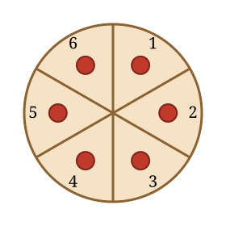

## Statement

Une tarte ronde est coupée en six parts égales, et une cerise est posée sur chaque part.

Jules voudrait réunir les six cerises sur une seule part, la sienne. Sa mère, mathématicienne, lui accorde le droit de déplacer les cerises, mais à une condition : **à chaque coup, il doit choisir deux cerises et les faire glisser toutes les deux en même temps, chacune sur une part voisine de celle où elle se trouve**. Les deux cerises n'ont pas besoin d'aller dans le même sens. Il peut répéter l'opération autant de fois qu'il veut.

Jules peut-il atteindre son but ?

## Hints

1. Numérotez les parts de $1$ à $6$ en tournant, comme sur la figure.
2. Cherchez une quantité qui ne change pas, ou qui ne change que d'une manière très limitée, à chaque coup.
3. Regardez la somme des numéros des parts sur lesquelles se trouvent les six cerises. De combien peut-elle varier en un coup ?
4. Attention aux parts $6$ et $1$, qui sont voisines : le numéro change alors de $5$. Est-ce gênant pour la parité ?

## Solution

**L'invariant : la parité de la somme des numéros.**

Numérotons les parts de $1$ à $6$ en tournant autour de la tarte. À chaque instant, considérons la somme $S$ des numéros des parts occupées par les six cerises (une cerise sur la part $4$ compte pour $4$ ; si deux cerises sont sur la part $4$, elles comptent $4 + 4$).

Regardons l'effet d'un déplacement d'**une seule** cerise vers une part voisine :

- de la part $k$ vers la part $k+1$ ou $k-1$ (pour $2 \leqslant k \leqslant 5$) : le numéro change de $+1$ ou $-1$ ;
- de la part $6$ vers la part $1$ : le numéro change de $-5$ ;
- de la part $1$ vers la part $6$ : le numéro change de $+5$.

Dans tous les cas, la variation est un nombre **impair** ($\pm 1$ ou $\pm 5$).

Or un coup déplace **deux** cerises à la fois. La variation totale de $S$ est donc la somme de deux nombres impairs, c'est-à-dire un nombre **pair**.

> **Conclusion : la parité de $S$ ne change jamais.**

**Le calcul décisif.**

Au départ, il y a une cerise sur chaque part, donc

$$S = 1 + 2 + 3 + 4 + 5 + 6 = 21 ,$$

qui est **impair**.

Si Jules réussissait, les six cerises seraient toutes sur une même part, disons la part numéro $k$. La somme vaudrait alors

$$S = \underbrace{k + k + k + k + k + k}_{6 \text{ fois}} = 6k ,$$

qui est **pair**, quelle que soit la valeur de $k$.

Il faudrait donc que $S$ passe d'impair à pair, ce qui est impossible puisque sa parité ne change jamais.

**Conclusion.** Non, Jules ne pourra jamais réunir les six cerises sur une seule part.

## Going further

On peut aussi colorier les parts alternativement en clair et en foncé : $1, 3, 5$ claires et $2, 4, 6$ foncées. Comme le nombre de parts est pair, deux parts voisines sont toujours de couleurs différentes. Chaque cerise déplacée change donc de couleur, et à chaque coup deux cerises changent de couleur : le nombre de cerises sur les parts claires varie de $-2$, $0$ ou $+2$. Sa parité est donc, elle aussi, un invariant. Au départ il y a $3$ cerises sur les parts claires (impair) ; à l'arrivée il y en aurait $0$ ou $6$ (pair). Même conclusion.

Ce deuxième argument montre au passage pourquoi le problème serait différent avec un nombre **impair** de parts : les parts $1$ et $n$ seraient alors de la même couleur et le coloriage ne fonctionnerait plus.
