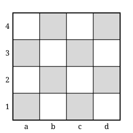
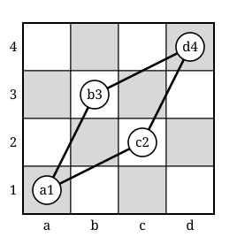

## Statement

On pose un cavalier d'échecs sur une case d'un échiquier $4 \times 4$. Les colonnes sont notées $a$, $b$, $c$, $d$ et les lignes $1$, $2$, $3$, $4$.

Le cavalier se déplace comme aux échecs : deux cases dans une direction, puis une case perpendiculairement.

Le cavalier peut-il visiter chacune des $16$ cases exactement une fois puis revenir sur sa case de départ ?

Si oui, donner un parcours. Si non, le démontrer.

## Hints

1. Essaie d'abord à la main, sur un dessin. Tu n'y arriveras pas : il faut donc chercher une raison.
2. Un tel parcours forme un circuit fermé de $16$ cases. Dans ce circuit, chaque case a exactement **deux** voisins : celle d'où le cavalier arrive et celle où il repart.
3. Les cases les plus pauvres sont les coins. Depuis $a1$, où le cavalier peut-il aller ? Fais la liste, il n'y a pas beaucoup de choix.
4. Fais la même liste pour le coin $d4$. Compare avec celle de $a1$.
5. Si deux cases ont exactement les mêmes deux voisins, et que chacune doit utiliser ses deux voisins, que se passe-t-il ?

## Solution

**Réponse : c'est impossible.**

**Ce qu'est un tel parcours.** Un parcours qui visite les $16$ cases une fois chacune et revient au départ est un **circuit fermé** de longueur $16$. Dans ce circuit, chaque case est reliée à exactement deux autres : celle qui la précède et celle qui la suit.

**Les coups depuis les coins.** Depuis un coin, un cavalier n'a que deux coups possibles. Faisons la liste pour deux coins opposés.

Depuis $a1$ : deux cases vers le haut et une vers la droite donne $b3$ ; une case vers le haut et deux vers la droite donne $c2$. Il n'y a rien d'autre, les autres directions sortent du plateau. Donc
$$\text{voisins de } a1 = \{\,b3,\ c2\,\}.$$

Depuis $d4$ : deux cases vers le bas et une vers la gauche donne $c2$ ; une case vers le bas et deux vers la gauche donne $b3$. Donc
$$\text{voisins de } d4 = \{\,b3,\ c2\,\}.$$

**Les deux coins ont exactement les mêmes voisins.** C'est là qu'est l'astuce.

**On en tire la contradiction.** Supposons qu'un circuit existe.

- La case $a1$ y a exactement deux voisins, et elle n'a que deux voisins possibles : le circuit utilise donc **les deux** arêtes $a1 - b3$ et $a1 - c2$.
- Pour la même raison, le circuit utilise **les deux** arêtes $d4 - b3$ et $d4 - c2$.

Regardons maintenant la case $b3$ : elle est déjà reliée dans le circuit à $a1$ et à $d4$. Ses deux places sont prises, elle ne peut être reliée à rien d'autre. Même chose pour $c2$.

Le circuit contient donc le chemin fermé
$$a1 \longrightarrow b3 \longrightarrow d4 \longrightarrow c2 \longrightarrow a1,$$
et aucune de ces quatre cases n'a de liaison vers l'extérieur.

Ce circuit se referme après **quatre** cases seulement. Il ne peut donc pas être le circuit de $16$ cases cherché, et le circuit ne peut pas non plus contenir deux boucles séparées, puisqu'un circuit est d'un seul tenant.

**Contradiction. Il n'existe pas de parcours fermé du cavalier sur l'échiquier $4 \times 4$.**

**Remarque.** Le même raisonnement vaut pour les deux autres coins : $a4$ et $d1$ ont eux aussi exactement les mêmes voisins, à savoir $b2$ et $c3$.

## Going further

1. En abandonnant l'obligation de revenir au départ, le cavalier peut-il visiter les $16$ cases exactement une fois ? (La réponse est encore non, mais l'argument ci-dessus ne suffit plus : il faut regarder de plus près.)
2. Sur un échiquier $5 \times 5$, montre qu'aucun circuit fermé n'existe non plus, cette fois pour une raison de coloriage : à chaque coup le cavalier change de couleur de case, et il y a $13$ cases d'une couleur contre $12$ de l'autre.
3. Sur l'échiquier ordinaire $8 \times 8$, un circuit fermé du cavalier existe. Cherche-en un : on appelle cela un *parcours fermé du cavalier*.
