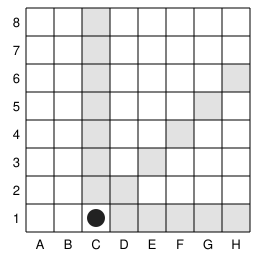
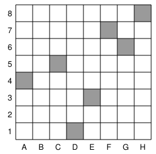

## Statement

On pose un jeton sur la case $C1$ d'un échiquier ordinaire $8 \times 8$ (les colonnes sont notées $A$ à $H$ de gauche à droite, les lignes $1$ à $8$ de bas en haut).

Deux joueurs déplacent le jeton à tour de rôle. À chaque tour, on déplace le jeton d'autant de cases que l'on veut, mais au moins une, dans l'une des trois directions suivantes :

- vers la droite,
- vers le haut,
- en diagonale vers le haut et vers la droite (le même nombre de cases dans les deux sens).

Le joueur qui amène le jeton sur la case $H8$ gagne.

Lequel des deux joueurs a une stratégie gagnante ?

## Hints

1. Le jeton ne peut jamais reculer ni descendre : la partie se termine forcément. Il y a donc un gagnant et un perdant, et on peut raisonner à l'envers.
2. Appelle une case **perdante** si le joueur qui doit jouer depuis cette case va perdre, et **gagnante** sinon. De quel type est la case $H8$ ?
3. Une case est gagnante dès qu'un coup mène de là à une case perdante. Elle est perdante si **tous** les coups mènent à des cases gagnantes.
4. Pars de $H8$ et remonte case par case. Toutes les cases de la ligne $8$, de la colonne $H$ et de la grande diagonale sont gagnantes : pourquoi ?
5. La première case perdante que tu trouveras après $H8$ est $G6$. Cherche ensuite sa symétrique, puis continue.

## Solution

**La partie est finie.** À chaque coup, le numéro de colonne ou le numéro de ligne augmente strictement. Le jeton ne peut donc jamais repasser deux fois au même endroit, et la partie s'arrête forcément. Il y a un gagnant et un perdant : on peut classer chaque case.

**Le vocabulaire.** Appelons une case **perdante** si le joueur dont c'est le tour, avec le jeton sur cette case, va perdre si son adversaire joue bien, et **gagnante** sinon. La règle de classement est la suivante :

- une case est **gagnante** s'il existe au moins un coup menant à une case perdante ;
- une case est **perdante** si tous les coups possibles mènent à des cases gagnantes.

**Le point de départ.** La case $H8$ est **perdante** : celui qui doit jouer depuis $H8$ a déjà perdu, puisque son adversaire vient d'y amener le jeton et a gagné. (Et de toute façon, aucun coup n'est possible depuis $H8$.)

**On remonte.** Toute case de la ligne $8$, toute case de la colonne $H$ et toute case de la grande diagonale $A1$–$H8$ permet d'atteindre $H8$ en un coup : ces cases sont donc **gagnantes**.

La première case qui n'est dans aucune de ces trois lignes, en partant du coin, est $G6$. Examinons-la : depuis $G6$ on atteint $G7$, $G8$, $H6$ et $F6$, $E6$, ..., ainsi que $H7$ en diagonale. Toutes ces cases sont sur la ligne $8$, la colonne $H$ ou la diagonale, sauf celles qu'il faut vérifier à la main ; en les passant en revue, on constate qu'aucune n'est perdante. Donc $G6$ est **perdante**, et par symétrie $F7$ aussi.

En continuant l'analyse à rebours, case par case, on obtient exactement **sept cases perdantes** :

$$H8, \quad G6, \quad F7, \quad E3, \quad C5, \quad D1, \quad A4 .$$

Remarque que ces cases sont symétriques par rapport à la grande diagonale, ce qui est normal : le jeu est inchangé si l'on échange les rôles des lignes et des colonnes.

**La réponse.** La case de départ $C1$ n'est pas dans cette liste : c'est une case **gagnante**. **C'est donc le joueur qui commence qui a une stratégie gagnante.**

**Sa stratégie.** Son premier coup : déplacer le jeton d'une case vers la droite, de $C1$ à $D1$, qui est perdante. Ensuite, depuis n'importe quelle case gagnante où son adversaire l'aura laissé, il existe toujours un coup vers une case perdante, et il le joue. Son adversaire repart donc toujours d'une case perdante, d'où tous les coups mènent à des cases gagnantes. De proche en proche, c'est le premier joueur qui finira par amener le jeton sur $H8$.

## Going further

La méthode employée ici, l'**analyse rétrograde**, s'applique à tout jeu fini sans match nul où les deux joueurs voient tout : on part des positions finales et on remonte. Elle est lente mais elle ne rate jamais rien.

Ce jeu-ci porte un nom, le **jeu de Wythoff**. Sur un échiquier infini, les cases perdantes suivent une règle remarquable : leurs coordonnées sont données par les multiples successifs du nombre d'or. C'est ce qui explique que les sept cases trouvées ici soient réparties de façon si irrégulière.
