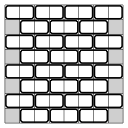

## Statement

Chloé et Dinh-Khanh jouent sur un échiquier $8 \times 8$.

Tour à tour, en commençant par Chloé, chaque joueur choisit une case qui n'a pas encore été choisie et la colorie dans sa couleur : **rouge** pour Chloé, **bleu** pour Dinh-Khanh.

Montrer que Dinh-Khanh peut toujours faire en sorte que Chloé n'obtienne jamais un carré $2 \times 2$ entièrement rouge.

## Hints

1. Dinh-Khanh n'a pas besoin de prévoir la partie : il lui suffit de **répondre** à chaque coup de Chloé.
2. Cherche à regrouper les $64$ cases en $32$ paires, une fois pour toutes, de sorte que Dinh-Khanh puisse toujours répondre dans la paire que Chloé vient d'entamer.
3. Pour que cela suffise, il faut que **chaque carré $2 \times 2$ de l'échiquier contienne les deux cases d'une même paire**. Pourquoi cela règle-t-il le problème ?
4. Essaie des paires horizontales, en décalant d'une colonne d'une ligne à l'autre, comme un mur de briques.
5. Un carré $2 \times 2$ occupe deux colonnes voisines $c$ et $c+1$. Selon la parité de $c$, dans quelle ligne du carré trouveras-tu une paire complète ?

## Solution

**La stratégie en une phrase.** Dinh-Khanh regroupe d'avance les $64$ cases en $32$ paires. Ensuite, **chaque fois que Chloé colorie une case, il colorie en bleu l'autre case de la paire**.

**Pourquoi ce coup est toujours disponible.** Après chacun des coups de Dinh-Khanh, toute paire est soit entièrement coloriée (une case rouge, une case bleue), soit entièrement vierge. Quand Chloé colorie une case, la paire de cette case était donc vierge, et son autre case est encore libre.

**Ce que cela garantit.** Aucune paire ne sera jamais entièrement rouge : dans chaque paire coloriée, il y a exactement une case rouge et une case bleue.

Il suffit donc de construire un regroupement tel que **tout carré $2 \times 2$ de l'échiquier contienne les deux cases d'une même paire**. Un tel carré contiendra alors une case bleue, et ne pourra pas être tout rouge.

**Le regroupement.** Numérotons les lignes et les colonnes de $1$ à $8$. On apparie les cases ligne par ligne, en décalant d'une colonne d'une ligne à l'autre, comme les briques d'un mur :

- dans chaque ligne **impaire**, on apparie les colonnes $(1,2)$, $(3,4)$, $(5,6)$, $(7,8)$ ;
- dans chaque ligne **paire**, on apparie les colonnes $(2,3)$, $(4,5)$, $(6,7)$ ; il reste alors, dans cette ligne, les deux cases des colonnes $1$ et $8$, que l'on apparie entre elles.

Chaque ligne fournit ainsi $4$ paires, soit $32$ paires en tout : toutes les cases sont bien rangées.

**La vérification.** Prenons un carré $2 \times 2$ quelconque : il occupe deux lignes voisines $r$ et $r+1$, et deux colonnes voisines $c$ et $c+1$, avec $1 \leqslant c \leqslant 7$. Parmi les deux lignes $r$ et $r+1$, l'une est paire et l'autre impaire.

- **Si $c$ est impair** (donc $c \in \{1, 3, 5, 7\}$), les colonnes $c$ et $c+1$ forment une paire dans la **ligne impaire** du carré. Cette paire est entièrement dans le carré.
- **Si $c$ est pair** (donc $c \in \{2, 4, 6\}$), les colonnes $c$ et $c+1$ forment une paire dans la **ligne paire** du carré.

Dans les deux cas, le carré contient une paire complète.

*(On remarque au passage que les paires formées par les deux cases des colonnes $1$ et $8$ ne servent jamais dans cette vérification : elles sont là uniquement pour que toutes les cases soient appariées.)*

**Conclusion.** Avec cette stratégie, **Dinh-Khanh empêche à coup sûr Chloé de colorier un carré $2 \times 2$ entièrement en rouge.**

## Going further

Remarque ce que la stratégie ne fait pas : elle ne cherche jamais à deviner ce que Chloé prépare, et elle ne réfléchit jamais à la position. Tout le travail a été fait une fois pour toutes en choisissant le regroupement.

C'est le grand avantage des stratégies d'appariement : elles sont simples à décrire, faciles à justifier, et insensibles à la façon dont joue l'adversaire. Sauras-tu trouver un regroupement qui empêche cette fois Chloé d'obtenir **trois cases rouges alignées** horizontalement ?
