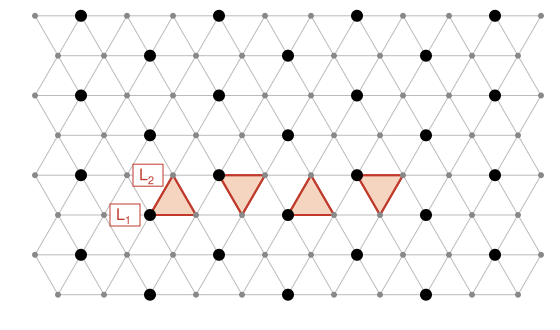

## Statement

Erik et Aurélien jouent sur un réseau triangulaire infini, formé de triangles équilatéraux qui pavent
le plan. Deux sommets du réseau sont **voisins** s'ils sont les deux extrémités d'un côté d'un de ces
triangles. Chaque sommet a six voisins.

À chaque tour :

- Erik pose un lutin sur chacun de deux sommets voisins qui n'ont pas encore de lutin ;
- puis Aurélien retire **un** lutin de son choix, n'importe où sur le réseau (pas forcément l'un de ceux
  qu'Erik vient de poser).

Erik veut qu'à un moment de la partie, il y ait sur une même droite $k$ sommets consécutifs du réseau qui
portent tous un lutin.

Quel est le plus grand entier $k$ pour lequel Erik peut être sûr d'y parvenir, quoi que fasse Aurélien ?

## Hints

1. Aurélien a intérêt à garder certains sommets toujours vides. Si ces sommets ne sont jamais voisins,
   Erik ne peut en occuper qu'un seul par tour, et Aurélien peut le libérer aussitôt.
2. Repère les sommets par des coordonnées $(a, b)$ et regarde les sommets pour lesquels $a - b$ est un
   multiple de $3$. Combien y en a-t-il parmi $6$ sommets consécutifs alignés ?
3. Pour Erik, travaille dans une petite bande formée de deux rangées de $6$ sommets. Tant qu'il le peut,
   il y pose ses lutins deux par deux. Que reste-t-il de vide quand il ne peut plus ?
4. Découpe les $12$ sommets de la bande en $4$ petits triangles de trois sommets voisins deux à deux.

## Solution

**Des coordonnées.** Fixons un sommet $O$ du réseau, un vecteur $\vec u$ qui va de $O$ à son voisin de
droite, et un vecteur $\vec v$ qui va de $O$ à un voisin situé à $60^\circ$ au-dessus. Tout sommet $M$
s'écrit d'une seule façon $\overrightarrow{OM} = a\vec u + b\vec v$ avec $a$ et $b$ entiers : on le note
$(a, b)$.

Les six voisins de $(a, b)$ sont $(a \pm 1, b)$, $(a, b \pm 1)$, $(a - 1, b + 1)$ et $(a + 1, b - 1)$. Les
sommets consécutifs d'une droite du réseau s'obtiennent en ajoutant toujours le même pas $(1, 0)$,
$(0, 1)$ ou $(-1, 1)$.

Nous allons montrer que la réponse est $k = 5$.

### 1. Aurélien peut empêcher 6 lutins alignés

Appelons **gentil** un sommet $(a, b)$ tel que $a - b$ est un multiple de $3$ (les gros points noirs de
la figure).

*Deux sommets gentils ne sont jamais voisins.* Quand on passe d'un sommet à un voisin, le nombre $a - b$
change de $+1$, $-1$, $+2$ ou $-2$ : il ne peut pas passer d'un multiple de $3$ à un autre.

*Six sommets consécutifs alignés contiennent deux sommets gentils.* Le long d'une droite, à chaque pas,
$a - b$ augmente de $1$ (pas $(1, 0)$), diminue de $1$ (pas $(0, 1)$), ou diminue de $2$ (pas
$(-1, 1)$). Dans les trois cas, les restes de $a - b$ dans la division par $3$ parcourent les trois
valeurs $0$, $1$, $2$ en boucle, avec une période de $3$. Parmi $6$ sommets consécutifs, il y a donc
exactement deux sommets gentils.

*La stratégie d'Aurélien.* Aurélien s'arrange pour qu'à la fin de chacun de ses tours, aucun sommet
gentil ne porte de lutin. C'est vrai au départ. Ensuite, Erik pose deux lutins sur deux sommets voisins,
dont au plus un est gentil. S'il en a posé un sur un sommet gentil, Aurélien le retire. Sinon, il retire
n'importe quel lutin.

Ainsi, à tout moment, au plus un sommet gentil porte un lutin. Six sommets consécutifs alignés
contiennent deux sommets gentils, donc ils ne portent jamais tous un lutin : Erik ne peut pas garantir
$k = 6$, ni à plus forte raison $k \geqslant 6$.

### 2. Erik peut obtenir 5 lutins alignés

Prenons les deux rangées

$$L_1 = \{(0, 0), (1, 0), \ldots, (5, 0)\} \qquad \text{et} \qquad L_2 = \{(0, 1), (1, 1), \ldots, (5, 1)\},$$

qui forment une bande de $12$ sommets. Le sommet $(a, 0)$ de $L_1$ est voisin de $(a, 1)$ et de
$(a - 1, 1)$ dans $L_2$.

**Première phase : remplir la bande.** Tant qu'il existe dans la bande deux sommets voisins sans lutin,
Erik y pose ses deux lutins. Après le tour complet (Erik pose $2$ lutins, Aurélien en retire au plus $1$),
le nombre de lutins dans la bande a augmenté d'au moins $1$. Comme la bande ne compte que $12$ sommets,
cette phase s'arrête : arrive un moment où, au tour d'Erik, **deux sommets vides de la bande ne sont
jamais voisins**. Hors de la bande, aucun lutin n'a été posé.

**Au plus quatre sommets vides.** Découpons la bande en quatre petits triangles, dont les trois sommets
sont voisins deux à deux (voir la figure) :

$$\{(0,0), (1,0), (0,1)\}, \quad \{(2,0), (1,1), (2,1)\}, \quad \{(3,0), (4,0), (3,1)\}, \quad \{(5,0), (4,1), (5,1)\}.$$

Chaque triangle contient au plus un sommet vide, sinon il y aurait deux sommets vides voisins. La bande
contient donc au plus $4$ sommets vides.

**Seconde phase : le coup final.** On regarde où sont les sommets vides.

- *Si $L_1$ a au plus un sommet vide.* S'il n'en a aucun, les $6$ sommets de $L_1$ portent déjà un lutin.
  S'il en a un, Erik y pose un lutin, et l'autre sur un voisin situé sous la bande, qui est libre. À ce
  moment, les $6$ sommets de $L_1$ portent un lutin. C'est encore mieux que $5$.
- *Si $L_2$ a au plus un sommet vide*, on fait de même avec $L_2$, en posant le second lutin au-dessus
  de la bande.
- *Sinon*, $L_1$ et $L_2$ ont chacune au moins deux sommets vides, et comme il y en a au plus $4$ en
  tout, chacune en a exactement deux.

  Si l'extrémité $(0, 0)$ de $L_1$ est vide, l'autre sommet vide de $L_1$ est parmi les cinq sommets
  consécutifs $(1, 0), \ldots, (5, 0)$. Erik pose un lutin sur ce sommet (et l'autre sous la bande) : ces
  cinq sommets portent alors tous un lutin. Même chose si $(5, 0)$ est vide, avec $(0, 0), \ldots, (4, 0)$,
  et de même pour les extrémités $(0, 1)$ et $(5, 1)$ de $L_2$.

  Il reste le cas où les quatre sommets vides sont parmi $(1, 0), \ldots, (4, 0)$ et
  $(1, 1), \ldots, (4, 1)$, deux dans chaque rangée. Montrons qu'il est impossible. Les deux sommets vides
  de $L_1$ ne sont pas voisins, donc leurs abscisses sont $\{1, 3\}$, $\{1, 4\}$ ou $\{2, 4\}$. Un sommet
  vide $(a, 0)$ interdit que $(a, 1)$ et $(a - 1, 1)$ soient vides.

  - Avec $\{1, 3\}$, les sommets $(0,1)$, $(1,1)$, $(2,1)$, $(3,1)$ sont interdits : il ne reste que
    $(4, 1)$ pour les deux sommets vides de $L_2$.
  - Avec $\{1, 4\}$, les sommets $(0,1)$, $(1,1)$, $(3,1)$, $(4,1)$ sont interdits : il ne reste que
    $(2, 1)$.
  - Avec $\{2, 4\}$, les sommets $(1,1)$, $(2,1)$, $(3,1)$, $(4,1)$ sont tous interdits.

  Dans les trois cas, $L_2$ ne peut pas avoir deux sommets vides parmi $(1, 1), \ldots, (4, 1)$. Ce cas
  n'arrive donc jamais.

Dans tous les cas possibles, Erik obtient à un moment au moins $5$ sommets consécutifs alignés portant
tous un lutin.

**Conclusion.** Le plus grand $k$ pour lequel Erik peut être sûr de réussir est $k = 5$.

## Going further

Attention à bien lire l'énoncé : Aurélien peut retirer **n'importe quel** lutin, pas seulement l'un des
deux qu'Erik vient de poser. Plus de la moitié des copies reçues par les correcteurs avaient supposé le
contraire.

Contre la stratégie des sommets gentils, la bande se remplit exactement sauf les quatre sommets gentils
$(0, 0)$, $(3, 0)$, $(1, 1)$, $(4, 1)$, et Erik obtient $5$ lutins alignés, jamais $6$ : les deux moitiés
de la solution se rejoignent.
