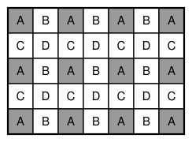

## Statement

Un **tromino en L** est la pièce formée de trois cases d'un quadrillage disposées en coin, c'est-à-dire trois des quatre cases d'un carré $2 \times 2$ :

On dispose d'un rectangle $5 \times 7$ et d'autant de trominos en L que l'on veut. On pose les trominos sur le rectangle, éventuellement les uns par-dessus les autres, chacun devant coïncider avec trois cases du quadrillage sans dépasser du rectangle. On peut les tourner comme on veut.

Peut-on s'arranger pour que **toutes** les cases du rectangle soient recouvertes exactement le même nombre de fois ?

## Hints

1. Appelons $k$ ce nombre commun de recouvrements, et $N$ le nombre de trominos utilisés. Écris une première équation reliant $N$ et $k$, en comptant de deux façons le nombre total de cases recouvertes.
2. Il te faut maintenant une seconde relation, une inégalité cette fois, qui dise que $N$ doit être **grand**. Pour cela, il faut trouver des cases difficiles à recouvrir.
3. Colorie le rectangle avec quatre couleurs en répétant le motif $2 \times 2$ : $A$ et $B$ sur les lignes impaires, $C$ et $D$ sur les lignes paires, en alternant à chaque colonne.
4. Un tromino en L tient dans un carré $2 \times 2$ du quadrillage. Combien de cases de couleur $A$ peut-il recouvrir au maximum ?
5. Compte les cases $A$ du rectangle $5 \times 7$. Chacune doit être recouverte $k$ fois : combien de trominos cela impose-t-il au minimum ?

## Solution

La réponse est **non**.

Supposons qu'un tel recouvrement existe : chaque case du rectangle est recouverte exactement $k$ fois, avec $k \geqslant 1$. Notons $N$ le nombre de trominos utilisés.

### Étape 1. Compter les cases recouvertes

Comptons de deux façons le nombre total de « cases recouvertes », en comptant une case autant de fois qu'elle est recouverte.

- Par les pièces : chaque tromino recouvre $3$ cases, ce qui fait $3N$.
- Par les cases : le rectangle compte $5 \times 7 = 35$ cases, chacune recouverte $k$ fois, ce qui fait $35k$.

Donc

$$3N = 35k. \qquad (1)$$

### Étape 2. Le coloriage

Colorions le rectangle avec quatre couleurs $A$, $B$, $C$, $D$, en répétant le motif $2 \times 2$ qui porte $A$ puis $B$ sur sa ligne du haut, et $C$ puis $D$ sur sa ligne du bas.

Autrement dit, les lignes impaires portent $A\,B\,A\,B\,A\,B\,A$ et les lignes paires $C\,D\,C\,D\,C\,D\,C$.

**Combien de cases $A$ ?** Elles se trouvent aux intersections des lignes impaires ($1$, $3$, $5$ : trois lignes) et des colonnes impaires ($1$, $3$, $5$, $7$ : quatre colonnes). Il y a donc

$$3 \times 4 = 12 \text{ cases } A.$$

**Un tromino recouvre au plus une case $A$.** Un tromino en L occupe trois des quatre cases d'un carré $2 \times 2$ du quadrillage. Or, par construction du coloriage, tout carré $2 \times 2$ du quadrillage contient exactement une case de chacune des quatre couleurs. Un tromino recouvre donc trois couleurs différentes, et en particulier **au plus une case $A$**.

### Étape 3. Compter les recouvrements des cases $A$

Comptons maintenant de deux façons le nombre de « cases $A$ recouvertes », toujours avec multiplicité.

- Par les cases : il y a $12$ cases $A$, chacune recouverte $k$ fois, ce qui fait $12k$.
- Par les pièces : chaque tromino apporte au plus $1$, ce qui fait au plus $N$.

Donc

$$12k \leqslant N. \qquad (2)$$

### Étape 4. La contradiction

En combinant $(1)$ et $(2)$ :

$$35k = 3N \geqslant 3 \times 12k = 36k,$$

donc $35k \geqslant 36k$, c'est-à-dire $k \leqslant 0$.

Cela contredit $k \geqslant 1$.

**Un tel recouvrement est donc impossible.**

## Going further

L'intérêt de ce coloriage est qu'il est taillé sur mesure pour la pièce : comme le tromino tient dans un carré $2 \times 2$, et que le coloriage donne à chaque carré $2 \times 2$ exactement une case de chaque couleur, on sait tout de suite qu'une pièce ne peut pas recouvrir deux cases de la même couleur.

Il reste alors à choisir, parmi les quatre couleurs, celle qui est la plus nombreuse. Les effectifs sur un rectangle $5 \times 7$ sont

| couleur | lignes | colonnes | nombre de cases |
|---|---|---|---|
| $A$ | $1, 3, 5$ | $1, 3, 5, 7$ | $12$ |
| $B$ | $1, 3, 5$ | $2, 4, 6$ | $9$ |
| $C$ | $2, 4$ | $1, 3, 5, 7$ | $8$ |
| $D$ | $2, 4$ | $2, 4, 6$ | $6$ |

Total : $12 + 9 + 8 + 6 = 35$, ce qui rassure. C'est bien $A$, la plus nombreuse, qui donne la contradiction : avec $B$ on n'obtiendrait que $35k \geqslant 27k$, qui est vrai et n'apprend rien.

Le même argument montre qu'on ne peut pas non plus paver simplement, en une seule couche, un rectangle dont le nombre de cases d'une couleur dépasse le tiers du total.
