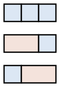

## Statement

Une faïencerie fabrique deux sortes de carreaux : des carrés de $1 \,\text{cm} \times 1 \,\text{cm}$ et des rectangles de $1 \,\text{cm} \times 2 \,\text{cm}$. Tous les carreaux d'une même sorte sont identiques entre eux.

On veut couvrir entièrement une frise de $1 \,\text{cm}$ de large et de $24 \,\text{cm}$ de long, sans chevauchement et sans débordement.

**De combien de façons différentes peut-on le faire ?**

Voici, par exemple, les trois carrelages possibles d'une frise de $3 \,\text{cm}$ :

## Hints

1. Commencez petit. Comptez les carrelages d'une frise de longueur $1$, puis $2$, puis $3$, puis $4$. Notez ces nombres.
2. Appelons $u_n$ le nombre de carrelages d'une frise de longueur $n$. Vous devriez trouver $u_1 = 1$, $u_2 = 2$, $u_3 = 3$, $u_4 = 5$. Cette suite vous dit peut-être quelque chose.
3. Pour trouver une relation, regardez seulement le carreau le plus à gauche. Combien de possibilités pour lui, et que reste-t-il à carreler dans chaque cas ?
4. Il n'y a pas de formule simple à écrire : il faut calculer $u_{24}$ de proche en proche.

## Solution

**Notation.** Notons $u_n$ le nombre de façons de carreler une frise de longueur $n$ (en centimètres).

**Les premiers cas.**

- $n = 1$ : un seul carreau possible, le carré. Donc $u_1 = 1$.
- $n = 2$ : soit deux carrés, soit un rectangle. Donc $u_2 = 2$.
- $n = 3$ : carré-carré-carré, rectangle-carré, ou carré-rectangle. Donc $u_3 = 3$.
- $n = 4$ : on trouve $5$ carrelages.

**La relation de récurrence.** Prenons une frise de longueur $n \geqslant 3$ et regardons le carreau le plus à gauche. Deux cas, et deux seulement :

- c'est un **carré** (largeur $1$). Il reste alors une frise de longueur $n - 1$ à carreler, ce qui se fait de $u_{n-1}$ façons ;
- c'est un **rectangle** (largeur $2$). Il reste alors une frise de longueur $n - 2$ à carreler, ce qui se fait de $u_{n-2}$ façons.

Ces deux cas s'excluent l'un l'autre et couvrent toutes les possibilités, donc

$$u_n = u_{n-1} + u_{n-2} .$$

C'est exactement la règle de la suite de Fibonacci. Avec $u_1 = 1$ et $u_2 = 2$, on reconnaît la suite de Fibonacci décalée d'un cran.

**Le calcul jusqu'à 24.** Chaque terme est la somme des deux précédents :

| $n$ | 1 | 2 | 3 | 4 | 5 | 6 | 7 | 8 | 9 | 10 | 11 | 12 |
|---|---|---|---|---|---|---|---|---|---|---|---|---|
| $u_n$ | 1 | 2 | 3 | 5 | 8 | 13 | 21 | 34 | 55 | 89 | 144 | 233 |

| $n$ | 13 | 14 | 15 | 16 | 17 | 18 | 19 | 20 | 21 | 22 | 23 | 24 |
|---|---|---|---|---|---|---|---|---|---|---|---|---|
| $u_n$ | 377 | 610 | 987 | 1597 | 2584 | 4181 | 6765 | 10946 | 17711 | 28657 | 46368 | 75025 |

**Conclusion.** Il y a

$$u_{24} = 75\,025$$

façons de carreler la frise de $24 \,\text{cm}$.

## Going further

On peut retrouver le même nombre d'une autre manière, en comptant selon le nombre $k$ de rectangles utilisés. Si le carrelage contient $k$ rectangles, il contient $24 - 2k$ carrés, donc $24 - k$ carreaux en tout, et il suffit de choisir lesquels sont des rectangles :

$$u_{24} = \sum_{k=0}^{12} \binom{24-k}{k} = \binom{24}{0} + \binom{23}{1} + \binom{22}{2} + \cdots + \binom{12}{12} = 75\,025 .$$

C'est une identité classique : la somme d'une « diagonale » du triangle de Pascal donne un nombre de Fibonacci.
