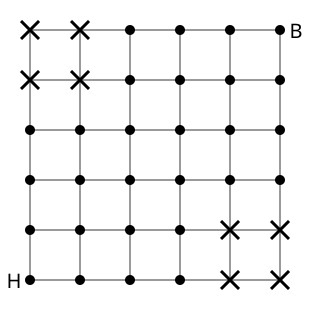
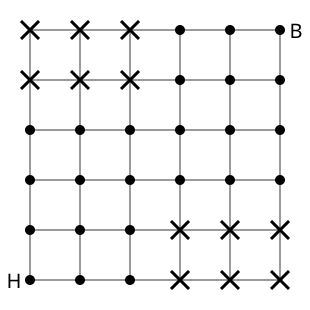

## Statement

Dans la ville de Quadriville, les rues forment un quadrillage parfait. Vous habitez au carrefour $H$, en bas à gauche du plan, et votre bureau est au carrefour $B$, cinq rues plus à l'est et cinq rues plus au nord.

Vous ne revenez jamais en arrière : chaque trajet est une suite de dix déplacements d'un carrefour au carrefour voisin, cinq vers l'**est** et cinq vers le **nord**.

Malheureusement, des travaux bloquent certains carrefours, marqués par une croix sur les plans : il est impossible d'y passer.

1. Avec les travaux du premier plan, combien de trajets différents restent possibles ?

2. Même question avec le second plan, où les travaux se sont étendus.

## Hints

1. Repérez les carrefours par leurs coordonnées : $H$ est en $(0\,;0)$ et $B$ en $(5\,;5)$. Sans travaux, combien y aurait-il de trajets ?
2. Après cinq déplacements, en quel carrefour peut-on se trouver ? La somme des deux coordonnées vaut alors $5$ : il n'y a que six carrefours possibles.
3. Sur le premier plan, combien de ces six carrefours sont encore ouverts ?
4. Un trajet passe par exactement un de ces carrefours : découpez-le en deux morceaux et comptez chaque morceau.
5. Pour le second plan, une autre méthode est plus sûre : écrivez dans chaque carrefour le nombre de trajets qui mènent de $H$ jusqu'à lui, en partant du bas à gauche.

## Solution

Repérons les carrefours par leurs coordonnées, $H = (0\,;0)$ et $B = (5\,;5)$.

**Sans travaux**, un trajet est une suite de dix déplacements dont cinq vers le nord : il suffit de choisir les cinq déplacements qui montent parmi les dix, soit

$$\binom{10}{5} = 252 \ \text{trajets}.$$

### 1. Le premier plan

**L'idée : le passage obligé.** Après cinq déplacements, la somme des deux coordonnées vaut exactement $5$. Tout trajet passe donc par un des six carrefours

$$(0\,;5), \quad (1\,;4), \quad (2\,;3), \quad (3\,;2), \quad (4\,;1), \quad (5\,;0),$$

et par un seul, puisqu'il n'y passe qu'à la cinquième étape.

Sur le premier plan, les carrefours barrés sont $(0\,;4)$, $(1\,;4)$, $(0\,;5)$, $(1\,;5)$ en haut à gauche et $(4\,;0)$, $(5\,;0)$, $(4\,;1)$, $(5\,;1)$ en bas à droite. Quatre des six carrefours de passage sont donc barrés : il ne reste que $(2\,;3)$ et $(3\,;2)$.

**Les trajets par $(3\,;2)$.** De $H$ à $(3\,;2)$, il y a cinq déplacements dont deux vers le nord, soit $\binom{5}{2} = 10$ chemins. Aucun ne rencontre de travaux : tous ces chemins restent dans la zone $x \le 3$ et $y \le 2$, alors que les carrefours barrés ont tous $x \ge 4$ ou $y \ge 4$.

De $(3\,;2)$ à $B = (5\,;5)$, il y a cinq déplacements dont deux vers l'est, soit $\binom{5}{2} = 10$ chemins, et là encore aucun ne rencontre de travaux, car ils restent dans la zone $x \ge 3$ et $y \ge 2$.

Cela donne $10 \times 10 = 100$ trajets.

**Les trajets par $(2\,;3)$.** La figure est symétrique par rapport à la diagonale : on trouve de même $100$ trajets.

**Total.**

$$100 + 100 = 200 \ \text{trajets}.$$

Les travaux ont donc supprimé un peu plus des deux tiers des trajets.

### 2. Le second plan

Les travaux se sont étendus : sont maintenant barrés les carrefours $(0\,;4)$, $(1\,;4)$, $(2\,;4)$, $(0\,;5)$, $(1\,;5)$, $(2\,;5)$ en haut à gauche, et $(3\,;0)$, $(4\,;0)$, $(5\,;0)$, $(3\,;1)$, $(4\,;1)$, $(5\,;1)$ en bas à droite.

Comptons cette fois de proche en proche. Écrivons dans chaque carrefour le nombre de trajets qui mènent de $H$ jusqu'à lui.

- Un carrefour barré reçoit le nombre $0$ : on ne peut pas y arriver.
- Pour atteindre un autre carrefour, on arrive soit du carrefour situé à l'ouest, soit de celui situé au sud. Son nombre est donc la **somme** des nombres de ces deux voisins (en ne comptant que ceux qui existent).

On remplit le tableau en partant du bas à gauche. Voici le résultat, présenté comme le plan, le nord vers le haut :

| | $x=0$ | $x=1$ | $x=2$ | $x=3$ | $x=4$ | $x=5$ |
|---|---|---|---|---|---|---|
| $y=5$ | $0$ | $0$ | $0$ | $16$ | $54$ | $\mathbf{120}$ |
| $y=4$ | $0$ | $0$ | $0$ | $16$ | $38$ | $66$ |
| $y=3$ | $1$ | $4$ | $10$ | $16$ | $22$ | $28$ |
| $y=2$ | $1$ | $3$ | $6$ | $6$ | $6$ | $6$ |
| $y=1$ | $1$ | $2$ | $3$ | $0$ | $0$ | $0$ |
| $y=0$ | $1$ | $1$ | $1$ | $0$ | $0$ | $0$ |

**Total : $120$ trajets.**

**Vérification par la première méthode.** Les six carrefours de passage sont toujours les mêmes, et seuls $(2\,;3)$ et $(3\,;2)$ restent ouverts. Le tableau donne $10$ chemins de $H$ à $(2\,;3)$ et $6$ chemins de $H$ à $(3\,;2)$. Ensuite :

- de $(3\,;2)$ à $B$, on reste dans la zone $x \ge 3$, où plus aucun carrefour n'est barré : $\binom{5}{2} = 10$ chemins, d'où $6 \times 10 = 60$ trajets ;
- de $(2\,;3)$ à $B$, il faut éviter $(2\,;4)$ et $(2\,;5)$ : le premier déplacement doit donc aller vers l'est, et il reste à aller de $(3\,;3)$ à $B$, soit $\binom{4}{2} = 6$ chemins, d'où $10 \times 6 = 60$ trajets.

Total $60 + 60 = 120$, ce qui confirme le tableau.

**Ce qu'il faut retenir.** Deux méthodes, deux usages. Le découpage en un passage obligé est élégant et rapide quand les obstacles sont bien placés ; le remplissage de proche en proche ne demande aucune idée et marche toujours, quelle que soit la forme des travaux.

## Going further

1. Sur le premier plan, quel est le nombre de trajets si l'on barre en plus le carrefour $(3\,;2)$ ?
2. Où faudrait-il placer un seul carrefour barré pour supprimer le plus grand nombre possible de trajets ?
3. Les travaux du second plan sont disposés en escalier. Barrons maintenant tous les carrefours situés strictement au-dessus de la diagonale $y = x$ : combien reste-t-il de trajets ? Vous trouverez un nombre célèbre.
