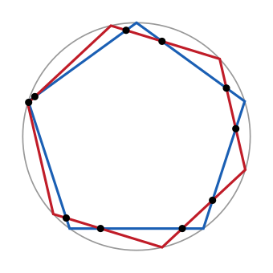

## Statement

On inscrit dans un même cercle quatre polygones réguliers : un pentagone ($5$ côtés), un hexagone ($6$ côtés), un heptagone ($7$ côtés) et un octogone ($8$ côtés).

On suppose que deux de ces polygones n'ont jamais de sommet commun, et que trois de leurs côtés ne se coupent jamais en un même point.

En combien de points, situés à l'intérieur du cercle, deux côtés de deux polygones différents se croisent-ils ?

## Hints

1. Deux côtés d'un **même** polygone régulier ne se croisent jamais à l'intérieur du cercle : un polygone régulier est convexe. Il n'y a donc que les paires de polygones différents à examiner. Combien y a-t-il de telles paires ?
2. Traiter d'abord une paire, par exemple le pentagone et l'hexagone, en s'aidant de la figure. Compter combien de côtés de l'hexagone coupent un côté donné du pentagone.
3. Un côté du pentagone est une corde $[AB]$. Une corde du cercle coupe $[AB]$ exactement quand une seule de ses deux extrémités se trouve sur l'arc $AB$ qui ne contient aucun autre sommet du pentagone.
4. Cet arc mesure $\frac{360°}{5} = 72°$. Les sommets de l'hexagone sont espacés de $60°$ : combien y en a-t-il au minimum sur un arc de $72°$ ?
5. Si un arc contient au moins un sommet de l'hexagone mais pas tous, combien de côtés de l'hexagone ont exactement une extrémité dans cet arc ?
6. En déduire une règle générale pour un $m$-gone et un $n$-gone avec $m < n$, puis additionner sur les six paires.

## Solution

**Une seule question à résoudre : combien de croisements entre deux polygones ?**

Un polygone régulier est convexe : deux de ses côtés ne se coupent jamais à l'intérieur du cercle. Tous les points de croisement proviennent donc de deux polygones **différents**. Il y a $\binom{4}{2} = 6$ paires à examiner :

$$(5,6),\; (5,7),\; (5,8),\; (6,7),\; (6,8),\; (7,8).$$

**La règle générale.**

Soient un $m$-gone régulier et un $n$-gone régulier inscrits dans le même cercle, sans sommet commun, avec $m < n$. Montrons que **chaque côté du $m$-gone est coupé par exactement deux côtés du $n$-gone.**

Soit $[AB]$ un côté du $m$-gone. Les points $A$ et $B$ découpent le cercle en deux arcs. Appelons $\mathcal{A}$ le petit arc, celui qui ne contient aucun autre sommet du $m$-gone : il mesure $\dfrac{360°}{m}$.

*Quand une corde coupe-t-elle $[AB]$ ?* Une corde $[CD]$ coupe $[AB]$ en un point intérieur au cercle si et seulement si les points $C$ et $D$ sont de part et d'autre de la droite $(AB)$, c'est-à-dire si exactement l'un des deux est sur l'arc $\mathcal{A}$.

*Combien de sommets du $n$-gone sont sur $\mathcal{A}$ ?* Les sommets du $n$-gone sont répartis régulièrement, espacés de $\dfrac{360°}{n}$. Comme $n > m$, on a

$$\frac{360°}{n} < \frac{360°}{m} = \text{mesure de } \mathcal{A}.$$

Un arc plus long que l'écart entre deux sommets consécutifs contient donc au moins un sommet du $n$-gone. Par ailleurs $\mathcal{A}$ n'est pas le cercle entier, donc il ne les contient pas tous.

*Conclusion pour ce côté.* Parcourons les $n$ sommets du $n$-gone dans l'ordre autour du cercle. Ils se répartissent en deux groupes : ceux qui sont sur $\mathcal{A}$ (au moins un) et ceux qui n'y sont pas (au moins un). Comme les sommets de $\mathcal{A}$ sont consécutifs, ces deux groupes forment deux blocs, et il y a exactement **deux** côtés du $n$-gone qui passent d'un bloc à l'autre : celui qui entre dans $\mathcal{A}$ et celui qui en sort. Ce sont les deux seuls côtés du $n$-gone à couper $[AB]$.

Le $m$-gone ayant $m$ côtés, on obtient

$$2m \text{ points de croisement entre le } m\text{-gone et le } n\text{-gone}.$$

Ces points sont bien tous distincts : par hypothèse, trois côtés ne sont jamais concourants.

**Le décompte.**

| paire | $m$ (le plus petit) | croisements $2m$ |
|---|---|---|
| pentagone / hexagone | $5$ | $10$ |
| pentagone / heptagone | $5$ | $10$ |
| pentagone / octogone | $5$ | $10$ |
| hexagone / heptagone | $6$ | $12$ |
| hexagone / octogone | $6$ | $12$ |
| heptagone / octogone | $7$ | $14$ |

$$10 + 10 + 10 + 12 + 12 + 14 = 68.$$

**Conclusion.** Il y a $68$ points de croisement à l'intérieur du cercle.

## Going further

1. Pourquoi le décompte fait-il intervenir le **plus petit** des deux nombres de côtés ? Reprendre le raisonnement en partant d'un côté de l'$n$-gone : où bloque-t-il ?
2. On ajoute un triangle équilatéral aux quatre polygones. Combien de points de croisement en tout ?
3. Que se passe-t-il si deux des polygones partagent un sommet ? Montrer sur l'exemple du pentagone et de l'hexagone que le compte tombe alors à $8$.
