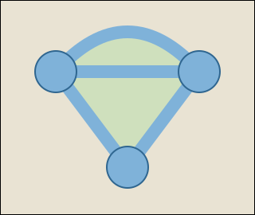

## Statement

Dans une région plate se trouvent **sept lacs**. On a creusé **dix canaux**. Chaque canal relie deux lacs, aucun canal n'en croise un autre, et un canard peut désormais nager de n'importe quel lac à n'importe quel autre.

Les lacs et les canaux découpent la terre ferme en morceaux. On appelle **île** un morceau de terre entièrement entouré d'eau.

**Combien y a-t-il d'îles dans la région ?**

Voici un exemple plus petit, avec trois lacs et quatre canaux : il y a deux îles, dessinées en vert.

## Hints

1. Le nombre d'îles ne dépend pas du dessin exact, seulement du nombre de lacs et de canaux. Essayez plusieurs petits exemples pour vous en convaincre.
2. Imaginez qu'au départ les sept lacs existent mais qu'aucun canal n'est creusé. Combien y a-t-il d'îles ? Combien de « morceaux d'eau » séparés ?
3. Creusez maintenant les canaux un par un, et regardez à chaque fois ce qui change. Il n'y a que deux cas possibles.
4. Un canal relie soit deux lacs qui n'étaient pas encore reliés par l'eau, soit deux lacs qui l'étaient déjà. Dans quel cas apparaît une île ?

## Solution

**L'idée : creuser les canaux un par un** et suivre deux compteurs :

- $m$ = le nombre de morceaux d'eau séparés (deux lacs sont dans le même morceau s'ils sont reliés par des canaux) ;
- $i$ = le nombre d'îles.

**Au départ**, aucun canal n'est creusé : les sept lacs sont sept morceaux d'eau séparés, et aucune terre n'est entourée d'eau. Donc

$$m = 7, \qquad i = 0 .$$

**Ce que fait un nouveau canal.** Creusons un canal reliant deux lacs. Deux cas, et deux seulement.

*Cas 1 : les deux lacs appartenaient à deux morceaux d'eau différents.* Le canal soude ces deux morceaux en un seul : $m$ diminue de $1$. Aucune terre nouvelle ne se retrouve entourée : $i$ ne change pas.

*Cas 2 : les deux lacs appartenaient déjà au même morceau d'eau.* Il existait donc déjà un chemin d'eau entre eux. Le nouveau canal, ajouté à ce chemin, forme une boucle d'eau fermée, qui enferme un morceau de terre : une île apparaît. Donc $i$ augmente de $1$, et $m$ ne change pas.

(Dans le cas 2, il apparaît exactement **une** île de plus, pas davantage : le canal ne touche la terre que le long de ses deux rives, et il coupe en deux le morceau de terre qu'il traverse, dont une moitié seulement se retrouve encerclée.)

**Le bilan.** Appelons $p$ le nombre de canaux du premier type et $s$ le nombre de canaux du second. Il y a dix canaux en tout :

$$p + s = 10 .$$

À la fin, tous les lacs communiquent : il ne reste qu'un seul morceau d'eau, donc $m = 1$. Comme $m$ est parti de $7$ et n'a diminué que lors des canaux du premier type, à raison de $1$ à chaque fois :

$$7 - p = 1, \qquad \text{donc} \qquad p = 6 .$$

Il reste donc $s = 10 - 6 = 4$ canaux du second type, et chacun a créé exactement une île.

**Conclusion.** Il y a

$$i = 4$$

îles dans la région.

## Going further

Le raisonnement ne dépend pas des nombres $7$ et $10$. Avec $L$ lacs et $C$ canaux, tous les lacs étant reliés entre eux, le nombre d'îles vaut toujours

$$i = C - L + 1 .$$

C'est la **formule d'Euler** pour les graphes planaires, écrite autrement. Sous sa forme habituelle, avec $S$ sommets, $A$ arêtes et $F$ faces (y compris la face extérieure), elle s'énonce

$$S - A + F = 2 .$$

Ici les sommets sont les lacs, les arêtes les canaux, et les faces les îles plus l'extérieur : $7 - 10 + (4+1) = 2$. $\checkmark$

Les six canaux du premier type forment ce qu'on appelle un **arbre couvrant** : le plus petit réseau qui relie déjà tous les lacs entre eux. Il en faut toujours exactement $L - 1$.
