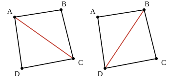

## Statement

Dans un polygone convexe, on trace des diagonales qui ne se croisent pas à l'intérieur du polygone, jusqu'à ce que la figure soit entièrement découpée en triangles. Un tel découpage s'appelle une **triangulation** du polygone.

Voici les deux triangulations d'un quadrilatère convexe : on trace l'une des deux diagonales, et c'est fini.

On note $T_n$ le nombre de triangulations d'un polygone convexe à $n$ côtés. On vient de voir que $T_4 = 2$, et on a aussi $T_3 = 1$ : un triangle est déjà découpé en triangles, il n'y a rien à faire.

1. Combien un pentagone convexe a-t-il de triangulations ? Autrement dit, calculer $T_5$ en les dessinant toutes.
2. Combien de diagonales une triangulation d'un polygone à $n$ côtés utilise-t-elle, et combien de triangles obtient-on ? (Les deux réponses ne dépendent pas de la triangulation choisie.)
3. On pose par convention $T_2 = 1$. Montrer que pour tout $n \geqslant 3$,

   $$T_n = T_2 T_{n-1} + T_3 T_{n-2} + T_4 T_{n-3} + \cdots + T_{n-1} T_2 .$$

4. En déduire $T_6$ et $T_7$.

## Hints

1. Pour le pentagone : une triangulation le coupe en trois triangles, donc l'un des cinq sommets n'est relié à aucune diagonale. Combien y a-t-il de choix pour ce sommet ?
2. Pour la question 2, raisonnez sur la somme des angles, ou bien comptez les côtés de tous les petits triangles en distinguant les côtés du polygone et les diagonales.
3. Pour la question 3, choisissez un côté du polygone une fois pour toutes, par exemple $[A_1 A_n]$. Dans une triangulation, ce côté appartient à **exactement un** triangle.
4. Ce triangle s'écrit $A_1 A_j A_n$ pour un certain sommet $A_j$. Une fois ce triangle enlevé, que reste-t-il de part et d'autre ?
5. À gauche il reste le polygone $A_1 A_2 \ldots A_j$, à droite le polygone $A_j A_{j+1} \ldots A_n$. Comptez leurs côtés, et remarquez que les deux morceaux se triangulent indépendamment l'un de l'autre. Le cas où un morceau est réduit à un segment est exactement celui que la convention $T_2 = 1$ sert à traiter.

## Solution

### 1. Le pentagone

Une triangulation du pentagone $ABCDE$ le découpe en triangles. Chaque triangle a trois côtés, et une diagonale sert de côté à deux triangles ; on verra à la question 2 qu'il y a ici $5 - 3 = 2$ diagonales et $5 - 2 = 3$ triangles.

Deux diagonales sans point commun intérieur et trois triangles : cela veut dire que les deux diagonales partent du même sommet. En effet, si elles partaient de deux sommets différents, elles découperaient le pentagone en trois morceaux dont l'un serait un quadrilatère, donc pas un triangle.

Il y a donc autant de triangulations que de choix du sommet d'où partent les deux diagonales :

$$T_5 = 5 .$$

On peut aussi simplement les dessiner toutes les cinq pour s'en convaincre.

### 2. Le nombre de diagonales et de triangles

Soit une triangulation d'un polygone convexe à $n$ côtés, comportant $d$ diagonales et $t$ triangles.

**Par les angles.** La somme des angles du polygone vaut $(n-2) \times 180°$. Comme les triangles découpent le polygone sans recouvrement, la somme de tous leurs angles vaut aussi la somme des angles du polygone, soit $t \times 180°$. Donc

$$t = n - 2 .$$

**Par les côtés.** Comptons les côtés de tous les triangles : cela fait $3t$ côtés. Chacun est soit un côté du polygone, compté une fois, soit une diagonale, comptée deux fois (une pour chaque triangle qui s'appuie dessus). Donc $3t = n + 2d$, d'où

$$2d = 3(n-2) - n = 2n - 6, \qquad d = n - 3 .$$

Une triangulation d'un polygone à $n$ côtés utilise donc toujours $n-3$ diagonales et produit $n-2$ triangles.

### 3. La relation de récurrence

Numérotons les sommets $A_1, A_2, \ldots, A_n$ dans l'ordre, et fixons le côté $[A_1 A_n]$.

Dans une triangulation, ce côté est un côté d'exactement un triangle du découpage. Le troisième sommet de ce triangle est l'un des sommets $A_2, A_3, \ldots, A_{n-1}$ : appelons-le $A_j$.

Une fois le triangle $A_1 A_j A_n$ tracé, les deux côtés $[A_1 A_j]$ et $[A_j A_n]$ séparent le reste du polygone en deux morceaux :

- à gauche, le polygone convexe $A_1 A_2 \ldots A_j$, qui a $j$ côtés ;
- à droite, le polygone convexe $A_j A_{j+1} \ldots A_n$, qui a $n - j + 1$ côtés.

Ces deux morceaux doivent eux aussi être découpés en triangles, et ils le sont de façon complètement indépendante l'un de l'autre. Il y a donc $T_j \times T_{n-j+1}$ triangulations du polygone qui contiennent le triangle $A_1 A_j A_n$.

Lorsque $j = 2$, le morceau de gauche est réduit au segment $[A_1 A_2]$ : il n'y a rien à découper, et c'est exactement ce que dit la convention $T_2 = 1$. Même chose à droite pour $j = n-1$.

Les triangles $A_1 A_j A_n$ possibles s'excluent deux à deux, donc en additionnant sur $j = 2, 3, \ldots, n-1$ :

$$T_n = \sum_{j=2}^{n-1} T_j \, T_{n-j+1} = T_2 T_{n-1} + T_3 T_{n-2} + \cdots + T_{n-1} T_2 .$$

Vérifions sur les cas connus :

$$T_4 = T_2 T_3 + T_3 T_2 = 1 + 1 = 2, \qquad T_5 = T_2 T_4 + T_3 T_3 + T_4 T_2 = 2 + 1 + 2 = 5 .$$

C'est bien ce qu'on avait trouvé.

### 4. L'hexagone et l'heptagone

$$T_6 = T_2 T_5 + T_3 T_4 + T_4 T_3 + T_5 T_2 = 5 + 2 + 2 + 5 = \boxed{14},$$

$$T_7 = T_2 T_6 + T_3 T_5 + T_4 T_4 + T_5 T_3 + T_6 T_2 = 14 + 5 + 4 + 5 + 14 = \boxed{42} .$$

Un hexagone convexe a donc $14$ triangulations, et un heptagone convexe en a $42$.

## Going further

La suite obtenue, $1, 1, 2, 5, 14, 42, 132, 429, \ldots$, s'appelle la suite des **nombres de Catalan**. En posant $C_n = T_{n+2}$, la relation de la question 3 devient

$$C_n = C_0 C_{n-1} + C_1 C_{n-2} + \cdots + C_{n-1} C_0 ,$$

et on peut montrer que

$$C_n = \frac{1}{n+1} \binom{2n}{n} .$$

L'exercice 2405 établit cette formule en comptant des chemins dans un quadrillage : c'est le même nombre, obtenu sur un problème qui n'a l'air de rien avoir à voir avec les polygones.
