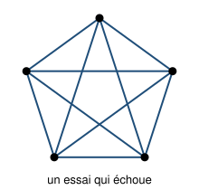

## Statement

On place des points dans le plan et on relie **chaque paire de points** par un segment. On voudrait que deux segments ne se rencontrent jamais ailleurs qu'en un point commun à tous les deux.

1. Avec **quatre** points, c'est possible. Trouver une disposition qui convient.
2. Avec **cinq** points, montrer que c'est **impossible**, quelle que soit la disposition.

On admettra la **formule d'Euler** : pour un dessin du plan d'un seul tenant, formé de points reliés par des segments qui ne se coupent pas,

$$S - A + F = 2,$$

où $S$ est le nombre de points, $A$ le nombre de segments et $F$ le nombre de régions du plan découpées par le dessin, **la région extérieure comprise**.

## Hints

1. Pour la question 1, essaie des dispositions où les quatre points **ne forment pas** un quadrilatère convexe.
2. Pour la question 2, raisonne par l'absurde : suppose qu'un tel dessin existe, et compte $S$, puis $A$.
3. La formule d'Euler te donne alors $F$ sans que tu aies besoin de voir le dessin. C'est le point remarquable : on démontre l'impossibilité d'une figure qu'on n'a jamais vue.
4. Combien de segments faut-il au minimum pour border une région ?
5. Compte de deux façons les couples (région, segment qui la borde). Tu obtiendras une inégalité entre $F$ et $A$ qui contredit tes valeurs.

## Solution

**Question 1.** Il suffit de placer un point **à l'intérieur** du triangle formé par les trois autres.

Appelons $A$, $B$, $C$ les trois points du triangle et $D$ le point intérieur. Les six segments sont $[AB]$, $[BC]$, $[CA]$, $[DA]$, $[DB]$, $[DC]$. Les trois premiers forment le contour ; les trois autres partent tous de $D$ et restent à l'intérieur du triangle, chacun dans un des trois petits triangles découpés. Aucun croisement.

(Avec quatre points formant un quadrilatère convexe, au contraire, les deux diagonales se croisent toujours : il faut bien choisir la disposition.)

**Question 2.** Raisonnons par l'absurde et supposons qu'un tel dessin existe avec cinq points.

**Les deux premiers comptes.**

Il y a $S = 5$ points. Chaque paire de points donne un segment, et il y a

$$\binom{5}{2} = \frac{5 \times 4}{2} = 10$$

paires, donc $A = 10$ segments. Le dessin est d'un seul tenant, puisque deux points quelconques sont reliés.

**Le nombre de régions.** La formule d'Euler donne alors

$$5 - 10 + F = 2, \qquad \text{donc} \qquad F = 7 .$$

Remarquons bien ce qui vient de se passer : sans rien savoir du dessin, on sait qu'il découperait le plan en exactement $7$ régions.

**Le double comptage.** Comptons les couples (région, segment qui borde cette région), de deux façons.

- *Par région.* Une région est bordée par **au moins trois** segments. En effet deux points distincts ne sont reliés que par un seul segment, donc il est impossible d'enfermer une région avec un ou deux segments. Le nombre de couples est donc au moins $3F = 21$.
- *Par segment.* Un segment a une région de chaque côté, donc il borde **au plus deux** régions. Le nombre de couples est donc au plus $2A = 20$.

Il faudrait donc

$$21 \leqslant 20 ,$$

ce qui est faux.

**Conclusion.** L'hypothèse était absurde : **on ne peut pas placer cinq points et relier toutes les paires sans croisement.** Quatre points, oui ; cinq, jamais.

## Going further

Le résultat ne change pas si l'on s'autorise des **courbes** au lieu de segments : la formule d'Euler et le double comptage ne parlent que de points, de traits et de régions, jamais de lignes droites. Même en tordant les traits autant qu'on veut, cinq points reliés deux à deux se croiseront.

Il existe une autre figure célèbre impossible à dessiner sans croisement : **trois maisons et trois puits**, chaque maison reliée à chacun des trois puits, soit $9$ chemins. Ici les régions sont bordées par au moins $4$ traits (un chemin va toujours d'une maison à un puits, donc il faut alterner), ce qui donne $4F \leqslant 2A = 18$, soit $F \leqslant 4$. Or la formule d'Euler impose $F = 2 - 6 + 9 = 5$. Impossible là encore.

Le mathématicien polonais Kazimierz Kuratowski a démontré en 1930 un résultat très fort : ces **deux** figures sont les seuls obstacles. Un réseau se dessine sans croisement si et seulement s'il ne contient, caché à l'intérieur de lui, ni les cinq points reliés deux à deux, ni les trois maisons et les trois puits.
