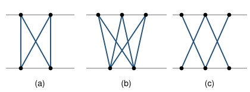

## Statement

Entre deux droites parallèles, on trace des courbes. Chaque courbe part d'un point de la droite du haut, arrive à un point de la droite du bas, et **descend sans jamais remonter** ; elle ne touche les deux droites qu'à ses extrémités. Deux courbes peuvent partir du même point, ou arriver au même point. Jamais trois courbes ne passent par un même point.

On compte alors trois nombres :

- $L$, le nombre de **courbes** ;
- $I$, le nombre de **croisements** entre courbes (une extrémité commune n'est pas un croisement) ;
- $R$, le nombre de **régions bornées** de la bande située entre les deux droites. Il y a toujours deux régions non bornées, celle tout à gauche et celle tout à droite ; on ne les compte pas.

1. Pour chacun des trois dessins ci-dessus, déterminer $I$, $L$ et $R$.
2. Deviner une relation entre $I$, $L$ et $R$ qui soit vraie pour les trois dessins.
3. La démontrer, pour tout dessin obéissant aux règles ci-dessus.

## Hints

1. Pour compter les régions, colorie-les une par une au crayon : c'est le seul moyen de ne pas en oublier.
2. Compare $R$ à la somme $I + L$.
3. Pour la question 3, ne pars pas du dessin terminé, il y a trop de cas. Trace les courbes **une par une** et regarde ce qui change à chaque ajout.
4. Une nouvelle courbe qui rencontre le dessin déjà tracé en $k$ points se trouve découpée en combien de morceaux ?
5. Un morceau de la nouvelle courbe traverse une région de part en part. Que fait-il à cette région ?

## Solution

**Question 1.** On lit sur les dessins :

| dessin | $I$ | $L$ | $R$ |
| --- | --- | --- | --- |
| (a) | 1 | 4 | 4 |
| (b) | 3 | 6 | 8 |
| (c) | 2 | 4 | 5 |

**Question 2.** Dans les trois cas,

$$I + L - R = 1, \qquad \text{c'est-à-dire} \qquad R = I + L - 1 .$$

En effet : $1 + 4 - 4 = 1$, puis $3 + 6 - 8 = 1$, puis $2 + 4 - 5 = 1$.

**Question 3.** On trace le dessin courbe par courbe, et on montre que la quantité $I + L - R$ ne change jamais.

**Le point de départ : une seule courbe.**

Avec une seule courbe, il n'y a aucun croisement et aucune région bornée : la courbe sépare la bande en deux morceaux, tous deux non bornés. Donc

$$I = 0, \qquad L = 1, \qquad R = 0, \qquad I + L - R = 1 .$$

**Une remarque utile : il y a toujours exactement deux régions non bornées.**

Chaque courbe descend sans remonter, donc elle coupe la bande en deux, une partie à gauche et une partie à droite. Les seules régions non bornées sont donc celle qui est à gauche de toutes les courbes et celle qui est à droite de toutes. Dès qu'il y a au moins une courbe, il y en a exactement deux.

**L'ajout d'une courbe.**

Ajoutons une nouvelle courbe au dessin, et notons $k$ le nombre de points où elle rencontre les courbes déjà tracées. Trois choses changent.

- **Les croisements.** On en gagne exactement $k$ :
$$I \ \longrightarrow \ I + k .$$
- **Les courbes.** On en gagne une :
$$L \ \longrightarrow \ L + 1 .$$
- **Les régions.** Les $k$ points de rencontre découpent la nouvelle courbe en $k+1$ morceaux. Chaque morceau traverse une région de part en part, sans rien rencontrer entre ses deux bouts : il la coupe donc en deux, et fait gagner une région. Le nombre total de régions de la bande augmente donc de $k+1$. Comme le nombre de régions non bornées reste égal à $2$, le nombre de régions **bornées** augmente lui aussi de $k+1$ :
$$R \ \longrightarrow \ R + k + 1 .$$

**Le bilan.** Après l'ajout, la quantité vaut

$$(I + k) + (L + 1) - (R + k + 1) = I + L - R .$$

Elle est donc **exactement la même qu'avant**. Le nombre $k$ a disparu : peu importe combien de fois la nouvelle courbe croise les anciennes.

**Conclusion.** En partant d'une seule courbe, où $I + L - R = 1$, et en ajoutant les courbes une par une sans jamais changer cette quantité, on obtient pour tout dessin

$$\boxed{I + L - R = 1}, \qquad \text{soit} \qquad R = I + L - 1 .$$

Remarquons ce que cela signifie : le nombre de régions ne dépend **pas** de la forme des courbes, ni de l'ordre dans lequel on les a tracées. Il est entièrement déterminé par le nombre de courbes et le nombre de croisements.

## Going further

Appliquons la formule au cas complet : $N$ points sur la droite du haut, $M$ points sur celle du bas, et **tous** les segments joignant un point du haut à un point du bas. Alors $L = NM$ et le nombre de croisements vaut

$$I = \binom{N}{2}\binom{M}{2} .$$

Avec $N = 4$ et $M = 3$ : $L = 12$, $I = 18$, donc

$$R = 18 + 12 - 1 = 29 \ \text{régions bornées},$$

ce qu'on peut vérifier en coloriant le dessin, avec de la patience.

La démonstration n'a jamais utilisé le fait que les traits soient droits : c'est pour cela qu'on a parlé de courbes dès le départ. C'est d'ailleurs plus facile ainsi, car on peut alors ajouter les courbes dans n'importe quel ordre sans se demander si le dessin reste réalisable avec des segments.

Enfin, cette formule est une cousine déguisée de la **formule d'Euler** $S - A + F = 2$. On passe de l'une à l'autre en comptant les points du dessin (les extrémités et les croisements) et les morceaux de courbe qu'ils découpent. La forme $I + L - R = 1$ est simplement plus commode ici, parce qu'elle parle directement de ce qu'on voit sur la feuille.
