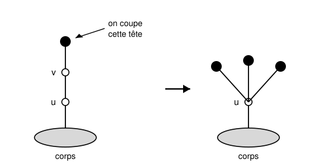
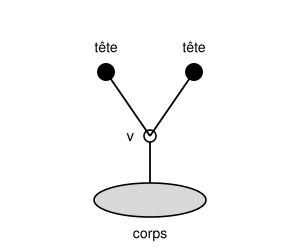

## Statement

Une **hydre** est un arbre dessiné au-dessus d'un **corps**. Elle est faite de segments appelés
cous. Certains cous se terminent par un point de branchement, d'où repartent d'autres cous ;
un cou qui ne se prolonge par rien se termine par une **tête**, dessinée ci-dessous par un
disque noir. Le corps, lui, n'est pas une tête.

Hercule frappe l'hydre coup par coup. À chaque coup, il choisit une tête et la tranche. Ensuite
l'hydre repousse, selon les règles suivantes.

- Si la tête coupée était attachée **directement au corps**, rien ne repousse.
- Sinon, on regarde le point de branchement $v$ auquel la tête était attachée, puis on descend
  d'un cran vers le corps, jusqu'au point $g$ suivant (qui peut être le corps lui-même). On fait
  alors pousser sur $g$ **deux copies** de toute la partie de l'hydre qui part de $v$, une fois la
  tête enlevée.
- Un point de branchement qui n'a plus rien au-dessus de lui devient une tête.
- L'hydre meurt quand il ne lui reste plus aucune tête.

Voici la règle en image sur un exemple. Hercule coupe la tête du haut ; le point $v$ n'a plus rien
au-dessus de lui, il devient une tête, et deux copies de ce qui partait de $v$ poussent sur $u$.

Hercule affronte maintenant l'hydre suivante : un seul point de branchement $v$, portant deux
têtes.

1. Montrer qu'Hercule finit toujours par tuer cette hydre, et que le nombre de coups est le même
   quelle que soit la façon dont il choisit ses têtes. Combien de coups faut-il ?
2. Plus généralement, on note $a_k$ le nombre de coups nécessaires pour abattre une hydre formée
   d'un seul point de branchement portant $k$ têtes. Exprimer $a_k$ en fonction de $k$.

## Hints

1. Commence par l'hydre la plus simple de toutes : un point de branchement portant **une** seule
   tête. Que se passe-t-il quand Hercule coupe cette tête ? Compte les coups jusqu'au bout.
2. Dans cette famille d'hydres, toutes les branches partent directement du corps. Quand Hercule
   frappe dans une branche, que deviennent les autres ?
3. Si les branches n'interagissent jamais, le nombre total de coups est la somme des coups
   branche par branche, et l'ordre n'a aucune importance. Il reste à traiter une branche seule.
4. Coupe une tête sur une branche portant $k$ têtes. Combien de branches obtiens-tu, et combien
   de têtes chacune porte-t-elle ?
5. Tu devrais trouver une relation de la forme $a_k = 3\,a_{k-1} + 1$. Pour la résoudre, cherche
   un nombre $c$ tel que la suite $a_k + c$ soit géométrique.

## Solution

Dans cette famille d'hydres, tous les points de branchement sont attachés directement au corps.
Appelons **branche de taille $k$** un point de branchement, accroché au corps, portant $k$ têtes.
L'hydre du dessin est donc une seule branche de taille $2$.

**Ce qui se passe quand on coupe une tête d'une branche de taille $k$, avec $k \geqslant 1$.**

La tête coupée était attachée au point $v$ de la branche, qui n'est pas le corps. On descend d'un
cran : on arrive au **corps**. On fait donc pousser sur le corps deux copies de la branche
décapitée, c'est-à-dire deux nouvelles branches de taille $k-1$. La branche d'origine, elle, a
perdu une tête : c'est maintenant une branche de taille $k-1$.

Bilan d'un coup : **une branche de taille $k$ est remplacée par trois branches de taille $k-1$.**

Deux remarques importantes.

- Si $k - 1 = 0$, une « branche de taille $0$ » est un point de branchement sans rien au-dessus :
  d'après les règles, il devient une tête, attachée directement au corps. La couper ne fait rien
  repousser. Une branche de taille $0$ coûte donc exactement $1$ coup.
- Les nouvelles branches poussent **sur le corps**, jamais à l'intérieur d'une autre branche. Un
  coup porté dans une branche ne modifie donc aucune des autres branches présentes.

**Question 1 : l'ordre n'a pas d'importance.**

C'est la deuxième remarque qui règle la question. Une hydre de cette famille est un paquet de
branches indépendantes : chaque coup ne concerne qu'une branche, et les branches qu'il crée sont
elles aussi indépendantes des autres. Le travail total est donc la somme des travaux branche par
branche, et l'ordre dans lequel Hercule mélange ces travaux ne change ni le total, ni le résultat.

Il suffit donc de savoir ce que coûte une branche seule. Notons $a_k$ ce coût pour une branche de
taille $k$.

- $a_0 = 1$, comme on vient de le voir.
- Pour $k \geqslant 1$, le premier coup porté dans la branche la remplace par trois branches de
  taille $k-1$, qui coûteront chacune $a_{k-1}$. Donc
  $$a_k = 1 + 3\,a_{k-1}.$$

Calculons :
$$a_0 = 1, \qquad a_1 = 1 + 3 = 4, \qquad a_2 = 1 + 12 = 13.$$

L'hydre du dessin est une branche de taille $2$ : elle meurt au bout de **$13$ coups**, quelle
que soit la stratégie d'Hercule.

(On peut suivre le déroulement : le premier coup laisse trois branches de taille $1$ ; chacune
demande $4$ coups, soit un coup qui la transforme en trois têtes plantées sur le corps, puis trois
coups pour les faucher. Total $1 + 3 \times 4 = 13$.)

**Question 2 : la formule générale.**

La suite $(a_k)$ vérifie $a_k = 3 a_{k-1} + 1$ avec $a_0 = 1$. Cherchons $c$ tel que
$a_k + c = 3\,(a_{k-1} + c)$. En développant, il faut $1 + c \cdot 1 = 3c$, donc $c = \tfrac12$.

La suite $\left(a_k + \tfrac12\right)$ est donc géométrique de raison $3$, et son premier terme
vaut $a_0 + \tfrac12 = \tfrac32$. Par conséquent
$$a_k + \frac12 = \frac32 \times 3^{k} = \frac{3^{k+1}}{2},$$
d'où
$$\boxed{a_k = \frac{3^{k+1} - 1}{2}}.$$

Vérification : $a_0 = \tfrac{3-1}{2} = 1$, $a_1 = \tfrac{9-1}{2} = 4$, $a_2 = \tfrac{27-1}{2} = 13$,
et l'on trouve ensuite $a_3 = 40$, $a_4 = 121$.

**Conclusion.** L'hydre du dessin demande $13$ coups, et une hydre formée d'un point de
branchement portant $k$ têtes en demande $\dfrac{3^{k+1} - 1}{2}$, quelle que soit la stratégie
d'Hercule.

## Going further

Une hydre à $10$ têtes sur un seul cou demande déjà $\dfrac{3^{11} - 1}{2} = 88\,573$ coups. Le
nombre de têtes augmente pendant très longtemps avant de retomber, et c'est ce qui rend le jeu
déroutant : tout donne l'impression qu'Hercule perd.

Le résultat vraiment surprenant est dû à Laurie Kirby et Jeff Paris, en 1982 :

> **Quelle que soit l'hydre, et quelle que soit la façon dont Hercule choisit ses têtes, il
> gagne.** Il ne peut pas perdre, même en jouant aussi mal que possible.

Passe maintenant à trois niveaux, avec l'hydre en forme de chaîne de la première figure. Le
premier coup est forcé, et il te ramène à une hydre de la famille étudiée ici : tu devrais
trouver $41$ coups en tout, encore une fois sans que la stratégie intervienne.

Ajoute alors une seule tête sur le point $u$ de cette chaîne. Cette fois Hercule a un choix dès
le départ, et selon la tête qu'il coupe en premier le combat dure $122$ ou $124$ coups : le total
n'est plus indépendant de la stratégie. Retrouve ces deux nombres.
