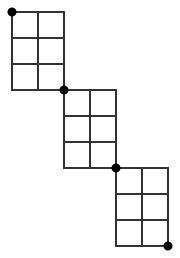

## Statement

Dans un quadrillage de $m$ colonnes et $n$ lignes de carreaux, on part du sommet en haut à gauche pour aller jusqu'au sommet en bas à droite, en suivant les segments du quadrillage et en n'allant jamais que vers la **droite** ou vers le **bas**.

Un tel chemin comporte $m$ pas vers la droite et $n$ pas vers le bas, dans un ordre quelconque : il y a donc

$$\binom{m+n}{m}$$

chemins en tout. Par exemple, dans un quadrillage $3 \times 3$, il y en a $\binom{6}{3} = 20$.

On s'autorise maintenant à **effacer** des segments. Les chemins ne peuvent alors emprunter que les segments restants, toujours vers la droite ou vers le bas. En effaçant bien, on fait baisser le nombre de chemins autant qu'on veut.

**La question.** Construire un réseau de segments, contenu dans un quadrillage de $6$ colonnes et $9$ lignes de carreaux, dans lequel il reste **exactement $1000$ chemins** du coin supérieur gauche au coin inférieur droit.

*Une solution paresseuse est à écarter : un quadrillage de $999$ colonnes et $1$ ligne contient déjà $\binom{1000}{1} = 1000$ chemins sans rien effacer. Mais il mesure mille carreaux de long. Tout l'intérêt est de faire tenir les mille chemins dans un petit rectangle.*

## Hints

1. Que vaut $1000$ sous forme de produit ? Il y a plusieurs écritures, cherche celle qui utilise trois facteurs égaux.
2. Si **tous** les chemins d'un réseau sont obligés de passer par un même sommet $P$, alors le nombre total de chemins est le produit du nombre de chemins qui mènent à $P$ par le nombre de chemins qui partent de $P$.
3. Cherche donc un petit quadrillage **complet** qui contient exactement $10$ chemins. Parmi les nombres $\binom{m+n}{m}$, lequel vaut $10$, et pour quels $m$ et $n$ ?
4. Il reste à assembler trois exemplaires de ce quadrillage de façon qu'un chemin soit forcé de les traverser l'un après l'autre. Pose-les en escalier, chacun accroché au précédent par un seul sommet.

## Solution

**L'idée : faire apparaître un produit.**

$$1000 = 10 \times 10 \times 10 .$$

Pour que des nombres de chemins se multiplient, il faut créer des **passages obligés**. Si tous les chemins d'un réseau doivent passer par un sommet $P$, alors chaque chemin se coupe en deux morceaux indépendants, avant $P$ et après $P$, et le nombre total de chemins est le produit des deux nombres de chemins.

**Un bloc à dix chemins.**

Il faut donc un petit quadrillage complet ayant exactement $10$ chemins, c'est-à-dire $\binom{m+n}{m} = 10$. Comme $\binom{5}{2} = 10$, le quadrillage de $2$ colonnes et $3$ lignes de carreaux convient : un chemin y fait $2$ pas à droite et $3$ pas en bas, et il y a $\binom{5}{2} = 10$ façons de choisir les moments des deux pas à droite.

*(L'autre écriture $\binom{10}{1} = 10$ donnerait un quadrillage de $9$ colonnes et $1$ ligne : trop long, il ne tiendrait pas trois fois dans le rectangle imposé.)*

**L'assemblage en escalier.**

Prenons trois exemplaires de ce bloc et posons-les en escalier : le coin en bas à droite du premier bloc **est** le coin en haut à gauche du deuxième, et le coin en bas à droite du deuxième est le coin en haut à gauche du troisième. Tous les autres segments du grand quadrillage sont effacés.

Le premier bloc occupe les colonnes $1$ et $2$ et les lignes $1$ à $3$ ; le deuxième les colonnes $3$ et $4$ et les lignes $4$ à $6$ ; le troisième les colonnes $5$ et $6$ et les lignes $7$ à $9$. Le tout tient donc dans un quadrillage de $6$ colonnes et $9$ lignes, comme demandé.

**Le compte.**

Appelons $P$ le sommet commun aux blocs $1$ et $2$, et $Q$ le sommet commun aux blocs $2$ et $3$.

Un chemin part du coin en haut à gauche. Tant qu'il est dans le premier bloc, il ne peut pas en sortir : aucun segment ne relie le premier bloc au reste, sauf en $P$. Comme il doit finir en bas à droite du grand rectangle, il est obligé d'atteindre $P$. De même il est ensuite obligé d'atteindre $Q$, puis l'arrivée.

Un chemin est donc exactement la donnée de trois choix indépendants :

- un chemin du départ à $P$ dans le premier bloc : $10$ possibilités ;
- un chemin de $P$ à $Q$ dans le deuxième bloc : $10$ possibilités ;
- un chemin de $Q$ à l'arrivée dans le troisième bloc : $10$ possibilités.

D'après le principe multiplicatif, le nombre total de chemins vaut

$$10 \times 10 \times 10 = \boxed{1000} .$$

Le réseau utilise $51$ segments, là où le quadrillage complet $6 \times 9$ en compte $123$.

## Going further

Le magazine pose aussi la question suivante, nettement plus dure : trouver un réseau à exactement $1000$ chemins obtenu à partir d'un quadrillage complet en n'effaçant **qu'un seul** segment. Le nombre de chemins d'un quadrillage complet auquel on retire un segment vaut $\binom{m+n}{m}$ moins le nombre de chemins passant par ce segment, ce qui donne une différence de deux produits de coefficients binomiaux : il faut faire tomber cette différence sur $1000$ exactement.

Autre variante : avec la même méthode d'escalier, quels nombres peut-on atteindre ? Tout produit de coefficients binomiaux, donc par exemple $1024 = 2^{10}$ avec dix blocs d'un seul carreau, ou $720 = 6 \times 120$. En revanche un nombre premier comme $1009$ résiste à cette méthode : il faudrait un seul bloc ayant exactement $1009$ chemins. Cherche s'il en existe un qui ne soit pas un très long couloir.
