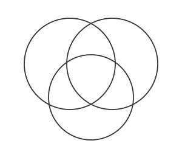
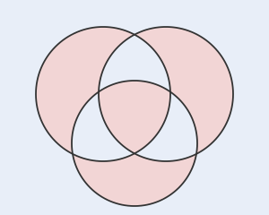

## Statement

On trace $n$ cercles dans le plan. Ils découpent le plan en régions.

Montrer qu'on peut colorier chaque région en bleu ou en rouge de telle sorte que **deux
régions séparées par un arc de cercle soient toujours de couleurs différentes**.

## Hints

1. Essaie à la main avec $1$ cercle, puis $2$, puis $3$. Trouves-tu à chaque fois un
   coloriage ?
2. C'est une bonne situation pour une récurrence sur le nombre de cercles.
3. Suppose le coloriage réussi pour $n$ cercles, et ajoute un $(n+1)$-ième cercle $C$. Les
   anciennes régions se coupent en deux là où $C$ les traverse.
4. Garde les couleurs à l'extérieur de $C$, et **inverse** toutes les couleurs à l'intérieur
   de $C$.
5. Il reste à vérifier que la règle est respectée, en distinguant deux cas selon que l'arc
   séparateur appartient à $C$ ou à un ancien cercle.

## Solution

Raisonnons par récurrence sur le nombre $n$ de cercles.

**Cas de base : $n = 0$.**

Il n'y a aucun cercle : le plan est une seule région, qu'on colorie en bleu. Il n'y a aucun
arc, donc aucune condition à vérifier.

(On peut aussi prendre $n = 1$ : le cercle découpe le plan en un disque intérieur et
l'extérieur. On colorie l'intérieur en rouge, l'extérieur en bleu, et c'est bon.)

**Hérédité.**

Supposons que pour un certain $n$, **toute** configuration de $n$ cercles admette un
coloriage valide. Donnons-nous $n+1$ cercles, et appelons $C$ l'un d'entre eux.

*Étape 1.* Oublions provisoirement $C$. Il reste $n$ cercles, et par hypothèse de récurrence,
les régions qu'ils délimitent admettent un coloriage valide. Fixons-en un.

*Étape 2.* Remettons $C$. Chaque ancienne région est soit entièrement à l'intérieur de $C$,
soit entièrement à l'extérieur, soit coupée en deux par $C$. Les nouvelles régions sont donc
les morceaux ainsi obtenus, et chacune hérite naturellement de la couleur de l'ancienne région
dont elle provient.

*Étape 3.* On modifie ce coloriage de la façon suivante :

> **On garde la couleur de chaque région située à l'extérieur de $C$, et on inverse la couleur
> de chaque région située à l'intérieur de $C$.**

**Vérification.**

Prenons deux nouvelles régions $R$ et $R'$ séparées par un arc $\gamma$. Deux cas.

*Cas 1 : $\gamma$ est un arc de $C$.* Alors $R$ et $R'$ sont de part et d'autre de $C$ :
l'une est à l'intérieur, l'autre à l'extérieur. De plus, elles proviennent de la **même**
ancienne région, celle que $C$ vient de couper en deux le long de $\gamma$. Elles avaient donc
la même couleur avant l'étape 3. Après, l'une a été inversée et l'autre non : elles sont
maintenant de couleurs différentes. $\checkmark$

*Cas 2 : $\gamma$ est un arc de l'un des $n$ anciens cercles.* Alors $\gamma$ ne rencontre pas
$C$ (sinon $C$ le couperait en plusieurs arcs, et $\gamma$ ne serait pas un arc de la nouvelle
configuration). Donc $\gamma$ est entièrement à l'intérieur de $C$, ou entièrement à
l'extérieur, et il en va de même pour $R$ et $R'$ qui le bordent.

Or $R$ et $R'$ proviennent de deux anciennes régions séparées par $\gamma$, donc de couleurs
différentes.

- Si les deux sont à l'extérieur de $C$ : aucune n'a changé, elles restent différentes.
  $\checkmark$
- Si les deux sont à l'intérieur de $C$ : les deux ont été inversées, elles restent
  différentes. $\checkmark$

Dans tous les cas la règle est respectée. La propriété est donc vraie au rang $n+1$, ce qui
achève la récurrence. $\blacksquare$

Voici ce que donne la construction sur la configuration de trois cercles de l'énoncé.

## Going further

Le même argument marche pour $n$ **droites**, ou pour $n$ courbes fermées quelconques, du
moment que chacune sépare le plan en un « intérieur » et un « extérieur ».

Il y a d'ailleurs, pour les droites, une description directe du coloriage, sans récurrence :
on colorie une région en rouge ou en bleu selon la **parité** du nombre de droites qu'il faut
traverser pour l'atteindre depuis un point de référence. Traverser une droite change la
parité, donc change la couleur.

Pour les cercles, la description directe est encore plus simple : colorie une région selon la
**parité du nombre de cercles à l'intérieur desquels elle se trouve**. Vérifie que c'est
exactement le coloriage que la récurrence construit.
