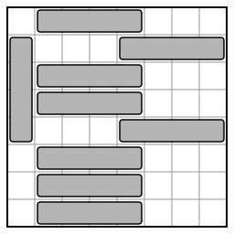
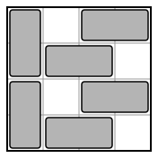

## Statement

Soit $n \geqslant 1$ un entier. On dispose d'un échiquier de $2n \times 2n$ cases, et de rectangles
de $1 \times n$ cases. On pose des rectangles sur l'échiquier, horizontalement ou verticalement :
chaque rectangle recouvre exactement $n$ cases qui se suivent sur une même ligne ou sur une même
colonne, et deux rectangles ne se chevauchent jamais.

Un ensemble de rectangles posés est dit **saturé** s'il est impossible d'ajouter un rectangle sans
chevaucher un rectangle déjà posé.

Trouver, en fonction de $n$, le plus petit nombre $k$ de rectangles que peut contenir un ensemble
saturé.

## Hints

1. Commence par les petits cas : $n = 1$, puis $n = 2$ (ce sont des dominos sur un échiquier
   $4 \times 4$), puis $n = 3$.
2. Pour $n \geqslant 3$, on peut y arriver avec $2n + 1$ rectangles : un seul vertical, tous les
   autres horizontaux.
3. Pour montrer qu'il en faut au moins $2n + 1$, regarde d'abord le cas où tous les rectangles sont
   horizontaux. Chaque ligne en contient un. Où peut-il être dans sa ligne ?
4. Si l'une des $n$ colonnes de gauche contient un rectangle vertical, imagine-le décalé d'une case
   vers la gauche. Qu'est-ce qui l'empêche d'être posé là ? Déduis-en que les colonnes qui ne
   contiennent aucun rectangle vertical se suivent.

## Solution

Numérotons les lignes de $1$ à $2n$ de haut en bas, et les colonnes de $1$ à $2n$ de gauche à
droite. La case de la ligne $\ell$ et de la colonne $c$ est notée $(\ell, c)$. Appelons **place**
un groupe de $n$ cases qui se suivent sur une ligne ou sur une colonne : c'est un endroit où l'on
pourrait poser un rectangle. Un ensemble de rectangles est saturé exactement quand **chaque place
contient au moins une case recouverte**.

La réponse est : $k = 4$ si $n = 1$, $k = 6$ si $n = 2$, et $k = 2n + 1$ si $n \geqslant 3$.

**Le cas $n = 1$.** Les rectangles sont des carrés d'une case, et une case libre est une place. Un
ensemble saturé doit donc recouvrir les $4$ cases, et il en faut $4$.

Dans toute la suite, $n \geqslant 2$, et l'on peut distinguer les rectangles horizontaux des
rectangles verticaux.

### 1. Une construction avec $2n + 1$ rectangles quand $n \geqslant 3$

On pose :

- un rectangle vertical dans la colonne $1$, sur les lignes $2$ à $n + 1$ ;
- sur les lignes $2$ et $n + 1$, un rectangle horizontal sur les colonnes $n + 1$ à $2n$ ;
- sur chacune des autres lignes, un rectangle horizontal sur les colonnes $2$ à $n + 1$.

Voici cet ensemble pour $n = 4$ :

Il y a bien $1 + 2n$ rectangles, qui ne se chevauchent pas : dans les lignes $2$ et $n + 1$, le
rectangle vertical occupe la colonne $1$ et le rectangle horizontal les colonnes $n + 1$ à $2n$.
Vérifions qu'aucune place n'est entièrement libre.

- **Lignes.** Dans la ligne $1$ et dans les lignes $n + 2$ à $2n$, les cases libres sont la case de
  la colonne $1$ et les $n - 1$ cases des colonnes $n + 2$ à $2n$. Dans les lignes $2$ et $n + 1$,
  ce sont les $n - 1$ cases des colonnes $2$ à $n$. Dans les lignes $3$ à $n$, ce sont les $n - 1$
  cases des colonnes $n + 2$ à $2n$. Jamais $n$ cases libres qui se suivent.
- **Colonnes.** La colonne $n + 1$ est entièrement recouverte. Dans les colonnes $2$ à $n$, seules
  les cases des lignes $2$ et $n + 1$ sont libres, et elles ne se suivent pas car
  $n + 1 \geqslant 4$. Dans la colonne $1$, les cases libres sont celle de la ligne $1$ et les
  $n - 1$ cases des lignes $n + 2$ à $2n$. Dans les colonnes $n + 2$ à $2n$, les cases recouvertes
  sont celles des lignes $2$ et $n + 1$, et les cases libres forment trois morceaux de $1$, de
  $n - 2$ et de $n - 1$ cases.

L'ensemble est donc saturé.

### 2. Un ensemble saturé contient toujours au moins $2n + 1$ rectangles

Prenons un ensemble saturé, et supposons qu'il contient **au plus $2n$ rectangles**. Montrons que
c'est impossible.

**Cas A : tous les rectangles sont dans le même sens.** En tournant l'échiquier d'un quart de tour,
on peut supposer qu'ils sont tous horizontaux. Une ligne sans rectangle serait une place (elle a
$2n \geqslant n$ cases libres) : chaque ligne contient donc au moins un rectangle. Comme il y a
$2n$ lignes et au plus $2n$ rectangles, **chaque ligne en contient exactement un**.

Dans une ligne, ce rectangle occupe les colonnes $c$ à $c + n - 1$, avec $1 \leqslant c \leqslant n + 1$.

- Si $c = 1$, les colonnes $n + 1$ à $2n$ de cette ligne sont libres : c'est une place.
- Si $c = n + 1$, les colonnes $1$ à $n$ sont libres : c'est aussi une place.

Donc $2 \leqslant c \leqslant n$, et la case de la colonne $1$ est libre. C'est vrai dans chaque
ligne : la colonne $1$ est entièrement libre, et elle contient une place verticale. Contradiction.

**Cas B : il y a des rectangles dans les deux sens.** Les rectangles verticaux ou les rectangles
horizontaux sont au plus $n$, puisqu'il y a au plus $2n$ rectangles en tout. En tournant
l'échiquier, on peut supposer qu'**il y a au plus $n$ rectangles verticaux**, et au moins un.

*Étape 1. On pousse vers le bord.* Soit $c$ une colonne, avec $2 \leqslant c \leqslant n$, qui
contient un rectangle vertical $r$. Les cases de la colonne $c - 1$ situées sur les mêmes lignes que
$r$ forment une place. Comme l'ensemble est saturé, un rectangle $r'$ recouvre l'une de ces cases,
disons la case $(\ell, c - 1)$.

Si $r'$ était horizontal, il serait sur la ligne $\ell$ et contiendrait la colonne $c - 1$, mais pas
la colonne $c$, car la case $(\ell, c)$ est occupée par $r$. Il serait donc entièrement à gauche de
la colonne $c$, dans les colonnes $1$ à $c - 1$. C'est impossible, car il n'y a que
$c - 1 \leqslant n - 1$ colonnes. Donc $r'$ est vertical, et il est dans la colonne $c - 1$.

Ainsi, **si l'une des colonnes $2$ à $n$ contient un rectangle vertical, la colonne juste à sa
gauche en contient un aussi.** De proche en proche, si la colonne $c \leqslant n$ contient un
rectangle vertical, toutes les colonnes $1, 2, \ldots, c$ en contiennent un. De la même façon, en
poussant vers la droite, si la colonne $c \geqslant n + 1$ contient un rectangle vertical, toutes
les colonnes $c, c + 1, \ldots, 2n$ en contiennent un.

*Étape 2. Les colonnes sans rectangle vertical se suivent.* D'après l'étape 1, les colonnes qui
contiennent un rectangle vertical sont les colonnes $1$ à $p$ et les colonnes $2n - q + 1$ à $2n$,
pour deux entiers $p, q \geqslant 0$ avec $p \leqslant n$ et $q \leqslant n$. Ces $p + q$ colonnes
contiennent chacune au moins un rectangle vertical, donc $p + q \leqslant n$. Les colonnes
$p + 1$ à $2n - q$ ne contiennent aucun rectangle vertical, et elles sont au nombre de
$2n - p - q \geqslant n$.

*Étape 3. On compte les rectangles horizontaux.* Choisissons $n$ colonnes qui se suivent parmi les
colonnes $p + 1$ à $2n - q$. Dans chaque ligne, les $n$ cases de ces colonnes forment une place. Un
rectangle recouvre l'une d'elles, et ce n'est pas un rectangle vertical : c'est un rectangle
horizontal de cette ligne. Chacune des $2n$ lignes contient donc un rectangle horizontal, et il y
a au moins $2n$ rectangles horizontaux.

Avec au moins un rectangle vertical, cela fait au moins $2n + 1$ rectangles. Contradiction.

**Conclusion de la partie 2.** Pour tout $n \geqslant 2$, un ensemble saturé contient au moins
$2n + 1$ rectangles. Avec la partie 1, la réponse est $k = 2n + 1$ pour $n \geqslant 3$.

### 3. Le cas $n = 2$

Les rectangles sont des dominos, et l'échiquier a $4 \times 4$ cases. Une place est formée de deux
cases voisines par un côté. D'après la partie 2, un ensemble saturé contient au moins $5$ dominos.

**Il n'existe pas d'ensemble saturé de $5$ dominos.** Supposons qu'il en existe un. Les dominos
verticaux ou les dominos horizontaux sont au plus $2$. En tournant l'échiquier, on peut supposer
qu'il y a au plus $2$ dominos verticaux. Les étapes 1, 2 et 3 de la partie 2 n'utilisent que cela
(au plus $n$ rectangles verticaux), et l'étape 3 donne alors au moins un domino horizontal dans
chaque ligne. Il y a donc au moins $4$ dominos horizontaux, et au plus $1$ domino vertical.

Faisons d'abord une remarque. Si une ligne contient **un seul** domino horizontal, et aucune case
d'un domino vertical, ce domino est sur les colonnes $2$ et $3$. Sinon, il serait sur les colonnes
$1$ et $2$, ou $3$ et $4$, et les deux autres cases de la ligne formeraient une place.

- **Aucun domino vertical.** Les $5$ dominos sont horizontaux et chaque ligne en contient un. Une
  ligne en contient donc deux, et les trois autres lignes en contiennent un seul, sur les colonnes
  $2$ et $3$. Dans ces trois lignes, la case de la colonne $1$ est libre. Parmi trois lignes de
  l'échiquier, il y en a toujours deux qui se suivent : leurs deux cases de la colonne $1$ forment
  une place. Contradiction.
- **Un domino vertical.** D'après l'étape 1, il est dans la colonne $1$ ou dans la colonne $4$. En
  retournant l'échiquier de gauche à droite, on peut supposer qu'il est dans la colonne $1$. Il y a
  alors $4$ dominos horizontaux, un dans chaque ligne.
  - Les deux lignes qui ne touchent pas le domino vertical ont leur domino sur les colonnes $2$ et
    $3$, d'après la remarque : leurs cases des colonnes $1$ et $4$ sont libres. Si le domino
    vertical était sur les lignes $1$ et $2$, les cases $(3, 1)$ et $(4, 1)$ seraient libres et
    formeraient une place. De même, il ne peut pas être sur les lignes $3$ et $4$. Il est donc sur
    les lignes $2$ et $3$, et les cases $(1, 1)$, $(1, 4)$, $(4, 1)$ et $(4, 4)$ sont libres.
  - Dans la ligne $2$, il reste les colonnes $2$, $3$ et $4$, et le domino horizontal en recouvre
    deux. Si la case $(2, 4)$ était libre, elle formerait une place avec la case $(1, 4)$. Le domino
    est donc sur les colonnes $3$ et $4$, et la case $(2, 2)$ est libre. De même, avec la case
    $(4, 4)$, on trouve que la case $(3, 2)$ est libre.
  - Mais alors les cases $(2, 2)$ et $(3, 2)$ forment une place. Contradiction.

**Il existe un ensemble saturé de $6$ dominos :**

Les cases libres sont $(1, 2)$, $(2, 4)$, $(3, 2)$ et $(4, 4)$. Deux d'entre elles ne sont jamais
voisines par un côté, donc aucun domino ne peut être ajouté. Pour $n = 2$, la réponse est $k = 6$.

**Conclusion : le plus petit nombre de rectangles d'un ensemble saturé vaut $4$ pour $n = 1$, $6$
pour $n = 2$, et $2n + 1$ pour tout $n \geqslant 3$.**
