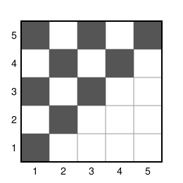

## Statement

On considère une grille de cases carrées, infinie dans toutes les directions. La **croix** d'une
case est formée de toutes les cases de sa ligne et de toutes les cases de sa colonne.

Soit $k \geqslant 1$ un entier. Au départ, on colorie $N$ cases. Ensuite, on a le droit de colorier
une case encore blanche dès que sa croix contient au moins $k$ cases déjà coloriées. On colorie les
cases une par une, et on peut continuer indéfiniment.

Quel est le plus petit entier $N$ pour lequel on peut choisir les $N$ cases du départ de sorte que
chaque case de la grille finisse par être coloriée ?

## Hints

1. Traite d'abord $k = 1$, puis $k = 2$. Combien de cases faut-il au départ, et où les placer ?
2. Pour l'exemple, place les cases du départ dans un carré de $k \times k$ cases. Commence par
   remplir ce carré.
3. Pour montrer qu'il faut assez de cases au départ, suis l'ordre dans lequel les cases sont
   coloriées, et **repère** une case coloriée chaque fois qu'elle n'est ni sur la ligne ni sur la
   colonne d'une case repérée avant elle.
4. Deux croix dont les centres ne sont ni sur la même ligne ni sur la même colonne ont exactement
   $2$ cases en commun. Combien de cases du départ la croix de la deuxième case repérée apporte-t-elle
   de nouveau ? Et la troisième ?

## Solution

**Réponse : $N = k + (k - 2) + (k - 4) + \cdots$, en s'arrêtant au dernier terme positif.**

Cela donne $N = \ell(\ell + 1)$ si $k = 2\ell$ est pair, car
$2 + 4 + \cdots + 2\ell = 2(1 + 2 + \cdots + \ell) = \ell(\ell + 1)$, et $N = (\ell + 1)^2$ si
$k = 2\ell + 1$ est impair, car $1 + 3 + \cdots + (2\ell + 1)$ est la somme de $\ell + 1$ termes d'une
suite arithmétique, égale à $(\ell + 1) \times \frac{1 + (2\ell + 1)}{2} = (\ell + 1)^2$. Par
exemple, pour $k = 1, 2, 3, 4, 5$, on trouve $N = 1, 2, 4, 6, 9$.

### Il faut au moins $k + (k - 2) + (k - 4) + \cdots$ cases au départ

Supposons qu'avec $N$ cases au départ, on arrive à colorier toute la grille. Les autres cases sont
coloriées une par une, dans un certain ordre. Passons-les en revue dans cet ordre, et **repérons**
certaines d'entre elles :

- la première case coloriée après le départ est repérée ;
- ensuite, une case coloriée est repérée si elle n'est ni sur la ligne ni sur la colonne d'une case
  repérée avant elle, c'est-à-dire si elle n'est dans la croix d'aucune case repérée avant elle.

Notons $R_1, R_2, R_3, \ldots$ les cases repérées, dans l'ordre. Par construction, chaque case
coloriée après le départ est dans la croix d'une case repérée qui n'est pas coloriée après elle :
soit elle est elle-même repérée, soit elle est dans la croix d'une case repérée avant elle.

**Il y a une infinité de cases repérées.** Supposons qu'il n'y en ait qu'un nombre fini $r$. Leurs
croix occupent $r$ lignes et $r$ colonnes. Choisissons une ligne qui n'en fait pas partie : elle
contient une infinité de cases qui ne sont dans aucune des $r$ colonnes, donc dans aucune des $r$
croix. Comme il n'y a que $N$ cases au départ, l'une de ces cases est coloriée après le départ, sans
être dans la croix d'une case repérée. C'est impossible.

**Deux croix ont peu de cases en commun.** Si $p < m$, la case $R_m$ n'est ni sur la ligne ni sur
la colonne de $R_p$. Les croix de $R_p$ et de $R_m$ ont alors exactement deux cases en commun :
celle qui est sur la ligne de $R_p$ et la colonne de $R_m$, et celle qui est sur la ligne de $R_m$
et la colonne de $R_p$.

**Chaque case repérée apporte de nouvelles cases du départ.** Au moment où l'on colorie $R_m$, sa
croix contient au moins $k$ cases coloriées. Parmi elles, au plus $2(m - 1)$ sont dans les croix de
$R_1, \ldots, R_{m-1}$, à raison d'au plus deux par croix. Les autres, au nombre d'au moins
$k - 2(m - 1)$, ne sont dans aucune de ces croix.

Ces cases sont des cases du départ. En effet, une case coloriée après le départ et avant $R_m$ est
dans la croix d'une case repérée coloriée au plus tard en même temps qu'elle, donc avant $R_m$ : c'est
l'une des cases $R_1, \ldots, R_{m-1}$.

Ainsi, la croix de $R_m$ contient au moins $k - 2(m - 1)$ cases du départ qui ne sont dans aucune
des croix précédentes. Les cases trouvées pour $R_1$, pour $R_2$, pour $R_3$, et ainsi de suite, sont
donc toutes différentes. Comme il y a une infinité de cases repérées, on obtient
$$N \geqslant k + (k - 2) + (k - 4) + \cdots ,$$
en s'arrêtant au dernier terme positif.

### Un exemple avec exactement ce nombre de cases

Prenons un carré de $k \times k$ cases. Numérotons ses lignes de $1$ à $k$ de bas en haut, et ses
colonnes de $1$ à $k$ de gauche à droite. Notons $(i\,;j)$ la case de la ligne $i$ et de la
colonne $j$. Pour un entier $d$, la **diagonale $d$** est formée des cases $(i\,;j)$ du carré telles
que $i - j = d$. Pour $d \geqslant 0$, elle compte $k - d$ cases. Remarquons que deux cases d'une même
diagonale ne sont jamais sur la même ligne, ni sur la même colonne.

Au départ, on colorie les diagonales $0, 2, 4, \ldots$, c'est-à-dire les diagonales paires et
positives ou nulles. Cela fait bien $k + (k - 2) + (k - 4) + \cdots$ cases.

**Première étape : les diagonales impaires positives.** On colorie les diagonales $1, 3, 5, \ldots$
en commençant par la plus grande et en finissant par la diagonale $1$. Prenons une case $(i\,;j)$ de
la diagonale $d$, avec $d$ impair, au moment où on la colorie. À ce moment, les cases coloriées sont
celles des diagonales paires positives ou nulles, et celles des diagonales impaires plus grandes que
$d$. Comptons les cases coloriées de sa croix.

- **Sur sa ligne.** Les cases $(i\,;j')$ avec $j' \leqslant i$ sont sur les $i$ diagonales
  $0, 1, \ldots, i - 1$. Parmi celles-ci, les diagonales $1, 3, \ldots, d$ ne sont pas coloriées, et
  il y en a $\frac{d + 1}{2}$ (elles sont toutes là, car $d = i - j \leqslant i - 1$). Les cases
  $(i\,;j')$ avec $j' > i$ sont sur des diagonales négatives, encore blanches. La ligne contient
  donc $i - \frac{d + 1}{2}$ cases coloriées.
- **Sur sa colonne.** Les cases $(i'\,;j)$ avec $i' \geqslant j$ sont sur les $k - j + 1$
  diagonales $0, 1, \ldots, k - j$. De même, $\frac{d + 1}{2}$ d'entre elles ne sont pas coloriées
  (elles sont toutes là, car $d = i - j \leqslant k - j$). Les autres cases de la colonne sont sur des
  diagonales négatives. La colonne contient donc $k - j + 1 - \frac{d + 1}{2}$ cases coloriées.

Au total, la croix contient
$$i - \frac{d + 1}{2} + k - j + 1 - \frac{d + 1}{2} = (i - j) + k + 1 - (d + 1) = k$$
cases coloriées, car $i - j = d$. On peut donc colorier la case. Comme deux cases de la diagonale $d$
ne sont jamais dans la même croix, l'ordre dans lequel on colorie les cases d'une diagonale ne compte
pas.

**Deuxième étape : les diagonales négatives.** On colorie maintenant les diagonales
$-1, -2, \ldots, -(k - 1)$, dans cet ordre. Prenons une case $(i\,;j)$ de la diagonale $-m$, avec
$m \geqslant 1$, de sorte que $j = i + m$. À ce moment, les diagonales $d \geqslant -(m - 1)$ sont
toutes coloriées.

- Sur sa ligne, les $j - 1$ cases situées à sa gauche sont sur les diagonales $i - 1$, $i - 2$,
  jusqu'à $i - (j - 1) = -(m - 1)$ : elles sont toutes coloriées.
- Sur sa colonne, les $k - i$ cases situées au-dessus d'elle sont sur des diagonales plus grandes
  que $-m$ : elles sont toutes coloriées.

La croix contient donc au moins $(j - 1) + (k - i) = k + m - 1 \geqslant k$ cases coloriées. À la fin
de cette étape, tout le carré est colorié.

**Troisième étape : le reste de la grille.** On colorie les cases hors du carré par couronnes
successives : d'abord celles qui touchent le carré, ce qui donne un carré plus grand, puis celles qui
touchent ce nouveau carré, et ainsi de suite. Chaque couronne contient un nombre fini de cases. Dans
chaque couronne, on colorie d'abord les cases des lignes $1$ à $k$, puis les autres.

- Une case des lignes $1$ à $k$ a, sur sa ligne, les $k$ cases du carré, déjà coloriées.
- Une autre case a, sur sa colonne, les $k$ cases de cette colonne situées sur les lignes $1$ à $k$.
  Elles sont dans la même couronne ou dans une couronne précédente, et elles ont été coloriées avant.

Chaque case de la grille finit donc par être coloriée.

**Conclusion : le plus petit nombre de cases au départ est $N = k + (k - 2) + (k - 4) + \cdots$,
c'est-à-dire $\ell(\ell + 1)$ si $k = 2\ell$ et $(\ell + 1)^2$ si $k = 2\ell + 1$.**

## Going further

- Pour $k = 2$, il faut deux cases au départ. Montre que deux cases sur une même ligne ne suffisent
  pas, et que deux cases qui se touchent par un coin suffisent.
