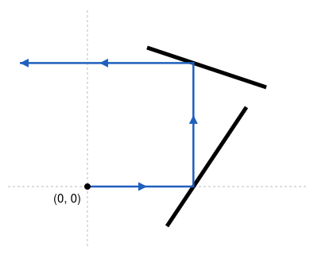

## Statement

Dans le plan muni d'un repère, on a placé un nombre fini de **murs**, au moins un. Chaque mur est un
segment qui n'est ni horizontal ni vertical, et dont les deux extrémités ne font pas partie du mur.
Deux murs n'ont jamais de point commun, et le point $(0, 0)$ n'est sur aucun mur.

Thanima part du point $(0, 0)$ et se déplace vers la droite. Elle avance toujours en ligne droite,
horizontalement ou verticalement. Chaque fois qu'elle arrive sur un mur, elle tourne d'un quart de
tour et repart, sans traverser le mur. Comme le mur n'est ni horizontal ni vertical, un seul des deux
quarts de tour le permet.

On dit que Thanima touche un mur **par le dessus** si elle arrive sur lui en venant d'un point situé
au-dessus de la droite qui porte ce mur, et **par le dessous** sinon.

Montrer qu'il est impossible que Thanima touche chacun des murs à la fois par le dessus et par le
dessous.

## Hints

1. Imagine un mur que Thanima touche par le dessus, et tel qu'aucun autre mur ne se trouve au-dessus
   de lui. Que lui arrive-t-il ensuite ?
2. Dis qu'un mur $M$ est au-dessus d'un mur $M'$ si une même droite verticale les rencontre tous les
   deux, $M$ plus haut que $M'$. Peut-on avoir à la fois $M$ au-dessus de $M'$ et $M'$ au-dessus de
   $M$ ?
3. Pour montrer qu'il existe un mur sans aucun mur au-dessus de lui, montre qu'on ne peut pas avoir
   des murs $M_1, M_2, \ldots, M_m$ chacun sous le suivant, et $M_m$ sous $M_1$. Prends une telle
   boucle la plus courte possible, et regarde le mur dont l'extrémité gauche est la plus à droite.

## Solution

Disons qu'un mur $M$ est **au-dessus** d'un mur $M'$, ou que $M'$ est **sous** $M$, s'il existe une
droite verticale qui rencontre ces deux murs, et qui rencontre $M$ plus haut que $M'$.

**Étape 1 : deux murs ne peuvent pas être chacun au-dessus de l'autre.** Prenons deux murs $M$ et
$M'$ qu'une même verticale rencontre. Aucun des deux n'est vertical, donc ils sont portés par des
droites d'équations $y = ax + b$ et $y = a'x + b'$. Les abscisses des points de $M$ forment un
intervalle ouvert (les extrémités sont exclues), de même pour $M'$, et les abscisses communes forment
encore un intervalle ouvert $I$, non vide.

Sur $I$, la différence de hauteur

$$d(x) = (ax + b) - (a'x + b')$$

ne s'annule jamais, car les deux murs n'ont aucun point commun. Or $d$ est une fonction affine : si
elle prenait sur $I$ une valeur positive et une valeur négative, elle s'annulerait entre les deux.
Donc $d$ garde le même signe sur tout $I$ : si $M$ est plus haut que $M'$ sur une verticale, il l'est
sur toutes les verticales qui les rencontrent tous les deux. Les deux murs ne peuvent pas être chacun
au-dessus de l'autre.

**Étape 2 : pas de boucle.** Appelons **boucle** une liste de murs différents
$M_1, M_2, \ldots, M_m$, avec $m \geqslant 2$, où chaque mur est sous le suivant et où $M_m$ est sous
$M_1$. Supposons qu'il existe une boucle, et prenons-en une avec $m$ le plus petit possible. On lit
les indices en tournant : après $M_m$ vient $M_1$, et avant $M_1$ vient $M_m$.

D'après l'étape 1, $m \neq 2$, donc $m \geqslant 3$. Parmi les murs de la boucle, choisissons un mur
$M_j$ dont l'extrémité gauche a la plus grande abscisse, notée $\ell$. Ses deux voisins dans la boucle
sont $M_{j-1}$, qui est sous lui, et $M_{j+1}$, qui est au-dessus.

Chacun de ces deux voisins partage avec $M_j$ une verticale, d'abscisse $x_0$ plus grande que
$\ell$ puisque $M_j$ n'existe qu'à droite de $\ell$. Son extrémité gauche a une abscisse inférieure
ou égale à $\ell$, donc ce voisin est présent à toutes les abscisses comprises strictement entre
$\ell$ et $x_0$, tout comme $M_j$. Ainsi, une verticale d'abscisse juste un peu plus grande que
$\ell$ rencontre les trois murs $M_{j-1}$, $M_j$ et $M_{j+1}$. Sur cette verticale, d'après l'étape 1, $M_{j-1}$ est plus bas que
$M_j$, qui est plus bas que $M_{j+1}$. Donc $M_{j-1}$ est sous $M_{j+1}$.

En retirant $M_j$ de la liste, on obtient une boucle de $m - 1 \geqslant 2$ murs. C'est contraire au
choix de $m$ : **il n'existe aucune boucle**.

**Étape 3 : un mur tout en haut, un mur tout en bas.** Partons d'un mur quelconque. S'il y a un mur
au-dessus de lui, passons à ce mur, et recommençons. Si cela ne s'arrêtait jamais, comme il n'y a
qu'un nombre fini de murs, on retomberait un jour sur un mur déjà rencontré, et les murs parcourus
entre-temps formeraient une boucle. (Un mur n'est jamais au-dessus de lui-même, car une verticale ne
le rencontre qu'en un point.) C'est impossible d'après l'étape 2.

On finit donc sur un mur $T$ **sans aucun mur au-dessus de lui**. Par conséquent, la demi-droite
verticale qui monte à partir d'un point de $T$ ne rencontre aucun mur. De la même façon, il existe un
mur $F$ sans aucun mur au-dessous de lui, et la demi-droite verticale qui descend à partir d'un point
de $F$ ne rencontre aucun mur. Les murs $T$ et $F$ peuvent être le même mur.

**Étape 4 : toucher $T$ par le dessus, c'est partir pour toujours.** Supposons que Thanima touche
$T$ par le dessus, en un point $P$.

Elle n'arrive pas en $P$ en montant, puisqu'elle viendrait alors du dessous. Elle n'y arrive pas
non plus en descendant. Sinon, juste avant, elle descendait le long de la demi-droite
qui monte à partir de $P$. Elle aurait commencé cette descente en un point de cette demi-droite, après
avoir tourné. Or elle ne tourne que sur les murs, cette demi-droite n'en contient aucun, et au départ
elle se déplace horizontalement.

Elle arrive donc en $P$ horizontalement, au-dessus de la droite qui porte $T$. Elle tourne alors d'un
quart de tour. Descendre la ferait passer sous cette droite, donc traverser le mur : elle **monte**.
Elle suit alors la demi-droite qui monte à partir de $P$, ne rencontre plus jamais aucun mur, et
s'éloigne pour toujours.

De la même façon, si Thanima touche $F$ par le dessous, elle part ensuite vers le bas pour toujours,
sans plus jamais toucher de mur.

**Conclusion.** Si Thanima touchait chaque mur des deux côtés, elle toucherait $T$ par le dessus et
$F$ par le dessous. Mais après celui de ces deux évènements qui arrive en premier, elle ne touche plus
aucun mur, et l'autre ne peut pas arriver. C'est impossible : Thanima ne peut pas toucher tous les
murs des deux côtés.

## Going further

L'étape 2 a une jolie conséquence. On peut retirer les murs un par un, en faisant glisser chacun tout
droit vers le haut, sans jamais heurter un autre mur. On commence par un mur sans aucun mur au-dessus
de lui, puis on recommence avec les murs qui restent, et ainsi de suite.
