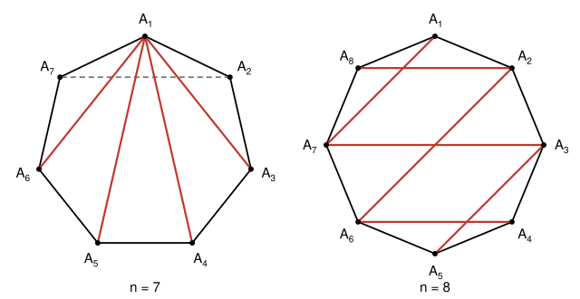

## Statement

Soit $n \geqslant 3$ un entier. Le gâteau d'anniversaire de Rémi a la forme d'un polygone convexe à $n$
sommets. Théo donne plusieurs coups de couteau différents dans le gâteau. Un coup de couteau est un
segment qui relie deux sommets **non voisins** du polygone, c'est-à-dire une diagonale.

Un coup de couteau est **bien fait** s'il rencontre exactement un autre coup de couteau en un point qui
n'est pas un sommet du polygone. Les autres coups sont mal faits, et Théo a le droit d'en donner aussi.

Combien de coups bien faits Théo a-t-il pu donner, au maximum ?

## Hints

1. Fais des essais pour $n = 4, 5, 6, 7$. Il semble que la réponse dépende de la parité de $n$.
2. Si aucun coup bien fait n'en croise un autre bien fait, les coups bien faits ne se croisent pas du
   tout. Combien de diagonales qui ne se croisent pas peut-on tracer dans un polygone convexe ?
3. Sinon, deux coups bien faits $[AB]$ et $[CD]$ se croisent. Aucun autre coup ne peut les croiser.
   Montre que tous les autres coups restent dans l'un des quatre « morceaux de bord » délimités par
   $A$, $C$, $B$, $D$.
4. Raisonne sur un plus petit polygone qui ferait mieux que ta formule : les quatre petits polygones,
   eux, ont moins de sommets.

## Solution

Notons $g(n) = n - 2$ si $n$ est pair, et $g(n) = n - 3$ si $n$ est impair. Nous allons montrer que le
maximum cherché est $g(n)$.

**Vocabulaire.** Deux coups se **croisent** s'ils se rencontrent en un point qui n'est pas un sommet.
Deux coups qui ont une extrémité commune ne se croisent donc pas. Si $[XY]$ et $[AB]$ sont deux coups
sans extrémité commune, ils se croisent exactement quand $X$ et $Y$ sont de part et d'autre de la droite
$(AB)$. En effet, la droite $(AB)$ ne rencontre le gâteau, qui est convexe, que le long du segment
$[AB]$.

### 1. Les constructions

Numérotons $A_1, A_2, \ldots, A_n$ les sommets dans l'ordre.

- **$n$ impair.** Théo donne les coups $[A_1A_3], [A_1A_4], \ldots, [A_1A_{n-1}]$ et le coup $[A_2A_n]$.
  Chaque coup $[A_1A_j]$ croise $[A_2A_n]$, car $A_j$ et $A_1$ sont de part et d'autre de $(A_2A_n)$, et
  il ne croise aucun autre coup, puisque les autres partent aussi de $A_1$. Les $n - 3$ coups $[A_1A_j]$
  sont donc bien faits.
- **$n$ pair.** Théo donne les coups $[A_iA_j]$ avec $i + j = n$, et les coups $[A_iA_j]$ avec
  $i + j = n + 2$. Cela fait $\frac{n}{2} - 1$ coups de chaque sorte, soit $n - 2$ coups. Les coups d'une
  même sorte sont parallèles (sur un polygone régulier), ou du moins ne se croisent pas : ils sont
  emboîtés les uns dans les autres. Un coup $[A_iA_{n-i}]$ de la première sorte croise exactement un
  coup de la seconde, le coup $[A_{i+1}A_{n+1-i}]$, et inversement. Les $n - 2$ coups sont bien faits.

On peut donc toujours obtenir $g(n)$ coups bien faits. Il reste à montrer qu'on ne peut pas faire mieux.

### 2. Des coups qui ne se croisent pas

**Lemme.** Dans un polygone convexe à $n$ sommets, on peut tracer au plus $n - 3$ diagonales qui ne se
croisent pas deux à deux.

Traçons ces $k$ diagonales l'une après l'autre. Chaque nouvelle diagonale ne croise pas les précédentes,
donc elle est tracée à l'intérieur d'un seul des morceaux déjà découpés, et elle le coupe en deux. À la
fin, il y a $k + 1$ morceaux, qui sont des polygones convexes ayant chacun au moins $3$ sommets, tous
pris parmi les sommets du gâteau.

Les angles de ces morceaux remplissent exactement les angles du gâteau, sommet par sommet. La somme de
tous leurs angles vaut donc la somme des angles du gâteau, $(n - 2) \times 180^\circ$. Mais chaque
morceau a une somme d'angles d'au moins $180^\circ$. Donc $(k + 1) \times 180^\circ \leqslant (n - 2) \times 180^\circ$,
c'est-à-dire $k \leqslant n - 3$.

### 3. On ne peut pas faire mieux que $g(n)$

Raisonnons par l'absurde. Supposons qu'il existe des polygones convexes où l'on peut faire plus de
coups bien faits que la formule $g$ ne le permet, et prenons-en un qui a le **plus petit nombre de
sommets** possible, disons $n$. Pour tout polygone convexe ayant moins de $n$ sommets, la formule est
donc respectée. Elle l'est aussi, trivialement, pour un « polygone » à $2$ ou $3$ sommets, où il n'y a
aucune diagonale : $g(2) = g(3) = 0$.

Fixons des coups de couteau dans ce polygone à $n$ sommets qui donnent plus de $g(n)$ coups bien faits.

**Premier cas : deux coups bien faits ne se croisent jamais.** D'après le lemme, il y a au plus $n - 3$
coups bien faits, et $n - 3 \leqslant g(n)$. C'est impossible.

**Second cas : deux coups bien faits $[AB]$ et $[CD]$ se croisent.** Leurs extrémités alternent sur le
bord : en tournant autour du gâteau, on rencontre $A$, $C$, $B$, $D$ dans cet ordre. Ces quatre sommets
découpent les $n - 4$ autres sommets en quatre **arcs** :

- l'arc 1, avec les $a$ sommets situés entre $A$ et $C$ ;
- l'arc 2, avec les $b$ sommets situés entre $C$ et $B$ ;
- l'arc 3, avec les $c$ sommets situés entre $B$ et $D$ ;
- l'arc 4, avec les $d$ sommets situés entre $D$ et $A$.

On a $a + b + c + d = n - 4$. Appelons **arc fermé** 1 l'arc 1 auquel on ajoute ses deux bouts $A$ et $C$,
et de même pour les autres.

*Tout autre coup reste dans un arc fermé.* Le coup $[AB]$ est bien fait et croise déjà $[CD]$ : il ne
croise aucun autre coup. De même pour $[CD]$. Soit $[XY]$ un autre coup.

Un sommet qui n'est pas $A$, $B$, $C$, $D$ est du côté de $C$ ou du côté de $D$ par rapport à la droite
$(AB)$, et du côté de $A$ ou du côté de $B$ par rapport à la droite $(CD)$. Ces deux renseignements
donnent son arc : l'arc 1 est du côté de $C$ et du côté de $A$, l'arc 2 du côté de $C$ et du côté de $B$,
l'arc 3 du côté de $D$ et du côté de $B$, l'arc 4 du côté de $D$ et du côté de $A$.

- Si $X$ et $Y$ ne sont ni l'un ni l'autre parmi $A$, $B$, $C$, $D$ : comme $[XY]$ ne croise pas $[AB]$,
  $X$ et $Y$ sont du même côté de $(AB)$, et comme il ne croise pas $[CD]$, ils sont du même côté de
  $(CD)$. Ils sont donc dans le même arc.
- Si $X = A$ : le coup $[AY]$ ne croise pas $[CD]$, donc $Y$ est du côté de $A$ par rapport à $(CD)$, ou
  bien $Y$ est $C$ ou $D$. Donc $Y$ est dans l'arc 1, dans l'arc 4, ou vaut $C$ ou $D$. Dans tous les cas
  $A$ et $Y$ sont dans l'arc fermé 1 ou dans l'arc fermé 4. On raisonne de même si $X$ ou $Y$ vaut $B$,
  $C$ ou $D$.

**Les quatre petits polygones.** Notons $P_1$ le polygone convexe dont les sommets sont ceux de l'arc
fermé 1 : il a $a + 2$ sommets. De même $P_2$, $P_3$, $P_4$ ont $b + 2$, $c + 2$, $d + 2$ sommets.

Tout coup autre que $[AB]$ et $[CD]$ relie deux sommets d'un même arc fermé, disons le premier. C'est soit
le côté $[AC]$ de $P_1$, soit une diagonale de $P_1$.

- Le coup $[AC]$, s'il a été donné, ne croise aucun coup : il faudrait pour cela un coup ayant une
  extrémité strictement dans l'arc 1 et l'autre hors de l'arc fermé 1. Il est donc mal fait.
- Une diagonale de $P_1$ ne peut croiser que des coups qui sont aussi des diagonales de $P_1$. Les coups
  des autres arcs fermés ont leurs deux extrémités hors de l'arc 1, et l'arc fermé 1 ne partage avec un
  autre arc fermé qu'une seule extrémité : leurs extrémités ne peuvent pas alterner.

Ainsi, les coups bien faits autres que $[AB]$ et $[CD]$ sont des diagonales de $P_1$, $P_2$, $P_3$ ou
$P_4$, et chacun reste bien fait si l'on ne garde que les coups tracés dans son petit polygone. Chaque
petit polygone a au plus $n - 2$ sommets, donc moins que $n$, et la formule y est respectée : $P_1$
contient au plus $g(a + 2)$ coups bien faits, et de même pour les autres.

**Le calcul.** On a $g(m + 2) = m$ si $m$ est pair, et $g(m + 2) = m - 1$ si $m$ est impair. Le nombre de
coups bien faits est donc au plus

$$2 + g(a+2) + g(b+2) + g(c+2) + g(d+2) = 2 + (a + b + c + d) - t = n - 2 - t,$$

où $t$ est le nombre de nombres impairs parmi $a$, $b$, $c$, $d$.

- Si $n$ est pair, on obtient au plus $n - 2 = g(n)$.
- Si $n$ est impair, $a + b + c + d = n - 4$ est impair, donc l'un au moins des quatre nombres est
  impair et $t \geqslant 1$. On obtient au plus $n - 3 = g(n)$.

Dans les deux cas, c'est contraire au choix de notre polygone. Il n'existe donc aucun polygone où l'on
fait mieux que $g(n)$.

**Conclusion.** Théo a pu donner au maximum $n - 2$ coups bien faits si $n$ est pair, et $n - 3$ coups
bien faits si $n$ est impair.

## Going further

Le raisonnement « prenons un plus petit contre-exemple » est une façon déguisée de faire une
**récurrence** sur le nombre de sommets. Il oblige à bien dire à quels polygones on applique le résultat :
ici, les petits polygones $P_1, \ldots, P_4$ ne sont traversés par aucun coup venant de l'extérieur, et
c'est exactement ce qui permet de les traiter comme des gâteaux à part entière.

Une vérification par ordinateur de toutes les façons de donner les coups confirme les maximums $2$, $2$,
$4$, $4$, $6$, $6$ pour $n = 4, 5, 6, 7, 8, 9$.
