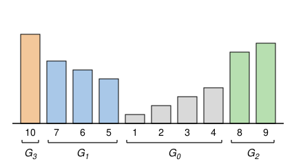

## Statement

Oscar dresse un singe. Il a planté $n$ bambous en ligne, tous de hauteurs différentes. Le singe,
perché sur un bambou, obéit à deux ordres :

- « Droite ! » : il saute sur le bambou le plus proche **à sa droite** parmi ceux qui sont plus hauts
  que le bambou où il se trouve ;
- « Gauche ! » : il fait de même **vers la gauche**.

S'il n'y a aucun bambou plus haut du côté demandé, l'ordre ne peut pas être donné.

Par exemple, si les hauteurs sont $4, 1, 3, 2, 5$ de gauche à droite, le singe posé sur le bambou de
hauteur $1$ saute sur celui de hauteur $3$ à l'ordre « Droite ! », et sur celui de hauteur $4$ à
l'ordre « Gauche ! ». Depuis le bambou de hauteur $3$, l'ordre « Droite ! » l'envoie sur celui de
hauteur $5$ : il passe au-dessus du bambou de hauteur $2$, trop petit.

Oscar se vante : pour deux bambous quelconques, son singe peut toujours aller du plus petit des deux
au plus grand des deux en **au plus $k$ ordres**.

Soit $k \geq 1$ un entier. Quelle est la plus grande valeur de $n$ pour laquelle une telle disposition
des bambous est possible ?

## Hints

1. Seul l'ordre des hauteurs compte. Numérote les bambous de $1$ (le plus petit) à $n$ (le plus
   grand), et cherche les meilleures dispositions pour $k = 1$, puis pour $k = 2$.
2. Le singe doit pouvoir atteindre tous les bambous en partant du bambou $1$. Montre qu'alors, de
   chaque côté du bambou $1$, les hauteurs augmentent quand on s'éloigne de $1$.
3. Écris, pour chaque bambou $2, 3, \ldots, n$, s'il est à gauche ou à droite de $1$, et regroupe en
   paquets les numéros consécutifs qui sont du même côté. Montre qu'un saut mène toujours soit au bambou de
   numéro juste au-dessus, soit au plus petit bambou d'un de ces paquets.
4. Un bambou qui n'est pas le plus petit de son paquet ne peut être atteint que depuis le bambou de
   numéro juste en dessous. Regroupe encore les paquets en blocs $G_0, G_1, G_2, \ldots$ et montre que
   le bloc $G_j$ contient au plus $k + 1 - j$ bambous.

## Solution

Le singe ne fait que comparer des hauteurs : seul compte l'ordre des bambous du plus petit au plus
grand. On numérote donc les bambous de $1$ (le plus petit) à $n$ (le plus grand), et on désigne
chaque bambou par son numéro. « $x$ est plus grand que $y$ » veut dire que le bambou $x$ est plus
haut que le bambou $y$.

Pour un bambou $x$, on note $d(x)$ le plus petit nombre d'ordres qui amènent le singe du bambou $1$
au bambou $x$. Si Oscar a raison, alors $d(x) \leq k$ pour tout bambou $x$.

**La réponse est**

$$n = 1 + 2 + \cdots + (k+1) = \frac{(k+1)(k+2)}{2}.$$

### 1. Une disposition qui atteint cette valeur

On range les nombres de $1$ à $\frac{(k+1)(k+2)}{2}$ en blocs de nombres consécutifs :
$G_0 = \{1, 2, \ldots, k+1\}$ a $k + 1$ éléments, $G_1$ contient les $k$ nombres suivants, $G_2$ les
$k - 1$ suivants, et ainsi de suite jusqu'à $G_k$, qui contient un seul nombre. Le bloc $G_j$ a donc
$k + 1 - j$ éléments, et tous les éléments de $G_j$ sont plus petits que ceux de $G_{j+1}$.

On place les bambous ainsi :

- les bambous de $G_0$ côte à côte, $1$ à gauche, puis $2$, puis $3$, ..., jusqu'à $k + 1$ ;
- les bambous de $G_1$ à gauche de $1$, du plus petit au plus grand en allant vers la gauche ;
- les bambous de $G_2$ à droite de $k + 1$, du plus petit au plus grand en allant vers la droite ;
- puis $G_3$ tout à gauche, $G_4$ tout à droite, en alternant, toujours du plus petit au plus grand
  en s'éloignant de $1$.

Voici la disposition obtenue pour $k = 3$, avec $10$ bambous :

Dans cette disposition, les hauteurs augmentent quand on s'éloigne du bambou $1$, de chaque côté.
Regardons les deux sortes de sauts.

- **S'éloigner de $1$.** Si $x$ n'est pas le plus grand de son bloc, son voisin du côté opposé à $1$
  est le bambou $x + 1$, qui est plus grand : l'ordre qui éloigne de $1$ mène en $x + 1$. Pour les
  bambous de $G_0$, y compris $1$, cet ordre est « Droite ! ».
- **Passer de l'autre côté.** Prenons $x$ dans $G_j$ avec $j < k$, et donnons l'ordre qui va vers
  $1$. Le singe rencontre d'abord les bambous de son côté plus proches de $1$ : ils sont tous plus
  petits que $x$, puisque les hauteurs augmentent en s'éloignant de $1$. Puis il rencontre $1$, et de
  l'autre côté les blocs déjà placés, $G_{j-1}, G_{j-3}, \ldots$, qui sont formés de nombres plus
  petits que $x$. Le premier bambou plus grand que $x$ est donc le bambou de $G_{j+1}$ le plus proche
  de $1$, c'est-à-dire le plus petit élément de $G_{j+1}$. Pour les bambous de $G_0$, y compris $1$,
  cet ordre est « Gauche ! ».

Prenons maintenant deux bambous $x < y$, avec $x$ dans $G_i$ et $y$ dans $G_j$. Comme les blocs sont
rangés par ordre croissant, $i \leq j$.

- Si $i = j$, le singe s'éloigne de $1$ en passant par $x + 1, x + 2, \ldots$ jusqu'à $y$. Cela fait
  $y - x$ ordres, et $y - x \leq (k + 1 - j) - 1 = k - j \leq k$.
- Si $i < j$, le singe passe de l'autre côté $j - i$ fois : il arrive sur le plus petit élément de
  $G_{i+1}$, puis sur celui de $G_{i+2}$, ..., puis sur celui de $G_j$. Il s'éloigne ensuite de $1$
  jusqu'à $y$, en au plus $(k + 1 - j) - 1 = k - j$ ordres. Au total, il donne au plus
  $(j - i) + (k - j) = k - i \leq k$ ordres.

Dans tous les cas, $k$ ordres suffisent. Cette disposition de $\frac{(k+1)(k+2)}{2}$ bambous convient.

### 2. De chaque côté de $1$, les hauteurs augmentent

Prenons maintenant une disposition quelconque qui vérifie la propriété d'Oscar.

**Lemme 1.** Si $a$ et $b$ sont deux bambous à gauche de $1$, et que $b$ est plus à gauche que $a$,
alors $b$ est plus grand que $a$. De même à droite de $1$.

*Preuve.* Le singe doit pouvoir aller de $1$ à $b$. Il part de $1$, qui est à droite de $a$. Regardons
le premier ordre qui l'amène sur $a$ ou plus à gauche que $a$. C'est forcément un « Gauche ! », donné
depuis un bambou $c$ situé à droite de $a$.

- Si le singe atterrit sur $a$, il est à la hauteur de $a$.
- Sinon, il passe au-dessus de $a$. Il saute toujours sur le **premier** bambou plus grand que $c$,
  donc $a$ est plus petit que $c$, et le bambou d'arrivée est plus grand que $c$, donc plus grand que
  $a$.

Dans les deux cas, à cet instant, le singe est sur un bambou au moins aussi grand que $a$. Ensuite il
monte à chaque saut. Il arrive sur $b$ à cet instant ou plus tard, et $b \neq a$, donc $b$ est plus
grand que $a$. $\square$

La ligne de bambous a donc la forme d'un V : les hauteurs diminuent jusqu'à $1$, puis augmentent.

### 3. Les groupes et la règle des sauts

On écrit, pour chaque bambou $2, 3, \ldots, n$, s'il est à gauche ou à droite de $1$, puis on regroupe
les numéros **consécutifs** qui sont du même côté. On appelle ces paquets $P_1, P_2, P_3, \ldots$ dans
l'ordre des numéros, et on pose $P_0 = \{1\}$. Les paquets $P_1, P_3, P_5, \ldots$ sont d'un côté, les
paquets $P_2, P_4, \ldots$ de l'autre.

Dans l'exemple de la figure, $P_0 = \{1\}$, $P_1 = \{2, 3, 4\}$ (à droite), $P_2 = \{5, 6, 7\}$ (à
gauche), $P_3 = \{8, 9\}$ (à droite) et $P_4 = \{10\}$ (à gauche).

Grâce au lemme 1, un bambou $x$ a deux sauts possibles :

- l'ordre qui l'éloigne de $1$ le mène sur le plus petit bambou plus grand que $x$ **de son côté** ;
- l'ordre qui va vers $1$ passe au-dessus de tous les bambous de son côté qui sont entre lui et $1$,
  tous plus petits, puis au-dessus de $1$, et le mène sur le plus petit bambou plus grand que $x$
  **de l'autre côté**.

Depuis $1$, les deux ordres mènent au plus petit bambou de chaque côté, c'est-à-dire en $2$ et au plus
petit élément de $P_2$.

Soit $x$ dans le paquet $P_t$.

- Si $x$ n'est pas le plus grand de $P_t$, alors $x + 1$ est de son côté : un ordre mène en $x + 1$,
  l'autre au plus petit élément de $P_{t+1}$.
- Si $x$ est le plus grand de $P_t$, alors $x + 1$ est le plus petit élément de $P_{t+1}$, de l'autre
  côté : un ordre mène en $x + 1$, l'autre au plus petit élément de $P_{t+2}$, le prochain paquet de
  son côté.

Le bambou $1$ suit la deuxième règle, comme plus grand élément de $P_0$. On en tire deux règles.

- **(R1)** Un bambou $y$ qui n'est pas le plus petit de son paquet ne peut être atteint que depuis le
  bambou $y - 1$.
- **(R2)** Le plus petit bambou de $P_u$ ne peut être atteint que depuis un bambou de $P_{u-1}$, ou
  depuis le plus grand bambou de $P_{u-2}$.

### 4. Les blocs

On regroupe les paquets en **blocs**, en les lisant dans l'ordre $P_0, P_1, P_2, \ldots$ :

- un paquet d'au moins deux bambous forme un bloc à lui seul ;
- un paquet d'un seul bambou forme un bloc avec le paquet qui le suit, s'il y en a un.

On appelle les blocs $G_0, G_1, G_2, \ldots$ dans l'ordre. Comme $P_0 = \{1\}$ n'a qu'un bambou, on a
$G_0 = \{1\} \cup P_1$. Chaque bloc est formé de nombres consécutifs, et **chaque bloc, sauf peut-être
le dernier, a au moins deux bambous**. Dans l'exemple de la figure, on retrouve
$G_0 = \{1, 2, 3, 4\}$, $G_1 = \{5, 6, 7\}$, $G_2 = \{8, 9\}$ et $G_3 = \{10\}$.

**Lemme 2.** Pour chaque bloc $G_j$, son plus petit bambou $m$ vérifie $d(m) \geq j$, et tout autre
bambou $y$ de $G_j$ vérifie $d(y) \geq j + 1$.

*Preuve.* On le montre bloc après bloc, dans l'ordre (c'est une récurrence sur $j$).

Pour $G_0$ : $d(1) = 0$, et tout autre bambou demande au moins un ordre.

Soit $j \geq 1$, et supposons le lemme vrai pour tous les blocs avant $G_j$.

*Le plus petit bambou $m$ de $G_j$.* C'est le plus petit élément d'un paquet $P_u$. D'après (R2), le
dernier saut vers $m$ part d'un bambou de $P_{u-1}$ ou du plus grand bambou de $P_{u-2}$.

- Le paquet $P_{u-1}$ est le dernier paquet de $G_{j-1}$. Tout bambou de $G_{j-1}$ vérifie
  $d \geq j - 1$, donc le chemin vers $m$ compte au moins $j$ ordres.
- Si $P_{u-2}$ est aussi dans $G_{j-1}$, c'est la même chose.
- Sinon, $P_{u-2}$ est le dernier paquet de $G_{j-2}$, et son plus grand bambou est le plus grand
  bambou de $G_{j-2}$. Ce n'est pas le plus petit, car $G_{j-2}$ n'est pas le dernier bloc et a donc
  au moins deux bambous. Il vérifie $d \geq (j - 2) + 1 = j - 1$, et là encore $d(m) \geq j$.

*Un autre bambou $y$ de $G_j$.*

- Si $y$ n'est pas le plus petit de son paquet, il n'est atteint que depuis $y - 1$ d'après (R1). Or
  $y - 1$ est dans $G_j$, donc $d(y - 1) \geq j$, et $d(y) \geq j + 1$.
- Si $y$ est le plus petit de son paquet $P_v$, alors $G_j$ est formé de deux paquets :
  $P_{v-1} = \{m\}$, puis $P_v$. D'après (R2), $y$ est atteint depuis $m$, qui vérifie $d(m) \geq j$,
  ou depuis le plus grand bambou de $P_{v-2}$. Celui-ci est le plus grand bambou de $G_{j-1}$, qui
  n'est pas son plus petit, donc il vérifie $d \geq (j - 1) + 1 = j$. Dans les deux cas,
  $d(y) \geq j + 1$. $\square$

### 5. La majoration

Soit $g_j$ le nombre de bambous du bloc $G_j$, et $M$ le plus grand.

- Si $G_j$ est un seul paquet, ses bambous sont $m, m + 1, \ldots, M$, et d'après (R1) chacun n'est
  atteint que depuis le précédent. Donc $d(M) \geq d(m) + g_j - 1 \geq j + g_j - 1$.
- Si $G_j = \{m\} \cup P_v$, le plus petit bambou de $P_v$ vérifie $d \geq j + 1$ d'après le
  lemme 2, puis on avance dans $P_v$ un bambou à la fois. Donc
  $d(M) \geq (j + 1) + (g_j - 2) = j + g_j - 1$.

Comme $d(M) \leq k$, on obtient

$$g_j \leq k + 1 - j .$$

En particulier il n'y a aucun bloc $G_j$ avec $j \geq k + 1$, car il aurait au plus $0$ bambou. Les
blocs sont donc parmi $G_0, G_1, \ldots, G_k$, et

$$n = g_0 + g_1 + \cdots + g_k \leq (k + 1) + k + \cdots + 1 = \frac{(k+1)(k+2)}{2}.$$

### Conclusion

La plus grande valeur de $n$ est $\boxed{\frac{(k+1)(k+2)}{2}}$. Par exemple $3$ bambous pour
$k = 1$, $6$ pour $k = 2$ et $10$ pour $k = 3$.

## Going further

- La majoration n'a utilisé que les chemins qui partent du bambou $1$. Si Oscar affirmait seulement
  que son singe va du plus petit bambou à n'importe quel autre en au plus $k$ ordres, la réponse
  serait donc la même.
- La disposition optimale n'est pas unique. Pour $k = 2$, exactement quatre dispositions de $6$
  bambous conviennent : $5, 4, 1, 2, 3, 6$ (celle de la partie 1), $6, 4, 1, 2, 3, 5$, et les deux
  mêmes lues de droite à gauche. Pour $k = 3$, il y en a huit, dont $10, 8, 5, 1, 2, 3, 4, 6, 7, 9$,
  où les blocs ne sont plus des paquets d'un seul côté.
- Un ordinateur a vérifié la réponse en essayant toutes les dispositions de $8$ bambous au plus, et
  toutes les dispositions en V de $16$ bambous au plus.
