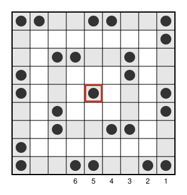
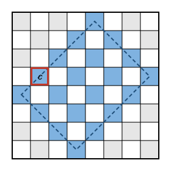

## Statement

Soit $n \geq 1$ un entier. Aline pose des champignons sur certaines cases d'une grille de $n \times n$
cases, au plus un champignon par case. Deux cases sont **voisines** si elles ont un côté commun.

Une case, avec ou sans champignon, est dite **méchante** si le nombre de ses voisines qui portent un
champignon est pair. Attention, $0$ est un nombre pair.

Pour quelles valeurs de $n$ Aline peut-elle poser ses champignons de sorte qu'il y ait **exactement
une** case méchante ?

## Hints

1. Essaie $n = 1$, $n = 2$ et $n = 3$.
2. Pour $n$ impair, découpe la grille en anneaux carrés emboîtés, du bord vers le centre, et ne mets
   des champignons que sur un anneau sur deux.
3. Sur un anneau, fais le tour en posant les champignons par deux : deux cases avec, deux cases sans,
   deux cases avec, et ainsi de suite.
4. Pour $n$ pair, suppose qu'il n'y a qu'une case méchante $c$. Cherche un ensemble $S$ de cases qui
   contient $c$, qui a un nombre pair de cases, et tel que chaque case de la grille a un nombre pair de
   voisines dans $S$. Compte alors de deux façons les couples formés d'une case de $S$ et d'une de ses
   voisines qui porte un champignon.
5. Pour construire $S$, colorie la grille en damier et suis les deux diagonales qui passent par $c$.

## Solution

**Réponse : c'est possible si et seulement si $n$ est impair.**

On numérote les colonnes de $1$ à $n$ de gauche à droite, et les lignes de $1$ à $n$ de bas en haut.
La case $(a, b)$ est celle de la colonne $a$ et de la ligne $b$.

### 1. Quand $n$ est impair, c'est possible

Si $n = 1$, l'unique case n'a aucune voisine. Elle a donc $0$ voisine avec un champignon, un nombre
pair : elle est méchante, et c'est la seule case. On suppose maintenant $n \geq 3$.

**Les anneaux.** Le bord de la grille forme un premier anneau carré. Si on l'enlève, il reste une
grille $(n-2) \times (n-2)$, dont le bord forme le deuxième anneau, et ainsi de suite. Comme $n$ est
impair, le dernier « anneau » est la case centrale toute seule. Les autres anneaux ont un côté $s$
impair, au moins égal à $3$, et un tel anneau contient $4(s-1)$ cases, un multiple de $4$.

Les anneaux de rang impair (le premier, le troisième, ...) sont dits **pleins**, les autres **vides**.
Ils alternent donc du bord vers le centre.

**La numérotation.** Sur un anneau de côté $s \geq 3$, on numérote les cases de $1$ à $4(s-1)$ en
partant du coin en bas à droite et en faisant le tour : vers la gauche le long du bas, puis vers le
haut, puis vers la droite le long du haut, puis vers le bas. Une case du côté numéro $h$
($h = 0$ pour le bas, $1$ pour la gauche, $2$ pour le haut, $3$ pour la droite), située à $j$ pas du
coin où commence ce côté, avec $0 \leq j \leq s - 1$, porte le numéro

$$1 + h(s-1) + j . \qquad (1)$$

Un coin est à la fois la fin d'un côté ($j = s - 1$) et le début du suivant ($j = 0$), et la formule
donne le même numéro dans les deux cas, sauf pour le coin de départ : il vaut $1$ comme début du bas,
et la formule donne $1 + 4(s-1)$ comme fin du côté droit. Ces deux valeurs diffèrent d'un multiple de
$4$, et seul le reste de la division par $4$ va nous servir.

**Le placement.** Sur chaque anneau plein de côté $s \geq 3$, on pose un champignon sur les cases de
numéro $1, 2$, puis $5, 6$, puis $9, 10$, et ainsi de suite : deux cases avec, deux cases sans, tout
autour de l'anneau. Une case porte donc un champignon exactement quand son numéro est de la forme
$4i + 1$ ou $4i + 2$. Si la case centrale est un anneau plein, on y pose aussi un champignon. On ne
pose rien sur les anneaux vides.

Dans ce motif qui se répète de $4$ en $4$, **deux cases dont les numéros diffèrent de $2$, ou de $2$
plus un multiple de $4$, sont toujours l'une avec champignon et l'autre sans**.

**Vérification.** On montre que toute case autre que la case centrale a exactement une voisine avec un
champignon, et que la case centrale en a un nombre pair.

*(a) Une case $X$ d'un anneau plein, autre que la case centrale.* Ses voisines qui ne sont pas sur
son anneau sont sur les anneaux juste à côté, qui sont vides. Il reste ses deux voisines sur son propre
anneau : celle qui la précède et celle qui la suit dans le tour (c'est vrai aussi pour un coin). Comme
l'anneau a un multiple de $4$ cases, le motif « avec, avec, sans, sans » se referme bien, et on lit :

| numéro de $X$ | $4i + 1$ | $4i + 2$ | $4i + 3$ | $4i + 4$ |
| --- | --- | --- | --- | --- |
| case précédente | sans | avec | avec | sans |
| case suivante | avec | sans | sans | avec |

Dans tous les cas, $X$ a exactement une voisine avec un champignon.

*(b) Une case $X$ d'un anneau vide de côté $t \geq 3$.* Ses deux voisines sur son anneau n'ont pas de
champignon. Juste à l'extérieur se trouve un anneau plein de côté $t + 2$. Juste à l'intérieur se
trouve un anneau plein de côté $t - 2$ si $t \geq 5$, ou la case centrale si $t = 3$, et elle est alors
pleine.

- *Si $X$ est un coin*, ses deux autres voisines sont sur l'anneau extérieur : ce sont les deux cases
  qui encadrent le coin de cet anneau, juste avant et juste après lui dans le tour. Leurs numéros
  diffèrent de $2$, ou de $2$ plus un multiple de $4$ quand le coin est la case numéro $1$. Une seule
  des deux a un champignon.
- *Si $X$ n'est pas un coin*, elle a une voisine $Y$ sur l'anneau extérieur et une voisine $Z$ à
  l'intérieur, de l'autre côté. Disons que $X$ est sur le côté numéro $h$ de son anneau, à $j$ pas du
  coin où il commence, avec $1 \leq j \leq t - 2$. Alors $Y$ est sur le côté numéro $h$ de l'anneau
  extérieur, à $j + 1$ pas de son coin, et si $t \geq 5$, $Z$ est sur le côté numéro $h$ de l'anneau
  intérieur, à $j - 1$ pas de son coin. D'après $(1)$, leurs numéros sont

  $$1 + h(t+1) + (j + 1) \qquad \text{et} \qquad 1 + h(t-3) + (j - 1),$$

  qui diffèrent de $4h + 2$. Une seule des deux cases $Y$ et $Z$ a un champignon.

  Si $t = 3$, la case $Z$ est la case centrale, qui porte un champignon. La case $Y$ est alors le
  milieu d'un côté de l'anneau de côté $5$, de numéro $3$, $7$, $11$ ou $15$ d'après $(1)$, donc sans
  champignon. Là encore, une seule des deux a un champignon.

Dans tous les cas, $X$ a exactement une voisine avec un champignon.

*(c) La case centrale.*

- Si elle est pleine, ses quatre voisines sont sur l'anneau vide de côté $3$ : aucune n'a de
  champignon.
- Si elle est vide, l'anneau de côté $3$ est plein, et ses quatre voisines sont les milieux de ses
  côtés, de numéros $2$, $4$, $6$ et $8$. Exactement deux d'entre elles, $2$ et $6$, ont un champignon.

Dans les deux cas, la case centrale est méchante.

La case centrale est donc la seule case méchante : pour $n$ impair, c'est possible.

### 2. Quand $n$ est pair, c'est impossible

**L'astuce.** Supposons qu'il existe un placement avec une seule case méchante $c$. Supposons aussi
qu'on dispose d'un ensemble $S$ de cases tel que :

1. $c$ est dans $S$ ;
2. $S$ contient un nombre pair de cases ;
3. chaque case de la grille a un nombre pair de voisines dans $S$.

Comptons de deux façons le nombre $N$ de couples $(X, Y)$ de cases voisines, avec $X$ dans $S$ et $Y$
portant un champignon.

- *En partant de $Y$.* D'après la propriété 3, chaque case $Y$ avec un champignon a un nombre pair de
  voisines dans $S$. Donc $N$ est une somme de nombres pairs : $N$ est pair.
- *En partant de $X$.* Chaque case $X$ de $S$ compte pour son nombre de voisines avec un champignon.
  Ce nombre est impair si $X \neq c$, car $X$ n'est pas méchante, et pair si $X = c$. Donc $N$ est la
  somme de $|S| - 1$ nombres impairs et d'un nombre pair. D'après la propriété 2, $|S| - 1$ est impair,
  donc $N$ est impair.

C'est une contradiction. Il suffit donc de construire un tel ensemble $S$ pour chaque case $c$.

**La construction de $S$.** Soit $c = (p, q)$ et $d = |p - q|$. On colorie la grille en damier, de
sorte que $c$ soit noire : la case $(a, b)$ est noire quand $a + b$ a la même parité que $p + q$. Pour
une case $(a, b)$, on pose $u = a + b$ et $v = a - b$. On appelle $S$ l'ensemble des cases noires qui
vérifient

$$|v| \leq d \qquad \text{et} \qquad d + 2 \leq u \leq 2n - d .$$

Sur la grille, cela dessine un rectangle penché, dont les côtés suivent les diagonales et dont les
quatre sommets touchent les quatre bords de la grille, et $S$ est formé des cases noires de ce
rectangle.

**Une remarque utile.** Si deux entiers $a$ et $b$ vérifient ces deux conditions, alors $(a, b)$ est
une case de la grille. En effet, $2a = u + v$ est compris entre $(d + 2) - d = 2$ et $(2n - d) + d = 2n$,
donc $1 \leq a \leq n$. De même, $2b = u - v$ donne $1 \leq b \leq n$.

*Propriété 1.* La case $c$ est noire, et pour elle $|v| = d$. De plus $p + q - d = 2 \min(p, q) \geq 2$
et $p + q + d = 2 \max(p, q) \leq 2n$. Donc $c$ est dans $S$.

*Propriété 2.* Le demi-tour autour du centre de la grille envoie la case $(a, b)$ sur la case
$(n + 1 - a, n + 1 - b)$. Il ne change pas $|a - b|$, et il change $a + b$ en $2n + 2 - (a + b)$ : il
conserve donc les deux conditions et la couleur. Il envoie ainsi $S$ sur $S$. Comme $n$ est pair, le
centre de la grille est un coin commun à quatre cases, et aucune case n'est envoyée sur elle-même. Les
cases de $S$ se groupent donc par paires, et $|S|$ est pair.

*Propriété 3.* Soit $X = (a, b)$ une case de la grille, avec $u = a + b$ et $v = a - b$.

- Si $X$ est noire, ses voisines sont blanches, donc aucune n'est dans $S$ : $0$ voisine.
- Si $X$ est blanche, ses voisines $(a \pm 1, b)$ et $(a, b \pm 1)$ sont noires. Pour elles, les
  couples (somme, différence) sont

  $$(u + 1, v + 1), \quad (u - 1, v - 1), \quad (u + 1, v - 1), \quad (u - 1, v + 1),$$

  c'est-à-dire les quatre combinaisons de $u \pm 1$ et $v \pm 1$. D'après la remarque, une telle
  position est dans $S$ exactement quand elle vérifie les deux conditions. Le nombre de voisines de $X$
  dans $S$ vaut donc $\alpha \times \beta$, où $\alpha$ est le nombre de valeurs parmi $v - 1$, $v + 1$
  comprises entre $-d$ et $d$, et $\beta$ le nombre de valeurs parmi $u - 1$, $u + 1$ comprises entre
  $d + 2$ et $2n - d$.

  Comme $X$ est blanche, $u$ et $v$ ont la parité de $d + 1$. On ne peut donc pas avoir $v = \pm d$,
  et $\alpha = 1$ n'arrive que pour $v = d + 1$ ou $v = -(d + 1)$. De même, $\beta = 1$ n'arrive que
  pour $u = d + 1$ ou $u = 2n - d + 1$. Si le produit $\alpha \beta$ était impair, on aurait
  $\alpha = \beta = 1$, donc $|v| = d + 1$ et :

  - soit $u = d + 1$, et alors $2 \min(a, b) = u - |v| = 0$ ;
  - soit $u = 2n - d + 1$, et alors $2 \max(a, b) = u + |v| = 2n + 2$.

  Dans les deux cas, $X$ ne serait pas une case de la grille. Donc $\alpha \beta$ est pair : $0$, $2$
  ou $4$.

L'ensemble $S$ a les trois propriétés, d'où la contradiction : pour $n$ pair, aucun placement ne
convient.

### Conclusion

Aline peut obtenir exactement une case méchante **si et seulement si $n$ est impair**.

## Going further

- Un ordinateur montre que pour $n$ impair, jusqu'à $n = 15$, la seule case qui peut être l'unique case
  méchante est la case centrale. Montrer avec le même ensemble $S$ qu'une case $(p, q)$ avec $p + q$
  impair ne peut jamais être la seule case méchante. (Le demi-tour envoie maintenant la case centrale
  sur elle-même : de quelle couleur est-elle ?)
- La même méthode marche pour toutes sortes de jeux de lampes et d'interrupteurs sur une grille : on
  y compte tout « modulo $2$ », c'est-à-dire qu'on ne regarde que la parité des nombres.
