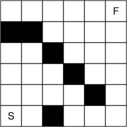
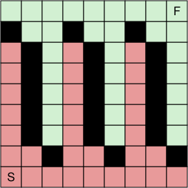

## Statement

Soit $n \geqslant 2$ un entier. Une grenouille se déplace sur une grille de $3n \times 3n$ cases. À chaque saut, elle passe de sa case à la case située juste au-dessus, ou à la case située juste à droite. Elle veut aller de la case en bas à gauche, marquée $S$, à la case en haut à droite, marquée $F$. Malheureusement, certaines cases sont piégées : si la grenouille saute sur une telle case, elle y reste prisonnière.

Un ensemble de cases piégées est **bloquant** s'il empêche la grenouille d'aller de $S$ à $F$. Un ensemble bloquant est **minimal** si, dès qu'on retire le piège de l'une quelconque de ses cases, l'ensemble obtenu n'est plus bloquant.

Par exemple, pour $n = 2$, les six cases noires de la grille ci-dessous forment un ensemble bloquant minimal.

a) Démontrer qu'il existe un ensemble bloquant minimal qui contient au moins $3n(n-1)$ cases.

b) Démontrer que tout ensemble bloquant minimal contient au plus $3n^2$ cases.

## Hints

1. Colorie la grille : en noir les cases piégées, en rose les cases non piégées que la grenouille peut atteindre depuis $S$, en vert les cases non piégées depuis lesquelles elle peut atteindre $F$. Que veut dire « bloquant » avec ces couleurs ?
2. Que veut dire « minimal » ? Regarde les voisines d'une case noire : celle du dessous, celle de gauche, celle du dessus, celle de droite.
3. Pour le a), pars de bandes verticales qui alternent rose, noir, vert, rose, noir, vert, et ainsi de suite. Il faut ensuite corriger la ligne du bas et la ligne du haut.
4. Pour le b), chaque case rose autre que $S$, et chaque case noire, a une case rose juste en dessous d'elle ou juste à sa gauche. Combien de cases une même case rose peut-elle servir ainsi ? Compare le nombre de cases noires au nombre de cases roses.

## Solution

**Les pièges sur $S$ ou sur $F$.** Si la case $S$ est piégée, la grenouille est bloquée d'emblée. Un ensemble bloquant minimal qui contient $S$ ne contient donc rien d'autre : si l'on retirait le piège d'une autre case, $S$ resterait piégée et l'ensemble resterait bloquant. De même pour $F$. Ces deux ensembles n'ont qu'une case, ce qui est bien moins que $3n^2$. **Dans toute la suite, les cases $S$ et $F$ ne sont pas piégées.**

**Trois couleurs.** On fixe un ensemble de cases piégées, et on colorie :

- en **noir** les cases piégées ;
- en **rose** les cases non piégées que la grenouille peut atteindre en partant de $S$, y compris $S$ elle-même ;
- en **vert** les cases non piégées depuis lesquelles la grenouille peut atteindre $F$, y compris $F$ elle-même.

Certaines cases n'ont peut-être aucune couleur. Voici trois remarques.

1. *L'ensemble est bloquant si et seulement si aucune case n'est à la fois rose et verte.* En effet, si une case est rose et verte, la grenouille va de $S$ à cette case, puis de cette case à $F$. Inversement, si la grenouille peut aller de $S$ à $F$, alors $F$ est rose et verte.
2. *Toute case rose autre que $S$ a une case rose juste en dessous d'elle ou juste à sa gauche.* C'est la case d'où la grenouille vient de sauter, sur un trajet depuis $S$. De même, toute case verte autre que $F$ a une case verte juste au-dessus d'elle ou juste à sa droite.
3. *Un ensemble bloquant est minimal si et seulement si chaque case noire a une voisine rose juste en dessous ou juste à gauche, et une voisine verte juste au-dessus ou juste à droite.*

Démontrons la remarque 3. Supposons qu'une case noire $c$ ait une voisine rose $b$ en dessous ou à gauche, et une voisine verte $g$ au-dessus ou à droite. Si l'on retire le piège de $c$, la grenouille va de $S$ à $b$, saute sur $c$, puis sur $g$, et va de $g$ à $F$. L'ensemble n'est plus bloquant.

Inversement, supposons qu'en retirant le piège d'une case noire $c$, la grenouille puisse aller de $S$ à $F$. Son trajet passe par $c$, sinon l'ensemble de départ n'aurait pas été bloquant. Comme la grenouille monte ou va à droite à chaque saut, elle ne passe qu'une fois par $c$. La case qu'elle occupe juste avant $c$ a donc été atteinte depuis $S$ sans passer par $c$ : elle est rose, et elle est juste en dessous de $c$ ou juste à sa gauche. De même, la case qu'elle occupe juste après $c$ est verte, et elle est juste au-dessus de $c$ ou juste à sa droite.

**a) Une construction.** On numérote les lignes de $1$ à $3n$ de bas en haut, et les colonnes de $1$ à $3n$ de gauche à droite. On pose des pièges :

- dans la ligne $2$, sur les colonnes $3, 6, \ldots, 3n$, c'est-à-dire les multiples de $3$ ;
- dans chaque ligne de $3$ à $3n - 2$, sur les colonnes $2, 5, \ldots, 3n - 1$, de la forme $3j - 1$ ;
- dans la ligne $3n - 1$, sur les colonnes $1, 4, \ldots, 3n - 2$, de la forme $3j - 2$.

Comme $n \geqslant 2$, on a $3 \leqslant 3n - 2$, donc les lignes de $3$ à $3n-2$ existent. Voici la grille obtenue pour $n = 3$, avec les couleurs de la remarque.

*Le nombre de pièges.* Il y a $n$ pièges dans la ligne $2$, $n$ dans chacune des $3n - 4$ lignes de $3$ à $3n - 2$, et $n$ dans la ligne $3n - 1$. Cela fait
$$n + (3n-4)\,n + n = n(3n-2) = 3n^2 - 2n \geqslant 3n^2 - 3n = 3n(n-1).$$

*L'ensemble est bloquant.* Appelons $\mathcal{R}$ l'ensemble formé de la ligne $1$, des cases non piégées de la ligne $2$, et des cases des colonnes $3j - 2$ dans les lignes de $3$ à $3n - 2$. On vérifie qu'un saut depuis une case de $\mathcal{R}$ vers une case non piégée reste dans $\mathcal{R}$.

- Depuis une case de la ligne $1$, un saut à droite reste dans la ligne $1$, et un saut vers le haut arrive dans la ligne $2$, sur une case piégée ou dans $\mathcal{R}$.
- Depuis une case non piégée de la ligne $2$, de colonne $x$ qui n'est pas un multiple de $3$ : vers la droite, on arrive en colonne $x + 1$ de la ligne $2$, sur un piège ou dans $\mathcal{R}$. Vers le haut, on arrive en ligne $3$, colonne $x$ : c'est un piège si $x$ est de la forme $3j - 1$, et une case de $\mathcal{R}$ si $x$ est de la forme $3j - 2$.
- Depuis une case de colonne $x = 3j - 2$, dans une ligne $y$ entre $3$ et $3n - 2$ : vers la droite, la case de colonne $3j - 1$ est piégée. Vers le haut, on arrive dans $\mathcal{R}$ si $y + 1 \leqslant 3n - 2$, et sur un piège de la ligne $3n - 1$ sinon.

La case $S$ est dans $\mathcal{R}$, donc toutes les cases que la grenouille peut atteindre sont dans $\mathcal{R}$. Or $F$, en ligne $3n$, n'est pas dans $\mathcal{R}$. L'ensemble est bloquant.

*L'ensemble est minimal.* D'après la remarque 3, il suffit de trouver, pour chaque piège, une voisine rose en dessous ou à gauche et une voisine verte au-dessus ou à droite. Notons d'abord :

- toute case de la ligne $1$ est rose : on y arrive en allant à droite depuis $S$ ;
- toute case de colonne $3j - 2$ entre les lignes $2$ et $3n - 2$ est rose : on va à droite jusqu'à la colonne $3j - 2$, puis on monte, et aucune de ces cases n'est piégée ;
- toute case de la ligne $3n$ est verte : on va à droite jusqu'à $F$ ;
- toute case de colonne $3j$ entre les lignes $3$ et $3n - 1$ est verte : on monte jusqu'à la ligne $3n$, sans rencontrer de piège, puis on va à droite jusqu'à $F$.

On conclut ainsi.

- Un piège de la ligne $2$, en colonne $3j$, a une voisine rose en dessous, dans la ligne $1$, et une voisine verte au-dessus, en ligne $3$ et colonne $3j$.
- Un piège de colonne $3j - 1$, dans une ligne entre $3$ et $3n - 2$, a une voisine rose à gauche, en colonne $3j - 2$, et une voisine verte à droite, en colonne $3j$.
- Un piège de la ligne $3n - 1$, en colonne $3j - 2$, a une voisine rose en dessous, en ligne $3n - 2$, et une voisine verte au-dessus, dans la ligne $3n$.

**Cet ensemble bloquant est minimal, et il contient $3n^2 - 2n \geqslant 3n(n-1)$ cases.**

**b) La majoration.** On considère un ensemble bloquant minimal, avec $S$ et $F$ non piégées. On note $p$ le nombre de cases noires, $r$ le nombre de cases roses et $v$ le nombre de cases vertes.

*Les couleurs ne se chevauchent pas.* Une case noire n'est ni rose ni verte, et d'après la remarque 1, aucune case n'est à la fois rose et verte. Donc
$$r + v + p \leqslant 9n^2.$$

*On compare $p$ et $r$.* D'après les remarques 2 et 3, chaque case rose autre que $S$, et chaque case noire, a une case rose juste en dessous d'elle ou juste à sa gauche. À chacune de ces $(r - 1) + p$ cases, on associe une telle case rose (s'il y en a deux, on en choisit une). Une case rose $b$ ne peut être associée qu'à deux cases au plus : celle qui est juste au-dessus de $b$, et celle qui est juste à droite de $b$. On a associé $(r - 1) + p$ cases à $r$ cases roses, chacune servant au plus deux fois, donc
$$(r - 1) + p \leqslant 2r, \qquad \text{c'est-à-dire} \qquad p \leqslant r + 1.$$

*On compare $p$ et $v$.* Le même raisonnement, avec les cases vertes et les voisines du dessus ou de droite, donne $p \leqslant v + 1$.

*Conclusion.* En additionnant,
$$3p = p + p + p \leqslant (r + 1) + (v + 1) + p = (r + v + p) + 2 \leqslant 9n^2 + 2.$$
Donc $p \leqslant 3n^2 + \frac{2}{3}$, et comme $p$ est un entier, **$p \leqslant 3n^2$ : tout ensemble bloquant minimal contient au plus $3n^2$ cases.**

## Going further

- Le b) n'utilise pas la forme de la grille : sur une grille de $N \times N$ cases, un ensemble bloquant minimal contient au plus $(N^2 + 2)/3$ cases. L'énoncé ne demande pas le vrai maximum, qui se situe entre $3n^2 - 2n$ et $3n^2$.
- Le corrigé note que plusieurs élèves n'ont regardé que $n = 1$ et $n = 2$. Ils ont trouvé des ensembles de $3n$ cases, comme celui de l'énoncé, et $3n \geqslant 3n(n-1)$ dans ces deux cas. Mais à partir de $n = 3$, on a $3n < 3n(n-1)$, et il faut une vraie idée, comme les bandes verticales.
- Le corrigé propose aussi une solution beaucoup plus longue du b) : découper la grille en morceaux de trois cases contenant chacun une case de chaque couleur. Le corrigé signale qu'une affirmation tentante est fausse : un carré de $3 \times 3$ cases peut contenir plus de trois pièges. Par exemple, sur la grille de $6 \times 6$ cases, piège les cases des colonnes $1$, $2$, $3$ et $5$ de la ligne $2$, la case de colonne $5$ de la ligne $1$, et la case de colonne $4$ de la ligne $3$. Vérifie que cet ensemble est bloquant et minimal, et trouve un carré de $3 \times 3$ cases qui contient quatre de ses pièges.
