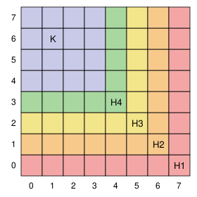

## Statement

Tristan organise un contrôle de trois exercices. Chaque exercice est noté par un nombre entier de $0$ à $7$.

On dit qu'un élève $A$ **domine** un élève $B$ si $A$ a une note supérieure ou égale à celle de $B$ à chacun des trois exercices.

a) On suppose que $64$ élèves passent le contrôle. Montrer que Tristan peut trouver deux élèves dont l'un domine l'autre.

b) On suppose seulement que $49$ élèves passent le contrôle. Montrer que Tristan peut encore trouver deux élèves dont l'un domine l'autre.

## Hints

1. Raisonne par l'absurde : suppose qu'aucun élève n'en domine un autre. Deux élèves peuvent-ils alors avoir les mêmes notes aux exercices $1$ et $2$ ?
2. Pour a) : il y a $8 \times 8 = 64$ couples possibles de notes aux exercices $1$ et $2$. Chaque couple est donc pris par exactement un élève. Regarde les $8$ élèves qui ont eu $5$ à l'exercice $1$ : que peux-tu dire de leurs notes aux exercices $2$ et $3$ ?
3. Pour a), suite : tu dois trouver que la somme des notes aux exercices $2$ et $3$ vaut $7$ pour tout le monde. Fais le même raisonnement pour les autres paires d'exercices, et additionne.
4. Pour b) : représente chaque élève par la case $(x, y)$ d'un quadrillage $8 \times 8$, où $x$ et $y$ sont ses notes aux exercices $1$ et $2$. Cherche de longues « chaînes » de cases où chaque case est à la fois plus à droite (ou pareil) et plus haut (ou pareil) que la précédente.
5. Si $9$ élèves sont sur une même chaîne, deux d'entre eux ont la même note à l'exercice $3$. Pourquoi l'un domine-t-il alors l'autre ?

## Solution

Pour un élève $E$, on note $x_E$, $y_E$, $z_E$ ses notes aux exercices $1$, $2$ et $3$. Dans les deux questions, on raisonne par l'absurde : **on suppose qu'aucun élève n'en domine un autre**.

**Une remarque qui sert deux fois.** Deux élèves différents $A$ et $B$ ne peuvent pas avoir les mêmes notes à deux exercices. Par exemple, si $x_A = x_B$ et $y_A = y_B$, alors celui des deux qui a la meilleure note à l'exercice $3$ (ou n'importe lequel en cas d'égalité) domine l'autre.

### a) Avec 64 élèves

Il y a $8 \times 8 = 64$ couples possibles $(x, y)$ de notes aux exercices $1$ et $2$. D'après la remarque, deux élèves n'ont jamais le même couple. Comme il y a $64$ élèves, **chaque couple est pris par exactement un élève**. Pour la même raison, chaque couple de notes aux exercices $1$ et $3$ est pris par exactement un élève, et de même pour les exercices $2$ et $3$.

Fixons une note $v$ et regardons les $8$ élèves qui ont $v$ à l'exercice $1$. Leurs notes à l'exercice $2$ sont les $8$ valeurs $0, 1, \ldots, 7$, une fois chacune, et leurs notes à l'exercice $3$ aussi. Rangeons ces $8$ élèves par note croissante à l'exercice $2$. Si un élève a une meilleure note qu'un autre à l'exercice $2$, il doit avoir une moins bonne note à l'exercice $3$, sinon il le dominerait. Les notes à l'exercice $3$ forment donc une suite strictement décroissante de $8$ valeurs prises dans $\{0, \ldots, 7\}$ : c'est forcément $7, 6, \ldots, 0$. Donc, pour ces $8$ élèves, $y + z = 7$.

Comme cela vaut pour chaque valeur de $v$, **tout élève vérifie $y + z = 7$**. Le même raisonnement, en fixant la note à l'exercice $2$ puis celle à l'exercice $3$, donne $x + z = 7$ et $x + y = 7$ pour tout élève. En additionnant les trois égalités :

$$2(x + y + z) = 21.$$

C'est impossible, car $21$ est impair. L'hypothèse est donc fausse : il existe deux élèves dont l'un domine l'autre.

### b) Avec 49 élèves

On représente chaque élève $E$ par la case $(x_E, y_E)$ d'un quadrillage $8 \times 8$ : colonne $x_E$, ligne $y_E$. D'après la remarque, **chaque case contient au plus un élève**.

**Un découpage du quadrillage.** On découpe les $64$ cases en cinq morceaux :

- $H_1$ : la ligne $0$ entière, puis la colonne $7$ (soit $8 + 7 = 15$ cases) ;
- $H_2$ : la ligne $1$ de la colonne $0$ à la colonne $6$, puis la colonne $6$ de la ligne $2$ à la ligne $7$ ($7 + 6 = 13$ cases) ;
- $H_3$ : la ligne $2$ de la colonne $0$ à la colonne $5$, puis la colonne $5$ de la ligne $3$ à la ligne $7$ ($6 + 5 = 11$ cases) ;
- $H_4$ : la ligne $3$ de la colonne $0$ à la colonne $4$, puis la colonne $4$ de la ligne $4$ à la ligne $7$ ($5 + 4 = 9$ cases) ;
- $K$ : le carré des colonnes $0$ à $3$ et des lignes $4$ à $7$ ($16$ cases).

On a bien $15 + 13 + 11 + 9 + 16 = 64$.

**Dans une même équerre, deux cases sont toujours comparables.** On parcourt l'équerre $H_1$ de la case $(0, 0)$ vers la droite jusqu'à $(7, 0)$, puis on monte jusqu'à $(7, 7)$. À chaque pas, une des deux coordonnées augmente et l'autre ne bouge pas. Donc si une case $(x, y)$ de $H_1$ vient avant une case $(x', y')$ dans ce parcours, alors $x \leqslant x'$ et $y \leqslant y'$. C'est pareil pour $H_2$, $H_3$ et $H_4$.

**Le principe des tiroirs.** Le carré $K$ contient au plus $16$ élèves, donc les quatre équerres en contiennent au moins $49 - 16 = 33$. Si chaque équerre contenait au plus $8$ élèves, elles en contiendraient au plus $32$. Une des équerres contient donc **au moins $9$ élèves**.

**Conclusion.** Ces $9$ élèves ont des notes à l'exercice $3$ comprises entre $0$ et $7$ : il n'y a que $8$ valeurs possibles, donc deux d'entre eux, $A$ et $B$, ont la même note à l'exercice $3$. Ils sont dans la même équerre, donc, quitte à les échanger, $x_A \leqslant x_B$ et $y_A \leqslant y_B$. Avec $z_A = z_B$, l'élève $B$ domine l'élève $A$. C'est une contradiction : il existe bien deux élèves dont l'un domine l'autre.

**Remarque : 49 est le bon nombre.** Avec $48$ élèves, ce n'est plus vrai. Donnons aux élèves les $48$ triplets de notes $(x, y, z)$ de somme $x + y + z = 11$. Il y en a bien $48$ : on compte les solutions de $x + y + z = 11$ en entiers positifs, soit $78$, et on retire les $3 \times 10 = 30$ solutions où une note dépasse $7$. Si $A$ dominait $B$ avec des sommes égales, toutes les notes de $A$ et $B$ seraient égales : aucun de ces $48$ élèves n'en domine un autre.

## Going further

Avec des notes de $0$ à $1$ seulement, au lieu de $0$ à $7$, combien faut-il d'élèves au minimum pour être sûr d'en trouver deux dont l'un domine l'autre ?
