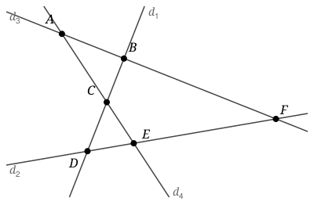

## Statement

On trace $2018$ droites dans le plan, deux à deux non parallèles et trois à trois non
concourantes. Autrement dit : deux droites quelconques se coupent toujours, et jamais trois
droites ne passent par un même point.

On note $E$ l'ensemble de tous leurs points d'intersection.

Deux points de $E$ sont dits **voisins** lorsqu'ils se trouvent sur une même droite et que le
segment qui les joint ne contient aucun autre point de $E$.

On veut colorier chaque point de $E$ de façon que deux points voisins ne portent jamais la même
couleur.

Combien faut-il de couleurs au minimum ?

Sur la figure, $A$ et $B$ sont voisins sur $d_3$, et $B$ et $F$ aussi ; en revanche $A$ et $F$
ne le sont pas, car le segment $[AF]$ contient $B$. De même $C$ et $D$ sont voisins sur $d_1$,
mais $B$ et $D$ ne le sont pas.

## Hints

1. Le nombre de droites, $2018$, ne sert à rien. Essaie avec $3$ droites, puis $4$.
2. Avec $3$ droites, les trois points sont deux à deux voisins. Combien de couleurs faut-il
   alors ?
3. Pour montrer que deux couleurs ne suffisent jamais, il faut trouver, dans n'importe quelle
   figure, trois points deux à deux voisins.
4. Cherche un petit triangle de la figure : un triangle formé par trois des droites et que
   **aucune** autre droite ne traverse. Montre par récurrence sur le nombre de droites qu'il en
   existe toujours un.
5. Quand on ajoute une droite à une figure qui possède un tel petit triangle, deux cas : soit
   elle évite le triangle, soit elle le traverse. Dans le second cas, en quoi le coupe-t-elle ?
6. Pour la majoration, tourne la figure de sorte que deux points n'aient jamais la même
   abscisse, puis colorie les points de gauche à droite.
7. Au moment de colorier un point, combien de ses voisins sont déjà coloriés ?

## Solution

**Réponse : $3$ couleurs.**

Le nombre $2018$ n'intervient nulle part : la réponse est $3$ dès qu'il y a au moins trois
droites.

**Partie 1 : deux couleurs ne suffisent jamais.**

Il suffit d'exhiber trois points deux à deux voisins : ils devraient porter trois couleurs
distinctes.

Appelons *petit triangle* un triangle formé par trois des droites et que **aucune** des autres
droites ne traverse.

> **Toute figure de $n \geq 3$ droites, deux à deux non parallèles et trois à trois non
> concourantes, contient un petit triangle.**

*Démonstration par récurrence sur $n$.*

Pour $n = 3$, les trois droites se coupent en trois points distincts et forment un triangle.
Comme il n'y a pas d'autre droite, ce triangle est un petit triangle.

Supposons le résultat vrai pour une figure de $n$ droites, et ajoutons-en une, appelée $d$. La
figure à $n$ droites contient un petit triangle $T$. Deux cas.

- **$d$ ne traverse pas l'intérieur de $T$.** Alors $T$ n'est traversé par aucune des $n+1$
  droites autres que les trois qui le forment : c'est encore un petit triangle.
- **$d$ traverse l'intérieur de $T$.** Elle ne peut pas passer par un sommet de $T$, car trois
  droites ne sont jamais concourantes. Elle entre donc par un côté et ressort par un autre, et
  découpe $T$ en deux morceaux : un triangle $T'$, appuyé sur un sommet de $T$, et un
  quadrilatère.

  Le triangle $T'$ est formé de deux des droites de $T$ et de $d$. Aucune autre droite ne le
  traverse : une telle droite traverserait $T'$, donc $T$, ce qui est exclu, et $d$ n'en
  traverse pas l'intérieur puisqu'elle en borde un côté. Donc $T'$ est un petit triangle.

Dans les deux cas, la figure à $n+1$ droites contient un petit triangle. La récurrence est
établie.

*Les sommets d'un petit triangle sont deux à deux voisins.* Soit $T$ un petit triangle, de
sommets $X$, $Y$, $Z$. Prenons le côté $[XY]$, porté par une droite $\delta$. Si un point de
$E$ se trouvait strictement entre $X$ et $Y$, il serait l'intersection de $\delta$ avec une
autre droite $\delta'$. Mais $\delta'$ traverse $\delta$ en ce point, donc passe des deux côtés
de $\delta$ : elle entre dans l'intérieur de $T$. Cela contredit le fait que $T$ est un petit
triangle. Donc $X$ et $Y$ sont voisins, et de même pour les deux autres côtés.

Ces trois points doivent donc recevoir trois couleurs deux à deux différentes : **deux couleurs
ne suffisent pas.**

**Partie 2 : trois couleurs suffisent toujours.**

Commençons par tourner légèrement toute la figure. Il n'y a qu'un nombre fini de points dans
$E$, donc un nombre fini de directions à éviter : on peut faire en sorte qu'aucune droite ne
soit verticale et que deux points de $E$ n'aient jamais la même abscisse. Cela ne change ni les
voisinages ni la question.

Rangeons alors les points de $E$ par abscisse croissante :
$$P_1, \; P_2, \; \ldots, \; P_N,$$
et colorions-les **dans cet ordre**, en donnant à chaque point une couleur parmi trois qui ne
soit encore portée par aucun de ses voisins déjà coloriés.

Montrons que c'est toujours possible. Soit $P_k$ le point que l'on colorie, intersection de
deux droites $d_i$ et $d_j$.

- Sur la droite $d_i$, $P_k$ a au plus deux voisins : le point de $E$ qui le précède
  immédiatement sur $d_i$ et celui qui le suit immédiatement. Comme $d_i$ n'est pas verticale,
  « précéder sur $d_i$ » veut dire « avoir une abscisse plus petite ». Le voisin qui précède
  est donc déjà colorié, celui qui suit ne l'est pas encore.
- Il en va de même sur $d_j$.
- $P_k$ n'a pas d'autre voisin : un voisin de $P_k$ est par définition sur une droite passant
  par $P_k$, et il n'y en a que deux.

Au moment de colorier $P_k$, **au plus deux** de ses voisins sont donc déjà coloriés : au plus
deux couleurs sont interdites, et la troisième reste disponible.

Le coloriage se termine donc, et il utilise trois couleurs.

**Conclusion : il faut exactement $3$ couleurs.**

## Going further

La récurrence de la partie 1 donne davantage que l'existence d'un petit triangle : en la suivant
de près, on voit qu'à chaque droite ajoutée le petit triangle obtenu est strictement plus
petit. On peut montrer beaucoup mieux, à savoir qu'une figure de $n$ droites en position
générale possède au moins $n-2$ petits triangles. C'est un résultat de Roberts, de $1889$.

La méthode de la partie 2 porte un nom : c'est le **coloriage glouton**. Elle s'applique chaque
fois qu'on peut ranger les objets à colorier dans un ordre tel que chacun n'ait qu'un petit
nombre de voisins parmi les précédents. Ici, ce nombre est $2$, et c'est l'ordre des abscisses
qui fait tout le travail.
