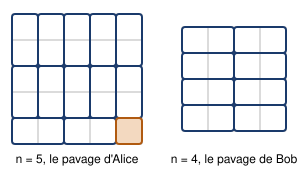

## Statement

Alice et Bob jouent dans une grille $n \times n$, avec $n \geqslant 2$. Alice commence. Chacun leur tour, ils écrivent dans une case encore vide un entier entre $1$ et $n^2$ qui n'a pas encore été écrit. La partie s'arrête quand la grille est pleine : chaque entier de $1$ à $n^2$ y figure alors exactement une fois.

Alice gagne si, à la fin, la somme des entiers d'au moins une ligne est divisible par $n$. Sinon Bob gagne.

Selon la valeur de $n$, lequel des deux joueurs a une stratégie gagnante ?

## Hints

1. Essaie d'abord à la main sur une grille $2 \times 2$, puis $3 \times 3$. Le résultat dépend de la parité de $n$.
2. Dans un jeu où l'on écrit des nombres deux à deux, une idée classique est la **stratégie miroir** : je découpe la grille en paires de cases, et quand l'adversaire écrit dans une case je réponds dans sa jumelle.
3. Quelle valeur faut-il répondre pour que les deux nombres d'une paire aient toujours la même somme ? Essaie $a \mapsto n^2 + 1 - a$, puis $a \mapsto n^2 - a$.
4. Il faut que la réponse soit toujours **possible** : ni déjà écrite, ni égale au nombre que l'adversaire vient d'écrire. Regarde quand $a = n^2 + 1 - a$, puis quand $a = n^2 - a$.
5. Reste à choisir le découpage en paires. Pour Bob, coupe chaque ligne en dominos horizontaux. Pour Alice, il faut d'abord se débarrasser d'une case, puisque $n^2$ est impair.

## Solution

La réponse :

$$\boxed{\text{Alice gagne si } n \text{ est impair, Bob gagne si } n \text{ est pair.}}$$

Dans les deux cas la stratégie est la même idée : découper la grille en **dominos** (paires de cases voisines) et répondre toujours dans le domino où l'adversaire vient de jouer.

### Bob gagne quand $n$ est pair

Bob découpe chaque ligne en $\tfrac{n}{2}$ dominos horizontaux (figure de droite). Sa règle : si Alice écrit le nombre $a$ dans une case, Bob écrit
$$n^2 + 1 - a$$
dans l'autre case du même domino.

**Cette réponse est toujours licite.** D'abord, $1 \leqslant a \leqslant n^2$ donne $1 \leqslant n^2+1-a \leqslant n^2$, donc le nombre est dans la bonne plage. Ensuite, il est différent de $a$ : l'égalité $a = n^2+1-a$ voudrait dire $2a = n^2+1$, or $n$ est pair donc $n^2+1$ est impair et ne peut pas valoir $2a$. Enfin, il n'a pas déjà été écrit : après chaque réponse de Bob, l'ensemble des nombres déjà posés est stable par l'échange $a \leftrightarrow n^2+1-a$, donc quand Alice pose un nombre neuf $a$, son partenaire $n^2+1-a$ est neuf lui aussi.

**À la fin, Bob a gagné.** Chaque domino porte deux nombres de somme $n^2+1$, et chaque ligne contient exactement $\tfrac{n}{2}$ dominos entiers. La somme d'une ligne vaut donc
$$\frac{n}{2}\,(n^2+1) = \frac{n^3}{2} + \frac{n}{2} .$$
Le premier terme $\tfrac{n^3}{2} = n \cdot \tfrac{n^2}{2}$ est un multiple de $n$. Il reste
$$\frac{n}{2}\,(n^2+1) \equiv \frac{n}{2} \pmod n ,$$
et comme $0 < \tfrac{n}{2} < n$, ce reste n'est pas nul. **Aucune** ligne n'est divisible par $n$ : Bob gagne.

### Alice gagne quand $n$ est impair

Ici $n^2$ est impair, donc on ne peut pas paver toute la grille par des dominos : il reste forcément une case seule. Alice s'arrange pour que ce soit la case en bas à droite, et elle pave le reste ainsi (figure de gauche) :

- la ligne du bas, privée de sa dernière case, compte $n-1$ cases, un nombre pair : Alice la coupe en $\tfrac{n-1}{2}$ dominos horizontaux ;
- les $n-1$ lignes du dessus forment un rectangle de hauteur paire : Alice le coupe en dominos verticaux.

Alice joue en premier : elle écrit $n^2$ dans la case libre du coin. Ensuite, si Bob écrit $a$, elle répond
$$n^2 - a$$
dans l'autre case du même domino.

**Cette réponse est toujours licite.** Bob ne peut pas écrire $a = n^2$, qui est déjà posé, donc $1 \leqslant a \leqslant n^2-1$ et $1 \leqslant n^2-a \leqslant n^2-1$. Elle est différente de $a$ : l'égalité $a = n^2-a$ donnerait $2a = n^2$, impossible car $n^2$ est impair. Et comme précédemment, l'ensemble des nombres écrits reste stable par l'échange $a \leftrightarrow n^2-a$ sur $\{1, \dots, n^2-1\}$, donc le partenaire d'un nombre neuf est neuf.

**À la fin, Alice a gagné.** Regardons la ligne du bas. Elle est faite de $\tfrac{n-1}{2}$ dominos, chacun de somme $n^2$, plus la case du coin qui porte $n^2$. Sa somme vaut
$$\frac{n-1}{2}\, n^2 + n^2 = \frac{n+1}{2}\, n^2 = n \times \frac{n(n+1)}{2} .$$
Comme $n$ est impair, $n+1$ est pair et $\tfrac{n(n+1)}{2}$ est un entier. La somme de la ligne du bas est donc un multiple de $n$ : Alice gagne.

### Pourquoi deux décalages différents

Les deux stratégies utilisent deux appariements légèrement différents, $a \leftrightarrow n^2+1-a$ et $a \leftrightarrow n^2-a$, et le choix n'est pas libre : il faut que l'appariement n'ait **aucun point fixe**, sinon un joueur serait coincé quand l'adversaire écrit précisément ce nombre-là. Le point fixe de $a \mapsto n^2+1-a$ existe si $n^2+1$ est pair, c'est-à-dire si $n$ est impair ; celui de $a \mapsto n^2-a$ existe si $n^2$ est pair, c'est-à-dire si $n$ est pair. Chaque appariement sert donc exactement dans le cas où l'autre échoue.

## Going further

1. Vérifier la stratégie de Bob à la main sur la grille $2 \times 2$, et celle d'Alice sur la grille $3 \times 3$.
2. On change la règle : Alice gagne si la somme d'une **colonne** est divisible par $n$. Qui gagne maintenant ?
3. On change encore : Alice gagne si la somme d'une ligne **ou** d'une colonne est divisible par $n$. Pour $n = 2$, on peut vérifier à la main que Bob gagne encore. Sa stratégie du cas pair tient-elle telle quelle pour $n$ pair quelconque, et si non, qu'est-ce qui coince ?
