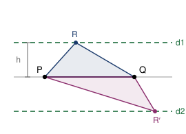

## Statement

Soit $S$ un ensemble de $n$ points du plan, tel que trois points de $S$ ne soient **jamais** alignés.

Montrer que le nombre de triangles d'aire exactement $1$ dont les trois sommets appartiennent à $S$ est au plus
$$\frac{2\,n(n-1)}{3} .$$

## Hints

1. Fixe deux points $P$ et $Q$ de $S$. L'aire du triangle $PQR$ ne dépend que de la distance de $R$ à la droite $(PQ)$. Écris la formule.
2. Quel est l'ensemble des points $R$ du plan tels que le triangle $PQR$ ait pour aire $1$ ?
3. L'hypothèse « jamais trois points alignés » se traduit par : une droite contient au plus combien de points de $S$ ?
4. Combien y a-t-il de choix possibles pour $R$ une fois $P$ et $Q$ fixés ? Combien de couples $(P, Q)$ ordonnés ?
5. Tu auras compté des **triplets ordonnés**. Combien de triplets ordonnés correspondent à un même triangle ?

## Solution

### Ce qu'on va compter

Appelons $N$ le nombre de **triplets ordonnés** $(P, Q, R)$ de points de $S$, deux à deux distincts, tels que le triangle $PQR$ ait pour aire $1$.

L'idée est de majorer $N$, puis de remarquer qu'un même triangle est compté plusieurs fois dans $N$.

### Étape 1 : les points $R$ possibles quand $P$ et $Q$ sont fixés

Fixons deux points distincts $P$ et $Q$ de $S$, et notons $\ell = PQ > 0$. Pour un point $R$ hors de la droite $(PQ)$, l'aire du triangle $PQR$ vaut
$$\mathcal{A} = \frac{\ell \times h}{2} ,$$
où $h$ est la distance de $R$ à la droite $(PQ)$.

Donc $\mathcal{A} = 1$ équivaut à $h = \dfrac{2}{\ell}$ : la distance de $R$ à $(PQ)$ est **imposée**.

L'ensemble des points situés à une distance donnée $h > 0$ d'une droite est la réunion de **deux droites parallèles** à celle-ci, une de chaque côté.

### Étape 2 : au plus quatre choix pour $R$

Chacune de ces deux droites parallèles contient au plus $2$ points de $S$. En effet, si elle en contenait $3$, ces trois points de $S$ seraient alignés, ce que l'énoncé interdit.

Il y a donc au plus $2 + 2 = 4$ points $R$ de $S$ convenant à un couple $(P, Q)$ donné.

### Étape 3 : la majoration de $N$

Le nombre de couples **ordonnés** $(P, Q)$ de points distincts de $S$ vaut $n(n-1)$ : $n$ choix pour $P$, puis $n-1$ pour $Q$.

Pour chacun, au plus $4$ choix de $R$. Donc
$$N \; \leqslant \; 4\,n(n-1) .$$

### Étape 4 : de $N$ au nombre de triangles

Soit $T$ un triangle d'aire $1$ à sommets dans $S$. Ses trois sommets peuvent être écrits dans n'importe quel ordre, ce qui donne
$$3 \times 2 \times 1 = 6$$
triplets ordonnés distincts, tous comptés dans $N$, et tous associés à ce seul triangle. Réciproquement, tout triplet compté dans $N$ provient d'un triangle d'aire $1$.

Donc, si l'on note $t$ le nombre de triangles d'aire $1$,
$$N = 6\,t .$$

### Conclusion

En combinant les étapes 3 et 4 :
$$6\,t \leqslant 4\,n(n-1) , \qquad \text{donc} \qquad t \leqslant \frac{4\,n(n-1)}{6} = \frac{2\,n(n-1)}{3} ,$$
ce qu'il fallait démontrer.

### Où sert l'hypothèse

L'hypothèse « jamais trois points alignés » sert exactement une fois, à l'étape 2, pour affirmer qu'une droite ne porte pas plus de deux points de $S$. Sans elle, une droite parallèle pourrait porter beaucoup de points et la majoration s'effondrerait.

## Going further

1. Refaire le calcul pour les triangles d'aire $c$, où $c > 0$ est un réel fixé. La majoration change-t-elle ?
2. Compter exactement le nombre de triangles d'aire $1$ pour les $4$ sommets d'un carré bien choisi, puis comparer avec la majoration.
3. La méthode donne $4$ points $R$ au plus. En cherchant à faire mieux, peut-on abaisser la constante $\tfrac{2}{3}$ ?
