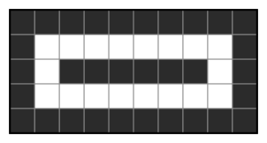

## Statement

Une grille de $5$ lignes et $100$ colonnes est formée de $500$ cases. On colorie $n$ de ces cases en noir, les autres restant blanches.

Deux cases sont dites **voisines** lorsqu'elles partagent un côté. La règle à respecter est la suivante :

> chaque case de la grille, qu'elle soit noire ou blanche, a **au plus deux voisines noires**.

Quelle est la plus grande valeur possible de $n$ ?

## Hints

1. Comme toujours pour un maximum, il faut deux choses : une construction qui atteint la valeur annoncée, et une preuve qu'on ne peut pas faire mieux.
2. Pour la construction, cherchez d'abord les cases les moins coûteuses. Combien de voisines a une case de coin ? Une case du bord ? Une case intérieure ?
3. Commencez par colorier tout le bord de la grille. Vérifiez que la règle est respectée. Que peut-on ajouter ensuite ?
4. Pour la majoration, comptez les **couples** $(X, Y)$ où $X$ est une case noire et $Y$ une voisine de $X$. Comptez-les de deux façons : d'abord en regardant chaque $X$, ensuite en regardant chaque $Y$.
5. Une case noire de coin contribue $2$ à ce compte, une case noire du bord $3$, une case noire intérieure $4$. Et chaque $Y$ y contribue au plus $2$.
6. Il vous restera à majorer le nombre de cases de coin et de bord de la grille.

## Solution

La réponse est $n = 302$.

### La majoration : on ne peut pas dépasser 302

Classons les cases noires en trois familles et notons

- $a$ le nombre de cases noires situées dans un **coin** de la grille ;
- $b$ le nombre de cases noires situées sur le **bord** sans être un coin ;
- $c$ le nombre de cases noires **intérieures**.

On a donc $n = a + b + c$.

La grille a $4$ coins, donc

$$a \leq 4.$$

Le bord de la grille contient $2 \times 5 + 2 \times 100 - 4 = 206$ cases, dont $4$ coins, donc $202$ cases de bord non-coins :

$$b \leq 202.$$

**Le double comptage.** Comptons de deux façons le nombre $N$ de couples $(X, Y)$ où $X$ est une case noire et $Y$ une voisine de $X$.

*En regardant $X$.* Une case de coin a $2$ voisines, une case de bord non-coin en a $3$, une case intérieure en a $4$. Donc

$$N = 2a + 3b + 4c.$$

*En regardant $Y$.* Pour chaque case $Y$ de la grille, le nombre de couples $(X,Y)$ comptés est le nombre de voisines noires de $Y$, qui est au plus $2$ par hypothèse. Comme la grille a $500$ cases,

$$N \leq 2 \times 500 = 1000.$$

**On combine.** De $2a+3b+4c \leq 1000$ on tire

$$4n = 4a+4b+4c = (2a+3b+4c) + 2a + b \leq 1000 + 2a + b \leq 1000 + 2\times 4 + 202 = 1210,$$

donc

$$n \leq \dfrac{1210}{4} = 302{,}5.$$

Comme $n$ est un entier, $n \leq 302$.

### La construction : on atteint 302

Numérotons les cases $(i, j)$ avec $i$ le numéro de ligne, de $1$ à $5$, et $j$ le numéro de colonne, de $1$ à $100$. Colorions en noir :

- **tout le bord** de la grille, c'est-à-dire les lignes $1$ et $5$ en entier et les colonnes $1$ et $100$ en entier ;
- **la portion centrale de la ligne du milieu** : les cases $(3, j)$ pour $3 \leq j \leq 98$.

Comptons : la ligne $1$ apporte $100$ cases, la ligne $5$ aussi, la colonne $1$ apporte $3$ cases nouvelles (celles des lignes $2$, $3$, $4$), la colonne $100$ également $3$, et la portion de ligne du milieu apporte $98 - 3 + 1 = 96$ cases. Au total

$$100 + 100 + 3 + 3 + 96 = 302.$$

Voici le même coloriage sur une grille $5 \times 10$, où il donne $32$ cases noires :

**Vérifions la règle**, case par case. On utilise la symétrie de la figure (haut-bas et gauche-droite) pour ne traiter qu'un quart des cas.

- Une case de la ligne $1$ : ses voisines de la ligne $1$ sont noires (une ou deux d'entre elles), et sa voisine du dessous, sur la ligne $2$, n'est noire que si elle est dans la colonne $1$ ou $100$. Pour une case $(1,1)$ : voisines noires $(1,2)$ et $(2,1)$, soit $2$. Pour une case $(1,j)$ avec $2 \leq j \leq 99$ : voisines noires $(1,j-1)$ et $(1,j+1)$, soit $2$.
- Une case $(2,1)$ : voisines noires $(1,1)$ et $(3,1)$, soit $2$ ; la case $(2,2)$ est blanche.
- Une case $(3,1)$ : voisines noires $(2,1)$ et $(4,1)$, soit $2$ ; la case $(3,2)$ est blanche.
- Une case blanche $(2,2)$ : voisines noires $(1,2)$ et $(2,1)$, soit $2$.
- Une case blanche $(3,2)$ : voisines noires $(3,1)$ et $(3,3)$, soit $2$.
- Une case blanche $(2,j)$ avec $3 \leq j \leq 98$ : voisines noires $(1,j)$ et $(3,j)$, soit $2$.
- Une case noire $(3,j)$ avec $4 \leq j \leq 97$ : voisines noires $(3,j-1)$ et $(3,j+1)$, soit $2$ ; celle $(3,3)$ n'a qu'une voisine noire, $(3,4)$.
- Une case blanche $(2,99)$ : voisines noires $(1,99)$ et $(2,100)$, soit $2$.

Toutes les cases ont donc bien au plus deux voisines noires.

### Conclusion

$$\boxed{n_{\max} = 302.}$$

## Going further

1. Refaites les deux moitiés du raisonnement pour une grille $5 \times 10$. Vous devez trouver $32$, la valeur du dessin.
2. Et pour une grille $3 \times 100$ ? La même méthode donne-t-elle une majoration atteinte par une construction ?
