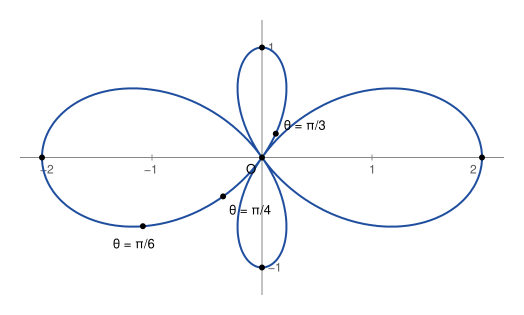
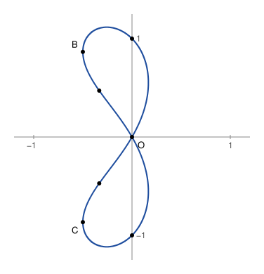
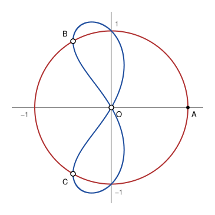

## Statement

Le plan est muni d'un repère orthonormé d'origine $O$.

**Une façon de repérer les points.** Pour deux réels $r$ et $\theta$, on note $P(r, \theta)$ le
point de coordonnées $(r\cos\theta,\ r\sin\theta)$. Si $r > 0$, c'est le point situé à la distance
$r$ de $O$ dans la direction de l'angle $\theta$, comme sur le cercle trigonométrique. Si $r < 0$,
c'est le point situé à la distance $-r$ de $O$, dans la direction opposée. Enfin
$P(0, \theta) = O$.

**Le contexte.** On considère les points $A(1\,;0)$, $B\left(-\frac{1}{2}\,;\frac{\sqrt{3}}{2}\right)$
et $C\left(-\frac{1}{2}\,;-\frac{\sqrt{3}}{2}\right)$, sommets d'un triangle équilatéral de centre
$O$ inscrit dans le cercle de centre $O$ et de rayon $1$. Pour un point $M \neq O$, on écrit
$M = P(\rho, \theta)$ avec $\rho = OM > 0$, et l'on note $M_2$, $M_3$, $M_4$ les symétriques de
$M$ par rapport aux droites $(OB)$, $(OC)$ et $(BC)$. Dans une partie précédente, on a montré :

- les points $M_2$, $M_3$, $M_4$ sont alignés si et seulement si $M$ est sur le cercle
  $\mathcal{C}_0$ de centre $(-1\,;0)$ et de rayon $1$ (ce cercle passe par $O$, $B$ et $C$) ;
- lorsqu'ils ne sont pas alignés, le cercle circonscrit au triangle $M_2M_3M_4$ a pour rayon $1$
  si et seulement si
  $$\rho = 1 \quad \text{ou} \quad (\rho + \cos\theta)^2 = 1 - 3\cos^2\theta.$$

**Les questions.**

1. Soit $s$ la fonction définie sur $[-\pi, \pi]$ par $s(\theta) = 1 - 3\cos^2\theta$.

   a) Étudier les variations de $s$. Préciser ses extremums, les valeurs de $\theta$ pour
   lesquelles $s(\theta) = 0$, et l'ensemble $E$ des $\theta \in [-\pi, \pi]$ tels que
   $s(\theta) \geq 0$.

   b) En déduire l'allure de la courbe décrite par le point $P(s(\theta), \theta)$ lorsque
   $\theta$ parcourt $[-\pi, \pi]$. On justifiera les symétries de la courbe, on précisera ses
   points d'intersection avec les axes, et l'on placera les points obtenus pour
   $\theta = \frac{\pi}{6}$, $\frac{\pi}{4}$ et $\frac{\pi}{3}$.

2. Soit $r_1$ la fonction définie sur $E$ par $r_1(\theta) = \sqrt{1 - 3\cos^2\theta} - \cos\theta$.

   a) Déterminer les valeurs de $\theta$ pour lesquelles $r_1(\theta) = 0$, puis le signe de
   $r_1(\theta)$.

   b) En déduire l'allure de la courbe $\mathcal{C}_1$ décrite par le point $P(r_1(\theta), \theta)$
   lorsque $\theta$ parcourt $E$.

3. Dessiner, sans chercher une grande précision, l'ensemble des points $M$ pour lesquels le
   triangle $M_2M_3M_4$ a un cercle circonscrit de rayon $1$.

## Hints

1. **Question 1a.** Inutile de dériver : étudier d'abord $\cos\theta$, puis $\cos^2\theta$, sur
   $[0, \frac{\pi}{2}]$ et sur $[\frac{\pi}{2}, \pi]$. La fonction $s$ est
   paire.
2. **Question 1b.** Comparer les points obtenus pour $\theta$, pour $-\theta$ et pour
   $\pi - \theta$. Il suffit alors d'étudier $\theta \in [0, \frac{\pi}{2}]$.
3. **Question 1b.** Quand $s(\theta) < 0$, le point $P(s(\theta), \theta)$ est du côté opposé à la
   direction $\theta$ : dans quel quadrant se trouve-t-il ?
4. **Question 2a.** L'égalité $\sqrt{X} = Y$ équivaut à « $Y \geq 0$ et $X = Y^2$ ».
5. **Question 2b.** La courbe n'est symétrique que par rapport à un seul axe. Calculer les points
   obtenus aux deux bouts de $E \cap [0, \pi]$, et pour $\theta = \frac{\pi}{2}$ et
   $\theta = \frac{2\pi}{3}$.
6. **Question 3.** La condition $(\rho + \cos\theta)^2 = s(\theta)$ donne deux valeurs possibles
   pour $\rho$. L'une d'elles fait apparaître la fonction $r_1$.
7. **Question 3.** Pour $\rho = -\cos\theta - \sqrt{s(\theta)}$, remplacer $\theta$ par
   $\theta + \pi$ : le point $P(\rho, \theta)$ est aussi $P(-\rho, \theta + \pi)$.
8. **Question 3.** Ne pas oublier de retirer les points du cercle $\mathcal{C}_0$, et le point $O$.

## Solution

**1a.** Pour tout $\theta$, $\cos(-\theta) = \cos\theta$, donc $s$ est paire : on l'étudie sur
$[0, \pi]$.

- Sur $[0, \frac{\pi}{2}]$, $\cos\theta$ décroît de $1$ à $0$ en restant positif, donc
  $\cos^2\theta$ décroît de $1$ à $0$, et $s(\theta)$ croît de $-2$ à $1$.
- Sur $[\frac{\pi}{2}, \pi]$, $\cos\theta$ décroît de $0$ à $-1$, donc $\cos^2\theta$
  croît de $0$ à $1$, et $s(\theta)$ décroît de $1$ à $-2$.

Par parité, sur $[-\pi, -\frac{\pi}{2}]$, $s$ croît de $-2$ à $1$, et sur
$[-\frac{\pi}{2}, 0]$, elle décroît de $1$ à $-2$.

**Extremums :** le maximum vaut $1$, atteint en $\theta = \pm\frac{\pi}{2}$ ; le minimum vaut $-2$,
atteint en $\theta = -\pi$, $0$ et $\pi$.

**Zéros :** $s(\theta) = 0$ équivaut à $\cos^2\theta = \frac{1}{3}$, soit
$\cos\theta = \frac{1}{\sqrt{3}}$ ou $\cos\theta = -\frac{1}{\sqrt{3}}$. Notons $\alpha$ l'unique
réel de $[0, \frac{\pi}{2}]$ tel que $\cos\alpha = \frac{1}{\sqrt{3}}$ (à la calculatrice,
$\alpha \approx \text{0,955}$ radian, soit environ $\text{54,7}°$). Comme
$\cos(\pi - \alpha) = -\cos\alpha$, les zéros de $s$ sur $[-\pi, \pi]$ sont
$$-\pi + \alpha, \qquad -\alpha, \qquad \alpha, \qquad \pi - \alpha.$$

**Ensemble $E$ :** d'après les variations, $s(\theta) \geq 0$ exactement entre les zéros qui
entourent $\pm\frac{\pi}{2}$ :
$$E = [-\pi + \alpha,\ -\alpha] \cup [\alpha,\ \pi - \alpha].$$

**1b.** Notons $S(\theta) = P(s(\theta), \theta)$, de coordonnées
$(s(\theta)\cos\theta,\ s(\theta)\sin\theta)$.

*Symétries.* Comme $s(-\theta) = s(\theta)$, le point $S(-\theta)$ a pour coordonnées
$(s(\theta)\cos\theta,\ -s(\theta)\sin\theta)$ : c'est le symétrique de $S(\theta)$ par rapport à
l'axe des abscisses. Comme $\cos(\pi - \theta) = -\cos\theta$ et $\sin(\pi - \theta) = \sin\theta$,
on a $s(\pi - \theta) = s(\theta)$, et $S(\pi - \theta)$ a pour coordonnées
$(-s(\theta)\cos\theta,\ s(\theta)\sin\theta)$ : c'est le symétrique de $S(\theta)$ par rapport à
l'axe des ordonnées. La courbe est donc symétrique par rapport aux deux axes (et donc aussi par
rapport à $O$). Il suffit de tracer la partie obtenue pour $\theta \in [0, \frac{\pi}{2}]$,
puis de la reproduire par symétrie.

*Points particuliers*, pour $\theta \in [0, \frac{\pi}{2}]$ :

| $\theta$ | $0$ | $\frac{\pi}{6}$ | $\frac{\pi}{4}$ | $\alpha$ | $\frac{\pi}{3}$ | $\frac{\pi}{2}$ |
|---|---|---|---|---|---|---|
| $s(\theta)$ | $-2$ | $-\frac{5}{4}$ | $-\frac{1}{2}$ | $0$ | $\frac{1}{4}$ | $1$ |
| $S(\theta)$ | $(-2\,;0)$ | $\left(-\frac{5\sqrt{3}}{8}\,;-\frac{5}{8}\right)$ | $\left(-\frac{\sqrt{2}}{4}\,;-\frac{\sqrt{2}}{4}\right)$ | $O$ | $\left(\frac{1}{8}\,;\frac{\sqrt{3}}{8}\right)$ | $(0\,;1)$ |

Valeurs approchées : $S\left(\frac{\pi}{6}\right) \approx (-\text{1,08}\,;-\text{0,63})$,
$S\left(\frac{\pi}{4}\right) \approx (-\text{0,35}\,;-\text{0,35})$,
$S\left(\frac{\pi}{3}\right) \approx (\text{0,13}\,;\text{0,22})$.

*Allure.* Pour $\theta \in [0, \alpha[$, on a $s(\theta) < 0$ : le point $S(\theta)$ est dans la
direction opposée à $\theta$, donc dans le quart de plan $x < 0$, $y < 0$ (ou sur l'axe des
abscisses pour $\theta = 0$). Il part de $(-2\,;0)$ et se rapproche de $O$, puisque sa distance à
$O$ est $|s(\theta)|$, qui décroît de $2$ à $0$. Pour $\theta \in ]\alpha, \frac{\pi}{2}]$,
on a $s(\theta) > 0$ : le point est dans le quart de plan $x > 0$, $y > 0$, et s'éloigne de $O$
jusqu'au point $(0\,;1)$.

En reproduisant cet arc par les deux symétries, on obtient une courbe en forme de fleur à quatre
pétales, qui passent toutes par $O$ : deux grands pétales le long de l'axe des abscisses, jusqu'aux
points $(\pm 2\,;0)$, et deux petits le long de l'axe des ordonnées, jusqu'aux points $(0\,;\pm 1)$.

*Intersections avec les axes.* $S(\theta)$ est sur l'axe des abscisses si $s(\theta)\sin\theta = 0$,
c'est-à-dire $\theta \in \{-\pi, 0, \pi\}$ ou $s(\theta) = 0$ : ce sont les points $(-2\,;0)$,
$(2\,;0)$ et $O$. Il est sur l'axe des ordonnées si $s(\theta)\cos\theta = 0$, c'est-à-dire
$\theta = \pm\frac{\pi}{2}$ ou $s(\theta) = 0$ : ce sont les points $(0\,;1)$, $(0\,;-1)$ et $O$.

**2a.** Pour $\theta \in E$, $r_1(\theta) = 0$ équivaut à $\sqrt{1 - 3\cos^2\theta} = \cos\theta$,
c'est-à-dire à « $\cos\theta \geq 0$ et $1 - 3\cos^2\theta = \cos^2\theta$ », soit
$\cos^2\theta = \frac{1}{4}$ avec $\cos\theta \geq 0$, donc $\cos\theta = \frac{1}{2}$.

**Conclusion :** $r_1(\theta) = 0$ si et seulement si $\theta = \frac{\pi}{3}$ ou
$\theta = -\frac{\pi}{3}$ (ces deux valeurs sont bien dans $E$, car $s\left(\pm\frac{\pi}{3}\right) = \frac{1}{4}$).

*Signe.* Si $\cos\theta < 0$, alors $r_1(\theta) > 0$. Si $\cos\theta \geq 0$, les deux nombres
$\sqrt{s(\theta)}$ et $\cos\theta$ sont positifs, et $r_1(\theta) > 0$ équivaut à
$1 - 3\cos^2\theta > \cos^2\theta$, soit $\cos\theta < \frac{1}{2}$. Sur $[\alpha, \pi - \alpha]$,
on obtient donc : $r_1 < 0$ sur $[\alpha, \frac{\pi}{3}[$, et $r_1 > 0$ sur
$]\frac{\pi}{3}, \pi - \alpha]$. Par parité, c'est la même chose sur l'autre morceau
de $E$.

**2b.** Notons $Q(\theta) = P(r_1(\theta), \theta)$.

*Symétrie.* $r_1$ est paire, donc $Q(-\theta)$ est le symétrique de $Q(\theta)$ par rapport à
l'axe des abscisses : il suffit de tracer la partie obtenue pour $\theta \in [\alpha, \pi - \alpha]$.
En revanche, la courbe n'est pas symétrique par rapport à l'axe des ordonnées.

*Points particuliers.*

| $\theta$ | $\alpha$ | $\frac{\pi}{3}$ | $\frac{\pi}{2}$ | $\frac{2\pi}{3}$ | $\pi - \alpha$ |
|---|---|---|---|---|---|
| $r_1(\theta)$ | $-\frac{1}{\sqrt{3}}$ | $0$ | $1$ | $1$ | $\frac{1}{\sqrt{3}}$ |
| $Q(\theta)$ | $\left(-\frac{1}{3}\,;-\frac{\sqrt{2}}{3}\right)$ | $O$ | $(0\,;1)$ | $B$ | $\left(-\frac{1}{3}\,;\frac{\sqrt{2}}{3}\right)$ |

On a utilisé $\sin\alpha = \sqrt{1 - \frac{1}{3}} = \frac{\sqrt{2}}{\sqrt{3}}$, et
$\frac{\sqrt{2}}{3} \approx \text{0,47}$. Pour $\theta = \frac{2\pi}{3}$ :
$\cos\theta = -\frac{1}{2}$, $s(\theta) = \frac{1}{4}$, $r_1 = \frac{1}{2} + \frac{1}{2} = 1$, et
$Q\left(\frac{2\pi}{3}\right) = \left(-\frac{1}{2}\,;\frac{\sqrt{3}}{2}\right) = B$.

*Allure de l'arc $\theta \in [\alpha, \pi - \alpha]$.* Pour $\theta \in [\alpha, \frac{\pi}{3}[$,
$r_1(\theta) < 0$ : le point est dans le quart de plan $x < 0$, $y < 0$, et va du point
$\left(-\frac{1}{3}\,;-\frac{\sqrt{2}}{3}\right)$ jusqu'à $O$. Pour
$\theta \in ]\frac{\pi}{3}, \frac{\pi}{2}]$, il est dans le quart $x > 0$, $y > 0$ et va
de $O$ à $(0\,;1)$. Pour $\theta \in [\frac{\pi}{2}, \pi - \alpha]$, il est dans le quart
$x < 0$, $y > 0$, passe par $B$ et arrive en $\left(-\frac{1}{3}\,;\frac{\sqrt{2}}{3}\right)$.

*Raccord.* L'arc symétrique ($\theta \in [-\pi + \alpha, -\alpha]$) commence, pour
$\theta = -\alpha$, au point $\left(-\frac{1}{3}\,;\frac{\sqrt{2}}{3}\right)$, là où le premier arc
s'arrête, passe par $O$ (pour $\theta = -\frac{\pi}{3}$), par $(0\,;-1)$ et par $C$, et se termine,
pour $\theta = -\pi + \alpha$, au point $\left(-\frac{1}{3}\,;-\frac{\sqrt{2}}{3}\right)$, là où le
premier arc commence. La courbe $\mathcal{C}_1$ est donc une courbe fermée en forme de huit, qui se
croise en $O$ : une boucle au-dessus de l'axe des abscisses, passant par $(0\,;1)$ et $B$, et sa
symétrique en dessous, passant par $(0\,;-1)$ et $C$.

**3.** Soit $M = P(\rho, \theta)$ avec $\rho > 0$ et $\theta \in [-\pi, \pi]$.

*Première condition.* $\rho = 1$ : $M$ est sur le cercle de centre $O$ et de rayon $1$.

*Seconde condition.* $(\rho + \cos\theta)^2 = s(\theta)$ impose $s(\theta) \geq 0$, donc
$\theta \in E$, et alors $\rho + \cos\theta = \sqrt{s(\theta)}$ ou $\rho + \cos\theta = -\sqrt{s(\theta)}$.

- Si $\rho = \sqrt{s(\theta)} - \cos\theta = r_1(\theta)$, alors $M = Q(\theta)$ est sur
  $\mathcal{C}_1$.
- Si $\rho = -\sqrt{s(\theta)} - \cos\theta$, posons $\theta' = \theta + \pi$ si $\theta \leq 0$ et
  $\theta' = \theta - \pi$ si $\theta > 0$, de sorte que $\theta' \in [-\pi, \pi]$. Alors
  $\cos\theta' = -\cos\theta$ et $\sin\theta' = -\sin\theta$, donc $s(\theta') = s(\theta)$,
  $\theta' \in E$, et $r_1(\theta') = \sqrt{s(\theta)} + \cos\theta = -\rho$. Ainsi
  $Q(\theta') = P(-\rho, \theta') = P(\rho, \theta) = M$ : le point $M$ est encore sur
  $\mathcal{C}_1$.

Réciproquement, tout point de $\mathcal{C}_1$ autre que $O$ vérifie la seconde condition : si
$r_1(\theta) > 0$, c'est le premier cas avec $\rho = r_1(\theta)$, et si $r_1(\theta) < 0$, le
point $Q(\theta)$ est $P(-r_1(\theta), \theta')$, et $(-r_1(\theta) + \cos\theta')^2 = (\cos\theta - \sqrt{s(\theta)} - \cos\theta)^2 = s(\theta')$.
C'est pour cela que l'énoncé n'étudie que $r_1$ : les valeurs négatives de $r_1$ décrivent l'autre
signe devant la racine.

*Points à retirer.* Il faut exclure $O$ et les points du cercle $\mathcal{C}_0$, où le triangle
$M_2M_3M_4$ est aplati. Le cercle $\mathcal{C}_0$ coupe le cercle de rayon $1$ en $B$ et $C$. Un
point $M = P(\rho, \theta)$ de $\mathcal{C}_0$ autre que $O$ vérifie $\rho^2 + 2\rho\cos\theta + 1 = 1$
(distance au point $(-1\,;0)$ égale à $1$), soit $\rho = -2\cos\theta$. S'il est aussi sur
$\mathcal{C}_1$, alors $(-\cos\theta)^2 = 1 - 3\cos^2\theta$, d'où $\cos^2\theta = \frac{1}{4}$, et
comme $\rho > 0$, $\cos\theta = -\frac{1}{2}$ et $\rho = 1$ : c'est $B$ ou $C$.

**Conclusion :** l'ensemble cherché est la réunion du cercle de centre $O$ et de rayon $1$ et de la
courbe en huit $\mathcal{C}_1$, privée des trois points $O$, $B$ et $C$. Les deux courbes se coupent
en $B$, $C$, $(0\,;1)$ et $(0\,;-1)$.

**Bilan.** En écrivant un point sous la forme $(r\cos\theta,\ r\sin\theta)$, une condition sur la
distance à $O$ et sur l'angle se dessine en étudiant une simple fonction de $\theta$. Ici,
l'ensemble des points $M$ dont les symétriques $M_2$, $M_3$, $M_4$ sont sur un cercle de rayon $1$
est formé du cercle circonscrit à $ABC$ et d'une courbe en huit, privés de $O$, $B$ et $C$.

## Going further

- Avec la dérivée (en terminale), on peut étudier plus finement $r_1$ et montrer que la courbe
  $\mathcal{C}_1$ est tangente en $B$ et en $C$ à la droite $(BC)$ : $B$ et $C$ sont ses points
  d'abscisse la plus petite.
- Le point $P(r, \theta)$ est le point d'affixe $re^{i\theta}$ quand on connaît les nombres
  complexes : c'est ainsi que le sujet était écrit. Le calcul qui mène à la condition
  $(\rho + \cos\theta)^2 = 1 - 3\cos^2\theta$ est l'objet de l'exercice 40122.
