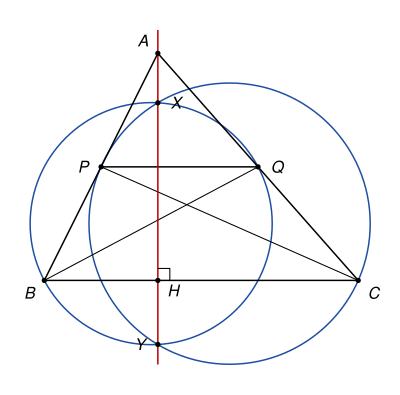

## Statement

Soit $ABC$ un triangle. On place un point $P$ sur la droite $(AB)$ et un point $Q$ sur la droite $(AC)$, de sorte que la droite $(PQ)$ soit parallèle à $(BC)$, avec $P \neq B$.

Le cercle de diamètre $[BQ]$ et le cercle de diamètre $[CP]$ se coupent en deux points $X$ et $Y$.

Montrer que la droite $(XY)$ est la perpendiculaire à $(BC)$ passant par $A$.

![Le triangle ABC, la parallèle (PQ) à (BC), et les cercles de diamètres [BQ] et [CP], qui se coupent en X et Y](10278-figure-1.svg)

## Hints

1. Choisissez un repère orthonormé dans lequel $(BC)$ est l'axe des abscisses et la hauteur issue de $A$ est l'axe des ordonnées.
2. Un point $M$ est sur le cercle de diamètre $[BQ]$ si et seulement si $\overrightarrow{MB} \cdot \overrightarrow{MQ} = 0$. Écrivez ainsi une équation de chacun des deux cercles.
3. Un point commun aux deux cercles vérifie les deux équations. Soustrayez-les.

## Solution

*Rappels.*

- *Cercle de diamètre $[UV]$.* Un point $M$ est sur le cercle de diamètre $[UV]$ si et seulement si $\overrightarrow{MU} \cdot \overrightarrow{MV} = 0$. (Pour $M$ différent de $U$ et de $V$, cela veut dire que l'angle $\widehat{UMV}$ est droit.)
- *Produit scalaire en repère orthonormé.* Si $\vec{u}$ a pour coordonnées $(x, y)$ et $\vec{v}$ a pour coordonnées $(x', y')$, alors $\vec{u} \cdot \vec{v} = x x' + y y'$.

**Étape 1 : un repère bien choisi.** Soit $H$ le pied de la hauteur issue de $A$. On prend un repère orthonormé d'origine $H$, dont l'axe des abscisses est la droite $(BC)$ et l'axe des ordonnées la droite $(AH)$. Dans ce repère,
$$A(0\,;\,a), \qquad B(b\,;\,0), \qquad C(c\,;\,0),$$
avec $a \neq 0$ et $b \neq c$.

La perpendiculaire à $(BC)$ passant par $A$ est l'axe des ordonnées, la droite d'équation $x = 0$. C'est cette droite qu'il faut obtenir.

**Étape 2 : les points $P$ et $Q$.** Le point $P$ est sur $(AB)$, donc $\overrightarrow{AP} = k\,\overrightarrow{AB}$ pour un certain réel $k$. Ainsi $P(kb\,;\,a - ka)$. La droite $(PQ)$ est parallèle à $(BC)$, qui est horizontale, donc $Q$ a la même ordonnée $a - ka$ que $P$. Le point $Q$ est sur $(AC)$, donc $\overrightarrow{AQ} = k'\,\overrightarrow{AC}$, ce qui donne l'ordonnée $a - k'a$. En comparant, $k' = k$, et
$$P(kb\,;\,a(1-k)), \qquad Q(kc\,;\,a(1-k)).$$
Comme $P \neq B$, on a $k \neq 1$.

**Étape 3 : les équations des deux cercles.** Notons $m = a(1-k)$ l'ordonnée commune de $P$ et $Q$. Pour un point $M(x\,;\,y)$ :
$$\overrightarrow{MB}(b - x\,;\,-y), \qquad \overrightarrow{MQ}(kc - x\,;\,m - y).$$
Le point $M$ est sur le cercle de diamètre $[BQ]$ si et seulement si
$$(x - b)(x - kc) + y(y - m) = 0. \qquad (1)$$
De même, $M$ est sur le cercle de diamètre $[CP]$ si et seulement si
$$(x - c)(x - kb) + y(y - m) = 0. \qquad (2)$$

**Étape 4 : soustraire.** Un point commun aux deux cercles vérifie (1) et (2), donc aussi leur différence. Le terme $y(y - m)$ disparaît, et en développant :
$$(x - b)(x - kc) - (x - c)(x - kb) = \left(x^2 - (b + kc)\,x + kbc\right) - \left(x^2 - (c + kb)\,x + kbc\right) = (c - b)(1 - k)\,x.$$
On obtient donc $(c - b)(1 - k)\,x = 0$. Or $c \neq b$ et $k \neq 1$, donc $x = 0$.

**Conclusion.** Les deux points communs $X$ et $Y$ ont une abscisse nulle : ils sont tous les deux sur l'axe des ordonnées. Comme $X \neq Y$, la droite $(XY)$ est l'axe des ordonnées, c'est-à-dire la perpendiculaire à $(BC)$ passant par $A$.

*Remarques.*

- Le calcul ne dépend pas de la position de $P$ sur la droite $(AB)$ : $P$ peut être entre $A$ et $B$, au-delà de $B$ ou au-delà de $A$. C'est l'avantage du calcul sur une chasse aux angles.
- Le corrigé officiel raisonne sans coordonnées. Notons $E$ et $F$ les pieds des hauteurs issues de $B$ et de $C$. L'angle $\widehat{BEQ}$ est droit, donc $E$ est sur le cercle de diamètre $[BQ]$, et de même $F$ est sur le cercle de diamètre $[CP]$. On montre ensuite que $AE \times AQ = AF \times AP$, et cette égalité dit que $A$ a la même « puissance » par rapport aux deux cercles, donc qu'il est sur la droite $(XY)$, appelée leur axe radical.
