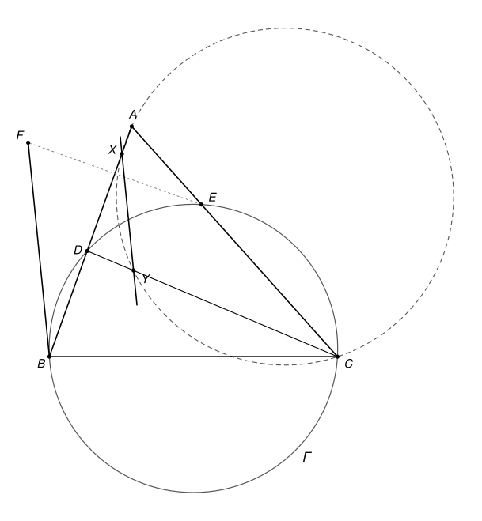

## Statement

Soit $ABC$ un triangle. Un cercle $\Gamma$ passant par $B$ et $C$ recoupe les segments $[AB]$ et $[AC]$ en deux points $D$ et $E$.

Soit $X$ un point du segment $[AD]$, distinct de $A$ et de $D$. La droite $(CD)$ recoupe le cercle circonscrit au triangle $ACX$ en un point $Y$, autre que $C$. Enfin, soit $F$ le symétrique de $E$ par rapport à la droite $(AB)$.

Démontrer que les droites $(BF)$ et $(XY)$ sont parallèles.

## Hints

1. Les points $Y$ et $F$ sont de part et d'autre de la droite $(AB)$. Il suffit donc de montrer que $\widehat{BXY} = \widehat{XBF}$. Pourquoi ?
2. La symétrie par rapport à $(AB)$ montre que $\widehat{XBF} = \widehat{ABE}$.
3. Dans le cercle $\Gamma$, l'angle $\widehat{ABE} = \widehat{DBE}$ est égal à un angle de sommet $C$.
4. Utilisez le cercle passant par $A$, $C$, $X$ et $Y$ pour montrer que $\widehat{BXY} = \widehat{ACD}$. Attention : selon la figure, $Y$ peut être entre $D$ et $C$, ou au-delà de $C$.

## Solution

### Ce qu'il suffit de montrer

Le point $E$ est sur le segment $[AC]$, donc du même côté de la droite $(AB)$ que $C$. Son symétrique $F$ est donc de l'autre côté de $(AB)$.

Le point $Y$, lui, est du même côté que $C$. En effet, le cercle circonscrit à $ACX$ coupe la droite $(AB)$ en $A$ et $X$ seulement, et $D$ n'est pas entre $A$ et $X$ : le point $D$ est donc à l'extérieur du cercle. La droite $(DC)$ coupe alors le cercle en deux points, $C$ et $Y$, situés du même côté de $D$. Ainsi $Y$ est sur la demi-droite $[DC)$, distinct de $D$, donc du même côté de $(AB)$ que $C$.

Les droites $(XY)$ et $(BF)$ sont coupées par la droite $(AB)$, et $Y$ et $F$ sont de part et d'autre de $(AB)$. Si les angles $\widehat{BXY}$ et $\widehat{XBF}$ sont égaux, ce sont des angles alternes-internes égaux, et les droites sont parallèles. **Il suffit donc de montrer que $\widehat{BXY} = \widehat{XBF}$.**

### Étape 1 : l'angle en X est égal à l'angle ACD

Comme $X$ est entre $A$ et $B$, on a $\widehat{BXY} = 180^\circ - \widehat{AXY}$. On a vu que $Y$ est sur la demi-droite $[DC)$. Il y a deux cas.

**Cas 1 : $Y$ est sur le segment $[DC]$** (c'est le cas de la figure). Dans le triangle $ADC$, le point $X$ est sur le côté $[AD]$ et $Y$ sur le côté $[DC]$. Le quadrilatère $AXYC$ est donc convexe, et il est inscrit dans un cercle : ses angles opposés sont supplémentaires, $\widehat{AXY} + \widehat{ACY} = 180^\circ$. Comme $\widehat{ACY} = \widehat{ACD}$, on obtient

$$\widehat{BXY} = 180^\circ - \widehat{AXY} = \widehat{ACY} = \widehat{ACD}.$$

**Cas 2 : $C$ est entre $D$ et $Y$.** Dans le triangle $ADY$, le point $X$ est sur le côté $[AD]$ et $C$ sur le côté $[DY]$. Le quadrilatère $AXCY$ est donc convexe et inscrit dans un cercle. Les points $X$ et $C$ sont du même côté de la droite $(AY)$, donc, par le théorème de l'angle inscrit, $\widehat{AXY} = \widehat{ACY}$. Comme $D$, $C$, $Y$ sont alignés dans cet ordre, $\widehat{ACY} = 180^\circ - \widehat{ACD}$. On obtient

$$\widehat{BXY} = 180^\circ - \widehat{AXY} = 180^\circ - \widehat{ACY} = \widehat{ACD}.$$

Dans les deux cas, **$\widehat{BXY} = \widehat{ACD}$.**

### Étape 2 : on passe dans le cercle Γ

Comme $E$ est sur le segment $[CA]$, on a $\widehat{ACD} = \widehat{ECD}$.

Les points $B$, $C$, $E$ et $D$ sont sur le cercle $\Gamma$. La droite $(DE)$ coupe le triangle $ABC$ en deux morceaux, et $B$ et $C$ sont du même côté de cette droite. Les angles inscrits $\widehat{ECD}$ et $\widehat{EBD}$ interceptent donc le même arc, et $\widehat{ECD} = \widehat{EBD}$.

Enfin $D$ est sur le segment $[BA]$, donc $\widehat{EBD} = \widehat{EBA}$. Ainsi **$\widehat{ACD} = \widehat{EBA}$.**

### Étape 3 : la symétrie

La symétrie par rapport à la droite $(AB)$ laisse $A$ et $B$ en place et envoie $E$ sur $F$. Elle conserve les angles, donc $\widehat{EBA} = \widehat{FBA}$. Comme $X$ est sur le segment $[BA]$, $\widehat{FBA} = \widehat{XBF}$.

### Conclusion

En mettant bout à bout les trois étapes :

$$\widehat{BXY} = \widehat{ACD} = \widehat{EBA} = \widehat{XBF}.$$

Ces angles alternes-internes sont égaux, donc **les droites $(BF)$ et $(XY)$ sont parallèles.**

## Going further

1. D'après l'étape 1, la direction de la droite $(XY)$ ne dépend pas du choix de $X$ sur $[AD]$. Expliquez pourquoi, sans utiliser le point $F$.
2. Construisez une figure où $C$ est entre $D$ et $Y$. (Essayez un angle $\widehat{BAC}$ petit et un point $X$ proche de $A$.)
