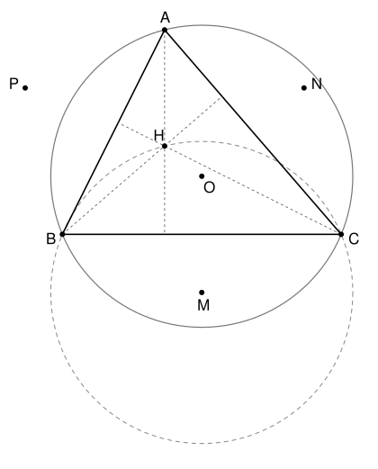

## Statement

Soit $ABC$ un triangle, $O$ le centre de son cercle circonscrit et $H$ son orthocentre. On suppose que $H$ est différent des trois sommets et de $O$.

On note $M$, $N$ et $P$ les centres des cercles circonscrits aux triangles $HBC$, $HCA$ et $HAB$. On suppose que $M \neq A$, $N \neq B$ et $P \neq C$, pour que les droites ci-dessous existent.

Montrer que les quatre droites $(AM)$, $(BN)$, $(CP)$ et $(OH)$ passent par un même point.

## Hints

1. Prends $O$ comme origine des vecteurs. Montre que le point $H'$ défini par $\overrightarrow{OH'} = \overrightarrow{OA} + \overrightarrow{OB} + \overrightarrow{OC}$ est sur la hauteur issue de $A$, puis sur les deux autres. Que peut-on en conclure ?
2. Soit $M'$ le point tel que $\overrightarrow{OM'} = \overrightarrow{OB} + \overrightarrow{OC}$. Calcule les distances $M'B$, $M'C$ et $M'H$.
3. Compare le milieu de $[AM]$ et le milieu de $[OH]$.

## Solution

On note $R$ le rayon du cercle circonscrit à $ABC$, de sorte que $OA = OB = OC = R$. Tous les vecteurs partent de $O$.

### Étape 1 : la relation d'Euler

Soit $H'$ le point tel que $\overrightarrow{OH'} = \overrightarrow{OA} + \overrightarrow{OB} + \overrightarrow{OC}$, et $A'$ le milieu de $[BC]$. Alors
$$\overrightarrow{AH'} = \overrightarrow{OH'} - \overrightarrow{OA} = \overrightarrow{OB} + \overrightarrow{OC} = 2\,\overrightarrow{OA'} .$$
Si $A' = O$, cela donne $H' = A$. Sinon, la droite $(OA')$ est la médiatrice de $[BC]$, car $OB = OC$ et $A'B = A'C$, donc elle est perpendiculaire à $(BC)$, et la droite $(AH')$ lui est parallèle (ou $H' = A$). Dans tous les cas, **$H'$ est sur la hauteur issue de $A$**, c'est-à-dire la droite qui passe par $A$ et qui est perpendiculaire à $(BC)$.

Le même calcul avec $B$ montre que $H'$ est sur la hauteur issue de $B$. Deux hauteurs se coupent en un seul point, l'orthocentre. Donc $H' = H$, et
$$\overrightarrow{OH} = \overrightarrow{OA} + \overrightarrow{OB} + \overrightarrow{OC} .$$

### Étape 2 : le triangle $HBC$ existe

Supposons que $H$ soit sur la droite $(BC)$. Comme $H$ est sur la hauteur issue de $A$, c'est alors le pied $K$ de cette hauteur. On sait que $H \neq B$, donc $K \neq B$, et la droite $(BH)$ est la droite $(BC)$. Mais $(BH)$ est la hauteur issue de $B$, perpendiculaire à $(AC)$. Le triangle serait rectangle en $C$, et ses hauteurs issues de $A$ et de $B$, qui sont les côtés $(CA)$ et $(CB)$, se couperaient en $C$ : on aurait $H = C$, ce qui est exclu.

Donc $H$, $B$, $C$ ne sont pas alignés : le triangle $HBC$ a un cercle circonscrit, et son centre $M$ est le seul point situé à la même distance de $H$, de $B$ et de $C$. De même pour les triangles $HCA$ et $HAB$.

### Étape 3 : le point $M$

Soit $M'$ le point tel que $\overrightarrow{OM'} = \overrightarrow{OB} + \overrightarrow{OC}$. D'après l'étape 1,
$$\overrightarrow{BM'} = \overrightarrow{OM'} - \overrightarrow{OB} = \overrightarrow{OC}, \qquad \overrightarrow{CM'} = \overrightarrow{OB}, \qquad \overrightarrow{M'H} = \overrightarrow{OH} - \overrightarrow{OM'} = \overrightarrow{OA} .$$
Donc $M'B = OC = R$, $M'C = OB = R$ et $M'H = OA = R$. Le point $M'$ est à la même distance de $H$, de $B$ et de $C$ : c'est le centre $M$ du cercle circonscrit à $HBC$ (étape 2). Ainsi
$$\overrightarrow{OM} = \overrightarrow{OB} + \overrightarrow{OC} ,$$
et de même $\overrightarrow{ON} = \overrightarrow{OC} + \overrightarrow{OA}$ et $\overrightarrow{OP} = \overrightarrow{OA} + \overrightarrow{OB}$.

### Étape 4 : conclusion

Soit $X$ le milieu de $[OH]$. D'après l'étape 1,
$$\overrightarrow{OX} = \frac{1}{2}\left(\overrightarrow{OA} + \overrightarrow{OB} + \overrightarrow{OC}\right) .$$
Le milieu de $[AM]$ est le point $Y$ tel que
$$\overrightarrow{OY} = \frac{1}{2}\left(\overrightarrow{OA} + \overrightarrow{OM}\right) = \frac{1}{2}\left(\overrightarrow{OA} + \overrightarrow{OB} + \overrightarrow{OC}\right) = \overrightarrow{OX} .$$
Donc $X$ est le milieu de $[AM]$. Comme $A \neq M$, la droite $(AM)$ existe et passe par $X$.

Le même calcul montre que $X$ est le milieu de $[BN]$ et de $[CP]$. Enfin, $X$ est sur la droite $(OH)$, qui existe car $O \neq H$. **Les quatre droites $(AM)$, $(BN)$, $(CP)$ et $(OH)$ passent toutes par le milieu de $[OH]$.**

## Going further

- Montre que $\overrightarrow{OM} = \overrightarrow{AH}$ : le quadrilatère $AHMO$ est un parallélogramme. Montre aussi que $M$ est le symétrique de $O$ par rapport à la droite $(BC)$.
- L'étape 3 montre que les cercles circonscrits à $HBC$, $HCA$ et $HAB$ ont le même rayon que le cercle circonscrit à $ABC$.
- Quand a-t-on $M = A$ ? Il faut que le vecteur $\overrightarrow{OB} + \overrightarrow{OC}$ ait pour longueur $R$. Montre que cela arrive exactement quand le triangle est isocèle en $A$ avec $\widehat{BAC} = 120°$.
- Le point $G$ tel que $\overrightarrow{OG} = \frac{1}{3}\,\overrightarrow{OH}$ est le centre de gravité du triangle. Les points $O$, $G$, $H$ sont donc alignés : c'est la droite d'Euler.
